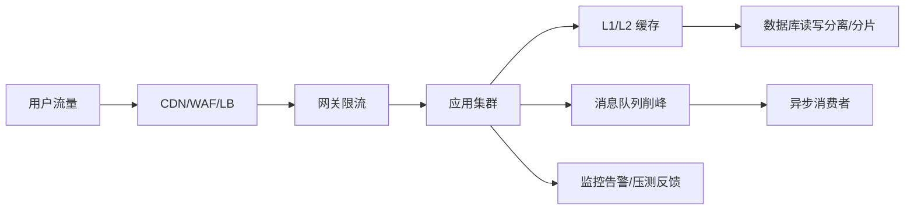

# 高并发架构设计

> [!abstract] 一句话总结
> 高并发设计不是只加机器，而是从入口削峰、应用无状态、缓存命中、异步化、数据分片、限流降级和容量压测形成闭环。

## 📌 精准定位

- 负责让系统在目标 QPS/TPS 下保持稳定延迟和错误率。
- 不负责无限承载突发，任何系统都要定义容量上限和拒绝策略。
- 关键边界：瓶颈可能在 CPU、锁、连接池、DB、缓存热点、网络或下游。

## 🧩 核心概念

| 概念 | 具体含义 | 精通要点 |
| ---- | -------- | -------- |
| 容量模型 | QPS、P99、峰值系数、资源利用率。 | 先估算再设计。 |
| 削峰填谷 | 队列、令牌、预约、异步处理。 | 保护核心资源。 |
| 无状态扩展 | 应用层横向扩容。 | 会话和本地状态外置或可重建。 |
| 热点治理 | 缓存、请求合并、分片、限流。 | 热点 key/行是并发杀手。 |

## ⚙️ 工作原理 / 主流程



1. 定义峰值 QPS、P99、错误率、核心接口和降级边界。
2. 消除单点：应用无状态、LB 多实例、连接池合理。
3. 读多优先缓存和 CDN，写多考虑队列、批处理、分片。
4. 每个依赖设置超时、限流、熔断和隔离。
5. 压测覆盖缓存失效、热点、下游慢、扩容和降级。

## 💻 代码 / 配置 / 伪代码

```text
容量估算：
DAU 1000 万，活动 10 分钟内 20% 用户访问，峰值系数 5。
平均 QPS = 1000万 * 20% / 600 = 3333。
峰值 QPS 约 1.7 万，按 30% 冗余设计入口和核心读链路。
```

## 🔍 源码入口 / 关键组件

- Nginx/Gateway access log
- JVM 线程、GC、锁、CPU profiling
- DB 慢查询和连接池指标
- Redis hotkey/bigkey/命中率
- JMeter/Gatling/k6 压测

## ⚠️ 生产坑与注意事项

- 只压测缓存命中，缓存失效时 DB 被打穿。
- 线程池和连接池默认值照搬。
- 同步调用链太长，尾延迟被放大。
- 热点集中到单 Redis key、DB 行、MQ partition。
- 只看平均值不看 P95/P99 和拒绝量。

## 🧭 排查路径

- QPS 上不去找 CPU、锁、连接池、DB、Redis、下游饱和点。
- P99 高看慢依赖、GC、队列等待、重试。
- 错误率高区分限流拒绝、超时、连接耗尽、业务异常。
- 扩容无效检查 DB 写、热点 key、单分区等共享瓶颈。

## 🎯 面试问题

> [!question] 高频问题
> - Q: 高并发从哪里开始？
>   - A: 先定容量目标和瓶颈假设，再做缓存、异步、分片、限流和压测验证。
> - Q: 削峰方式？
>   - A: 队列、令牌桶、预约排队、批处理、静态化、CDN。
> - Q: 为什么无状态？
>   - A: 实例可横向扩展和快速替换。
> - Q: 热点怎么处理？
>   - A: 本地缓存、拆 key、请求合并、分片、限流、预热。
> - Q: 压测看什么？
>   - A: 吞吐、P99、错误率、资源利用率、依赖指标和降级触发。

## ✅ 精通检查清单

- 能画出主流程，并标出最容易失败的节点。
- 能说出至少 3 个源码入口或关键组件。
- 能写出最小配置、SQL、伪代码或状态机。
- 能结合生产故障说明监控指标、排查命令和修复动作。
- 能和相邻方案做取舍对比，而不是只背定义。

## 🔗 关联笔记

- [[_index]]
- [[20-Java后端/00-总览/学习仪表盘]]

## 📚 参考资料

- Google SRE Book: Handling Overload
- Release It!: Stability Patterns
