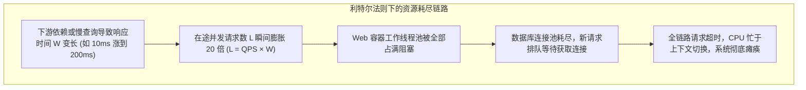
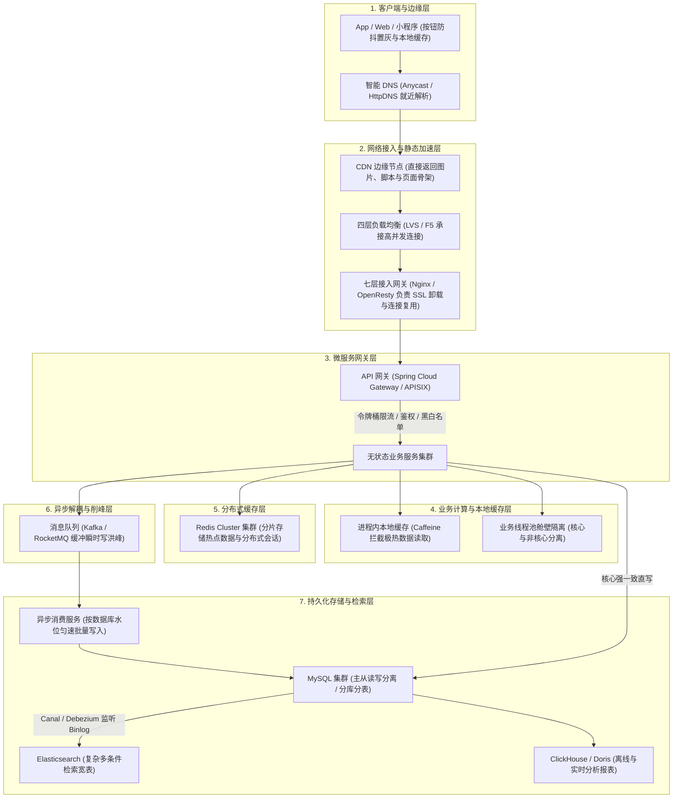
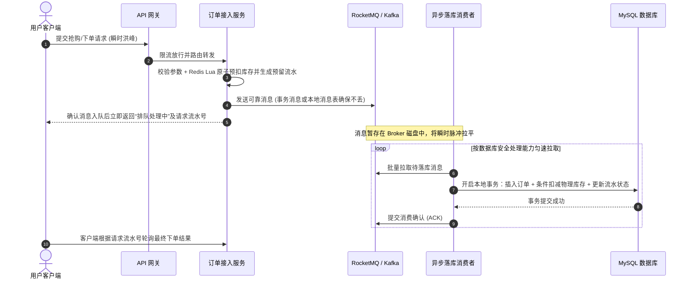
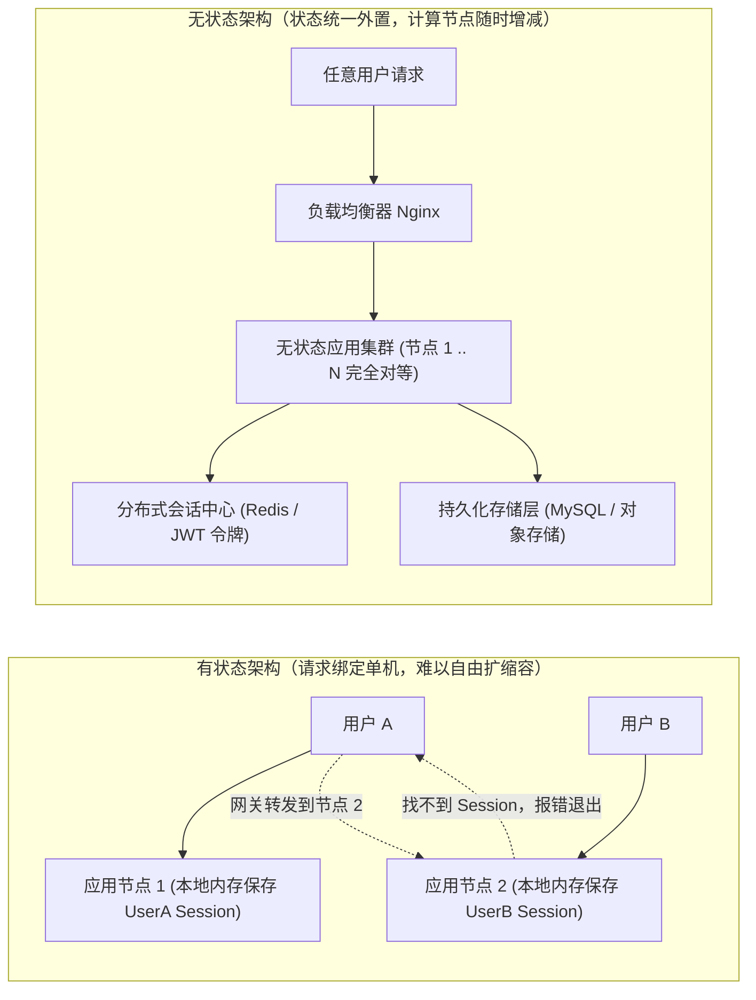

# 高并发架构设计：从排队瓶颈到全链路扩容

> **前置知识**：[[00-系统设计全景与心智模型]]、[[../03-并发编程/00-并发编程心智模型与学习路线|并发编程全景]]、[[../06-中间件/01-消息队列基础与核心问题处理|消息队列与核心问题]]、[[../06-中间件/05-Kafka架构原理与实战手册|Kafka高吞吐]]

---

## 1. 核心难点：高并发下系统到底是怎么崩溃的？

### 1.1 排队积压与利特尔法则（Little's Law）
很多工程师一听到高并发，第一反应就是“加服务器、加 Redis、加消息队列”。但如果问：“为什么有时候加了 10 台应用服务器，接口反而更慢甚至整个系统直接崩溃了？”仅靠背诵组件名词就很难回答。

从操作系统的底层视角来看，任何软硬件系统本质上都是一个**排队处理系统**。当系统处于稳定处理状态（即进入系统的请求都能在合理时间内处理完毕，没有发生无休止的积压）时，系统内部同时正在处理的请求数量满足排队论中的**利特尔法则（Little's Law）**：
$$L = \lambda \times W$$
- **$L$（在途并发请求数 In-flight Requests）**：当前时刻系统内部正在同时处理的平均请求数量（占用着线程、内存和连接）。
- **$\lambda$（系统吞吐率 Throughput / QPS）**：单位时间内系统实际完成处理的请求数量。
- **$W$（平均响应耗时 Latency / RT）**：单个请求从进入系统到处理完毕的平均驻留时间。

这个简单的公式直接揭示了高并发系统崩溃的根本原因：

```text
【高并发雪崩推导过程】
假设系统平时稳定运行在 10,000 QPS，单次请求平均耗时 W = 10ms (0.01s)：
此时系统内部同时存在的在途请求数 L = 10,000 × 0.01 = 100 个。
这 100 个并发请求由几台服务器的 Tomcat 线程池和数据库连接池轻松承载。

突然，某个下游接口抖动或数据库出现一条慢 SQL，导致单次请求平均耗时劣化到 W = 200ms (0.2s)：
为了维持原本 10,000 QPS 的处理速率，系统内部积压的在途请求数瞬间变为：
L = 10,000 × 0.2 = 2,000 个！

在途请求数瞬间暴增 20 倍！Web 容器线程池（如 Tomcat 默认 200 线程）和数据库连接池（如 HikariCP 常用 10~50 连接）在几秒内被全部占满。后续进来的新请求只能阻塞排队直至超时，CPU 全耗在线程上下文切换与锁等待上，系统有效吞吐率跌至零，引发全链路雪崩。
```



### 1.2 破局思路：高并发治理的三个演进方向
看懂了 $L = \lambda \times W$ 和底层连接、锁的限制，高并发架构的演进就有了明确的抓手：
1. **减少单次请求的工作量与耗时（降低 $W$）**：通过 CDN 动静分离、进程内本地缓存和分布式缓存，把绝大部分重复读取直接挡在数据库前面。
2. **控制同时进入系统的在途请求数（限制 $L$）**：在网关层做限流，在写操作链路引入消息队列异步削峰，把瞬时脉冲流量变成后台匀速消费，防止底层连接池被打爆。
3. **把单点竞争拆散到多个节点（提升上限 $\lambda$）**：将业务应用改造为无状态服务以便随时加机器；针对数据库单行热点锁冲突，采用库存分桶或分库分表将竞争分散开。

---

## 2. 全链路高并发架构蓝图

一套成熟的高并发架构从来不是靠单一组件死扛，而是从客户端一直到数据库存储层层过滤、协同分流：



---

## 3. 演进一：应对高并发读——动静分离与多级缓存

在绝大多数互联网业务（如商品浏览、资讯信息流、短视频主页）中，读请求的数量往往远大于写请求。应对高并发读的核心思路是：**让数据尽量靠近用户，能不回源就不回源，能走内存就不查数据库。**

### 3.1 动静分离与边缘加速
- **纯静态资源上 CDN**：图片、视频、JS/CSS 样式表等文件打包时带上内容哈希版本号（如 `app.8f9d2a.js`），通过设置 HTTP 响应头 `Cache-Control: public, max-age=31536000, immutable` 让浏览器和全国 CDN 节点长期缓存。只有首次访问或缓存过期淘汰时才会回源。
- **页面骨架与动态数据分离**：
  以电商商品详情页为例，商品标题、图文介绍、规格参数对所有用户都是一样的，可以在 CDN 或网关层缓存几分钟；而用户的实时优惠券、到手价、剩余库存和收货地址运费属于动态数据，由前端通过轻量异步接口单独拉取并渲染。这样既大幅降低了带宽消耗，又保证了核心交易数据的实时性。

### 3.2 多级缓存协同架构
当请求穿过 CDN 进入后端服务时，我们会按访问速度和容量成本构建多级缓存体系。下表展示了各层级的典型响应耗时量级与适用场景：

| 缓存层级 | 存储位置 | 典型延迟量级 | 典型承载能力 | 适合存放的数据 |
| :--- | :--- | :--- | :--- | :--- |
| **L1 客户端缓存** | 浏览器 / App 本地存储 | $\approx 0 \text{ ms}$ | 由终端设备各自承担 | 静态素材、前端配置字典 |
| **L2 CDN 边缘节点** | 边缘机房内存与 SSD | $5 \sim 20 \text{ ms}$ | 千万级 QPS | 公共静态页、商品图文骨架 |
| **L3 网关共享内存** | OpenResty `lua_shared_dict` | $< 1 \text{ ms}$ | 百万级 QPS | 全局降级开关、极热点白名单 |
| **L4 应用进程缓存** | JVM 堆内存 (`Caffeine`) | $< 0.1 \text{ ms}$ | 单实例数十万 QPS | 突发极热商品（HotKey）、基础配置 |
| **L5 分布式缓存** | `Redis Cluster` | $1 \sim 3 \text{ ms}$ | 集群数十万至百万 QPS | 用户会话、普通热点详情、预扣库存 |
| **L6 持久化数据库** | `MySQL` / `TiDB` (含 Buffer Pool) | $2 \sim 50 \text{ ms}$ | 单机数千 QPS | 资金流水、最终订单、权威库存 |

在代码落地时，通常采用“先查本地 Caffeine，未命中再查 Redis，最后用分布式互斥锁保护数据库回源”的组合策略。注意使用本地缓存时，必须限制最大条目数（防 OOM）并设置合理的短过期时间或配合消息广播清理旧数据：

```java
/**
 * 多级缓存读取实战：Caffeine 本地缓存 + Redis 分布式缓存 + Redisson 互斥锁防击穿
 */
@Service
@RequiredArgsConstructor
public class MultiLevelCacheService {

    private final Cache<String, ProductDTO> localCache; // Caffeine 本地缓存（需配置 maximumSize 与 expireAfterWrite）
    private final StringRedisTemplate redisTemplate;     // Redis 分布式缓存
    private final RedissonClient redissonClient;
    private final ProductRepository productRepository;

    public ProductDTO getProductDetail(Long productId) {
        String cacheKey = "product:detail:" + productId;

        // 1. 先查一级缓存：JVM 进程内 Caffeine（无网络开销，速度最快）
        ProductDTO product = localCache.getIfPresent(cacheKey);
        if (product != null) {
            return product;
        }

        // 2. 再查二级缓存：分布式 Redis
        String json = redisTemplate.opsForValue().get(cacheKey);
        if (StringUtils.isNotBlank(json)) {
            // 防缓存穿透：如果命中了预设的空对象占位符，直接返回 null
            if ("{}".equals(json)) {
                return null;
            }
            product = JSON.parseObject(json, ProductDTO.class);
            localCache.put(cacheKey, product); // 回填到本地缓存
            return product;
        }

        // 3. 防缓存击穿：热点 Key 失效瞬间，只允许一个线程抢锁回源查数据库
        String lockKey = "lock:product:" + productId;
        RLock lock = redissonClient.getLock(lockKey);
        try {
            // 最多等待 1 秒抢锁；抢到锁后由 Redisson 看门狗自动续期，底层数据库查询需配置超时时间
            if (lock.tryLock(1, TimeUnit.SECONDS)) {
                try {
                    // 双重检查（Double Check）：可能等待锁期间前一个线程已经把缓存回填好了
                    json = redisTemplate.opsForValue().get(cacheKey);
                    if (StringUtils.isNotBlank(json)) {
                        return "{}".equals(json) ? null : JSON.parseObject(json, ProductDTO.class);
                    }

                    // 真正回源查询数据库
                    product = productRepository.findById(productId);

                    if (product != null) {
                        // 防缓存雪崩：基础过期时间 1 小时，加上 ±5 分钟随机偏移，避免大批 Key 同时过期
                        long expireSeconds = 3600 + ThreadLocalRandom.current().nextInt(-300, 301);
                        redisTemplate.opsForValue().set(cacheKey, JSON.toJSONString(product), expireSeconds, TimeUnit.SECONDS);
                        localCache.put(cacheKey, product);
                    } else {
                        // 防缓存穿透：数据库也不存在该 ID，写入空对象占位符并设置 60 秒短 TTL
                        redisTemplate.opsForValue().set(cacheKey, "{}", 60, TimeUnit.SECONDS);
                    }
                    return product;
                } finally {
                    if (lock.isHeldByCurrentThread()) {
                        lock.unlock();
                    }
                }
            } else {
                // 没抢到锁时立即快速失败或返回降级提示，绝不能递归重试把调用栈和线程耗尽
                throw new BusinessException("当前访问人数较多，请稍后刷新重试");
            }
        } catch (InterruptedException e) {
            Thread.currentThread().interrupt();
            throw new BusinessException("系统繁忙，请稍后重试");
        }
    }
}
```

---

## 4. 演进二：应对高并发写——异步削峰与热点行锁拆分

读请求可以用缓存挡住，但写请求（如下单、扣减库存、记账）最终必须修改状态。当成千上万个线程同时去更新数据库里的同一行记录时，InnoDB 必须加**行级排他锁（X 锁）**，所有并发事务只能排队串行执行。如果事务内还夹杂着其他查询或网络操作，持锁时间变长，数据库的写吞吐就会急剧下降。

解决高并发写瓶颈主要有两种工程手段：**异步削峰**与**热点分桶**。

### 4.1 异步削峰：用消息队列拉平瞬时脉冲
当入口写流量瞬间冲到数万 QPS，而底层数据库只能稳定处理几千 QPS 时，如果让所有请求同步等待写库，连接池会在一瞬间爆满。此时可以在中间引入消息队列（RocketMQ / Kafka）充当缓冲区：



> [!IMPORTANT]
> **异步削峰的工程边界**：
> 1. **前端拿到“排队中”不代表下单已经成功**：只有后台消费者真正完成数据库事务提交后，订单才算正式生成。前端需要通过短轮询或推送获取最终状态。
> 2. **跨组件一致性保障**：Redis 预扣库存与发送 MQ 消息不是同一个原子操作。工程上需要在 Redis Lua 脚本预扣的同时记录带 `requestId` 的预留状态，或者配合 RocketMQ 事务消息与后台定时对账任务：如果应用在发 MQ 前宕机，对账任务能识别出悬空的预留记录并安全回补库存。

### 4.2 热点行锁拆分：库存分段分桶（Segmented Bucket）
如果业务场景要求**必须同步实时扣减数据库库存**（不允许异步排队），怎样突破单行记录的排他锁瓶颈？

我们可以借鉴 `LongAdder` 和 `ConcurrentHashMap` 的分段思想，在数据库层面做**物理分桶**：
- **拆分方式**：把原本存放在 1 行里的 10,000 件库存，拆成 100 行子桶记录（`bucket_id` 从 `0` 到 `99`），每个子桶存放 100 件库存。
- **路由与扣减**：用户下单时，根据 `userId % 100` 或随机算法定位到一个具体的 `bucket_id`，然后执行带 `stock_count >= buyCount` 条件的更新语句。这样原本集中在同一行上的锁竞争就被分散到了 100 个不同的行上。
- **边界处理**：当某个子桶库存不足但其他桶还有余量时，需要触发有界限的跨桶重试或后台合桶调拨；同时，订单取消返还库存时，必须根据原扣减流水退回原来的子桶并保证幂等。

```sql
-- 传统单行库存（所有并发更新全部排队争抢 product_id = 1001 这一行的 X 锁）
-- UPDATE t_stock SET stock = stock - 1 WHERE product_id = 1001 AND stock >= 1;

-- 分桶库存表结构设计
CREATE TABLE t_product_stock_bucket (
    id BIGINT PRIMARY KEY AUTO_INCREMENT,
    product_id BIGINT NOT NULL,
    bucket_id INT NOT NULL,     -- 子桶编号：0 ~ 99
    stock_count INT NOT NULL,   -- 当前子桶可用库存
    UNIQUE KEY uk_prod_bucket (product_id, bucket_id)
);

-- 下单扣减时，路由到具体子桶并校验库存余量（检查 Affected Rows 是否为 1）
UPDATE t_product_stock_bucket
SET stock_count = stock_count - #{buyCount}
WHERE product_id = #{productId}
  AND bucket_id = #{bucketId}
  AND stock_count >= #{buyCount};
```

---

## 5. 演进三：应用层水平扩展——无状态改造与状态下沉

为什么有些老系统在流量高峰期加了新机器也没法直接分担流量？因为它们把用户的登录状态（Session）或业务计数直接保存在了单台应用服务器的本地内存里。一旦负载均衡器把同一个用户的第二次请求转发到另一台机器，就会出现“未登录”或状态丢失。



### 5.1 无状态改造的三个实操准则
1. **外置会话状态**：不再使用 Tomcat 本地 `HttpSession`，改用 `Spring Session + Redis` 集中存储会话，或者颁发签名令牌（JWT）配合 Redis 黑名单控制注销。
2. **不在本机内存维护全局可变业务状态**：
   比如统计活动参与人数、限制每个用户每分钟的调用次数，如果用单机 `ConcurrentHashMap` 统计，在多实例部署下就会完全失准。应当根据业务语义把状态收口到 Redis 中（例如用 `INCR` 做精确计数限流，用 `Set` / `Bitmap` 做精确去重判断；如果只是统计全站近似 UV，才使用 `HyperLogLog`）。
3. **区分“计算层扩容”与“存储层瓶颈”**：
   把应用改造成无状态后，增加应用实例可以快速分担 CPU 计算（如序列化、模板渲染、加解密）压力；但如果瓶颈已经在底层的共享数据库或单点缓存上，单纯增加应用机器反而会放大数据库连接竞争，此时必须同步对存储层做读写分离或分片。

---

## 6. 生产实战排障：两个经典高并发故障复盘

### 6.1 故障一：盲目扩容应用实例后，CPU 利用率下降，但接口大面积超时
- **现象与根因**：
  大促前团队将订单服务从 4 台扩容到 40 台，每台机器的 HikariCP 连接池默认配置了 `maximumPoolSize = 50`。扩容后，40 台机器瞬间向底层 MySQL 申请 $40 \times 50 = 2000$ 个活跃连接。不仅直接触及了数据库配置的连接上限，更致命的是上千个线程在 InnoDB 内部同时争抢行锁和自适应哈希索引锁，导致数据库 CPU 全耗在锁等待与上下文切换上，处理能力断崖式下跌，进而把上游 40 台应用机器的工作线程全部卡死。
- **排查与解决步骤**：
  1. 查看数据库监控与 `SHOW PROCESSLIST`，确认是否存在大量锁等待（如 `Waiting for row lock`）或连接数打满。
  2. **收敛单实例连接池大小**：数据库连接池不是越大越好，单台数据库最适合的并发活跃执行线程数通常在 $\text{CPU 核数} \times 2$ 到 $\text{CPU 核数} \times 4$ 之间。必须用**数据库所能承受的总连接数除以应用实例数**来反推单机连接池上限（例如总连接控制在 400 以内，40 台机器每台只配 8~10 个连接）。
  3. 在网关层开启限流保护，裁撤多余的应用实例，先让数据库吞吐恢复正常。

### 6.2 故障二：突发全网热点事件，单台 Redis 分片节点网卡被打满
- **现象与根因**：
  某突发热点新闻发布后，全网几百万用户同时点击查看同一条内容。虽然部署了 16 个分片的 Redis Cluster，但因为这条新闻对应的缓存 Key 是固定的（如 `news:detail:998877`），根据 CRC16 哈希槽规则，所有请求 100% 落在同一个 Redis Master 节点上（即 **HotKey 热点击穿分片**）。该节点的单核 CPU 和网卡带宽瞬间跑满，连带导致落在该节点上的其他正常业务 Key 全部超时。
- **排查与解决步骤**：
  1. **定位热 Key**：通过业务埋点统计、`redis-cli --hotkeys` 或代理层监控迅速定位出引发倾斜的具体 Key。
  2. **升级为进程内本地缓存**：将该热点 Key 提升到应用层的 Caffeine 本地缓存中（设置如 5~10 秒的短 TTL），让读请求在应用服务器内存里直接返回，不再跨越网络去查 Redis。
  3. **Key 冗余复制分流（备选）**：如果业务不便使用本地缓存，也可以将该热 Key 复制成多个带不同 HashTag 的副本（如 `news:{1}:998877` ~ `news:{16}:998877`）分散到所有 Redis 节点上，客户端读取时随机挑选一个副本访问。

---

## 7. 高频面试追问

> [!question]- Q1：为什么单纯给应用服务器加机器，解决不了“爆款商品扣减库存”的高并发写问题？
> 1. **瓶颈位置不同**：给无状态应用加机器只能扩展 CPU 计算能力，但扣减同一件商品库存时，所有请求最终都要去修改数据库（或单点缓存）里的**同一行记录**。
> 2. **底层锁串行化**：在数据库 InnoDB 引擎中，更新同一行记录必须获取行级排他锁（X 锁），在底层是严格排队串行执行的。应用机器加得越多，同时涌入数据库争抢同一把行锁的线程就越多，反而会加剧锁等待、死锁检测和线程上下文切换开销，导致数据库真实吞吐不升反降。
> 3. **正确解法**：要么将扣减前置到 Redis 中通过 Lua 脚本原子预扣、再用 MQ 异步匀速落库；要么在数据库层面将单行库存拆分为多个物理子桶（Segmented Bucket），把单点锁竞争打散。

> [!question]- Q2：采用 MQ 异步削峰后，用户提交订单或支付后立即刷新页面，如果后台还没落库完，页面显示“未下单/待支付”引起用户重复提交怎么办？
> 1. **明确状态流转提示**：当请求通过前置校验并可靠写入 MQ 后，不要向用户展示模糊的旧状态，而是明确返回“订单正在生成中 / 支付结果确认中”的中间态页面，并禁用提交按钮防止重复点击。
> 2. **Redis 临时状态占位（读穿透抹平延迟）**：在发送 MQ 消息的同时，在 Redis 中写入一条带短过期时间（如 30 秒）的处理中标记（如 `order:status:temp:{requestId} = PROCESSING`）。用户立即刷新列表时，服务端优先合并读取该标记，在界面上平滑展示“处理中”。
> 3. **客户端有限轮询**：前端页面每隔 800ms~1s 携带 `requestId` 轮询一次处理结果（最多轮询 5 次）；一旦异步消费者完成落库并更新状态，立刻跳转成功页；若超时仍未完成，则引导用户稍后在订单中心查看。

> [!question]- Q3：如何设计一套全链路保护机制，确保突发流量超过系统极限时系统依然不会彻底崩溃？
> 核心是按请求链路从外到内设置三道防线：
> 1. **网关入口限流（Rate Limiting）**：根据压测得出的系统最大安全容量，在 API 网关层配置令牌桶或漏桶限流，把超出承受能力的流量直接挡在门外（返回友好排队提示），绝不让超额流量冲进内网耗尽连接池。
> 2. **线程池舱壁隔离（Bulkhead）**：将核心交易链路（如下单、支付）与非核心辅助链路（如积分发放、推荐列表、消息推送）的线程池和数据库连接池物理隔离开。即便推荐服务卡死，也最多占满它自己的几个线程，不会波及核心下单。
> 3. **慢调用熔断与有损降级（Circuit Breaker）**：为所有下游调用配置严格的超时时间与熔断规则。一旦某个依赖响应变慢或报错率超标，立即自动断开调用并返回默认兜底数据，保住主干业务可用。

---

## 8. 一分钟复盘记忆卡

```text
======================= 高并发架构核心记忆口诀 =======================
高并发瓶颈看排队，利特尔法则算在途（L = QPS × W）。
下游变慢在途暴涨，线程池满全链雪崩。
读多写少分级缓存，动静分离推向边缘；
瞬时写峰队列削平，单行热点分桶拆锁；
应用无状水平伸缩，连接上限反推配额。
======================================================================
```
