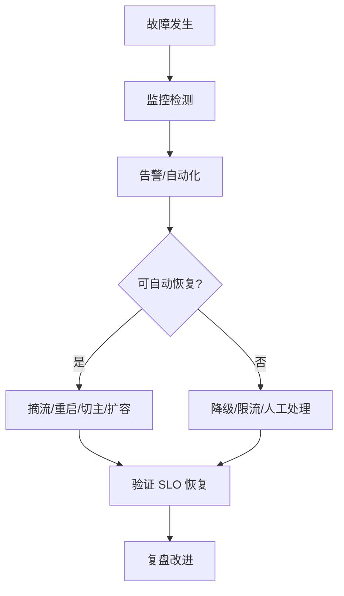

# 高可用架构设计

> [!abstract] 一句话总结
> 高可用围绕故障假设展开，通过冗余、隔离、自动恢复、降级、备份演练和可观测性，把故障影响限制在可接受范围。

## 📌 精准定位

- 负责减少不可用时间和故障影响面。
- 不负责消除所有故障，目标是故障发生时系统仍有明确行为。
- 关键边界：可用性要用 SLO 和错误预算衡量。

## 🧩 核心概念

| 概念 | 具体含义 | 精通要点 |
| ---- | -------- | -------- |
| SLO | 可用性、延迟、错误率目标。 | 驱动架构和投入。 |
| 冗余 | 多实例、多 AZ、多副本。 | 必须消除共同故障点。 |
| 故障隔离 | 舱壁、限流、熔断、分区。 | 防止局部扩散。 |
| 恢复能力 | 自动拉起、故障转移、备份恢复。 | 必须演练。 |

## ⚙️ 工作原理 / 主流程



1. 列故障模式：实例、AZ、DB 主库、缓存、下游。
2. 每个故障定义检测、隔离、恢复、回滚和用户表现。
3. 核心链路去单点：多实例、健康检查、数据副本、配置备份。
4. 不可自动恢复场景提供降级开关和 runbook。
5. 定期做故障演练和备份恢复演练。

## 💻 代码 / 配置 / 伪代码

```text
订单服务 SLO：
创建订单成功率 99.95% / 月。
P99 < 800ms。
支付回调不丢失，失败进入补偿队列。
库存服务超时则停止创建订单，推荐列表超时可降级为空。
```

## 🔍 源码入口 / 关键组件

- SLI/SLO availability、latency、error rate
- Kubernetes readiness/liveness
- 数据库主从/多 AZ
- Redis Sentinel/Cluster
- 告警、Runbook、故障复盘

## ⚠️ 生产坑与注意事项

- 主备在同一 AZ，共同故障点没消除。
- 健康检查只检查进程不检查关键依赖。
- 自动切主没有演练。
- 降级开关没人敢用或无指标确认。
- 备份存在但从未恢复验证。

## 🧭 排查路径

- 可用性下降按入口、应用、缓存、DB、下游分层看错误率。
- 故障扩散查超时、重试、线程池隔离、熔断。
- 切换失败看 DNS/LB 缓存、连接池、复制延迟、权限。
- 恢复后复发检查根因是否修复。

## 🎯 面试问题

> [!question] 高频问题
> - Q: 高可用怎么量化？
>   - A: 用 SLO/SLI，如成功率、P99、错误预算、恢复时间。
> - Q: 冗余为什么不等于高可用？
>   - A: 共同故障点、无法切换或数据不一致时冗余无效。
> - Q: 限流熔断作用？
>   - A: 隔离故障和过载，保护核心链路。
> - Q: 备份最大坑？
>   - A: 只备份不做恢复演练。
> - Q: 故障演练怎么做？
>   - A: 选故障模式，定义预期，低峰注入，观察检测隔离恢复。

## ✅ 精通检查清单

- 能画出主流程，并标出最容易失败的节点。
- 能说出至少 3 个源码入口或关键组件。
- 能写出最小配置、SQL、伪代码或状态机。
- 能结合生产故障说明监控指标、排查命令和修复动作。
- 能和相邻方案做取舍对比，而不是只背定义。

## 🔗 关联笔记

- [[_index]]
- [[20-Java后端/00-总览/学习仪表盘]]

## 📚 参考资料

- Google SRE Book: Availability
- Release It!: Stability Antipatterns
