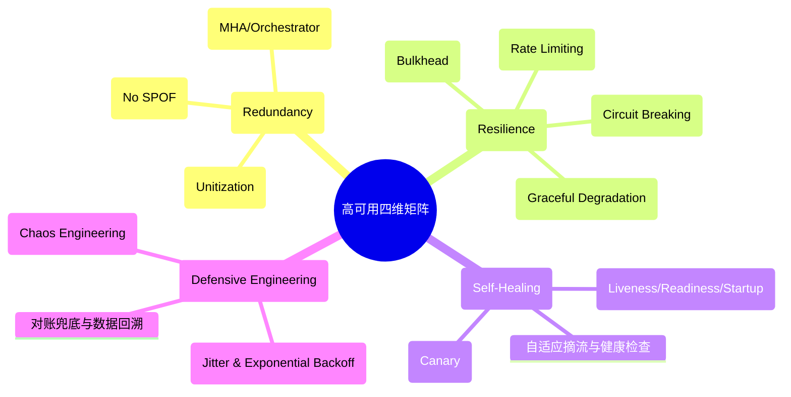
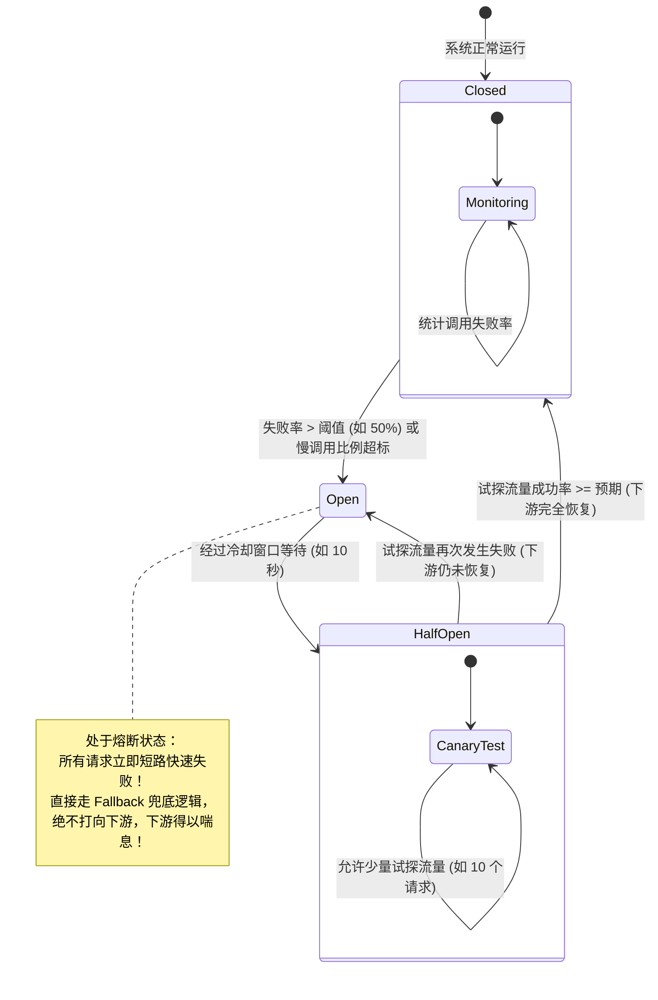
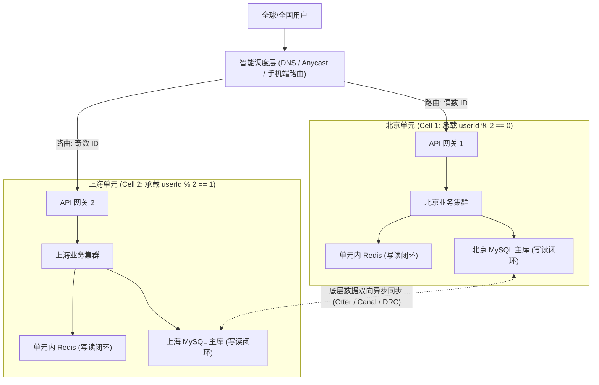
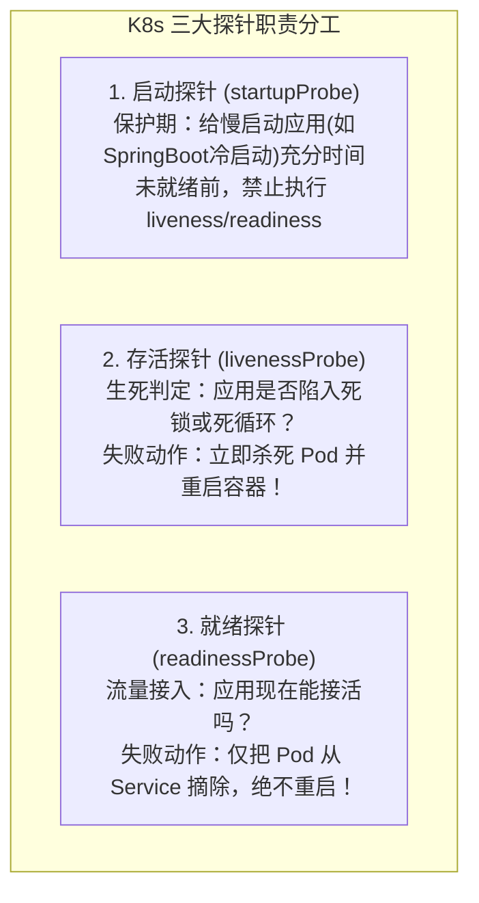

# 高可用架构设计：墨菲定律下的系统生存法则

> **前置知识**：[[00-系统设计全景与心智模型]]、[[01-高并发架构设计]]、[[../07-分布式与微服务/01-CAP与BASE理论|CAP与BASE理论]]、[[../07-分布式与微服务/06-限流-熔断-降级|限流熔断]]

---

## 1. 为什么需要高可用架构？（第一性原理与心智模型）

### 1.1 核心哲学：墨菲定律与失败是常态
计算机系统规模越大，组件越多，根据概率论，**“故障不是异常，而是系统的常态”**。
- 服务器磁盘会损坏、内存会产生位翻转、光缆会被挖掘机挖断；
- 网络会抖动、机房会停电、程序会出现不可预知的死循环或 OOM；
- 人性会犯错：误删库、发布配置错误、容量估算偏差。

高可用（High Availability, HA）的第一性原理是：
> **“我们无法消灭故障，高可用架构的本质是——通过冗余、隔离与降级，将故障的影响半径收敛在最小范围，并让系统在部分组件崩溃时仍能持续提供核心服务，最终实现自动自愈。”**

### 1.2 高可用黄金量化指标：SLA、RTO 与 RPO

#### (1) SLA（Service Level Agreement）几个 9
衡量系统稳定性的最高准绳：
$$\text{可用性} = \frac{\text{总运行时间} - \text{故障停机时间}}{\text{总运行时间}} \times 100\%$$

| 可用性级别 | 年故障停机时间 | 业务承受力与场景 |
| :--- | :--- | :--- |
| **99% (2个9)** | 3.65 天 | 内部后台系统、非核心统计报表 |
| **99.9% (3个9)** | 8.76 小时 | 普通互联网业务及格线 |
| **99.99% (4个9)** | 52.56 分钟 | 核心电商交易、主流支付业务、大厂标杆 |
| **99.999% (5个9)** | 5.26 分钟 | 银行核心结算、电信运营商主干网 |

#### (2) 灾难恢复双子星：RTO 与 RPO
- **RTO（Recovery Time Objective，恢复时间目标）**：发生灾难到业务系统**重新恢复对外服务**所需的时间（即“业务瘫痪了多久”）。
- **RPO（Recovery Point Objective，恢复点目标）**：发生灾难后**允许丢失的数据时间跨度**（即“丢了多少分钟/小时的数据”）。
- **终极理想**：$RTO \to 0$（秒级无感自动切流），$RPO \to 0$（数据零丢失）。

---

## 2. 高可用核心防御四维矩阵



---

## 3. 核心机制一：微服务自我保护（限流、熔断、降级与舱壁）

当雪崩来临时，没有一片雪花是无辜的。保护系统的关键是**阻止级联故障（Cascading Failure）**。

### 3.1 熔断器模式（Circuit Breaker 状态机）
熔断器如同家用电路的“空气开关”，当下游服务响应极其缓慢或错误率过高时，及时切断调用，防止上游线程被无休止挂起。



### 3.2 生产级 Resilience4j 熔断与隔离代码实战

```java
@Service
@Slf4j
public class PaymentClientService {

    /**
     * @CircuitBreaker: 熔断保护，配置名 paymentService
     * @Bulkhead: 舱壁隔离，限制并发线程数，防止支付接口拖垮主系统
     * @Retry: 指数退避重试
     */
    @CircuitBreaker(name = "paymentService", fallbackMethod = "processPaymentFallback")
    @Bulkhead(name = "paymentService", type = Bulkhead.Type.THREADPOOL)
    @Retry(name = "paymentService")
    public PaymentResponse processPayment(PaymentRequest request) {
        // 调用第三方外部支付网关（慢网络，极易抖动）
        return restTemplate.postForObject("https://api.payment.com/pay", request, PaymentResponse.class);
    }

    /**
     * 熔断/超载后的降级兜底方法（签名必须与原方法一致，并多加一个 Throwable 参数）
     */
    public PaymentResponse processPaymentFallback(PaymentRequest request, Throwable ex) {
        log.warn("支付服务熔断降级！请求单号: {}, 异常原因: {}", request.getOrderNo(), ex.getMessage());
        
        // 优雅柔性降级：进入“异步受理中”状态，前端引导用户查看订单，后台定时补单查询
        return PaymentResponse.builder()
                .status("PROCESSING")
                .message("支付渠道繁忙，系统正在安全处理中，请稍后刷新...")
                .build();
    }
}
```

配套的标准生产配置（`application.yml`）：
```yaml
resilience4j:
  circuitbreaker:
    instances:
      paymentService:
        slidingWindowType: COUNT_BASED      # 基于滑动窗口统计
        slidingWindowSize: 100              # 统计最近 100 次请求
        minimumNumberOfCalls: 20            # 最少调用 20 次才开始判断
        failureRateThreshold: 50.0          # 失败率达到 50% 触发熔断
        slowCallRateThreshold: 50.0         # 慢调用比例达到 50% 触发熔断
        slowCallDurationThreshold: 2000ms   # 响应时间 > 2s 算作慢调用
        waitDurationInOpenState: 10000ms    # 熔断开启后等待 10s 进入半开状态
        permittedNumberOfCallsInHalfOpenState: 10 # 半开状态放行 10 个请求探路
  bulkhead:
    instances:
      paymentService:
        maxConcurrentCalls: 50              # 最多允许 50 个并发线程同时调用该接口
```

---

## 4. 核心机制二：异地多活与单元化架构（Unitization）

单机房容灾的极限是“同城双活”，但面对大地震、光缆切断等城市级灾难，必须采用**异地多活（Multi-Region Active-Active）**。

### 4.1 异地多活的核心矛盾：光速限制与数据一致性
- 光在光纤中的传播速度约为 $200,000 \text{ km/s}$。
- 北京到上海直线距离约 1200 公里，往返网络延迟（RTT）约为 $20 \sim 30 \text{ ms}$。
- **物理定律限制**：任何需要跨机房同步确认的强一致数据库写事务，其接口响应时间（RT）绝对不可能低于 30ms。

### 4.2 单元化架构设计（以用户 ID 为维度的闭环分片）
将整个系统切分成多个独立的“业务单元”（Cell），核心业务在单元内完成闭环！



- **单元内闭环**：北京用户的查询、下单、支付，全部在北京单元内部完成，**跨机房调用为 0**，享受毫秒级响应！
- **异步复制与冲突解决**：数据库底层通过 Binlog 双向异步复制，通过时间戳覆盖或逻辑校验防止数据冲突。
- **灾备逃生**：北京机房断电时，智能调度层直接将北京用户的流量全局动态重定向到上海机房，完成灾难恢复。

---

## 5. 核心机制三：容器与编排自愈（K8s 探针避坑指南）

在现代云原生架构中，Kubernetes 承担着实例故障自愈的核心责任。但配置不当的探针是**集群集体重启雪崩的头号真凶**！



### 5.1 生产级 K8s 探针配置规范（规避雪崩式集体重启）

```yaml
apiVersion: apps/v1
kind: Deployment
metadata:
  name: order-service
spec:
  replicas: 4
  template:
    spec:
      containers:
      - name: order-app
        image: order-service:v2.0
        # 1. 启动探针：SpringBoot 启动可能需要 40s，给足探测窗口
        startupProbe:
          httpGet:
            path: /actuator/health/liveness
            port: 8080
          failureThreshold: 30
          periodSeconds: 2
        # 2. 存活探针：严禁检查下游数据库/Redis！仅检测 JVM 进程是否卡死
        livenessProbe:
          httpGet:
            path: /actuator/health/liveness
            port: 8080
          initialDelaySeconds: 10
          periodSeconds: 10
          timeoutSeconds: 2
          failureThreshold: 3
        # 3. 就绪探针：可以检测组件就绪情况，失败仅摘除流量，不重启容器
        readinessProbe:
          httpGet:
            path: /actuator/health/readiness
            port: 8080
          initialDelaySeconds: 10
          periodSeconds: 5
          timeoutSeconds: 2
          failureThreshold: 2
```

---

## 6. 高可用经典故障与血泪避坑 SOP

### 6.1 场景一：重试风暴（Retry Storm）击穿全链路
- **故障还原**：当下游数据库发生瞬时网络抖动（耗时从 5ms 增加到 2s），上游网关和 5 个微服务依次配置了“失败超时重试 3 次”。
- **连锁恶化**：一个外部请求在微服务链条中被指数级放大成 $3 \times 3 \times 3 = 27$ 次请求！原本下游只是小感冒，被上游 27 倍的重试洪水直接踩踏致死，即使网络恢复也再也无法爬起。
- **解法（重试三原则）**：
  1. **指数退避加随机抖动（Exponential Backoff with Full Jitter）**：重试间隔不能固定，必须引入随机随机波动（如 $100\text{ms} \times 2^n \pm \text{Random}$），避免所有线程同时对下游发起脉冲式二次冲击。
  2. **重试预算机制（Retry Budget）**：限流组件控制整个服务实例发起的重试请求数量不能超过正常请求的 10%。
  3. **非幂等接口绝对严禁重试**（如扣款、创建订单）。

### 6.2 场景二：探针误配导致集群“集体重启自杀”
- **故障还原**：某团队在 `livenessProbe` 存活探针中编写了 `SELECT 1 FROM dual` 检测 MySQL 连接。
- **致命结果**：夜间 DBA 做 MySQL 主从切换，数据库不可用 30 秒。所有 100 台微服务 Pod 的存活探针全部探测失败，K8s 判定这 100 台容器“全部暴毙”，同一时刻强行把全集群 Pod 杀死并触发集体重启！
- **血的教训**：**Liveness 探针只代表容器自身的生命周期，绝对不能包含任何外部网络依赖的健康度校验！外部依赖故障走熔断降级或 Readiness 摘除，绝不可引发自杀式重启！**

---

## 7. 大厂 30 秒面试绝杀（高频追问 3 连击）

### Q1：服务雪崩（Cascading Failure）的根本原因是什么？在生产中如何在 30 秒内紧急止血？
> **答题标杆**：
> 1. **根本原因**：某个底层弱依赖发生超时或故障，导致上游调用方线程大量阻塞挂起。由于资源（线程池、连接池）无法释放，故障沿调用链路向上逆行传播，最终耗尽整个系统的核心资源，导致全线崩溃。
> 2. **30 秒紧急止血四步法**：
>    - **第一步：网关层全局降级**：通过 Sentinel/配置中心瞬间推送动态规则，直接对故障弱依赖接口开启熔断降级，一秒返回 Mock 兜底数据，上游线程池瞬间全部解套释放。
>    - **第二步：入口压制**：开启网关令牌桶限流，丢卒保车，抛弃非核心功能流量。
>    - **第三步：摘除坏死实例**：若发现个别节点因为 OOM 出现长 STW，立即在注册中心手动摘流，防止流量持续下发。
>    - **第四步：排障与平稳恢复**：通过日志与 APM 链路追踪定界问题，排查完毕后以灰度放量（半开模式）逐步放行流量。

---

### Q2：异地多活架构中，数据发生跨地域双向同步延迟，如何避免数据覆盖冲突？
> **答题标杆**：
> 1. **避免冲突的第一法则是“消灭冲突”**：采用**单元化切分**，保证单条数据的主写入点唯一（例如：按用户 ID Hash，用户张三的写请求永远只在华东机房写入，华南机房只作为冷备或只读同步副本），从架构源头杜绝并发双写冲突。
> 2. **不可避免冲突时的仲裁策略**：
>    - **最后写入者胜（LWW - Last Write Wins）**：给数据记录增加全局逻辑时钟（如分布式高精度时间戳 Snowflake ID），同步时若发现时间戳落后则直接丢弃。
>    - **业务层合并补偿（CRDT）**：针对计数类场景（如文章点赞数、商品库存），采用增量累加（Delta）同步而非绝对值覆盖，保障最终一致性。

---

### Q3：什么是脑裂（Split-Brain）？ZooKeeper / Raft 等分布式系统是如何彻底避免脑裂的？
> **答题标杆**：
> 1. **脑裂定义**：分布式集群因机房网络分区被割裂成多个互相无法通信的孤岛，每个孤岛都自立为主节点（Leader），同时接收客户端写请求，导致数据发生不可逆的分叉与混乱。
> 2. **根治机制——过半多数派原则（Quorum / $N/2 + 1$）**：
>    - 集群节点总数必须为奇数（如 3、5 台）。
>    - 任何节点竞选 Leader，或者 Leader 提交写入事务，必须获得**超过半数（$> N/2$）**的存活节点投票确认。
>    - 当网络分裂为大小两个分区时，节点数少于一半的少数派分区根本无法凑齐多数票，永远无法选出 Leader 且自动拒绝写操作；只有包含多数派的分区能正常对外服务，从而在数学上彻底杜绝了两个同时可写 Leader 的并存。

---

## 8. 一分钟复盘记忆卡

```text
======================= 高可用架构核心记忆口诀 =======================
墨菲定律悬头顶，单点必崩是宿命。
SLA看几个9，RTO与RPO定止损。
多级冗余备多活，单元切分光速克；
限流熔断与降级，舱壁隔离保生机；
探针避开外部库，重试抖动防风暴；
过半机制破脑裂，自愈韧性筑长城。
======================================================================
```
