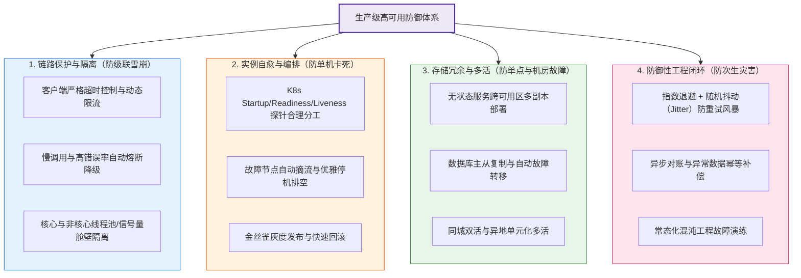
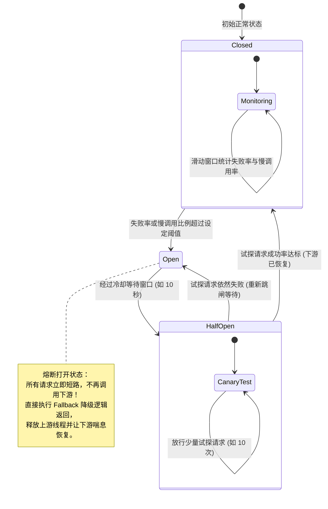
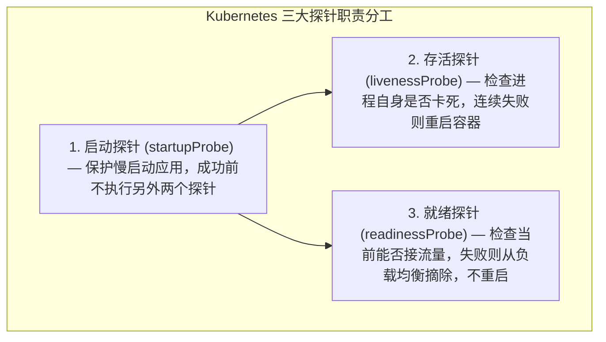
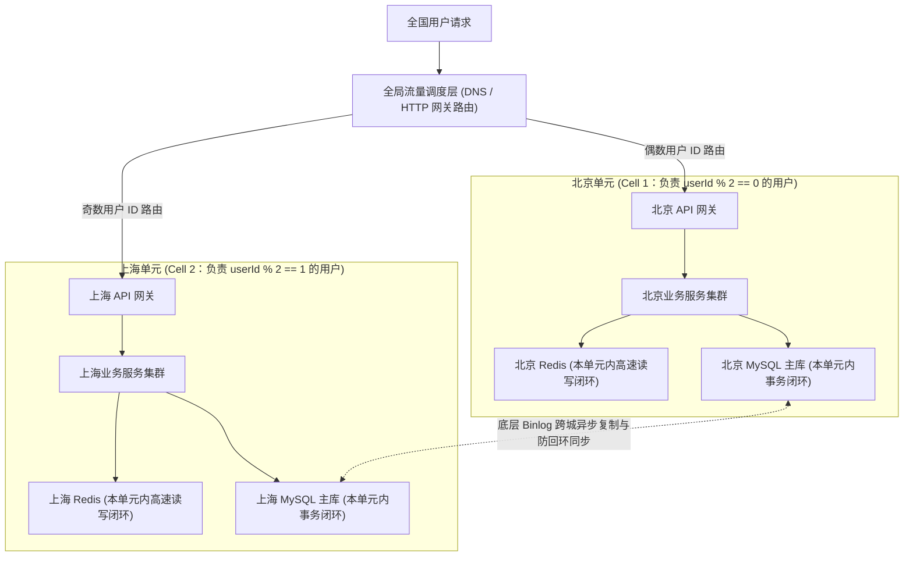

# 高可用架构设计：从故障隔离到异地多活容灾

> **前置知识**：[[00-系统设计全景与心智模型]]、[[01-高并发架构设计]]、[[../07-分布式与微服务/01-CAP与BASE理论|CAP与BASE理论]]、[[../07-分布式与微服务/06-限流-熔断-降级|限流熔断]]

---

## 1. 核心难点：为什么一个边缘组件故障会拖垮整个系统？

### 1.1 高可用面对的真实难题
在生产环境中，硬件故障和网络异常不是“万一发生”的小概率事件，而是每天都在发生的常态：服务器磁盘会损坏、机房光纤会被挖断、第三方外部接口会突然抖动变慢、甚至工程师发布时也会配错参数。

高可用（High Availability, HA）架构最核心的难点有两个：
1. **如何防止局部故障引发全链路级联雪崩？**
   在实际故障中，最可怕的往往不是某个下游服务直接宕机报错（报错很快就能返回），而是下游服务**半死不活、响应极慢**（比如从平时的 10ms 变成 10s 超时）。如果没有隔离和熔断机制，上游服务调用它的线程就会全部卡住等待，短短几秒内把上游服务器的线程池耗尽，进而像多米诺骨牌一样沿着调用链向上传染，导致整个系统瘫痪。
2. **当核心节点甚至整个机房挂掉时，如何在不丢数据的前提下快速恢复服务？**
   如果数据库只有单节点，机器坏了业务就彻底停摆；如果做了跨机房或跨城市容灾，又会受到物理光速延迟和数据同步一致性的制约——切流太快可能丢数据（或产生脑裂双写），切流太慢又会导致业务长时间中断。

因此，高可用架构的核心设计思路就是：**对内通过超时、熔断与舱壁隔离把故障锁死在局部；对外通过主从冗余、自动探针与单元化多活消除单点，实现快速恢复。**

### 1.2 衡量高可用的三个核心指标：SLA、RTO 与 RPO

在设计容灾方案前，必须先用明确的指标对齐业务对故障的容忍度：

#### (1) 可用性指标：SLI、SLO 与 SLA（几个 9）
在工程体系中，**SLI** 是实际采集到的监控指标（如接口请求成功率或服务正常响应时长占比），**SLO** 是技术团队内部设定的可用性目标，而 **SLA** 则是与客户或业务方签署的服务等级协议（通常包含未达标时的赔偿条款）。如果按全年 365 天的时间维度来直观换算，“几个 9”对应的全年累计允许停机时间如下：

| 可用性目标 | 全年累计可停机时间 | 典型适用业务场景 |
| :--- | :--- | :--- |
| **99% (2 个 9)** | 约 3.65 天 | 内部管理后台、离线统计报表系统 |
| **99.9% (3 个 9)** | 约 8.76 小时 | 普通互联网应用、非核心资讯与社区服务 |
| **99.99% (4 个 9)** | 约 52.56 分钟 | 主流电商核心交易链路、在线支付网关 |
| **99.999% (5 个 9)** | 约 5.26 分钟 | 银行核心账务结算、电信主干通信网 |
    
#### (2) 容灾恢复指标：RTO 与 RPO
当发生机房断电或数据库主库宕机等严重故障时，用这两个指标衡量容灾切换的效果：
- **RTO（Recovery Time Objective，恢复时间目标）**：从故障发生到系统重新恢复正常对外提供服务所允许的最大耗时（回答“业务会中断多久”）。
- **RPO（Recovery Point Objective，恢复点目标）**：故障恢复后，系统允许丢失的最新数据时间跨度（回答“最多会丢多少秒/多少分钟的数据”）。
- **架构权衡**：追求越趋近于 0 的 RTO 和 RPO，意味着需要越强的同步复制机制和跨地域多活基建，硬件与维护成本也会成倍上升。

---

## 2. 高可用防御体系全景图

围绕上述难点，生产级高可用架构从四个维度建立防线：



---

## 3. 第一道防线：服务自我保护（超时、隔离、熔断与降级）

当某个下游依赖（例如第三方支付渠道、物流查询接口或推荐服务）出现网络抖动或慢响应时，上游服务必须具备自我保护能力，绝不能陪着下游一起挂掉。

### 3.1 熔断器状态机（Circuit Breaker）
熔断器的工作原理类似于家庭电路中的空气开关：平时处于闭合（`Closed`）状态正常放行请求；一旦统计到近期调用失败率或慢调用比例超过阈值，立刻跳闸打开（`Open`），后续请求不再发起真实网络调用，而是直接执行本地降级逻辑快速返回，给下游留出恢复时间；等待一段冷却窗口后进入半开（`Half-Open`）状态，放行少量探测请求，确认下游恢复正常后再重新闭合。



### 3.2 Resilience4j 舱壁隔离与熔断代码实战

在代码实现中，需要特别注意三点：
1. **先配超时再谈熔断**：熔断器统计的“慢调用阈值”只负责记录指标和触发跳闸，本身不会强行中断正在阻塞的网络请求，因此底层的 `RestTemplate` 或 `HttpClient` 必须显式配置连接超时（Connect Timeout）和读取超时（Read Timeout）。
2. **信号量隔离与线程池隔离的选择**：同步方法常配合 `Bulkhead.Type.SEMAPHORE` 信号量限制最大并发调用数（开销极小）；若使用独立线程池隔离（`THREADPOOL`），则方法需返回 `CompletableFuture` 等异步类型。
3. **写操作降级不能盲目判定失败**：对于支付、下单等修改状态的请求，触发超时或熔断降级时，请求可能已经到达了对端。此时降级方法应当返回“状态确认中”，交由后台查单任务结合唯一支付单号去核实真实结果，切勿直接引导用户重复扣款。

```java
@Service
@Slf4j
public class PaymentClientService {

    /**
     * 组合使用舱壁隔离与熔断器保护外部支付调用
     * 注意：底层 restTemplate 必须配置合理的 connectTimeout 与 readTimeout
     */
    @CircuitBreaker(name = "paymentService", fallbackMethod = "processPaymentFallback")
    @Bulkhead(name = "paymentService", type = Bulkhead.Type.SEMAPHORE)
    public PaymentResponse processPayment(PaymentRequest request) {
        // 调用外部支付渠道接口（携带幂等支付单号）
        return restTemplate.postForObject("https://api.payment.com/pay", request, PaymentResponse.class);
    }

    /**
     * 熔断或并发超限时的兜底方法（方法签名需与原方法一致，并在末尾加上 Throwable 参数）
     */
    public PaymentResponse processPaymentFallback(PaymentRequest request, Throwable ex) {
        log.warn("支付渠道调用触发保护降级，单号: {}, 原因: {}", request.getOrderNo(), ex.getMessage());

        // 网络超时或熔断并不代表扣款一定失败，返回确认中状态，由异步查单任务核实推进
        return PaymentResponse.builder()
                .status("UNCONFIRMED")
                .message("支付结果正在确认中，请稍后在订单页查看，请勿重复发起支付")
                .build();
    }
}
```

配套的 `application.yml` 参数配置示例：
```yaml
resilience4j:
  circuitbreaker:
    instances:
      paymentService:
        slidingWindowType: COUNT_BASED               # 按请求次数滑动窗口统计
        slidingWindowSize: 100                       # 统计最近 100 次调用
        minimumNumberOfCalls: 20                     # 至少调用满 20 次才开始评估熔断
        failureRateThreshold: 50.0                   # 异常失败率达到 50% 触发熔断
        slowCallRateThreshold: 50.0                  # 慢调用比例达到 50% 触发熔断
        slowCallDurationThreshold: 2000ms            # 耗时超过 2 秒记为慢调用
        waitDurationInOpenState: 10000ms             # 熔断后冷却 10 秒进入半开状态
        permittedNumberOfCallsInHalfOpenState: 10    # 半开状态下放行 10 个试探请求
  bulkhead:
    instances:
      paymentService:
        maxConcurrentCalls: 50                       # 信号量舱壁：最多允许 50 个并发线程同时调用
```

---

## 4. 第二道防线：容器健康探针与实例自愈（K8s 避坑指南）

当单台服务器进程发生死锁、内存溢出后假死，或者刚启动正在预热缓存时，云原生架构通过 Kubernetes 的三大探针（Probes）实现自动摘流与重启自愈。

但在生产实践中，**探针配置不当是引发全集群同时重启雪崩的高发原因**。首先必须厘清三个探针各自的职责边界：



### 4.1 为什么存活探针（Liveness）绝对不能检查外部数据库？
假设某团队在 `livenessProbe` 接口里写了 `SELECT 1` 去检测 MySQL 或 Redis 连接。某天夜里数据库做主从切换，中断了 20 秒。结果 100 个微服务 Pod 的存活探针全部报错，Kubernetes 误以为这 100 个容器进程全部卡死了，于是在同一秒把全部 100 个 Pod 强行杀死并重启！原本只是 20 秒的数据库闪断，瞬间演变成耗时十几分钟的全站冷启动瘫痪。

**正确的探针配置原则**：
1. **`startupProbe`（启动探针）**：给 Spring Boot 等启动较慢的应用留足冷启动时间（例如每 2 秒探测一次，允许失败 30 次即最长 60 秒）。
2. **`livenessProbe`（存活探针）**：只检测应用进程自身的健康状态（如内置 Web 容器能否响应简单心跳），**严禁包含任何下游数据库、缓存或第三方服务的连接检查**。
3. **`readinessProbe`（就绪探针）**：用于控制实例是否挂载到 Service 接收流量。注意如果在这里检查共享数据库，当数据库短暂抖动时也可能导致所有 Pod 被同时摘除，因此建议仅检查本实例专属的初始化状态，而把共享下游故障交给应用内的熔断降级处理。

```yaml
apiVersion: apps/v1
kind: Deployment
metadata:
  name: order-service
spec:
  replicas: 4
  selector:
    matchLabels:
      app: order-service
  template:
    metadata:
      labels:
        app: order-service
    spec:
      containers:
      - name: order-app
        image: order-service:v2.0
        # 1. 启动探针：最长提供 60 秒冷启动保护期
        startupProbe:
          httpGet:
            path: /actuator/health/liveness
            port: 8080
          failureThreshold: 30
          periodSeconds: 2
        # 2. 存活探针：仅检查进程自身是否存活，绝不连外部数据库
        livenessProbe:
          httpGet:
            path: /actuator/health/liveness
            port: 8080
          initialDelaySeconds: 10
          periodSeconds: 10
          timeoutSeconds: 2
          failureThreshold: 3
        # 3. 就绪探针：未就绪时仅摘除流量，不触发容器重启
        readinessProbe:
          httpGet:
            path: /actuator/health/readiness
            port: 8080
          initialDelaySeconds: 10
          periodSeconds: 5
          timeoutSeconds: 2
          failureThreshold: 2
```

---

## 5. 第三道防线：跨机房容灾与异地多活单元化（Unitization）

单机故障靠集群多副本解决，但如果整个机房断电，或者整座城市的光缆故障怎么办？这就需要跨机房（同城双活）乃至跨城市（异地多活）容灾。

### 5.1 异地多活最大的物理障碍：光速与网络延迟
为什么不能简单地把应用部署在北京和上海两个机房，然后共享连接北京的同一个 MySQL 主库？
- 光在光纤中的传播速度约为 $200,000 \text{ km/s}$。北京到上海距离约 1200 公里，算上路由转发，单次网络往返延迟（RTT）通常在 **$20 \sim 30 \text{ ms}$** 左右。
- 如果一个业务接口需要先后执行 4 次数据库读写和 5 次 Redis 查询，上海机房的应用跨城访问北京的存储，光花在路上的网络延迟就要两三百毫秒，而且跨城专线一旦中断，上海机房依然无法独立完成交易。

### 5.2 破局方案：按用户维度切分的单元化架构（Cell Architecture）
为了克服跨城网络延迟，异地多活的核心思想是**“业务单元化（Unitization）”**——把全量用户按照一定规则（如 `userId % 2`）切分到不同的地理单元（Cell）。每个单元内部都拥有自己独立的网关、业务服务、Redis 和 MySQL 主库，**让同一个用户的读写请求 100% 在本单元机房内部闭环完成**，底层再通过数据同步工具（如 Canal / Otter / DRC）将变更异步复制到其他单元作为容灾备份。



### 5.3 单元化架构的三个核心工程问题
1. **避免双写冲突（单点归属原则）**：
   正常状态下，任何一条用户数据在同一时刻都只归属于一个固定的单元写入（例如偶数用户永远只写北京主库，上海库里该用户的数据只是只读热备）。这样从根源上避免了两个机房同时修改同一行数据引发的并发覆盖。
2. **故障切流与防脑裂（Fencing）**：
   当北京机房发生严重故障需要将流量切往上海时，不能仅仅修改顶层网关路由。必须先隔离旧机房的写入权限（Fencing，防止旧机房恢复瞬间继续接收残留请求造成双写），评估异步复制的延迟窗口，再将路由规则切换至上海单元，并在事后对异步复制未追平的极少量差异数据执行对账修复。
3. **跨单元公共数据怎么处理？**
   像买家（在上海单元）购买卖家（在北京单元）的商品这类跨主体业务，或者全国共享的秒杀总库存，无法简单按单个用户 ID 闭环。工程上通常将核心扣减锚定在商品所属的中心单元，或者将库存按比例预先分拨到各个单元独立扣减。

---

## 6. 第四道防线：防止保护机制变成“帮凶”（防重试风暴）

在分布式调用中，“失败自动重试”是提升接口成功率的常见手段。但如果不加约束地在多层服务间配置自动重试，一旦下游出现轻微抖动，重试机制就会瞬间制造出**重试风暴（Retry Storm）**，把原本还能勉强支撑的下游彻底打死。

### 6.1 重试风暴是怎么把流量放大几十倍的？
假设调用链路为 `网关 -> 订单服务 -> 库存服务 -> 数据库`。如果前三个层级都配置了“失败后额外重试 2 次（即每层最多尝试 3 次调用）”：
- 当数据库因为一次短暂的慢查询超时：
- 库存服务会向数据库发起 $3$ 次尝试；
- 订单服务超时后重试，触发库存服务执行 $3 \times 3 = 9$ 次尝试；
- 网关层超时后再次重试，最终打到数据库上的请求被放大到了 **$3^3 = 27$ 倍**！

### 6.2 生产级安全重试四原则
1. **单层重试原则**：在整条调用链路中，只允许最了解业务语义的那一层（通常是直接调用下游的客户端）负责重试，严禁每一层叠加重试；同时通过传递全链路截止时间（Deadline），一旦总耗时已经超过上游等待上限，立即放弃后续重试。
2. **指数退避加随机抖动（Exponential Backoff + Jitter）**：重试绝对不能立即紧接着发，也不能所有线程按固定间隔（如整 1 秒后）一起发。应当采用指数退避并加上随机打散（如等待 $100\text{ms} \times 2^n + \text{Random}(0, 100\text{ms})$），把重试流量平摊在时间轴上。
3. **重试预算控制（Retry Budget）**：在客户端维护一个滑动窗口统计，限制重试请求占总请求量的比例不能超过设定上限（例如 10%）。如果超过 10% 的请求都在报错需要重试，说明下游已经整体故障，此时继续重试毫无意义，应立即停止重试并触发熔断。
4. **非幂等写操作严禁盲目重试**：只有在下游接口已经实现了严格的幂等校验（如携带唯一请求号去重）时，写操作才能开启重试。

---

## 7. 高频面试追问

> [!question]- Q1：线上突然发生服务雪崩（大量接口超时、线程池打满），如何在 30 秒内快速止血恢复？
> 1. **切断故障源头（动态熔断降级）**：通过配置中心或 Sentinel 控制台，立即对响应变慢的非核心下游依赖下发强制降级规则，让后续请求直接走本地兜底返回，不再阻塞工作线程。
> 2. **控制入口流量（网关限流）**：在 API 网关层收紧限流阈值，优先保障登录、下单、支付等核心链路流量，暂时丢弃或排队边缘请求，让已经打满的连接池和线程池释放出来。
> 3. **隔离坏死节点**：如果监控发现某几台实例因为 Full GC 或死锁导致 CPU/响应时间异常，先在注册中心将其手动摘流（保留现场用于事后排查日志与堆栈），待集群水位恢复平稳后再通过半开灰度逐步放开流量。

> [!question]- Q2：什么是分布式系统的“脑裂（Split-Brain）”？ZooKeeper、etcd 或 Raft 集群是怎么解决脑裂的？
> 1. **脑裂成因**：当集群所在的两个机房之间发生网络分区（光纤中断，两边互相连不上，但各自内部的机器都活着）时，如果两边都以为对方挂了并各自选出一个新的主节点（Leader）同时接收写请求，就会导致同一份数据向两个不同方向修改，产生无法自动合并的数据冲突。
> 2. **过半多数派机制（Quorum：$\lfloor N/2 \rfloor + 1$）**：
>    为了从根源上阻止两个 Leader 同时生效，Raft / ZAB 等共识算法规定：**无论是选举新 Leader，还是提交一条写操作，都必须获得集群中超过半数（$> N/2$）节点的投票确认**（例如 5 台机器至少需要 3 台同意）。
>    当网络分裂成两个孤岛（比如一边 3 台、一边 2 台）时，只有包含 3 台机器的多数派分区能凑齐选票继续对外提供写服务；而只有 2 台机器的少数派分区因为凑不够 3 票，既选不出新 Leader，旧 Leader 写数据也无法提交，会自动退位拒绝写请求，从而在数学上保证了同一任期内绝不会出现两个有效主节点。

> [!question]- Q3：同城双活和异地多活有什么区别？什么情况下才需要上异地多活？
> 1. **同城双活（跨可用区容灾）**：两个机房位于同一座城市（距离通常在几十公里以内），通过高速裸光纤直连，网络往返延迟（RTT）仅需 $1 \sim 2 \text{ ms}$。由于延迟极低，两个机房的应用可以直接读写同一个高可用存储集群（或使用半同步复制），架构改造成本小，能防御单机房停电、火灾等故障，是绝大多数企业最具性价比的选择。
> 2. **异地多活（跨城市单元化）**：机房相距上千公里，网络延迟高达 $20 \sim 50 \text{ ms}$，无法跨城直连同一个数据库，必须对业务做深度的“单元化切分”与异步数据同步改造。只有当业务体量极大、需要防范城市级自然灾害或运营商骨干网瘫痪，且业务能承担高昂的基建与数据一致性改造成本时，才需要推进异地多活。

---

## 8. 一分钟复盘记忆卡

```text
======================= 高可用架构核心记忆口诀 =======================
硬件网络常抖动，局部慢调最致命。
SLA 定几个 9，RTO/RPO 划底线。
超时熔断加降级，舱壁隔离防传染；
存活探针莫查库，重试退避防风暴；
同城双活低延迟，异地多活靠单元；
过半投票防脑裂，对账兜底保万全。
======================================================================
```
