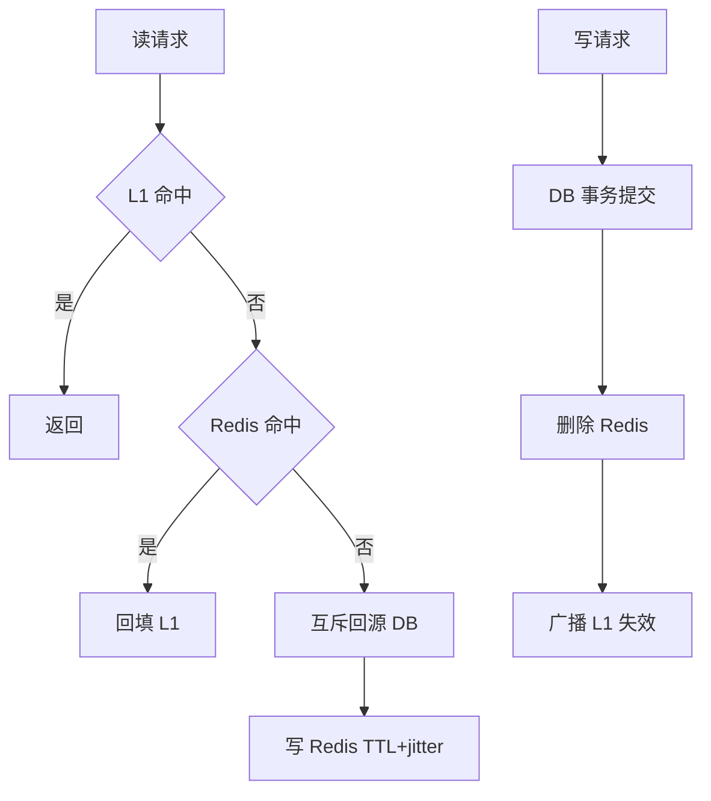

# 缓存架构设计

> [!abstract] 一句话总结
> 缓存架构要同时回答读路径、写路径、一致性、容量、热点、失效和故障降级，而不是只说加 Redis。

## 📌 精准定位

- 负责用更低成本承载高频读并保护后端存储。
- 不负责让数据永远最新，必须声明可接受的不一致窗口。
- 关键边界：写多强一致场景不适合重缓存。

## 🧩 核心概念

| 概念 | 具体含义 | 精通要点 |
| ---- | -------- | -------- |
| 读路径 | 本地缓存、Redis、DB 回源。 | 每层都有 TTL 和容量。 |
| 写路径 | 先写 DB 后删缓存、binlog 失效、写穿。 | 避免旧值回填。 |
| 失效策略 | TTL、主动删除、版本号。 | 决定脏读窗口。 |
| 容量治理 | key 设计、内存估算、淘汰策略。 | 避免大 key 和热点 key。 |

## ⚙️ 工作原理 / 主流程



1. 按接口列新鲜度要求：毫秒、秒级、分钟级或手动刷新。
2. 高频读低频写适合 cache-aside。
3. 缓存 key 带业务版本和租户/环境。
4. TTL 加随机抖动，热点提前预热或逻辑过期。
5. 设计 Redis 故障策略：旧值、限流、降级还是失败。

## 💻 代码 / 配置 / 伪代码

```text
商品详情缓存：
key = product:v3:{productId}
TTL = 10min + random(0..120s)
写路径 = 更新 DB -> 删除 Redis -> 发布本地缓存失效事件
热点 = 预热 + 逻辑过期 + singleflight 回源
```

## 🔍 源码入口 / 关键组件

- Redis/Caffeine 指标
- DB 慢查询和回源 QPS
- 业务发布/变更事件
- Canal/Debezium binlog 订阅
- 缓存命中和失效压测

## ⚠️ 生产坑与注意事项

- key 没版本，结构升级后反序列化失败。
- 写路径更新缓存被并发旧值覆盖。
- 缓存失败无限重试拖死应用线程。
- 逻辑过期返回旧值但无后台重建监控。
- 只统计整体命中率。

## 🧭 排查路径

- 脏数据还原 DB commit、删缓存、读回填时间线。
- 命中率低按接口/key 前缀拆分。
- Redis 慢看 bigkey、hotkey、slowlog、网络和序列化。
- DB 被打爆确认击穿、雪崩或缓存集群故障。

## 🎯 面试问题

> [!question] 高频问题
> - Q: 缓存架构怎么设计？
>   - A: 定一致性和读写路径，再设计 key、TTL、容量、热点、降级和监控。
> - Q: 为什么先写 DB 后删缓存？
>   - A: 避免并发旧值覆盖新值。
> - Q: 热点 key 怎么处理？
>   - A: 本地缓存、请求合并、逻辑过期、预热、拆分、限流。
> - Q: 缓存故障怎么办？
>   - A: 核心限流保护 DB，非核心返回旧值或降级。
> - Q: 怎么评估收益？
>   - A: 命中率、回源 QPS、P99、Redis 成本、脏读窗口。

## ✅ 精通检查清单

- 能画出主流程，并标出最容易失败的节点。
- 能说出至少 3 个源码入口或关键组件。
- 能写出最小配置、SQL、伪代码或状态机。
- 能结合生产故障说明监控指标、排查命令和修复动作。
- 能和相邻方案做取舍对比，而不是只背定义。

## 🔗 关联笔记

- [[_index]]
- [[20-Java后端/00-总览/学习仪表盘]]

## 📚 参考资料

- Redis Caching Patterns
- Designing Data-Intensive Applications: Caching
