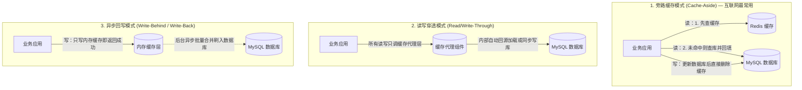
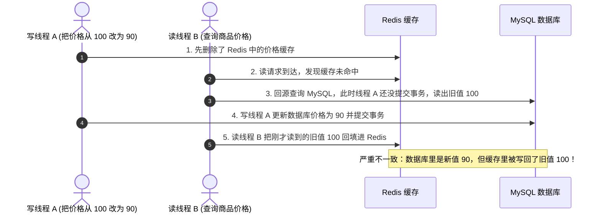
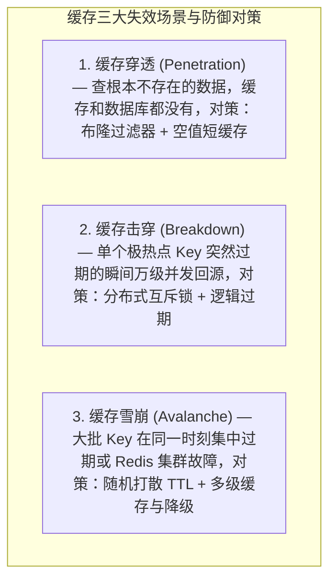

# 缓存架构设计：读写模式、数据一致性与高并发防御

> **前置知识**：[[00-系统设计全景与心智模型]]、[[01-高并发架构设计]]、[[../05-数据库与存储/05-Redis数据结构与应用|Redis核心架构]]、[[../05-数据库与存储/07-缓存穿透-击穿-雪崩|穿透击穿雪崩]]、[[../06-中间件/02-多级缓存架构实战|多级缓存架构实战]]

---

## 1. 核心难点：引入缓存之后会带来哪些新问题？

### 1.1 为什么所有高并发系统都离不开缓存？
计算机体系结构中有一个基础规律——**局部性原理（Principle of Locality）**：刚刚被访问过的数据，在短时间内很大概率会被再次访问（时间局部性）；与当前数据相邻的数据，也很快会被访问（空间局部性）。

同时，不同存储介质的访问速度存在巨大的物理差距：
- **CPU L1/L2 缓存与内存（DRAM）**：访问延迟在纳秒（$\text{ns}$）级；
- **应用跨网络访问 Redis 内存集群**：算上网络往返，通常在 **$0.5 \sim 2 \text{ ms}$** 左右；
- **访问关系型数据库（MySQL）**：即便 InnoDB 内部也有 Buffer Pool 内存缓冲池，但数据库还需要承担 SQL 解析、事务 MVCC 视图维护、行锁检查以及多表关联计算，一旦未命中缓冲池触发磁盘 I/O，耗时就会上升到 **$10 \sim 50 \text{ ms}$** 甚至更高。

因此，把高频读取的结果（如组装好的商品详情 JSON、用户会话信息）提前存放在 Redis 或应用本地内存中，能够省去重复计算与磁盘访问，让系统的读吞吐能力提升一到两个数量级。

### 1.2 缓存架构真正的三大难点
把数据放进缓存很容易，但一旦同一份数据同时存在于“缓存”和“数据库”两个地方，架构师就必须解决以下三个核心难题：
1. **双写一致性难题**：当数据库里的数据发生修改时，如何同步处理缓存，才能避免用户长期读到旧的脏数据？
2. **缓存失效冲击难题**：当恶意请求查询不存在的数据（穿透）、某个极热点缓存突然到期（击穿）、或者大批缓存同时失效（雪崩）时，如何防止瞬间涌入的读请求直接把底层数据库打挂？
3. **缓存自身瓶颈难题**：当单个缓存 Value 过大（BigKey）阻塞 Redis 单线程，或者单个热点 Key 访问量超出单台 Redis 节点网卡极限（HotKey）时，如何拆分与分流？

接下来我们顺着这三个难点，一步步推导生产级缓存架构的设计方案。

---

## 2. 缓存读写模式选型：数据如何在缓存与数据库间流转？

在工程实践中，应用服务、缓存与数据库之间的交互主要有三种经典模式：



| 缓存模式 | 核心工作机制 | 优势 | 局限与风险 | 典型适用场景 |
| :--- | :--- | :--- | :--- | :--- |
| **Cache-Aside（旁路缓存）** | 应用程序自己负责查缓存、回源查库、写库后删缓存 | 实现简单直观，缓存只存真正被访问的热点数据，与业务定制结构高度契合 | 需要应用层自己处理并发回填与删缓存失败重试 | 绝大多数互联网业务（商品详情、用户信息等） |
| **Read/Write-Through（读写穿透）** | 应用把缓存当成唯一主存储，由缓存组件内部负责回源读取和同步写库 | 业务代码干净，无需关心缓存失效细节 | 强依赖支持该协议的缓存组件，写操作需要同步等待缓存和数据库都完成 | 本地 `LoadingCache`（只读穿透）或专用存储网关 |
| **Write-Behind（异步回写）** | 写请求只更新缓存就立刻返回，由后台线程定期批量合并写入数据库 | 写吞吐极高，能将多次单行更新合并为一次写库 | **掉电或宕机前未刷盘的数据有丢失风险**，需要配合持久化日志与对账机制 | 点赞数、浏览量累加等允许短暂延迟的计数场景 |

在分布式微服务架构中，**Cache-Aside（旁路缓存）** 是最通用、最可控的选择。下面我们重点剖析该模式下的数据一致性保障。

---

## 3. 核心难题一：缓存与数据库的一致性怎么保证？

在 Cache-Aside 模式下，当一条数据被修改时，我们需要依次回答三个问题：**该更新缓存还是删除缓存？该先操作数据库还是先操作缓存？如果删缓存失败了怎么办？**

### 3.1 第一问：为什么写操作后要“删除缓存”，而不是“更新缓存”？
1. **防止并发写覆盖导致脏数据**：
   假设线程 A 和线程 B 同时修改同一件商品的价格。线程 A 先把数据库改成了 100 元，线程 B 紧接着把数据库改成了 90 元（此时数据库最新值是 90 元）。但在随后更新缓存的网络传输中，线程 B 的请求先到达 Redis 写入了 90 元，线程 A 的请求因为网络抖动后到达 Redis，把缓存覆盖成了旧值 100 元。如果采用“直接删除缓存”，无论谁先删谁后删，下一次读请求进来时都会从数据库加载出正确的 90 元。
2. **避免无效计算（按需惰性加载）**：
   很多缓存对象是由多张表关联查询并经过复杂计算组装出来的。如果某个字段一分钟内被修改了 10 次，但在此期间根本没有用户去读取它，每次修改都重新计算并更新缓存就是纯粹的算力浪费。直接把缓存删掉，等真正有读请求到来时再按需重建（Lazy Loading），成本最低。

### 3.2 第二问：为什么不能“先删缓存，再写数据库”？
如果采用“先删缓存，再写数据库”，在高并发读写交错下极易产生长期脏数据：



可以看到，由于数据库更新往往比内存读取慢，只要在写线程提交事务之前有读请求进来，读线程就会把旧值重新塞回缓存，而且在缓存过期之前一直都是错的。

### 3.3 第三问：为什么“先写数据库，再删缓存”是标准基线？
如果反过来采用**“先更新数据库并提交事务，再删除缓存”**：
- 正常情况下，写线程提交完事务后立刻删掉旧缓存，后续读请求会从数据库读到最新值并回填。
- 极端情况下会不会也出现旧值回填？只有当“缓存恰好在这一瞬间自然过期失效，读线程 B 查库拿到了旧值，紧接着写线程 A 在读线程 B 回填缓存之前飞快地完成了写库并删完缓存，最后读线程 B 发生 GC 卡顿才慢吞吞地把旧值写进缓存”时才会发生。由于写数据库通常比读数据库慢得多，这种时序交错发生的概率比“先删缓存”低得多。
- 即便如此，在工程上我们仍然要为所有缓存设置合理的 **TTL 过期时间**作为兜底；如果某项业务（如账户余额扣减）完全不能容忍任何毫秒级的旧值读取，则必须绕过缓存直接走数据库主库当前读。

### 3.4 生产级闭环：如果写完数据库后，“删缓存”失败了怎么办？
在业务代码里写完数据库后直接调用 `redis.delete(key)`，如果此时网络闪断或应用节点正好重启，删除操作没成功，缓存里就会一直留着旧数据。

为了彻底解决这个问题，大厂生产环境普遍采用 **“Canal 监听 MySQL Binlog + 消息队列异步重试删除”** 的解耦方案：


这套方案的优势在于：
1. **业务代码零侵入**：业务服务只需要专心把数据库事务写成功，不需要在业务代码里耦合复杂的删缓存重试逻辑。
2. **可靠重试保障最终一致**：只要数据库事务提交，Binlog 就一定存在。如果删除 Redis 失败，消费者可以利用消息队列的重试与死信机制反复重试，直到缓存被成功删除。在运维上只需监控 Binlog 同步延迟与 MQ 消费积压即可。

---

## 4. 核心难题二：缓存穿透、击穿与雪崩的工程防御

    当缓存层因为各种原因未能拦住请求时，瞬间涌入的高并发流量会直接冲击底层数据库。我们需要针对三种不同的失效成因分别建立防线：



### 4.1 三大场景对比与核心代码落地

1. **缓存穿透（查不存在的数据）**：
   - **起因**：攻击者用脚本遍历不存在的商品 ID（如负数或超大随机数）发起请求。因为数据库里也没有，缓存永远不会回填，每次请求都直穿数据库。
   - **解法**：第一层用 **布隆过滤器（Bloom Filter）** 提前把所有合法存在的 ID 哈希映射到位数组中，判断不存在的直接拦截；第二层，如果偶发布隆过滤器假阳性误判放行到了数据库，查出为空后，在 Redis 里写入一个空对象占位符（如 `"{}"`）并设置 **30~60 秒的短过期时间**。
2. **缓存击穿（单个热点 Key 过期）**：
   - **起因**：某个正在被十万人同时访问的爆款商品 Key 到期失效的那一毫秒，十万个请求同时发现缓存为空，一起去查数据库。
   - **解法**：回源查询数据库前先通过 Redisson 获取 **分布式互斥锁（Mutex Lock）**。只有抢到锁的那 1 个线程去查数据库并回填缓存，其余没抢到锁的线程短暂等待后重试读缓存或返回友好提示。对于核心活动热点，也可以采用“物理不设 TTL、后台异步定时刷新”的逻辑过期策略。
3. **缓存雪崩（大批 Key 集中失效或缓存宕机）**：
   - **起因**：凌晨定时任务批量预热了 10 万个商品缓存，全部设置了固定的 `3600` 秒过期，结果 1 小时后这 10 万个 Key 在同一秒集体失效；或者 Redis 节点发生故障。
   - **解法**：写入缓存时，在基础过期时间上加上一个 **随机时间偏移量**（如 `3600 + Random(0, 600)` 秒），让过期时间均匀分散；同时配合应用层 Caffeine 本地缓存和 Sentinel 限流降级保护数据库。

```java
@Service
@RequiredArgsConstructor
@Slf4j
public class SafeCacheService {

    private final StringRedisTemplate redisTemplate;
    private final RedissonClient redissonClient;
    private final ProductRepository productRepository;
    private final RBloomFilter<Long> productBloomFilter; // 已预热全量合法商品 ID 的分布式布隆过滤器

    public Product getProductSafely(Long productId) {
        String cacheKey = "product:" + productId;

        // 1. 防缓存穿透第一关：布隆过滤器拦截绝对不存在的 ID（新增商品上架时需同步写入过滤器）
        if (!productBloomFilter.contains(productId)) {
            log.warn("布隆过滤器拦截不存在的 productId: {}", productId);
            return null;
        }

        // 2. 查询 Redis 缓存
        String json = redisTemplate.opsForValue().get(cacheKey);
        if (StringUtils.isNotBlank(json)) {
            // 防缓存穿透第二关：命中空对象占位符，直接返回 null
            if ("{}".equals(json)) {
                return null;
            }
            return JSON.parseObject(json, Product.class);
        }

        // 3. 防缓存击穿：缓存未命中时，使用分布式互斥锁限制只有一个线程回源查库
        String lockKey = "lock:product:" + productId;
        RLock lock = redissonClient.getLock(lockKey);
        try {
            if (lock.tryLock(500, TimeUnit.MILLISECONDS)) {
                try {
                    // 双重检查：等待锁期间可能前一个线程已经回填了缓存
                    json = redisTemplate.opsForValue().get(cacheKey);
                    if (StringUtils.isNotBlank(json)) {
                        return "{}".equals(json) ? null : JSON.parseObject(json, Product.class);
                    }

                    // 回源查询数据库
                    Product dbProduct = productRepository.selectById(productId);
                    if (dbProduct != null) {
                        // 防缓存雪崩：基础 1 小时过期时间 + 0~600 秒随机打散
                        long expireSeconds = 3600 + ThreadLocalRandom.current().nextLong(600);
                        redisTemplate.opsForValue().set(cacheKey, JSON.toJSONString(dbProduct), expireSeconds, TimeUnit.SECONDS);
                        return dbProduct;
                    } else {
                        // 布隆过滤器存在极小概率假阳性：数据库确实无记录时，缓存空对象 60 秒
                        redisTemplate.opsForValue().set(cacheKey, "{}", 60, TimeUnit.SECONDS);
                        return null;
                    }
                } finally {
                    if (lock.isHeldByCurrentThread()) {
                        lock.unlock();
                    }
                }
            } else {
                // 未抢到锁时快速返回提示，避免无限等待或递归耗尽线程
                throw new BusinessException("商品信息加载中，请稍后重试");
            }
        } catch (InterruptedException e) {
            Thread.currentThread().interrupt();
            throw new BusinessException("系统繁忙，请稍后重试");
        }
    }
}
```

---

## 5. 核心难题三：大 Key（BigKey）与热 Key（HotKey）治理

即使缓存命中率很高，如果单个 Key 的体积过大或访问过于集中，也会把 Redis 集群拖垮。

### 5.1 大 Key（BigKey）的危害与拆分
- **什么是 BigKey**：通常指单个 String 类型的 Value 超过几十 KB（如直接把整篇长文章或大体积二进制图片塞进 Redis），或者单个 Hash / List / Set / ZSet 中包含了成千上万个元素（如一个大 V 用户的百万粉丝列表全存在同一个 Set 里）。
- **核心危害**：
  1. **阻塞 Redis 单线程**：Redis 核心命令由单线程顺序执行，读取或销毁一个包含 10 万个元素的集合会耗时几十甚至上百毫秒，期间该节点上的所有其他请求全部排队卡死。
  2. **网卡带宽打满与分片内存倾斜**：单次读取几十 KB 的大对象，几千并发就能把千兆网卡跑满。
- **治理方案**：
  1. **化整为零（分桶拆分）**：如果一个 Hash 包含 10 万个字段，可以按 `field.hashCode() % 100` 拆成 100 个小 Hash Key，每次只操作其中一个子桶。
  2. **清理冗余字段与压缩**：只缓存业务真正需要的核心字段，必要时在客户端使用 LZ4 或 Zstandard 压缩后再存入。
  3. **使用 `UNLINK` 异步非阻塞删除**：清理已有大 Key 时，绝对不要直接执行 `DEL`（会同步阻塞主线程回收内存），必须使用 `UNLINK key` 让 Redis 后台线程异步释放内存。

### 5.2 热 Key（HotKey）的危害与本地化
- **什么是 HotKey**：某个特定 Key（如突发明星热点新闻、直播间置顶商品）在极短时间内承受了数万乃至数十万 QPS 的集中访问。
- **核心危害**：在 Redis Cluster 中，同一个 Key 永远固定落在某一个分片节点上。无论给 Redis 集群加多少台机器，这个 HotKey 的流量都会 100% 打在同一台机器上，直接把该节点的单核 CPU 或网卡打崩。
- **治理方案**：
  1. **热点动态探测 + JVM 本地缓存（最彻底）**：通过客户端 SDK 滑动窗口计数或代理层监控实时识别出 HotKey，一旦超过阈值，立刻通知所有应用实例将该 Key 缓存到本地 `Caffeine` 内存中（设置数秒的短过期时间）。这样 99% 的读请求在应用层直接返回，不再给 Redis 发网络包。
  2. **多副本打散路由**：将热 Key 复制多份并带上不同的路由后缀（如 `hot_item:1` 到 `hot_item:16`），使它们均匀分布到集群的不同节点上，读取时随机访问其中一个副本。

---

## 6. 高频面试追问

> [!question]- Q1：常有人提到“延迟双删（先删缓存 -> 写数据库 -> sleep 一会儿再删一次缓存）”，为什么在生产中其实更推荐“先写库后删缓存 + Binlog 重试”？
> 1. **延迟时间无法精确估算**：延迟双删之所以要在写完库后 `sleep(N)` 毫秒再删一次，是为了等并发读线程把旧值回填完后再将其清掉。但在分布式环境中，受网络抖动、GC 停顿和数据库慢查询影响，读线程回填到底耗时多少毫秒根本无法准确预测——设短了旧值在第二次删除后才回填进去，依然是脏数据；设长了又会严重拖慢写接口的吞吐。
> 2. **阻塞线程且第二次删除可能失败**：在业务线程里 sleep 或异步定时删除，一旦遇到应用重启就会丢失任务。
> 3. **工程结论**：直接采用“先更新数据库提交事务，再删除缓存”，并由 Canal 监听 Binlog 投递 MQ 进行异步可靠重试删除，既不阻塞写请求，又能可靠保障最终一致性。

> [!question]- Q2：布隆过滤器为什么不能直接删除元素？如果业务中商品下架或删除了该怎么处理？
> 1. **为什么不能直接把 Bit 置回 0**：在标准布隆过滤器中，一个元素通过多个哈希函数映射到ビット数组的多个位上，而**不同的元素极有可能共用同一个位（Bit 碰撞）**。如果你在删除商品 A 时把它对应的位直接改成 0，就可能把商品 B 正在共用的那一位也抹掉了，导致后续查询商品 B 时被误判为“不存在”（破坏了布隆过滤器绝不漏判存在元素的底线）。
> 2. **工程解决方案**：
>    - **缓存层标记状态 + 空值缓存**：商品下架或删除频率通常不高，布隆过滤器只负责拦截“历史上从未存在过的非法 ID”。对于已下架的商品，放行到 Redis 后通过缓存中的 `status = OFFLINE` 状态字段或空对象占位符直接拦截即可，无需频繁修改布隆过滤器。
>    - **定期全量重建（双缓冲切换）**：如果删除数据量确实很大导致误判率上升，可以在后台异步扫描数据库构建一个新的布隆过滤器实例（同时增量同步期间新增的 ID），构建完成后原子替换旧实例。
>    - **计数布隆过滤器（Counting Bloom Filter）**：将每个 Bit 扩展为一个小计数器（如 4 bit），新增时加 1，删除时减 1，但会成倍增加内存消耗，按需选用。

> [!question]- Q3：多级缓存中，应用本地缓存（Caffeine）怎么知道 Redis 里的数据已经变了？
> 1. **短 TTL 自动过期（最简单常用）**：本地缓存只用于扛住极高并发的突发热点，通常将 `expireAfterWrite` 设置得很短（如 5~30 秒），允许几秒内的短暂最终一致。
> 2. **消息广播主动失效**：当数据发生重要变更（如商品改价、强制下架）时，通过 RocketMQ / Kafka 的广播消费模式（Broadcasting）或 Redis Pub/Sub 向所有应用实例发送一条失效通知，各实例收到后立即调用 `localCache.invalidate(key)` 清除本地缓存。
> 3. **Redis 6.0+ 客户端缓存追踪（Client-Side Caching / Tracking）**：开启 Redis 的 Tracking 功能（支持精准追踪模式或按前缀订阅的 `BCAST` 广播模式），当 Redis 中的 Key 被修改或删除时，Redis 服务端会主动向连接它的客户端推送失效通知，触发客户端清理本地内存。需要注意断线重连时应主动清空本地缓存以防漏收通知。

---

## 7. 一分钟复盘记忆卡

```text
======================= 缓存架构核心记忆口诀 =======================
局部原理提吞吐，纳秒毫秒差千倍。
旁路缓存最常用，先写数据库后删存；
直接更新易覆盖，先删缓存回填脏；
Canal 监听 Binlog 变，异步重试保最终。
穿透布隆加空值，击穿互斥锁单行；
雪崩随机打散时，大Key拆分热Key本。
======================================================================
```
