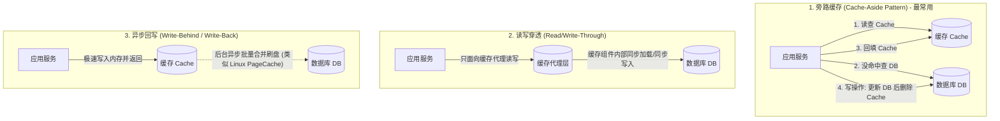
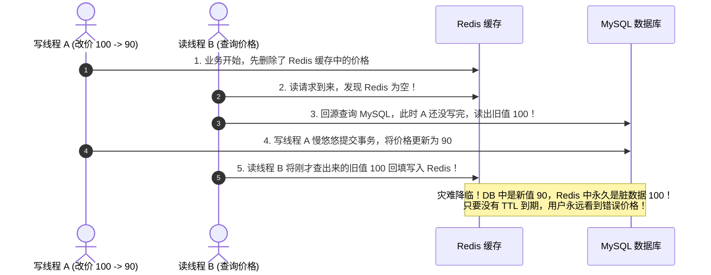
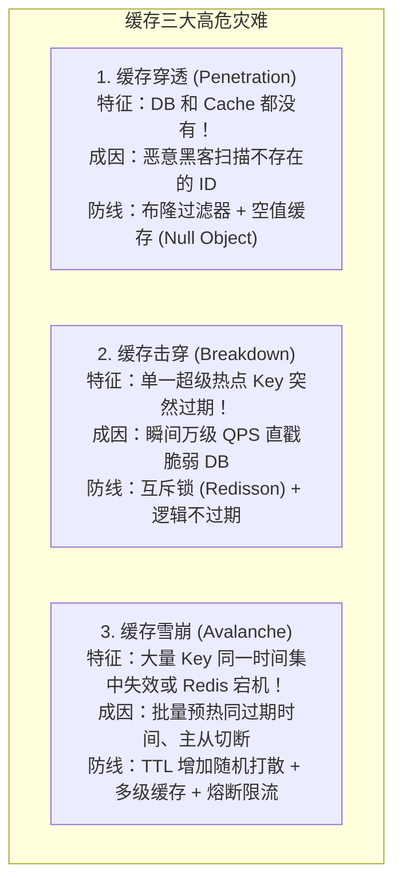

# 缓存架构设计：从局部性原理到一致性终极战役

> **前置知识**：[[00-系统设计全景与心智模型]]、[[01-高并发架构设计]]、[[20-Java后端/05-数据库与存储/06-Redis核心架构与数据结构|Redis核心架构]]、[[20-Java后端/05-数据库与存储/07-缓存穿透-击穿-雪崩|穿透击穿雪崩]]

---

## 1. 为什么需要缓存？（第一性原理与心智模型）

### 1.1 核心哲学：局部性原理（Principle of Locality）
计算机科学家彼得·丹宁（Peter Denning）曾提出计算机科学基石理论之一——**局部性原理**：
1. **时间局部性（Temporal Locality）**：如果一个数据被访问了，那么在不久的将来它很大概率还会被再次访问（例如：热点商品信息、用户 Token）。
2. **空间局部性（Spatial Locality）**：如果一个数据被访问了，那么与它物理相邻的数据很大概率很快也会被访问（例如：分页列表、连续数组）。

### 1.2 物理鸿沟：速度金字塔
计算机硬件存在残酷的物理延迟鸿沟：
- **CPU L1 缓存**：$\approx 1 \text{ ns}$
- **内存（DRAM）**：$\approx 50 \sim 100 \text{ ns}$
- **NVMe SSD 固态硬盘**：$\approx 20 \sim 100 \ \mu\text{s}$（比内存慢 1,000 倍）
- **机械磁盘随机 I/O / 跨机房网络 RTT**：$\approx 10 \sim 50 \text{ ms}$（比内存慢 100,000 倍）

> **第一性结论**：缓存的本质就是**“用廉价的内存空间换取宝贵的磁盘 I/O 和计算时间”**。
> 但计算机大师 Phil Karlton 留下了传世名言：
> **“计算机科学只有两大难题：缓存失效与命名规范。”（There are only two hard things in Computer Science: cache invalidation and naming things.）**

---

## 2. 四大经典缓存模式（Cache Patterns）

在系统架构中，数据在业务代码、缓存与数据库之间如何流转？行业总结了四种标准模式：



| 模式 | 核心机制 | 优点 | 缺点 | 适用场景 |
| :--- | :--- | :--- | :--- | :--- |
| **Cache-Aside** | 业务代码自己掌控查缓存、回源、删缓存 | 简单透明，冷数据不入缓存，缓存崩溃不影响 DB 主流程 | 业务代码侵入，存在极端并发脏数据可能 | **绝大多数业务系统的首选（95%+）** |
| **Read/Write-Through** | 缓存作为对外单一数据源，由缓存插件加载/写入 DB | 业务代码极简，彻底解耦存储细节 | 实现复杂，需要中间件驱动支持 | Guava Cache、分布式透明存储 |
| **Write-Behind** | 只写缓存立即返回，后台定时异步批量刷入 DB | 写性能极度恐怖（纳秒级），I/O 大合并 | 宕机必定丢失最后未落盘的数据，实现极其复杂 | Linux 操作系统 PageCache、游戏金币/血量实时扣减 |

---

## 3. 终极战役：缓存与数据库的一致性治理

在 Cache-Aside 模式下，当数据修改时，到底是“先更新数据库再删缓存”，还是“先删缓存再更新数据库”？为什么不能“直接更新缓存”？

### 3.1 为什么是“删除缓存”，而不是“更新缓存”？
- **原因一：并发写覆盖（脏写）**：
  线程 A 和线程 B 同时修改同一条数据。线程 A 先写了 DB，线程 B 后写了 DB。但由于网络调度，线程 B 先把新值更新进了缓存，线程 A 随后才把旧值覆盖进缓存！此时数据库是 B 的新值，缓存却永久保留了 A 的旧值！
- **原因二：算力浪费（惰性加载最佳）**：
  很多缓存数据是由多张表复杂关联聚合算出来的（比如商品详情聚合了分类、品牌、库存、优惠券规则）。如果每次只修改一个字段就重新计算并写入缓存，而这个商品一整天都没人看，就造成了极大的算力与带宽浪费。**只有等下一次有人真正在读的时候再重建，才是最经济的（Lazy Evaluation）**。

### 3.2 致命陷阱：为什么绝对不能“先删缓存，再写数据库”？



### 3.3 经典破局：为什么“先写数据库，再删缓存”安全得多？
反过来：“先提交数据库事务，再删除缓存”。
- 会不会发生脏数据？理论上只有一种极罕见的交错路径：
  1. 缓存刚好失效过期；
  2. 读线程查 DB 拿到旧值；
  3. 写线程更新 DB 事务提交，并执行删除缓存；
  4. 读线程把旧值回填到缓存。
- **为什么概率极低？**
  因为步骤 3 写数据库（磁盘 I/O、排他锁）的耗时通常是毫秒级，而步骤 2 纯读数据库快得多。要让“写 DB + 删缓存”夹在“读 DB 和写缓存”那短短几微秒的间隙里执行完毕，在现代计算机上发生的概率微乎其微。

### 3.4 生产级工业解法：Canal 监听 Binlog + MQ 可靠删除闭环

如果应用在执行完“写 DB”后，突然宕机或网络中断，导致“删除缓存”没能执行怎么办？
**大厂生产级终极方案：将删除缓存的职责解耦，交给可靠的基础设施！**


- **强一致性解耦**：业务代码只需要关心 DB 事务，绝不关心缓存删除。
- **重试保障**：即使 Redis 短暂网络抖动，MQ 提供了死信队列与持久化重试机制，直到最终把缓存删掉为止，**彻底达成 BASE 最终一致性**。

---

## 4. 缓存高危“三剑客与两重山”防御实战



### 4.1 生产级防穿透与防击穿代码标准范式

```java
@Service
@RequiredArgsConstructor
@Slf4j
public class SafeCacheService {

    private final StringRedisTemplate redisTemplate;
    private final RedissonClient redissonClient;
    private final ProductRepository productRepository;
    private final RBloomFilter<Long> productBloomFilter; // 预先初始化的布隆过滤器

    public Product getProductSafely(Long productId) {
        String cacheKey = "product:" + productId;

        // 1. 防穿透第一道防线：布隆过滤器（在内存中拦截 99.9% 虚假 ID）
        if (!productBloomFilter.contains(productId)) {
            log.warn("布隆过滤器拦截非法不存在的 productId: {}", productId);
            return null; // 直接打回，不查 Cache 也不查 DB
        }

        // 2. 查缓存
        String json = redisTemplate.opsForValue().get(cacheKey);
        if (StringUtils.isNotBlank(json)) {
            // 防穿透第二道防线：如果命中了空对象标记，直接返回 null
            if ("{}".equals(json)) {
                return null;
            }
            return JSON.parseObject(json, Product.class);
        }

        // 3. 缓存击穿防线：缓存未命中，使用分布式互斥锁，仅放行单线程回源
        String lockKey = "lock:product:" + productId;
        RLock lock = redissonClient.getLock(lockKey);
        try {
            // 尝试加锁，最多等待 500ms，锁持有 3s 自动释放
            if (lock.tryLock(500, 3000, TimeUnit.MILLISECONDS)) {
                try {
                    // Double Check：再次判断缓存是否已被前一个抢到锁的线程写好了
                    json = redisTemplate.opsForValue().get(cacheKey);
                    if (StringUtils.isNotBlank(json)) {
                        return "{}".equals(json) ? null : JSON.parseObject(json, Product.class);
                    }

                    // 真正回源数据库
                    Product dbProduct = productRepository.selectById(productId);
                    if (dbProduct != null) {
                        // 防雪崩关键：TTL 随机打散 (基准 1 小时 + 随机 0~600 秒)
                        long expireSeconds = 3600 + ThreadLocalRandom.current().nextLong(600);
                        redisTemplate.opsForValue().set(cacheKey, JSON.toJSONString(dbProduct), expireSeconds, TimeUnit.SECONDS);
                        return dbProduct;
                    } else {
                        // 数据库也没有（布隆过滤器可能存在的极小假阳性）：缓存空对象，TTL 给极短的 60 秒
                        redisTemplate.opsForValue().set(cacheKey, "{}", 60, TimeUnit.SECONDS);
                        return null;
                    }
                } finally {
                    lock.unlock();
                }
            } else {
                // 未抢到锁的并发请求：短暂休眠后自旋重试
                Thread.sleep(50);
                return getProductSafely(productId);
            }
        } catch (InterruptedException e) {
            Thread.currentThread().interrupt();
            throw new BusinessException("系统繁忙，请稍后重试");
        }
    }
}
```

### 4.2 缓存“两重山”：BigKey 与 HotKey 的生死治理
1. **大 Key（BigKey）治理**：
   - **定义**：String 类型值 $> 10\text{KB}$，或者集合类型（Hash/Set/ZSet）元素数量 $> 5000$ 个。
   - **危害**：Redis 是单线程执行模型，读取或删除 BigKey 会导致 Redis 主线程长时间阻塞（卡顿几十甚至数百毫秒），引发全集群超时。
   - **治理**：
     - **拆分**：将一个包含 10 万元素的 Hash 拆分成多个小 Hash（如按 `bucket = userId % 100` 存为 `user:cart:1001:bucket_3`）。
     - **异步非阻塞删除**：生产严禁使用 `DEL key`，必须全面使用 `UNLINK key`（后台异步回收内存）。
2. **热 Key（HotKey）治理**：
   - **定义**：单机 QPS $> 5000$ 的特定 Key。
   - **危害**：单个分片 Master 节点的网卡带宽打满，CPU 100%，引发同一实例上的其他请求同归于尽。
   - **治理**：**二级本地缓存（Caffeine / Tracking）+ 热点动态探测**。一旦探测到，推送到 JVM 本地内存，请求在应用层直接消费，不再出网卡。

---

## 5. 大厂 30 秒面试绝杀（高频追问 3 连击）

### Q1：延迟双删（Delayed Double Delete）真的能完全保证数据一致性吗？为什么大厂生产环境很少用？
> **答题标杆**：
> 1. **延迟双删机制**：写数据库前先删一次缓存，写完数据库后，`Thread.sleep(N)` 毫秒，再强制删一次缓存，试图抹平并发读线程在这期间回填的旧缓存。
> 2. **致命缺陷**：
>    - **休眠时间 $N$ 无法科学确定**：$N$ 必须大于并发读线程回源 DB 加写缓存的总耗时。在复杂的生产分布式网络中，GC、网络抖动、数据库排队都会导致耗时剧烈波动，$N$ 设小了起不到效果，设大了严重拖慢写接口响应时间。
>    - **二次删除可能失败**：如果第二次删除由于网络抖动失败，脏数据依然会长久留存。
> 3. **替代方案**：现代一线大厂普遍摒弃这种“玄学休眠”，全面拥抱 **Canal 监听 Binlog 投递 MQ 异步重试删除**，或者结合 **Redis 逻辑过期与版本号校验**。

---

### Q2：布隆过滤器如果误判了怎么办？如果底层数据库删除了某条数据，布隆过滤器支持删除吗？
> **答题标杆**：
> 1. **误判特性（假阳性 False Positive）**：布隆过滤器的数学定律是“**说不存在则必定不存在，说存在则可能存在**”。如果发生误判（把不存在的 ID 判定为存在），请求会穿透到下游。此时我们通过在 Redis 中**缓存空对象（Null Object + 60s 短过期）**作为第二道防线，依然能彻底阻止黑客攻击打爆数据库。
> 2. **标准布隆过滤器不支持删除**：因为多个元素的 Hash 映射可能共用了同一个位（Bit），如果直接将某位置为 0，会导致其他真正存在的元素被错误地判定为不存在！
> 3. **需要删除时的解决方案**：
>    - **计数布隆过滤器（Counting Bloom Filter）**：将每位扩展为一个 Counter（如 4 位的计数器），添加加 1，删除减 1，但内存占用翻 4 倍。
>    - **布隆过滤器定期全量离线重建（最常用）**：每天凌晨定时任务全量扫描一次数据库有效主键，重新生成一个新的布隆过滤器实例并原子热替换，既省内存又杜绝了计数溢出。

---

### Q3：Redis 6.0 引入的客户端缓存（Client-Side Caching / Tracking）是如何工作的？
> **答题标杆**：
> 1. **解决痛点**：以往在应用层做本地缓存（如 Caffeine），当 Redis 数据变更时，应用很难收到通知，容易读到过期数据。
> 2. **Tracking 核心机制**：
>    - **服务器端协助追踪**：Redis 服务端记录当前客户端连接读取过了哪些 Key。
>    - **失效消息广播（Invalidation Message）**：当任何客户端修改了某个 Key 时，Redis 服务端会向所有曾读取过该 Key 的客户端主动推送一条 Invalid 广播消息，客户端收到后立即将本地 Caffeine 缓存中该 Key 清除。
> 3. **广播模式优化（BCAST）**：为防止 Redis 记住每个 Key 导致内存暴增，生产中开启广播模式，按 Key 的前缀（如 `product:`）注册，只有前缀匹配的修改才向客户端广播，极大节省了 Redis 内存并保证了微秒级一致性。

---

## 6. 一分钟复盘记忆卡

```text
======================= 缓存架构核心记忆口诀 =======================
局部性原理定乾坤，纳秒毫秒差万门。
旁路缓存最常用，先写数据库后删存；
直接更新生脏写，算力浪费空留存；
穿透空值布隆拦，击穿互斥锁回填；
雪崩打散随机时，两重大热需提防；
Canal监听Binlog走，MQ重试保最终。
======================================================================
```
