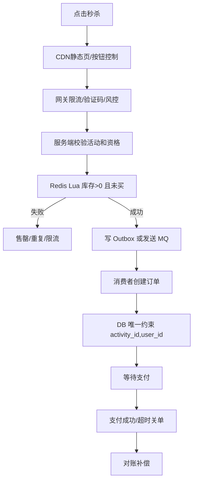

# 秒杀系统设计

> [!abstract] 一句话总结
> 秒杀系统用静态化、限流、资格校验、Redis 原子扣减、MQ 异步下单和数据库最终落库，把瞬时流量压缩到库存安全范围内；面试重点是容量估算、超卖/少卖、热点、补偿和压测证明。

## 📌 精准定位

- 负责在库存有限、流量突刺、用户体验可控前提下防超卖和击穿。
- 不负责让所有请求进入数据库竞争。
- 关键边界：库存扣减要有单点事实来源，异步下单要有幂等和补偿。
- 系统设计表达要从“正常链路”扩展到“容量、失败、补偿、指标、演进”。

## 🧮 容量估算

假设活动库存 1000，预约用户 10 万，开抢前 10 秒集中进入，峰值可能达到 1 万~5 万 QPS。

| 维度 | 估算 | 设计含义 |
| ---- | ---- | -------- |
| 请求峰值 | 1 万~5 万 QPS | 网关限流、验证码、排队页 |
| 真正成功 | 不超过库存 1000 | 只有少量请求进入落库链路 |
| DB 写入 | 订单创建 TPS 由 MQ 消费控制 | 削峰填谷，保护数据库 |
| Redis 热点 | 单活动库存 key 高并发访问 | Lua 原子扣减，必要时库存分片 |
| MQ 堆积 | 秒杀瞬时成功资格集中进入 | 监控 lag，消费者可水平扩容 |

## 🧩 核心概念

| 概念 | 具体含义 | 精通要点 |
| ---- | -------- | -------- |
| 入口削峰 | CDN 静态页、验证码、排队、限流。 | 减少无效请求进入核心链路。 |
| 库存预扣 | Redis Lua 原子校验和扣减。 | 防缓存层超卖。 |
| 异步下单 | MQ 承接成功资格，消费者落 DB。 | 保护数据库写入。 |
| 幂等防重 | 用户+活动唯一约束。 | 防重复抢购和重复消费。 |
| 补偿对账 | 校验 Redis、订单、流水。 | 防少卖、资格悬挂和状态不一致。 |

## ⚙️ 工作原理 / 主流程



1. 活动页静态化，库存动态信息走轻量接口。
2. 秒杀前预热库存到 Redis 并记录活动状态。
3. Lua 一次完成查库存、查购买标记、扣库存、写标记。
4. 扣减成功只代表获得下单资格，订单异步创建。
5. DB 仍要唯一约束和库存条件更新兜底。
6. 支付超时、MQ 失败、消费失败都要可补偿。

## 🔑 Redis Key 与 Lua

| Key | 说明 |
| --- | ---- |
| `seckill:stock:{activityId}` | 活动库存 |
| `seckill:buyers:{activityId}` | 已购买用户集合 |
| `seckill:result:{requestId}` | 请求结果 |
| `seckill:activity:{activityId}:status` | 活动状态 |

```lua
if redis.call('SISMEMBER', KEYS[2], ARGV[1]) == 1 then return -2 end
local stock = tonumber(redis.call('GET', KEYS[1]) or '0')
if stock <= 0 then return -1 end
redis.call('DECR', KEYS[1])
redis.call('SADD', KEYS[2], ARGV[1])
return 1
```

## 🗄️ 数据模型

```sql
CREATE TABLE seckill_order (
  id BIGINT PRIMARY KEY,
  request_id VARCHAR(64) NOT NULL,
  activity_id BIGINT NOT NULL,
  user_id BIGINT NOT NULL,
  status VARCHAR(32) NOT NULL,
  created_at DATETIME NOT NULL,
  UNIQUE KEY uk_activity_user(activity_id, user_id),
  UNIQUE KEY uk_request(request_id)
);

CREATE TABLE seckill_stock_flow (
  id BIGINT PRIMARY KEY,
  activity_id BIGINT NOT NULL,
  request_id VARCHAR(64) NOT NULL,
  flow_type VARCHAR(32) NOT NULL,
  quantity INT NOT NULL,
  created_at DATETIME NOT NULL,
  UNIQUE KEY uk_request_flow(request_id, flow_type)
);
```

## 🚨 失败场景与兜底

| 场景 | 风险 | 方案 |
| ---- | ---- | ---- |
| Redis 扣减成功，MQ 失败 | 用户资格悬挂、少卖 | Outbox 重试，失败回补库存和购买标记 |
| 消费者重复消费 | 重复下单 | requestId、用户活动唯一索引、库存流水唯一键 |
| 消费者失败 | 订单未创建 | MQ 重试、DLQ、人工补偿 |
| 支付和关单并发 | 已支付订单被取消 | `WHERE status='WAIT_PAY'` 条件更新 |
| Redis 与 DB 不一致 | 超卖/少卖 | 定时对账：订单、流水、Redis 库存三方校验 |
| 热点 key 压力过大 | Redis CPU 高 | 限流、分段放量、库存分片、本地缓存活动状态 |

## 📊 压测验证

| 验证项 | 目标 |
| ------ | ---- |
| 固定库存 1000，请求 10000 | 成功订单数 <= 1000 |
| 同一用户并发请求 20 次 | 最多成功 1 次 |
| MQ 消费者临时不可用 | 消息可重试或进入 DLQ |
| 支付和关单并发 | 最终只能有一个状态成功 |
| Redis/MQ/DB 指标 | 记录 QPS、P95/P99、MQ lag、MySQL TPS |

一致性校验：

```sql
SELECT activity_id, COUNT(*)
FROM seckill_order
WHERE status IN ('WAIT_PAY','PAID')
GROUP BY activity_id;

SELECT activity_id, user_id, COUNT(*) c
FROM seckill_order
GROUP BY activity_id, user_id
HAVING c > 1;
```

## 🧭 排查路径

- 超卖：查 Redis Lua、DB 条件更新、唯一约束、库存流水。
- 少卖：查 MQ 失败、消费者失败、库存回滚、风控误杀。
- 接口打满：看限流、验证码、黑名单、静态资源、网关 QPS。
- 下单延迟：看 MQ lag、消费者并发、DB 写瓶颈。
- 热点 Redis：看 Redis CPU、慢命令、key 访问集中度。

## 🎯 面试问题

> [!question] 高频问题
> - Q: 为什么异步下单？
>   - A: 把瞬时流量变队列消费，保护数据库并削峰。用户先拿到资格，订单异步创建。
> - Q: 如何防超卖？
>   - A: Redis Lua 预扣防缓存层超卖，DB 唯一约束和条件更新兜底，库存流水和对账任务做最终校验。
> - Q: 如何防重复抢？
>   - A: Redis 用户标记、requestId、DB 唯一索引、消费者幂等。
> - Q: 扣 Redis 后 MQ 失败怎么办？
>   - A: 用 outbox/事务消息，失败重试，超过阈值回补库存和购买标记。
> - Q: 热点 key 怎么处理？
>   - A: 入口限流、分段放量、库存分片、本地缓存活动状态，必要时用排队系统削峰。

## 🎤 面试 3 层回答

### 30 秒版

秒杀系统的核心是入口削峰、Redis Lua 原子预扣、MQ 异步落库和 DB 幂等兜底。真正要证明的是不会超卖、重复请求安全、异常可补偿、压测指标可观测。

### 2 分钟版

我会先做活动预热，把库存和活动状态放到 Redis。用户请求经过网关限流和资格校验后，用 Lua 原子扣库存和写已购标记。成功后写 MQ 或 outbox，消费者异步创建订单。DB 层用 `activity_id + user_id` 唯一索引防重复，用支付/关单状态机条件更新防并发冲突。最后通过压测和一致性 SQL 证明成功订单数不超过库存。

### 项目版

可以关联 [[../09-项目实战/01-项目-高并发秒杀系统]]，重点讲接口、表结构、Redis key、MQ 补偿、压测数据和故障复盘。

## ✅ 精通检查清单

- 能做容量估算并指出瓶颈。
- 能画出主流程和失败补偿链路。
- 能写出 Lua 预扣和 DB 唯一约束设计。
- 能解释超卖、少卖、重复消费、热点 key 的处理。
- 能说出压测指标和一致性校验方法。

## 🔗 关联笔记

- [[_index]]
- [[20-Java后端/00-总览/学习仪表盘]]
- [[../09-项目实战/01-项目-高并发秒杀系统]]
- [[../06-中间件/03-消息可靠性-顺序-幂等]]
- [[../05-数据库与存储/03-MySQL锁机制]]

## 📚 参考资料

- Redis Lua Scripting
- RocketMQ/Kafka async order pattern
- Microservices Patterns: Transactional Outbox
