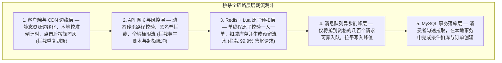
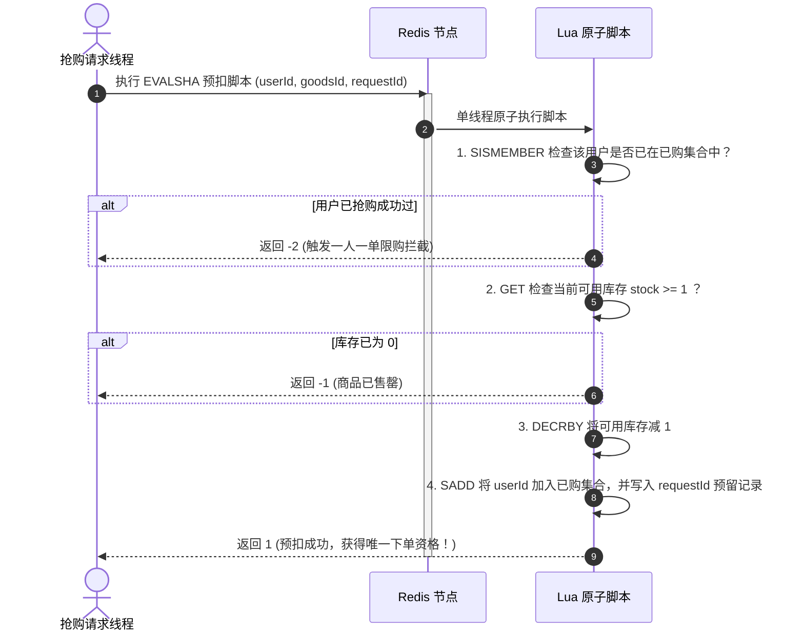
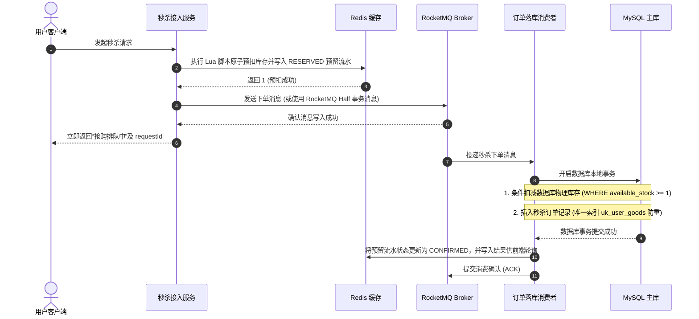
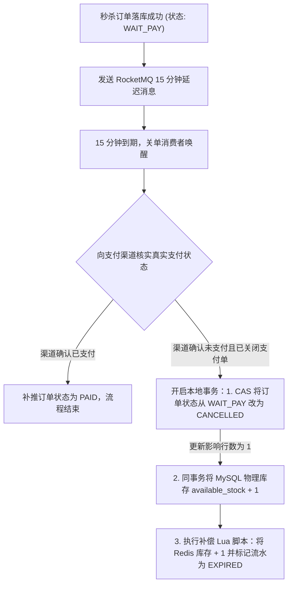

# 秒杀系统设计：从百万脉冲截流到防超卖闭环

> **前置知识**：[[00-系统设计全景与心智模型]]、[[01-高并发架构设计]]、[[02-高可用架构设计]]、[[03-缓存架构设计]]、[[07-订单系统设计]]

---

## 1. 核心难点：秒杀业务最棘手的问题到底是什么？

### 1.1 一句话看懂秒杀的核心矛盾
秒杀系统（如整点抢购 100 瓶茅台或 1000 张半价券）最核心的难点可以用一句话概括：**瞬间有几十万甚至上百万人同时涌入抢购几百件商品，如果让这些请求直接打到数据库，数据库会在一秒钟内连接耗尽崩溃；而且在极高并发下扣减同一件商品的库存，稍有不慎就会发生“超卖”（库存扣成负数）或“少卖”（库存被异常锁死卖不出去）。**

具体拆解下来，架构师必须正面解决以下四个硬骨头：
1. **极端脉冲与无效流量占比极高**：100 万人在整点那一秒同时点击抢购，但商品只有 100 件，意味着 **99.99% 的请求注定抢不到**。如何把这 99.99% 的无效请求在到达核心数据库之前一层层拦截掉？
2. **黄牛脚本与黑产刷单**：黑产会用自动化脚本绕过前端页面，在整点直接以毫秒级频率并发调用下单接口，普通用户根本抢不过。
3. **高并发下的“防超卖”与“一人一单”**：如果在代码里写“先查库存、判断大于 0、再减 1”，并发线程会同时读到还有 1 件库存并同时扣减成功，造成严重资损；而如果让百万请求直接去抢数据库的单行排他锁，数据库又根本扛不住。
4. **预扣库存与异步落库的一致性闭环**：为了抗住并发，我们把扣库存前置到了 Redis。但如果 Redis 扣成功了，发消息队列时服务器突然断电，或者用户抢到了却一直不付款，这件库存怎么安全地退回去？

### 1.2 演进思路：层层过滤的“漏斗架构”
理解了上述难点，秒杀系统的架构演进逻辑就非常清晰了——**在请求链路的每一层做前置拦截，把百万级请求逐层削减为百级数据库写入**：



下面我们顺着请求从客户端到数据库的完整路径，一步步拆解每一层的设计细节。

---

## 2. 第一步：客户端与 CDN 层——把静态请求彻底挡在门外

用户在秒杀开始前几分钟，往往会不停地刷新商品详情页看倒计时。如果每次刷新都去查后端服务和数据库，活动还没开始系统就先挂了。

- **动静分离与 CDN 预热**：
  秒杀页面的 HTML 骨架、CSS、JS 脚本和商品大图，在活动开始前就推送到全国 CDN 边缘节点缓存。用户刷新页面时 100% 由 CDN 直接返回，不消耗后端服务器任何算力。
- **倒计时时间校准（禁止前端每秒轮询服务器时间）**：
  不能让百万客户端每秒调用一次服务端时间接口。正确做法是：页面初次加载时请求一次极轻量的服务端时间戳接口，计算出客户端本地时钟与服务器时钟的差值 $\Delta t$。此后前端倒计时完全基于本地时钟加 $\Delta t$ 自行跳动；在倒计时归零前，“立即抢购”按钮在客户端保持置灰不可点击，点击一次后立即进入冷却置灰，防止用户手抖连点。

---

## 3. 第二步：网关与防刷层——动态秒杀地址与限流

前端的按钮置灰只能防住普通用户，防不住直接用代码调 HTTP 接口的黄牛脚本。如果下单接口地址是固定的（比如 `POST /seckill/order?goodsId=1001`），黄牛提前写好死循环脚本，整点一到每秒发几万次请求，真实用户根本没有机会。

### 3.1 动态秒杀地址（Path Token 机制）
为了防止接口被提前探测和重放，我们将下单拆成“先拿动态凭证，再发起抢购”两步：
1. **活动开始前**：没人知道真实的秒杀下单 URL 是什么。
2. **整点到达时**：用户点击抢购按钮，前端先携带登录态和验证码结果，请求一次获取秒杀凭证接口 `GET /seckill/token?goodsId=1001`。
3. **签发一次性凭证**：服务端校验当前时间确实已到整点，且用户通过了风控/人机校验（如滑块或点选验证码，既能拦截机器脚本，又能把所有人在 0.001 秒内的点击拉散到 1~3 秒内完成），随后生成一个与当前 `userId`、`goodsId` 绑定的随机 `pathToken` 存入 Redis（设置 60 秒有效期）。
4. **发起真正抢购**：客户端拿到 `pathToken` 后，拼接出真正的下单地址 `POST /seckill/{pathToken}/order` 发起请求。网关或前置校验层核对 `pathToken` 合法后将其消费，非法请求直接拒绝。

---

## 4. 第三步：Redis + Lua 原子预扣层——防超卖的核心防线

穿过网关限流和凭证校验的合法抢购请求，接下来要争夺那 100 件库存。
这里最核心的原则是：**绝对不能在 Java 代码里分步执行“先 `GET` 查库存、再判断 `stock > 0`、最后 `DECR` 减库存”！** 因为在并发环境下，多个线程会同时读到 `stock = 1`，同时通过判断并执行 `DECR`，把库存扣成 `-99`，造成致命超卖。

### 4.1 为什么用 Redis Lua 脚本？
Redis 会将整个 Lua 脚本作为一个整体，在单线程事件循环中**原子执行**——脚本执行期间绝对不会穿插其他任何客户端的命令。因此，我们可以把“检查是否重复购买”、“检查库存是否大于 0”、“扣减库存”、“记录用户已购与预留流水”全部写进同一个 Lua 脚本里，一步到位：



### 4.2 生产级原子预扣 Lua 脚本代码

```lua
-- KEYS[1]: 商品可用库存 Key，例如 "seckill:{1001}:stock"
-- KEYS[2]: 已购用户集合 Key，例如 "seckill:{1001}:users"
-- KEYS[3]: 预留流水哈希 Key，例如 "seckill:{1001}:reservations"
-- ARGV[1]: 用户 ID (userId)
-- ARGV[2]: 本次请求唯一流水号 (requestId)
-- ARGV[3]: 当前时间戳 (timestamp)

-- 1. 幂等与限购校验：检查该用户是否已经抢到过该商品
if redis.call('SISMEMBER', KEYS[2], ARGV[1]) == 1 then
    return -2  -- 返回 -2：一人一单，请勿重复抢购
end

-- 2. 库存充足性校验
local stock = tonumber(redis.call('GET', KEYS[1]) or '0')
if stock <= 0 then
    return -1  -- 返回 -1：手慢了，商品已售罄
end

-- 3. 原子执行扣减、标记已购用户，并写入带时间戳的预留流水（用于后续落库核对与异常回补）
redis.call('DECR', KEYS[1])
redis.call('SADD', KEYS[2], ARGV[1])
redis.call('HSET', KEYS[3], ARGV[2], ARGV[1] .. ':' .. ARGV[3] .. ':RESERVED')

return 1  -- 返回 1：预扣成功！
```

> [!WARNING]
> **Redis Cluster 集群下的 Hash Tag 铁律**：
> 在 Redis Cluster 分片集群中，同一个 Lua 脚本操作的所有 Key（如上面的 `KEYS[1]`、`KEYS[2]`、`KEYS[3]`）**必须位于同一个哈希槽（Slot）上**，否则 Redis 会直接报错拒绝执行。
> 解决方法是在 Key 命名中统一加上大括号 **Hash Tag `{1001}`**（即 `{goodsId}`）。Redis Cluster 会只对大括号内部的 `1001` 计算 CRC16 哈希值，从而保证这三个 Key 100% 落在同一台 Redis 节点上。

---

## 5. 第四步：异步削峰与事务落库——保证 Redis 与 MySQL 一致

经过 Redis Lua 脚本拦截后，100 万个请求里只有真正抢到库存的那 **100 个请求** 会拿到返回值 `1`，其余 999,900 个请求都已经拿到“已售罄”直接结束了。

接下来，我们需要为这 100 个幸运用户真正在 MySQL 里生成订单并扣减物理库存。这里最关键的问题是：**如果 Redis 已经预扣了库存，但在准备发 MQ 消息时应用服务器突然宕机，导致消息没发出去、订单没生成，那件库存岂不是永远消失了（少卖）？**

### 5.1 RocketMQ 事务消息 + 预留流水对账闭环
为了确保“只要 Redis 预扣成功，就一定能生成订单；如果最终没生成订单，就一定能把 Redis 库存退回来”，我们采用异步落库加双向对账机制：



1. **数据库底线防超卖（条件更新）**：
   即使前端缓存层出现任何意外，数据库依然是资金和物理库存的最后守门员。消费者在扣减 MySQL 库存时，SQL 必须带上 `AND available_stock >= 1` 条件：
   ```sql
   UPDATE t_seckill_stock
   SET available_stock = available_stock - 1,
       locked_stock = locked_stock + 1
   WHERE goods_id = 1001
     AND available_stock >= 1;
   ```
   因为 InnoDB 在执行 `UPDATE` 时会加行级排他锁并读取最新已提交的值（当前读），只要判断返回的影响行数（Affected Rows）为 1，就绝对不会扣成负数。将该更新与 `INSERT INTO t_order` 放在同一个本地数据库事务中，任何一步失败则整体回滚。
2. **应对发 MQ 前宕机（悬空预留回补）**：
   回头看我们在第 4 节 Lua 脚本里写入的 `seckill:{1001}:reservations` 预留流水（包含 `requestId`、扣减时间和 `RESERVED` 状态）。后台运行一个轻量级定时巡检任务，扫描那些处于 `RESERVED` 状态超过 30 秒仍未变成 `CONFIRMED` 的记录，再去数据库核对是否确实没有生成对应订单。一旦确认是发消息前宕机导致的悬空预留，立即执行补偿 Lua 脚本：将该流水状态原子CAS改为 `RELEASED`，把 Redis 库存 `+1`，并移除该用户的限购集合标记，从而彻底消除少卖！

---

## 6. 第五步：前端轮询与超时未支付回补库存

### 6.1 客户端如何知道最终抢购结果？
由于写数据库是异步进行的，客户端刚提交秒杀请求时收到的是 `PENDING`（排队处理中）状态和 `requestId`。
- 前端页面随后每隔 **1 秒** 调用一次结果查询接口 `GET /seckill/result?requestId=xxx`（直接查 Redis 中的结果标记）。
- 一旦消费者在几十毫秒内完成了数据库建单并更新了 Redis 标记，前端轮询拿到 `SUCCESS` 和正式的 `orderNo`，立即自动跳转到收银台页面引导付款；如果最多轮询 5 次仍未出结果，则引导用户在“我的订单”列表中查看。

### 6.2 用户抢到后 15 分钟不付款，怎么退回库存？
如果有人抢到了资格生成了订单，但迟迟不付款，商品也不能一直压在他手里。我们在订单创建成功的同时，向 RocketMQ 发送一条 **15 分钟延迟消息**：



---

## 7. 高频面试追问

> [!question]- Q1：如果参与秒杀的爆款商品有 10 万件库存，几百万人同时抢，单台 Redis 节点扛不住这一个 Key 的并发怎么办？
> 1. **问题定位**：单机 Redis 的单线程执行能力通常在数万到十万 QPS 左右。如果所有人都操作同一个 `seckill:{1001}:stock` Key，流量会全部集中在一台分片主节点上。
> 2. **解法：Redis 库存分桶（Segmented Stock Keys）**：
>    - 将 10 万件总库存平均拆成 10 个子桶 Key，例如 `seckill:{1001_0}:stock` 到 `seckill:{1001_9}:stock`，每个子桶分配 10,000 件库存。由于大括号内的 Hash Tag 不同，这 10 个子桶会被分散到 Redis Cluster 的不同分片节点上，吞吐能力随之成倍扩展。
>    - **如何同时保证“一人一单”？** 用户抢购时，直接按 **`userId % 10`** 固定路由到对应的分桶（同一个用户的请求永远落在同一个桶上，因此已购用户集合 `seckill:{1001_0}:users` 也只需要和对应分桶放在一起即可天然防重）。当某个子桶率先售罄时，再携带全局去重校验引导剩余请求尝试其他尚有余量的分桶。

> [!question]- Q2：为什么在 MySQL 扣减库存时，直接用 `UPDATE ... SET stock = stock - 1 WHERE id = 1001 AND stock >= 1` 就能防超卖，而不需要加 `version` 版本号乐观锁？
> 1. **ABA 与版本号的作用场景**：`version` 版本号主要用于防止“先读出数据到内存计算、再写回数据库”过程中的并发覆盖或 ABA 问题。如果在高并发扣库存时使用 `WHERE id = 1001 AND version = oldVersion`，100 个并发线程同时读到 `version = 1`，最后只有 1 个线程能更新成功，剩下 99 个线程全部因为版本号冲突而失败回滚（明明库里还有 99 件货却卖不出去，导致严重的少卖和无效重试）。
> 2. **条件自减的天然原子性**：当我们直接写 `SET stock = stock - 1 WHERE id = 1001 AND stock >= 1` 时，扣减计算和余量判断都是在 InnoDB 获取**行级排他锁（X 锁）**之后的“当前读”状态下原子完成的。100 个并发事务在数据库底层依次排队执行，只要前一个事务扣完后库存还大于等于 1，下一个事务就能继续扣减成功，既保证了 100% 不超卖，又不会因为版本号冲突误杀正常请求。

> [!question]- Q3：如果 Redis 主节点刚执行完 Lua 脚本预扣了库存，还没来得及同步给从节点就宕机了，从节点升主后库存多出来了，会导致超卖吗？
> 1. **现象分析**：由于 Redis 主从复制默认是异步的，主节点宕机确实可能导致刚扣减的那几件库存在新主节点上“没扣掉”，从而多放行了几个抢购请求进入 MQ。
> 2. **为什么最终不会发生实际超卖？**
>    因为我们的架构不是只靠 Redis 决定最终成败，**MySQL 数据库才是物理库存的最终守门员**。那几个被多放行进 MQ 的请求，在消费者执行数据库 `UPDATE ... WHERE available_stock >= 1` 时，排在后面的事务会发现数据库里的真实库存已经扣光（`Affected Rows == 0`），此时消费者会捕获库存不足、将抢购状态标记为失败并告知前端“手慢了已售罄”，从而在最终落库环节稳稳守住绝不超卖的底线。

---

## 8. 一分钟复盘记忆卡

```text
======================= 秒杀系统核心记忆口诀 =======================
秒杀痛点高脉冲，漏斗层层截流凶。
静态资源推 CDN，差值校时禁轮询；
动态路径防脚本，网关限流护核心；
Redis 预扣走 Lua，HashTag 同槽防超卖；
预留流水防掉电，事务消息削写峰；
数据库里条件扣，超时未付延迟退。
======================================================================
```
