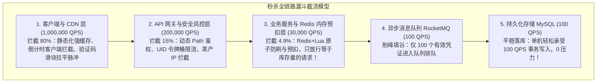
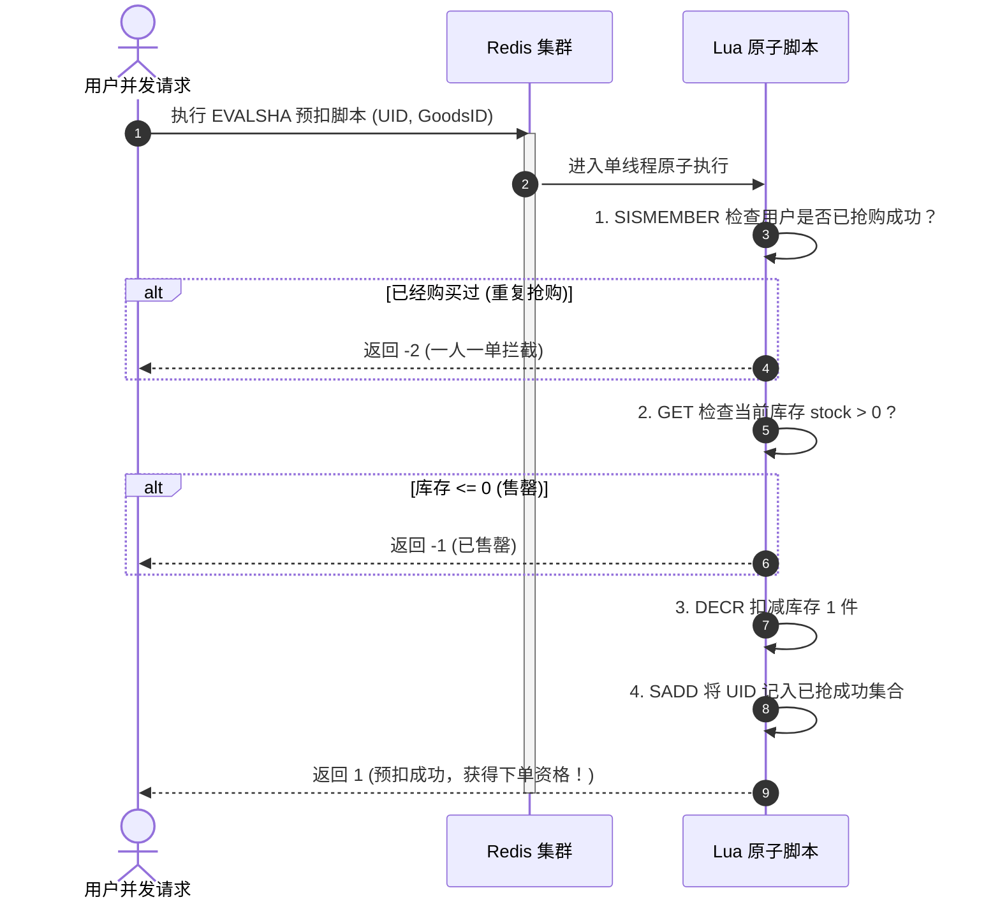
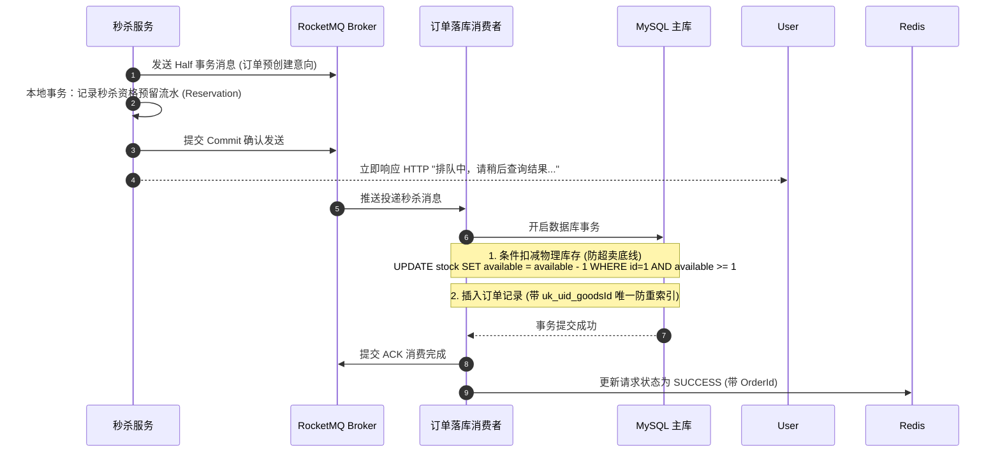
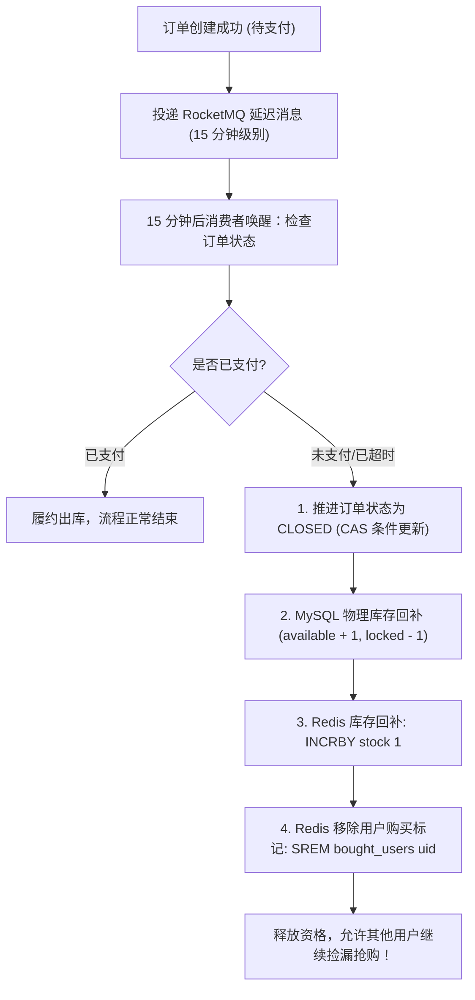

# 秒杀系统设计：从漏斗模型到极致防超卖体系

> **前置知识**：[[00-系统设计全景与心智模型]]、[[01-高并发架构设计]]、[[02-高可用架构设计]]、[[03-缓存架构设计]]、[[07-订单系统设计]]

---

## 1. 为什么秒杀系统是架构试金石？（第一性原理与心智模型）

### 1.1 核心矛盾：极度倾斜的供需失衡与脉冲冲击
秒杀系统的业务本质非常极端：
- **瞬时脉冲（Burst Traffic）**：100 万用户在 0.001 秒（整点一过）同时狂点“立即抢购”，流量瞬间暴增上千倍。
- **读极多写极少**：100 万次抢购点击，背后可能只有 100 件实体库存。**99.99% 的请求最终注定要失败**。
- **零容忍防线**：
  - **绝不超卖（Over-selling）**：库存 100 件，绝不能卖出 101 件，否则面临严重经济与法律资损。
  - **绝不少卖（Under-selling）**：明明有货却早早显示售罄，活动结束后库存积压，损害商业转化。
  - **黑产防御**：防止外挂黄牛脚本直接破解接口 URL 批量秒杀抢单。

### 1.2 核心思想：层层截流的“漏斗模型”（Funnel Architecture）
既然 99.99% 的流量都是无功而返的，架构的最高境界就是——**“绝不让无用的流量下沉到下一层脆弱的基础设施”**！



---

## 2. 秒杀核心防御六大硬核战役

### 2.1 战役一：页面与静态资源绝对边缘化（CDN 强阻隔）
- **动静彻底分离**：秒杀详情页中的 HTML 骨架、CSS、JS、商品主图，必须在活动前数小时推送到 CDN 边缘节点。
- **倒计时防刷技巧**：
  - 绝对不要在前端每秒向服务端请求一次“当前服务器时间”。
  - 做法：在页面初次加载时，请求一次轻量时间戳接口，计算客户端本地时间与服务器时间的固定差值 $\Delta t$；前端倒计时依靠本地时钟加上 $\Delta t$ 运算，在 0 秒到达前，**“立即抢购”按钮在前端硬置灰禁用**。

### 2.2 战役二：安全防刷与动态秒杀地址（URL 随机混淆）
绝不能让黑客提前抓包拿到固定的秒杀接口（如 `POST /seckill/order?goodsId=100`）。
- **动态 URL 机制**：
  1. 到点前，抢购接口处于隐藏或未生效状态。
  2. 整点时刻，客户端调用轻量接口获取一次性秒杀授权码（Path Token）：
     $$\text{Path Token} = \text{MD5}(\text{userId} + \text{goodsId} + \text{Salt})$$
  3. 最终下单接口为 `POST /seckill/{pathToken}/order`。网关层校验该 Token 是否合法且与用户匹配，非法请求当场丢弃。
- **数学验证码/滑块削峰**：
  - 强制弹出滑动拼图或简单算术题，不仅拦截黄牛自动化脚本，而且将用户点击动作分散在 $1 \sim 3$ 秒的时间区间内，**把尖锐的“脉冲尖刺”瞬间抹平成平缓的“丘陵”**。

---

### 2.3 战役三：防超卖与内存预扣（Redis + Lua 原子状态机）

这是整个秒杀系统技术含量最高的核心点。**绝不能在代码里先 `GET stock` 然后在 Java 中判断 `if (stock > 0)` 再 `DECR`**，这在并发下必定导致严重的超卖！



#### 生产级多条件原子 Lua 脚本实战

```lua
-- 参数说明：
-- KEYS[1]: 包含 HashTag 的商品库存 Key，如 "seckill:{1001}:stock"
-- KEYS[2]: 包含 HashTag 的已购用户 Set，如 "seckill:{1001}:bought_users"
-- ARGV[1]: 用户 ID
-- ARGV[2]: 购买数量 (通常为 1)

-- 1. 幂等校验：检查当前用户是否已经成功抢购过
if redis.call('SISMEMBER', KEYS[2], ARGV[1]) == 1 then
    return -2  -- 错误码 -2: 一人限购一件，重复下单
end

-- 2. 库存校验：获取当前可用库存
local stock = tonumber(redis.call('GET', KEYS[1]) or '0')
local buyCount = tonumber(ARGV[2])

if stock < buyCount then
    return -1  -- 错误码 -1: 库存不足，已售罄
end

-- 3. 原子扣减与身份标记
redis.call('DECRBY', KEYS[1], buyCount)
redis.call('SADD', KEYS[2], ARGV[1])

return 1  -- 成功码 1: 预扣成功，凭证有效！
```

> **注意（Redis Cluster 槽位约束）**：
> 在 Redis 集群中，Lua 脚本操作的多个 Key 必须位于同一个 Slot 槽位。因此 Key 的设计必须带上 **Hash Tag `{1001}`**（例如 `seckill:{1001}:stock` 和 `seckill:{1001}:bought_users`），确保两个 Key 严格哈希到同一台 Redis 节点。

---

### 2.4 战役四：异步削峰与落库最终一致性（RocketMQ 事务消息）

当 Redis Lua 返回 `1`（预扣成功）后，用户已经拿到了名额，但千万不要在当前 HTTP 线程中同步去操作 MySQL！



#### 数据库底线防御 SQL（绝对防超卖）

即使 Redis 发生极端灾难、数据错乱或者误判，**MySQL 必须作为最终资金与库存的守门员**：

```sql
-- 扣减物理库存必须带上 available_stock >= 扣减数量 的条件约束！
UPDATE t_seckill_product
SET available_stock = available_stock - 1,
    locked_stock = locked_stock + 1,
    version = version + 1
WHERE id = 1001 
  AND available_stock >= 1; 
-- 如果 affected rows == 0，说明物理库存已被抢完，立即回滚并触发告警！
```

---

### 2.5 战役五：客户端排队与轮询体验优化（状态机闭环）

前端收到 HTTP 响应“排队中（PENDING）”后，如何让用户得知自己到底抢到了没有？

1. **状态流转设计**：
   - `PENDING`：正在队列中排队创建订单。
   - `SUCCESS`：订单创建成功，返回真实的 `orderId`，前端立即引导跳转收银台支付！
   - `FAIL`：排队失败，说明库存售罄或物理落库失败，前端弹出“手慢了，商品已抢光”。
2. **优雅轮询策略**：
   - 客户端开启定时短轮询：每隔 **1 秒** 查询一次 `GET /seckill/result?goodsId=1001`。
   - **轮询上限**：最多查询 5 次。若 5 秒后仍未出结果，提示用户去“我的订单中心”查看，避免成千上万客户端死循环刷接口。

---

### 2.6 战役六：超时未支付与回补库存（杜绝少卖）

抢购成功后，必须给用户一个合理的支付倒计时（如 15 分钟）。若用户放弃支付，如何将库存优雅返还？



---

## 3. 大厂 30 秒面试绝杀（高频追问 3 连击）

### Q1：如果 Redis 预扣库存成功了，但准备发 MQ 时应用瞬间宕机断电，导致 MQ 没发出去，库存凭空少了（少卖），如何解决？
> **答题标杆**：
> 1. **本质分析**：跨存储介质（Redis 与 MQ）的一致性问题。
> 2. **解决方案——双向兜底与资格对账对齐**：
>    - **本地资格流水（Reservation）+ 定时补偿对账**：在预扣库存时，同时向 Redis 写入一条带有效期的“资格预占记录”（`seckill:reserve:{goodsId}:{userId}`，TTL 设为 30 秒）。
>    - **后台看门狗定时核对**：后台启动守护线程，每 10 秒扫描一次所有预占记录。若发现某条预留记录已存在超过 30 秒，但订单表中既无对应订单、MQ 消费记录中也没有该请求，判定为孤儿预扣，**自动调用 Lua 脚本将 Redis 库存 `INCRBY` 加回去，并从购买集合中抹掉该用户**，杜绝少卖！

---

### Q2：如果参与秒杀的商品有 10 万件，100 万人涌入，单 Key 集中在某台 Redis Master 上，网卡与 CPU 扛不住怎么办？
> **答题标杆**：
> 1. **识别瓶颈**：单 Key 无法跨分片，单机 Redis 单线程写极限通常在 $8 \sim 10$ 万 QPS，面对百万级瞬时脉冲会成为单点瓶颈。
> 2. **库存分桶拆分（Segmented Keys）**：
>    - 将 10 万总库存拆分成 10 个独立的子 Key：`seckill:{1001_bucket0}:stock` 到 `seckill:{1001_bucket9}:stock`，每个桶存 10,000 件。
>    - 由于每个桶拥有不同的 Hash Tag，它们会被自然且均匀地分散打散到 Redis Cluster 的不同物理 Master 分片上。
> 3. **请求路由与平滑负载**：
>    - 客户端请求进入时，通过 `userId % 10` 路由到指定的库存桶进行扣减，10 台 Redis Master 并行承载，**写吞吐瞬间线性提升 10 倍，轻松抗击 100 万 QPS**！

---

### Q3：为什么在 MySQL 扣减库存时用 `WHERE available_stock >= 1` 就能彻底杜绝超卖？为什么不需要显式的 Java 锁或 `version` 乐观锁？
> **答题标杆**：
> 1. **数据库底层排他锁原理**：MySQL InnoDB 执行 `UPDATE` 语句时，会自动对目标记录加**行级排他锁（X锁）**。所有并发尝试修改该行的事务，在存储引擎内核层面是**完全串行化排队**的。
> 2. **最新读（Current Read）机制**：在执行 `WHERE available_stock >= 1` 的条件判断时，InnoDB 使用的是“当前读”，即读取并校验最新已经提交的物理真实值，而不是历史快照（Snapshot）。
> 3. **无需版本号的原因**：对于纯数值扣减场景，`available_stock >= 1` 本身就是一个天然且强有力的逻辑判断条件，它不会发生 ABA 问题。当库存只剩 0 时，后续所有排队的 UPDATE 语句由于条件不满足，影响行数（Affected Rows）必定为 0，事务当场感知失败回滚，因此无需额外的 `version` 字段或重量级锁。

---

## 4. 一分钟复盘记忆卡

```text
======================= 秒杀系统核心记忆口诀 =======================
秒杀痛点高脉冲，漏斗截流立奇功。
动静分离推边缘，动态混淆藏URL；
滑块验证削尖刺，毫秒差值校时钟；
Redis预扣走Lua，防超防重槽位通；
事务消息保异步，条件更新底线冲；
延迟队列管未付，双向对账平账空。
======================================================================
```
