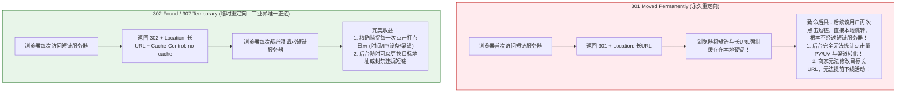
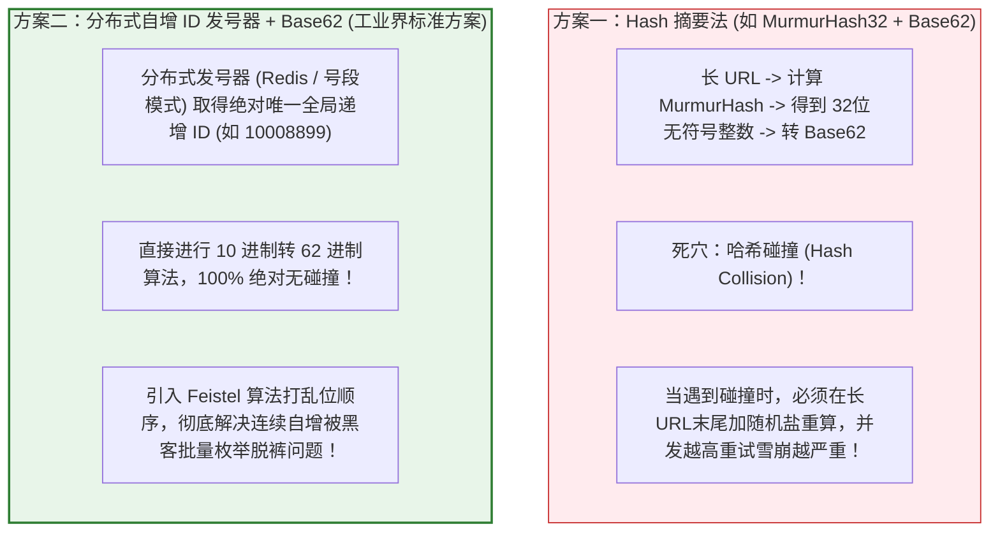

# 🔗 高并发高可用短链系统（TinyURL）架构设计

> [!abstract] 一句话总结
> 短链系统的核心本质是**“双向映射的高性能转换器（发号器自增 ID + 进制转换 Base62 + 混淆打乱）与极低延迟的 HTTP 302 重定向管道”**，通过布隆过滤器防穿透与多级缓存，支撑十亿级容量与十万级 QPS 跳转。

---

## 🗣️ 白话版（先建立直觉）

先看生活中的一个典型场景：
商家给你发了一条营销短信：“【淘宝】恭喜您获得618百元神券，点击领取：`https://item.taobao.com/item.htm?spm=a21bo.jianhua.201867-main.2.5af911d9f8mK9D&id=688888888888&scm=1007.40986.275655.0&pvid=84b56832-4742-4dc4-b78f-62e92c2049e7`”。
- **短信成本崩溃**：这条 URL 长达 150 个字符。国内短信规定 70 字算一条，光发这一条链接就要扣商家 3 条短信的钱！
- **用户体验极差**：手机屏幕上全是乱糟糟的密密麻麻的火星文代码，不仅难看，做成线下二维码还会因为图案过于密集而极其难以扫码识别。

短链是怎么拯救世界的？
短链服务把这串 150 字符的长链接，缩短成只有 6 个字符的短链接：
`https://t.cn/x7yZ8Q`
- 短信字数锐减，成本节省 60% 以上；
- 制作成二维码只有稀疏的几个大格子，手机哪怕在昏暗逆光下也能一瞬间扫出；
- **更致命的商业价值**：所有用户的点击都会经过短链服务器，系统能精准统计谁点了、几点点的、用的什么手机、哪个省份的，还能随时在后台把失效链接一键关停！

---

## 📌 第一性原理：HTTP 重定向状态码深度抉择（301 vs 302）

短链的核心运行机理是依靠 HTTP 响应头的 `Location` 进行跳转。但是在状态码选择上，很多初级工程师都会踩大坑：



> [!IMPORTANT]
> **结论**：虽然 301 能省下短链服务器的带宽，但在数据驱动的互联网时代，**丢失埋点和控制权等于自断经脉**！大厂工业界 **100% 采用 302 临时重定向**！

---

## 🔢 核心算法演进：哈希摘要 vs 发号器 Base62

如何把一个长 URL 变成仅有 6~7 位的短码（如 `x7yZ8Q`）？

### 1. 为什么是 Base62 编码？
- 字符集采用 **0-9, a-z, A-Z**，共 $10 + 26 + 26 = 62$ 个字符。
- 为什么不用 Base64？因为 Base64 包含 `+` 和 `/`，这两个符号在 URL 规范中属于特殊保留字符，传输必须做 URL Encode（转成 `%2B`），破坏了短链的简洁性。
- **6 位短码的理论空间容量**：
  $$62^6 = 56,800,235,584 \approx 568\text{ 亿个！}$$
  即使每天生成 1000 万条短链，568 亿个短码也足够连续使用 **15 年**！

### 2. 两大短码生成流派硬核对比



---

## 💻 工业级代码实战：自增 ID 混淆打乱与 Base62 算法

如果直接把递增 ID 转 Base62，ID 100、101 对应的短码会极其规律，黑客写个脚本一晚上就能扫光全站私密链接。
我们使用 **Feistel 可逆混淆置换算法**，让连续的整数映射出完全雪崩打乱的离散数字，再转 Base62：

```java
package com.example.shorturl.util;

public class ShortCodeUtils {

    // 62 进制字典表（可打乱顺序增强混淆）
    private static final String ALPHABET = "0123456789abcdefghijklmnopqrstuvwxyzABCDEFGHIJKLMNOPQRSTUVWXYZ";
    private static final int BASE = ALPHABET.length();

    /**
     * 1. 基础 Base62 编码：将长整型转换为短字符串
     */
    public static String encodeBase62(long num) {
        if (num <= 0) return "0";
        StringBuilder sb = new StringBuilder();
        while (num > 0) {
            sb.append(ALPHABET.charAt((int) (num % BASE)));
            num /= BASE;
        }
        return sb.reverse().toString();
    }

    /**
     * 2. Feistel 伪随机置换算法（防黑客连续枚举）
     * 保证在 62^6 (约 568 亿) 空间内，输入唯一的 ID，100% 映射出唯一的乱序数字，且绝对无碰撞！
     */
    public static long obfuscate(long val) {
        long l = (val >> 16) & 0xFFFF;
        long r = val & 0xFFFF;
        for (int i = 0; i < 4; i++) {
            long newL = r;
            // 轮函数 F: 简单的异或乘加
            long f = ((r * 31337 + 101) ^ 0x5A5A) & 0xFFFF;
            long newR = l ^ f;
            l = newL;
            r = newR;
        }
        return (l << 16) | r;
    }

    /**
     * 最终生成安全的 6 位短码
     */
    public static String generateShortCode(long incrementalId) {
        long scrambled = obfuscate(incrementalId);
        // 保证生成的短码固定通过高位补足 6 位
        String code = encodeBase62(scrambled);
        return String.format("%6s", code).replace(' ', '0');
    }
}
```

---

## 🗺️ 十万级 QPS 极速跳转全链路架构大图

短链系统是典型的**“极度读多写少”**架构（读写比高达 $100:1$ 甚至 $1000:1$）：

```mermaid
flowchart TD
    User["终端用户点击短链 (t.cn/x7yZ8Q)"] --> DNS["智能 DNS 解析与 CDN 边缘节点"]
    DNS --> Nginx["Nginx / LVS 高性能接入层"]
    
    subgraph ReadPath["高并发跳转关键路径 (读链路)"]
        Nginx --> Filter{"布隆过滤器 (BloomFilter)<br/>短码是否可能存在?"}
        Filter -->|绝对不存在| Return404["直接返回 404 (拦截无效扫描穿透)"]
        Filter -->|可能存在| RedisCache{"Redis 分布式缓存集群<br/>查短码映射缓存"}
        RedisCache -->|Cache Hit (99%命中)| Found302["立即返回 302 重定向 + Location: 长URL<br/>(耗时 < 5ms)"]
        RedisCache -->|Cache Miss (冷门或刚创建)| DB["查询 MySQL 分库分表集群"]
        DB --> WriteBack["异步回写 Redis (设置合理 TTL)"]
        WriteBack --> Found302
    end

    subgraph AsyncPath["异步统计埋点路径 (完全脱离主调用链)"]
        Found302 -.异步发送点击事件.-> MQ["Kafka / RocketMQ 削峰排队"]
        MQ --> Consumer["日志清洗消费服务"]
        Consumer --> ClickHouse[("ClickHouse 分析型数仓 (统计 PV/UV/地域/设备)")]
    end

    style ReadPath fill:#e8f5e9,stroke:#2e7d32,stroke-width:1px
    style AsyncPath fill:#ede7f6,stroke:#512da8,stroke-width:1px
    style Return404 fill:#ffebee,stroke:#c62828,stroke-width:1px
```

---

## ⚙️ 核心存储表结构与分库分表设计

```sql
CREATE TABLE `short_url_mapping` (
    `id` BIGINT UNSIGNED NOT NULL AUTO_INCREMENT COMMENT '全局自增发号器ID',
    `short_code` VARCHAR(16) NOT NULL COMMENT '6-7位短码 (建唯一索引)',
    `long_url` VARCHAR(2048) NOT NULL COMMENT '原始目标长URL',
    `url_hash` BIGINT NOT NULL COMMENT '长URL的CRC32/Murmur哈希值 (用于加速逆向查询)',
    `account_id` BIGINT NOT NULL COMMENT '创建者租户/用户ID',
    `status` TINYINT NOT NULL DEFAULT 1 COMMENT '状态：1有效，0禁用，2已过期',
    `expire_time` DATETIME DEFAULT NULL COMMENT '过期时间 (NULL表示永久)',
    `created_at` DATETIME NOT NULL DEFAULT CURRENT_TIMESTAMP,
    PRIMARY KEY (`id`),
    UNIQUE KEY `uk_short_code` (`short_code`),
    KEY `idx_url_hash` (`url_hash`)
) ENGINE=InnoDB DEFAULT CHARSET=utf8mb4 COMMENT='短链长链映射表';
```

> [!TIP]
> **分片策略（Sharding Rule）**：
> 由于跳转时系统只拿到了 `short_code`，**分库分表键必须能由 short_code 直接决定**！
> 最佳实践：通过 `MurmurHash(short_code) % 分片数` 进行路由分片；或者短码的前 1~2 位直接作为分片基因，精准路由到指定库表。

---

## ⚠️ 生产避坑指南与致命陷阱

### 1. 致命缺陷：同一长 URL 重复生成导致短码浪费
- **场景**：同一个商家误操作连点 10 次“生成短链”，如果每次都分配一个新短码，568 亿的容量很快会被刷光。
- **对策**：在表中增加 `url_hash` 列。生成前先根据 `url_hash` 查库，若已存在未过期的相同长链接，直接复用旧短码返回；为防 Hash 冲突，代码中比对 `long_url` 字符串完全相等后再复用。

### 2. 致命漏洞：黑客扫描短码引发缓存穿透击穿 DB
- **攻击**：黑客写脚本随机生成 1000 万个不存在的 6 位短码（如 `t.cn/aaaaaa`, `t.cn/aaaaab`）疯狂并发刷接口。
- **防御**：
  1. **布隆过滤器（Bloom Filter）**：在 Redis 前挡一层布隆过滤器，不存的短码 100% 直接拦截，绝不惊动缓存和 DB；
  2. **空值短缓存（Negative Caching）**：若穿透到 DB 发现不存在，在 Redis 存入 `short_code -> EMPTY` 并设置 60 秒极短过期时间。

### 3. 安全合规：重定向背后的钓鱼与 SSRF 风险
- 短链平台极其容易被黑客利用充当“钓鱼网站防毒软件绕过跳转工具”或“内网 SSRF 探测跳板”。
- **铁律**：创建短链时必须建立**域名白名单与违规黑名单机制**；严禁重定向至内网私有 IP（如 `127.0.0.1`, `192.168.x.x`, `10.x.x.x`）！

---

## 🎯 大厂高频面试 30 秒绝杀

> [!question] 面试高频问题 3 连击
> 
> **Q1：短链重定向返回 HTTP 301 还是 302？为什么大厂生产中几乎一律选择 302？**
> - **答（满分绝杀）**：
>   大厂一律选择 **302 Found（临时重定向）**。
>   虽然 301（永久重定向）可以让浏览器直接读取本地硬盘缓存、节省短链服务器的跳转带宽；但它的致命缺陷在于后续访问**完全绕过了短链服务器**，导致服务端根本无法统计点击事件、无法记录用户地理位置与设备 User-Agent 等核心商业转化数据，且一旦商家需要修改目标链接或提前下线，客户端本地缓存根本无法主动失效。选择 302 配合 `Cache-Control: no-cache` 能够确保每一次点击都能穿透至服务端完成严密统计与安全管控。
>
> **Q2：为什么短码生成推荐“发号器自增 ID + Base62”，而不是直接对长 URL 做哈希截取？**
> - **答（满分绝杀）**：
>   直接哈希（如 MD5/MurmurHash 截取 6 位）面临无法规避的**哈希碰撞（Hash Collision）**问题。随着数据量增大，碰撞概率急剧上升，发生碰撞时必须循环加盐重新哈希或回滚重试，导致写性能发生断崖式下跌。而“发号器自增 ID”是绝对单调递增唯一的，将其转为 Base62 能够保证**数学上的零碰撞率**。为了防止自增 ID 被黑客连续枚举破解，只需在转换为 Base62 前通过 Feistel 算法对整型数值做可逆的双向置换混淆，即可同时兼顾绝对唯一性与外在伪随机安全性。
>
> **Q3：短链系统面临数万级 QPS 的高并发跳转，如何从架构层面保障 5ms 内的极低延迟？**
> - **答（满分绝杀）**：
>   实施“读写分离与动静剥离四重奏”：
>   1. **布隆过滤器前置**：在入口处挂载 Bloom Filter，直接拦截 99.9% 恶意扫描不存在的虚假短码；
>   2. **全内存高速缓存**：热点短码 100% 预热进 Redis 集群，99% 的重定向读请求在内存中 2ms 内完成；
>   3. **异步日志剥离**：跳转主链路上绝不执行任何耗时的数据库统计写入，重定向响应发出后，通过消息队列（Kafka）异步广播点击事件，由下游数仓（ClickHouse）离线消费计算 PV/UV，确保主流程无阻塞。

---

## 🪝 一分钟复盘记忆卡

```
┌────────────────────────────────────────────────────────┐
│               短链系统 TinyURL 极速通关卡               │
├────────────────────────────────────────────────────────┤
│  1. 状态码选型：必须 302 临时重定向，保全埋点与控制权 │
│  2. 短码算法：分布式发号器自增 ID + Feistel 混淆 + 62进制│
│  3. 空间容量：6 位 Base62 容纳 568 亿短码，用 15 年    │
│  4. 高并发读：布隆过滤器防穿透 + Redis 缓存支撑 99% 读 │
│  5. 统计解耦：主链只负责跳转，埋点推 Kafka 异步落数仓 │
└────────────────────────────────────────────────────────┘
```

---

## 🔗 关联笔记

- [[00-系统设计全景与心智模型]] - 系统设计容量估算与高并发哲学
- [[01-高并发架构设计]] - 缓存与异步削峰通用架构
- [[03-缓存架构设计]] - 深入布隆过滤器与缓存穿透治理
- [[04-秒杀系统设计]] - 极端写并发下的分布式 ID 与锁控制
- [[_index]] - 返回系统设计专题索引
