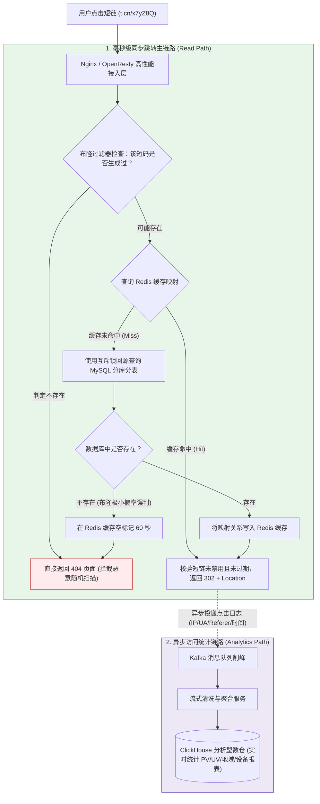

# 🔗 高并发短链系统（TinyURL）架构设计：发号编码与极速跳转

> **前置知识**：[[00-系统设计全景与心智模型]]、[[01-高并发架构设计]]、[[03-缓存架构设计]]

---

## 1. 核心难点：设计一个短链系统到底难在哪里？

在营销短信、社交媒体分享或生成二维码时，原始链接往往带着一长串追踪参数（例如 `https://mall.example.com/activity/2026?utm_source=sms&campaign_id=8899&user_tag=vip...`），不仅占满短信字数、导致二维码密集难以识别，而且一旦活动页地址变更，已经发出去的链接就无法修改。

短链系统（如 `https://t.cn/x7yZ8Q`）就是为了解决这一痛点而生。它的业务逻辑看似只是“保存长链和短码的对应关系”，但在日均千万级生成、百亿级存量映射、每秒十万次点击跳转的规模下，有三个核心工程难点：

1. **如何高效生成既短又绝不冲突的短码？**
   要把任意长网址压缩成 6~7 位的短字符串（如 `x7yZ8Q`），如果直接用哈希算法，遇到哈希碰撞怎么快速解决？如果用自增数字编码，怎么防止别人顺着 `000001`、`000002` 的规律把全站所有短链挨个猜出来？
2. **重定向状态码怎么选（301 还是 302），才能既快又不丢统计数据？**
   用户点击短链时，后台需要统计点击次数（PV/UV）、来源地域和设备分布，并且运营人员可能需要随时修改短链指向的目标地址或封禁违规链接。如果选错了 HTTP 状态码导致浏览器死死缓存旧地址，后台统计和实时管控就会完全失效。
3. **高并发点击下，如何在几毫秒内完成跳转并防住恶意扫描穿透？**
   短链是典型的“读远多于写”场景（读写比例通常在 100:1 以上）。当一条热门营销短信群发给几百万用户时，如何保证点击跳转延迟在几毫秒以内？如果黑客用脚本随机拼凑不存在的 6 位短码疯狂请求，怎么防止数据库被查挂？

下面我们顺着这三个难点一步步推导完整架构。

---

## 2. 第一步：跳转协议选型——为什么常用 302 而不是 301？

当用户在浏览器点击 `https://t.cn/x7yZ8Q` 时，短链服务器并不直接返回目标网页内容，而是返回一个 HTTP 重定向状态码，并在响应头中加入 `Location: 原始长网址`，让浏览器自动跳转过去。

在工程选型中，`301` 和 `302`（以及 HTTP/1.1 补充的 `307`/`308`）有着本质区别：


> [!IMPORTANT]
> **工程选型结论**：
> - 如果业务需要**实时统计点击数据**、或者需要支持**动态修改跳转目标与随时封禁违规链接**，应当选择 **`302 Found`**（若需严格保留原 POST 等请求方法可选 `307`），并显式配上 `Cache-Control: no-store` 响应头，防止浏览器或中间代理私自缓存跳转结果。
> - 只有当链接纯粹用于永久域名迁移、完全不需要服务端统计与动态管控时，才使用 `301`。

---

## 3. 第二步：短码生成算法——哈希摘要法 vs 分布式发号器 + Base62

### 3.1 为什么短码普遍采用 6 位 Base62 编码？
我们在设计短码字符集时，通常选用数字 `0-9`（10 个）、小写字母 `a-z`（26 个）和大写字母 `A-Z`（26 个），加起来正好是 **62 个字符（Base62）**。相比于包含 `+`、`/` 符号的标准 Base64，Base62 纯由字母和数字组成，放在 URL 路径里不会产生任何转义歧义。

那么短码定几位合适？我们算一下 **6 位 Base62** 的容量空间：
$$62^6 = 56,800,235,584 \approx 568 \text{ 亿}$$
568 亿是什么概念？就算系统每天新生成 1000 万条短链，一年也才消耗 36.5 亿个，6 位短码足够连续使用 **15 年以上**！

### 3.2 两种核心生成方案的对比与演进
要把一个长网址变成 6 位 Base62 字符串，行业里主要有两种流派：


1. **流派一（MurmurHash 哈希摘要法）**：
   - 做法：使用非加密高性能哈希算法（如 Google 的 MurmurHash）对长 URL 计算出一个整数，再转成 Base62。
   - 优缺点：不需要维护有状态的发号器，相同长 URL 天生算出相同结果；但因为哈希算法必然存在碰撞可能，写入数据库时必须靠 `UNIQUE KEY (short_code)` 唯一约束捕获冲突，一旦碰撞就要拼接随机后缀重试，随着存量数据越来越多，碰撞重试的概率也会上升。
2. **流派二（全局唯一发号器 + Feistel 置换 + Base62，推荐）**：
   - 做法：用分布式发号器（如基于数据库的号段模式 Leaf-segment 或多步长自增）分配全局唯一的递增整数 ID，再转为 62 进制。由于每个 ID 都是唯一的，且完整转成 Base62 是一一对应的单射，**天然 100% 不会发生碰撞**，写入数据库一次成功！
   - **解决自增 ID 可预测问题**：如果直接把连续递增的 ID `10001`、`10002` 转成 Base62，生成的短码只有最后一位在变，外部很容易写脚本把所有短链猜出来。因此我们在转 Base62 之前，先用 **Feistel 密码学置换结构** 把自增 ID 在固定比特位数内做一次可逆的打乱（比如 `10001` 变成 `284910293`，`10002` 变成 `9182734`），既保留了“一对一绝不冲突”的数学性质，又让生成的短码看起来毫无规律。

### 3.3 代码实战：Feistel 置换打乱 + Base62 编码

下面演示如何将一个 32 位范围内的自增 ID（可容纳约 42.9 亿个序号；若需完整覆盖 $62^6$ 空间，可将置换位宽扩展至 34~36 位）打乱并编码为 6 位短码：

```java
package com.example.shorturl.util;

public class ShortCodeGenerator {

    // 62 进制字符表（生产中可将该字母表顺序随机打乱作为系统配置保存，进一步降低可预测性）
    private static final String ALPHABET = "0123456789abcdefghijklmnopqrstuvwxyzABCDEFGHIJKLMNOPQRSTUVWXYZ";
    private static final int BASE = ALPHABET.length();

    /**
     * 1. 在 32 位整数空间 (0 ~ 2^32-1) 内进行 4 轮 Feistel 可逆置换
     * 核心性质：只要输入的自增 ID 不重复，输出的置换整数就绝对不重复，且外观高度离散
     */
    public static long permute32BitId(long id) {
        if (id < 0 || id > 0xFFFF_FFFFL) {
            throw new IllegalArgumentException("ID 超出 32 位无符号整数范围: " + id);
        }
        long left = (id >> 16) & 0xFFFF;
        long right = id & 0xFFFF;

        for (int round = 0; round < 4; round++) {
            long nextLeft = right;
            // 轮函数 F：在 16 位空间内进行混合运算并截断掩码
            long f = ((right * 31337 + 101 + round) ^ 0x5A5A) & 0xFFFF;
            long nextRight = left ^ f;
            left = nextLeft;
            right = nextRight;
        }
        return (left << 16) | right;
    }

    /**
     * 2. 将非负长整数完整转换为 Base62 字符串
     */
    public static String encodeBase62(long num) {
        if (num < 0) {
            throw new IllegalArgumentException("待编码数字必须为非负数");
        }
        if (num == 0) {
            return "0";
        }
        StringBuilder sb = new StringBuilder();
        while (num > 0) {
            sb.append(ALPHABET.charAt((int) (num % BASE)));
            num /= BASE;
        }
        return sb.reverse().toString();
    }

    /**
     * 3. 组合生成定长 6 位短码
     */
    public static String generateShortCode(long incrementalId) {
        long scrambledId = permute32BitId(incrementalId);
        String code = encodeBase62(scrambledId);
        // 不足 6 位时在高位补字符 '0'
        return String.format("%6s", code).replace(' ', '0');
    }
}
```

> [!NOTE]
> **注意区分“混淆”与“权限控制”**：
> Feistel 置换的作用是消除连续自增 ID 的规律性、防止被简单递增遍历；但如果某个链接指向的是用户私密文档或内部页面，仅靠短码随机是不够的，目标服务自身依然必须做登录态与权限校验。

---

## 4. 第三步：十万级 QPS 跳转与防穿透全链路架构

生成短链之后，真正的性能考验在**点击跳转（读链路）**。如何让用户点击短链后在几毫秒内拿到 `302` 响应，同时完成复杂的统计分析？核心策略是：**读路径纯走内存缓存，防穿透靠布隆过滤器，访问统计走消息队列彻底异步化。**



### 4.1 跳转链路的三道关键防线
1. **布隆过滤器 + 空值缓存防穿透**：
   每当新生成一条短链时，在写入数据库和 Redis 的同时，将该 `short_code` 加入分布式布隆过滤器。当黑客用脚本随机编造几百万个不存在的短码发起攻击时，99% 以上的非法请求在第一关就被布隆过滤器直接挡回 `404`；极少数发生哈希假阳性误判穿透到数据库的请求，查出为空后也会在 Redis 里写入 60 秒的 `EMPTY` 占位符，彻底保护 MySQL。
2. **热点短链缓存加速**：
   刚生成的短链会在创建时直接预热写入 Redis（设置如 7~30 天的 TTL）。对于全网群发的超级热点短链，还可以在接入层或应用进程内配合 `Caffeine` 本地缓存缓存几秒钟，避免单台 Redis 节点成为瓶颈。注意当后台运营封禁某条违规短链时，需同步删除 Redis 缓存并广播清理本地缓存。
3. **主次分离（异步统计埋点）**：
   如果每次点击跳转都要同步往数据库里 `UPDATE click_count = click_count + 1` 并插入一条访问明细，跳转延迟会慢上十倍不止。因此，跳转接口拿到目标 URL 后立刻向客户端返回 `302`，同时将包含客户端 IP、User-Agent、时间戳的点击事件异步发送到 Kafka（或直接通过 Nginx 访问日志由 Filebeat 采集入 Kafka），再批量写入 **ClickHouse** 列式数仓，轻松支撑海量多维报表查询。

---

## 5. 第四步：存储表结构与分库分表路由设计

当短链累计达到几十亿条时，底层 MySQL 需要进行分库分表。表结构设计上有一个极易踩坑的细节：**数据库的字符串排序规则（Collation）必须区分大小写！**

```sql
CREATE TABLE `short_url_mapping` (
    `id` BIGINT UNSIGNED NOT NULL COMMENT '全局唯一主键（由发号器分配）',
    `short_code` VARCHAR(16) CHARACTER SET ascii COLLATE ascii_bin NOT NULL COMMENT '短码（ascii_bin 严格区分大小写）',
    `long_url` VARCHAR(2048) NOT NULL COMMENT '目标原始长 URL',
    `url_hash` BIGINT NOT NULL COMMENT '长 URL 的 MurmurHash 值（用于按需加速相同长链查重）',
    `tenant_id` BIGINT NOT NULL COMMENT '创建方租户/商户 ID',
    `status` TINYINT NOT NULL DEFAULT 1 COMMENT '状态：1-正常可用，0-违规封禁',
    `expire_time` DATETIME DEFAULT NULL COMMENT '过期时间（NULL 表示长期有效）',
    `created_at` DATETIME NOT NULL DEFAULT CURRENT_TIMESTAMP,
    PRIMARY KEY (`id`),
    UNIQUE KEY `uk_short_code` (`short_code`),
    KEY `idx_tenant_url_hash` (`tenant_id`, `url_hash`)
) ENGINE=InnoDB DEFAULT CHARSET=utf8mb4 COMMENT='短链映射核心表';
```

### 5.1 为什么 `short_code` 必须用 `COLLATE ascii_bin`？
MySQL 默认的 `utf8mb4_general_ci` 或 `utf8mb4_0900_ai_ci` 排序规则是**大小写不敏感（Case-Insensitive，以 `_ci` 结尾）**的！
如果用了默认规则，在 MySQL 眼里短码 `x7yZ8Q` 和 `x7yz8q` 是完全相等的——不仅唯一索引会误报冲突，把 Base62 的可用空间直接缩水成 Base36，而且查询时还会匹配出错误的记录。使用 `CHARACTER SET ascii COLLATE ascii_bin` 按字节二进制精确比对，既节省存储空间，又严格区分大小写。

### 5.2 分库分表键（Sharding Key）怎么选？
- **绝大多数请求是按 `short_code` 查询跳转**（此时请求参数里只有 `short_code`，没有 `id` 也没有 `tenant_id`）。
- 因此，**分片键必须直接选用 `short_code`**（例如按 `MurmurHash(short_code) % 分片数` 路由），这样每次缓存未命中回源查询数据库时，都能 100% 精准定位到唯一的一张分表，绝不会触发全库广播查询。
- 如果业务上还需要支持“同一个商户在同一个营销活动下提交相同长 URL 时直接复用已有短码”，可以在生成前先按 `(tenant_id, long_url)` 计算签名并在 Redis 中做短周期幂等查重，或者将分片基因嵌入短码首字符中。

---

## 6. 安全合规：防范钓鱼跳转与链接滥用

公开或半公开的短链服务非常容易被黑灰产利用来隐藏钓鱼网站、木马下载链接，以此绕过短信网关或社交平台的安全扫描。在工程上必须加上两道安全校验：
1. **协议与域名白名单/黑名单校验**：
   生成短链时，严格校验目标 URL 必须以 `http://` 或 `https://` 开头（严禁 `javascript:`、`data:`、`file:` 等伪协议以防 XSS 攻击），并对接反诈与恶意域名黑名单库拦截钓鱼网址。
2. **后台预览抓取时的防 SSRF（服务端请求伪造）**：
   如果短链系统提供了“自动抓取目标网页标题与缩略图”的附加功能，服务端在发起 HTTP 请求抓取目标 URL 前，必须先解析其域名对应的 IP 地址，**严禁访问 `127.0.0.1`、`10.0.0.0/8`、`172.16.0.0/12`、`192.168.0.0/16` 以及云厂商元数据地址 `169.254.169.254` 等内网私有地址**，并且在跟随重定向时对每一跳的目标 IP 重新校验，防止攻击者利用短链预览功能探测企业内网。

---

## 7. 高频面试追问

> [!question]- Q1：为什么短链跳转普遍推荐用 302 而不是 301？如果用了 301 会有什么后果？
> 1. **浏览器缓存行为差异**：`301` 代表永久重定向，浏览器一旦收到 `301`，就会把“短链 -> 长链”的映射直接缓存在用户本地磁盘中。下次用户再点这个短链时，浏览器直接从本地读出长链跳过去，根本不会再向短链服务器发请求。
> 2. **业务后果**：第一，后台完全统计不到后续的点击次数、UV 和用户终端分布，营销效果分析彻底失真；第二，如果目标活动页地址变了，或者发现该长链变成了钓鱼网站需要紧急封禁，已经被浏览器缓存了 `301` 的用户依然会跳往旧地址。
> 3. **正确做法**：使用 `302` 临时重定向并配合 `Cache-Control: no-store` 响应头，确保每次点击都经过服务端校验与埋点，同时依靠服务端的 Redis 缓存把跳转耗时控制在几毫秒内。

> [!question]- Q2：发号器 + Base62 方案相比于直接用 MurmurHash 哈希长链，最大的优势是什么？
> 1. **彻底消除哈希碰撞**：哈希算法无论多优秀，把无限长的 URL 映射到有限的 6 位字符空间内都必然存在碰撞概率。一旦碰撞就需要查库校验并加盐重试，存量数据越大冲突率越高。而发号器分配的每个自增整数 ID 全局唯一，完整转为 62 进制是严格的一一映射（单射），从数学上保证了**零碰撞**，写库无需查重重试。
> 2. **兼顾不可预测性**：针对自增 ID 容易被按顺序遍历猜测的弱点，在发号器拿到递增 ID 后，先通过轻量级的 Feistel 有限域可逆置换算法将其打乱成离散数字，再转成 Base62，既保持了 100% 不冲突，又让生成的短码外观随机。

> [!question]- Q3：如果有一条短链被放进了春晚摇一摇或全网置顶微博，瞬间每秒几十万次点击，怎么保证跳转服务不崩？
> 1. **动静与边缘卸载**：在网关接入层（如 OpenResty / Nginx）利用 `lua_shared_dict` 共享内存或应用进程内 `Caffeine` 本地缓存直接缓存该极热点短码映射（设置 5~10 秒短 TTL），让请求在网关或应用内存里直接返回 `302`，无需每次都跨网络查 Redis。
> 2. **防穿透与防击穿兜底**：非热点请求走布隆过滤器 + Redis 集群；当某个 Key 过期回源 MySQL 时，通过分布式互斥锁确保只有一个线程查库，避免并发打穿数据库。
> 3. **点击统计彻底异步化**：主线程只管返回 `302` 响应，访问日志通过 Kafka 削峰后批量写入 ClickHouse，确保统计逻辑与核心跳转链路完全解耦。

---

## 8. 一分钟复盘记忆卡

```text
======================= 短链系统核心记忆口诀 =======================
短链跳转选 302，配上 no-store 统点击。
六位 62 进制五百亿，字段排序需二进制（ascii_bin）。
发号自增零碰撞，Feistel 置换防遍历；
布隆过滤拦伪造，Redis 缓存毫秒回；
分库分表按短码，点击埋点走异步。
======================================================================
```

---

## 🔗 关联笔记

- [[00-系统设计全景与心智模型]] - 系统设计容量估算与四步推导法
- [[01-高并发架构设计]] - 多级缓存与异步削峰通用架构
- [[03-缓存架构设计]] - 布隆过滤器与缓存穿透治理细节
- [[04-秒杀系统设计]] - 极端脉冲流量下的漏斗截流实战
- [[_index]] - 返回系统设计专题索引
