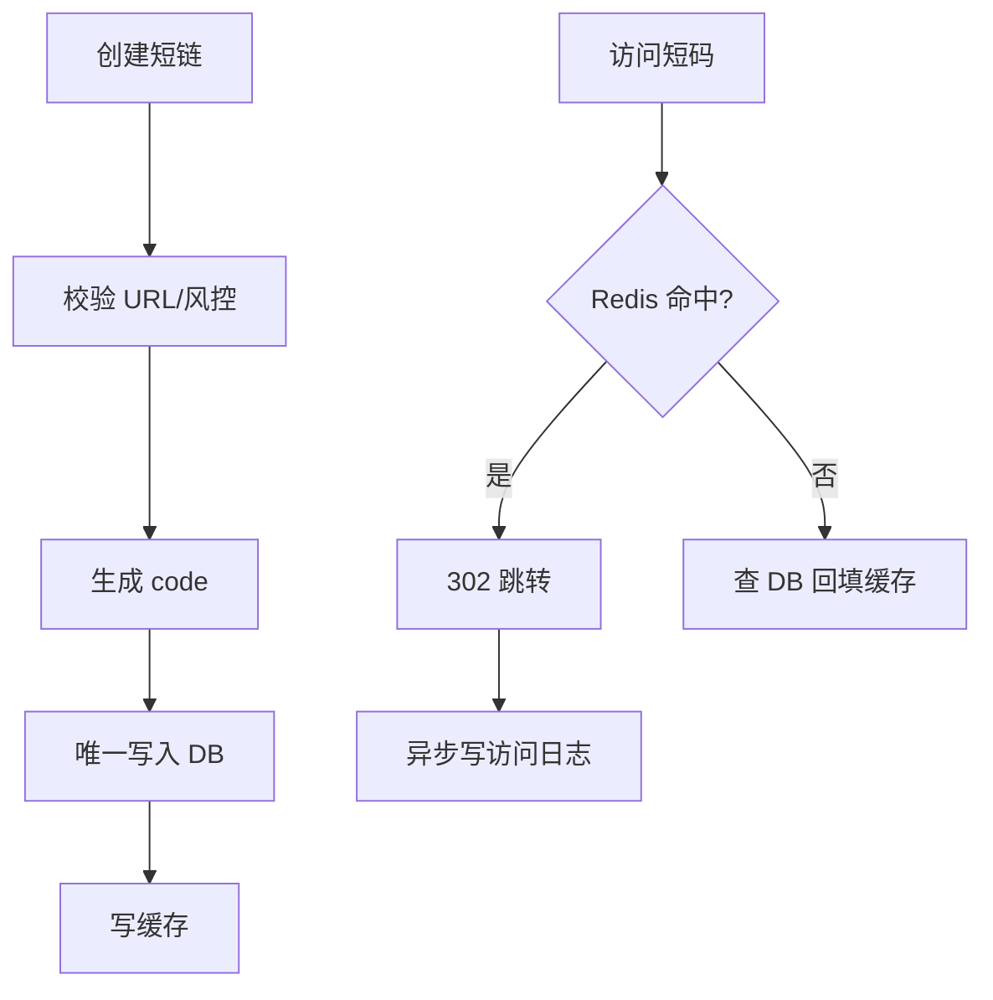

# 短链系统设计

> [!abstract] 一句话总结
> 短链系统把长 URL 映射为短码，核心是短码生成、唯一冲突、重定向延迟、缓存命中、风控和异步统计。

## 📌 精准定位

- 负责短码创建、解析跳转、过期管理和访问统计。
- 不负责绕过安全审计，必须防钓鱼、黑名单和滥用。
- 关键边界：跳转链路读多写少，P99 和可用性比创建链路更关键。

## 🧩 核心概念

| 概念 | 具体含义 | 精通要点 |
| ---- | -------- | -------- |
| 短码生成 | 自增 ID Base62、随机码、哈希。 | 要处理冲突和可枚举风险。 |
| 映射存储 | code -> long_url。 | 读路径适合缓存。 |
| 重定向 | 301 永久或 302 临时。 | 统计和可变目标通常用 302。 |
| 统计分析 | PV/UV/IP/UA/referrer。 | 异步采集避免拖慢跳转。 |

## ⚙️ 工作原理 / 主流程



1. 创建时标准化长 URL，避免同一 URL 多种形式重复。
2. 短码可用号段 ID + Base62，或随机码 + 唯一索引冲突重试。
3. 访问先查 Redis，miss 查 DB，不存在 code 做负缓存。
4. 跳转日志异步写 MQ，统计离线或流式计算。
5. 过期短链在缓存和 DB 都要判断。

## 💻 代码 / 配置 / 伪代码

```java
String encodeBase62(long id) {
  char[] a = "0123456789abcdefghijklmnopqrstuvwxyzABCDEFGHIJKLMNOPQRSTUVWXYZ".toCharArray();
  StringBuilder sb = new StringBuilder();
  do { sb.append(a[(int)(id % 62)]); id /= 62; } while (id > 0);
  return sb.reverse().toString();
}
```

## 🔍 源码入口 / 关键组件

- Base62 编码
- 号段/雪花/DB 自增发号器
- Redis cache-aside
- Nginx/Gateway 重定向
- 风控黑名单和安全扫描

## ⚠️ 生产坑与注意事项

- hash 截断无唯一校验。
- 短码递增可枚举泄露规模和内容。
- 访问统计同步写 DB 拖慢跳转。
- 301 被缓存导致后续改目标不生效。
- 不存在短码不缓存，被扫描打穿 DB。

## 🧭 排查路径

- 跳转慢看 Redis 命中、DB 查询、统计是否同步。
- 冲突多检查码长、算法、唯一索引重试。
- 恶意访问按 IP、UA、code 前缀限流。
- 统计不准区分爬虫、预览展开和重复刷新。

## 🎯 面试问题

> [!question] 高频问题
> - Q: 短码怎么生成？
>   - A: 号段 ID Base62，或随机码配唯一索引冲突重试。
> - Q: 301 和 302 怎么选？
>   - A: 可变目标和统计用 302，永久稳定 SEO 可用 301。
> - Q: 如何防枚举？
>   - A: 随机码、加盐打乱、限流、权限校验。
> - Q: 读路径怎么优化？
>   - A: Redis 缓存 code 映射，不存在也短 TTL 缓存，统计异步。
> - Q: 过期怎么处理？
>   - A: DB 存 expire_at，缓存 TTL 不超过过期时间，访问校验。

## ✅ 精通检查清单

- 能画出主流程，并标出最容易失败的节点。
- 能说出至少 3 个源码入口或关键组件。
- 能写出最小配置、SQL、伪代码或状态机。
- 能结合生产故障说明监控指标、排查命令和修复动作。
- 能和相邻方案做取舍对比，而不是只背定义。

## 🔗 关联笔记

- [[_index]]
- [[20-Java后端/00-总览/学习仪表盘]]

## 📚 参考资料

- HTTP Semantics: Redirection 301/302
- Base62 encoding patterns
