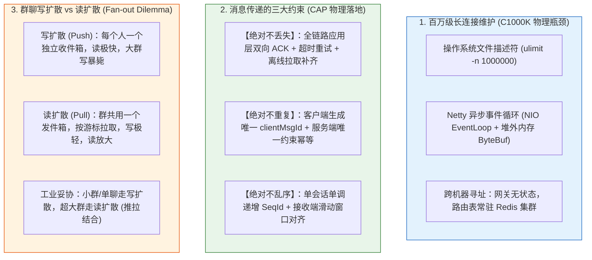
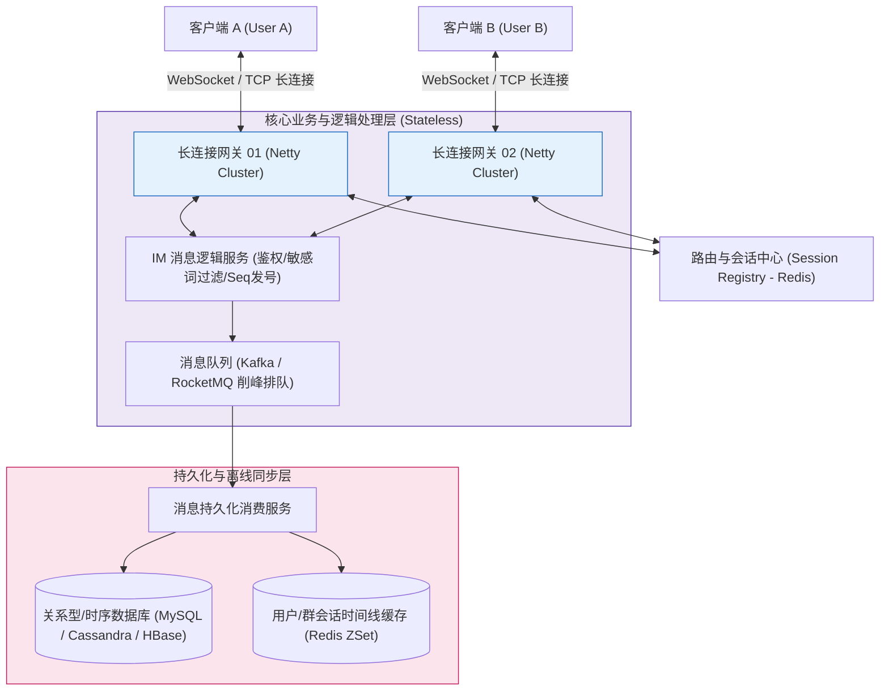
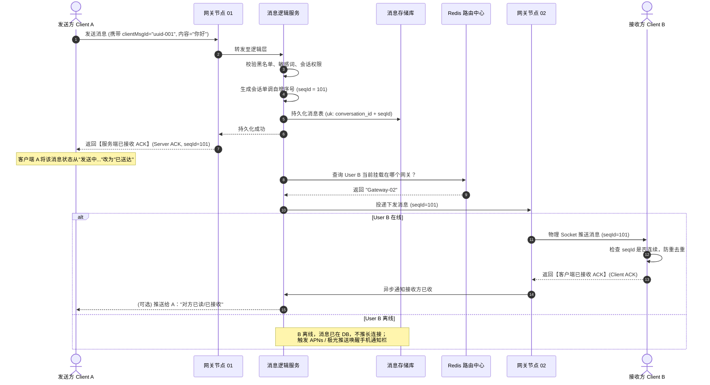
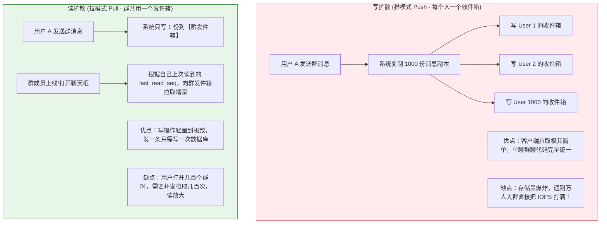

# 💬 百万长连接即时通讯（IM）系统架构设计

> [!abstract] 一句话总结
> 工业级即时通讯（IM）系统的第一性原理是**“通过 Netty 保持海量客户端的长连接通道，以分布式路由表（Session Registry）解决跨机寻址，以端到端应用层 ACK 与递增 Seq 保证消息不丢不乱，以推拉结合（写扩散 vs 读扩散）平衡群聊负载”**。

---

## 🗣️ 白话版（先建立直觉）

如果让你从零设计一个像**微信**一样的聊天系统：
- **当用户 A 和用户 B 聊天时**：
  A 连在“北京机房的服务器-01”上，B 连在“上海机房的服务器-08”上。
  A 发了一句“你好”，北京的服务器是怎么知道 B 在上海的服务器上的？怎么把这行字推到 B 的手机屏幕上的？如果 B 正好在地铁过隧道、手机断网了 30 秒，这句“你好”怎么保证既不丢失、又不会等 B 出来后收到 10 遍？
- **如果是在一个 5000 人的大群里聊天**：
  群主发了一句“今晚开会”。如果服务器傻乎乎地复制 5000 份消息，分别塞进 5000 个人的信箱里（写扩散），后台数据库瞬间就会被成千上万条重复数据直接挤爆！

即时通讯系统就像一个**极其精密、全球互联的超级邮政物流网**：
1. **邮局服务台（Netty 长连接网关）**：每个人的手机都用一根永远不挂断的专用电话线（WebSocket / TCP）连着离他最近的邮局网关；
2. **全国人口户籍台账（分布式路由中心 Redis）**：实时记录着“用户张三当前连在几号网关，李四连在几号网关”；
3. **收件签字回执（应用层 ACK 机制）**：你发出去的每一句话，必须收到对方手机签收签字的回执，没收到就自动重发；收到多份就凭身份证号（唯一 MsgId）丢弃重复包裹；
4. **大群自提柜（读扩散拉模式）**：大群消息只在黑板上写一次，群成员上线后自己抬头看黑板，按行号顺次抄写！

---

## 📌 第一性原理：IM 核心三大技术硬核矛盾



---

## 🗺️ 现代分布式 IM 系统全链路架构大图



---

## ⚙️ 消息“不丢、不重、不乱”的底层全闭环时序

很多人误以为“TCP 本身就能保证可靠传输，为什么 IM 还需要自己做 ACK？”
**致命盲区**：TCP 的 ACK 只能证明操作系统内核把数据包收到了，**无法证明接收端的 Java 代码成功反序列化了，更无法证明数据成功写入了数据库或展示在 UI 上**！手机突然没电关机，TCP 握手照样成功，但消息却丢了！

因此，IM 必须在**应用层（Application Layer）实现端到端闭环**：



---

## ⚖️ 群聊核心架构抉择：写扩散 vs 读扩散

当群成员有 1000 人时，群聊的设计方案直接决定了系统的生死：



### 工业界最佳折中：推拉结合方案
- **单聊**：100% 采用**写扩散**（双方各存一份，一人删除不影响另一人）；
- **普通小群（<500人）**：采用**写扩散**；
- **大型超级大群（>500人/直播间/千人大群）**：一律采用**读扩散**！
  - 消息只落一份群发件箱；
  - 在线用户通过长连接收到轻量的**“新消息到达通知（包含最大 seqId）”**；
  - 客户端收到通知后，异步发起 HTTP/Socket 请求批量拉取未读消息。

---

## 💻 工业级实战：Redis 路由表与跨网关转发核心代码

```java
package com.example.im.router;

import lombok.extern.slf4j.Slf4j;
import org.springframework.data.redis.core.StringRedisTemplate;
import org.springframework.stereotype.Service;

import java.time.Duration;

@Slf4j
@Service
public class SessionRegistryService {

    private final StringRedisTemplate redisTemplate;
    // 路由 Key 格式：im:route:user:{userId}:{deviceId} -> gateway_instance_id
    private static final String ROUTE_PREFIX = "im:route:user:";

    public SessionRegistryService(StringRedisTemplate redisTemplate) {
        this.redisTemplate = redisTemplate;
    }

    /**
     * 客户端建立长连接时，注册路由心跳
     */
    public void registerSession(String userId, String deviceId, String gatewayInstanceId) {
        String key = ROUTE_PREFIX + userId + ":" + deviceId;
        // 绑定所在网关，并设置 90 秒过期（需配合 30 秒心跳定期刷新续期）
        redisTemplate.opsForValue().set(key, gatewayInstanceId, Duration.ofSeconds(90));
        log.info("用户 [{}] 设备 [{}] 成功注册到长连接网关 [{}]", userId, deviceId, gatewayInstanceId);
    }

    /**
     * 寻址：查询接收方当前挂载在哪台网关
     */
    public String findGatewayForUser(String userId, String deviceId) {
        String key = ROUTE_PREFIX + userId + ":" + deviceId;
        return redisTemplate.opsForValue().get(key);
    }

    /**
     * 客户端断开连接，注销路由（必须校验避免旧连接并发注销误删新连接）
     */
    public void unregisterSession(String userId, String deviceId, String currentGatewayId) {
        String key = ROUTE_PREFIX + userId + ":" + deviceId;
        String boundGateway = redisTemplate.opsForValue().get(key);
        if (currentGatewayId.equals(boundGateway)) {
            redisTemplate.delete(key);
            log.info("用户 [{}] 正常下线，注销路由映射", userId);
        }
    }
}
```

---

## ⚠️ 生产避坑指南与致命陷阱

### 1. 致命缺陷：依赖操作系统 TCP KeepAlive 代替应用层心跳
- **灾难事故**：国内移动运营商的 NAT 路由器网关，会在手机空闲未发包 **1~2 分钟内静默释放掉 NAT 映射端口**！
- **后果**：TCP 的 KeepAlive 默认是 2 小时探测一次，此时在服务端的连接还是“ESTABLISHED”状态，但实际上网络管道早断了，发给用户的消息全部泥牛入海！
- **治理铁律**：**必须在应用层每隔 30~45 秒发送双向轻量 Ping/Pong 心跳包**，连续 3 次无回应立即主动关闭死连接释放文件描述符！

### 2. 致命漏洞：群聊重连引发“惊群效应（Thundering Herd）”
- **场景**：弱网电梯出来，群里积压了 500 条未读消息。全群 500 个人同时发起重连拉取请求。
- **后果**：数据库瞬间被打出千级复杂范围查询，直接被查垮。
- **正解**：
  1. 客户端重连必须加上 **随机抖动退避（Jitter Backoff）**（在 1~5 秒内随机延迟拉取）；
  2. 离线消息必须采用 **Redis ZSet 缓存近 3 天的会话时间线（Timeline）**，99% 的重连拉取只查 Redis，绝不打进底库！

---

## 🎯 大厂高频面试 30 秒绝杀

> [!question] 面试高频问题 3 连击
> 
> **Q1：IM 系统如何保证消息传输“绝对不丢失、绝对不重复、绝对不乱序”？**
> - **答（满分绝杀）**：
>   1. **不丢失（At-least-once）**：全链路采用**应用层双向 ACK 机制**。发送端发消息启动重试定时器，直到收到服务端的 Server-ACK 才算成功；服务端推给接收端时，必须等待接收端的 Client-ACK，超时则触发重推，且断网重连后根据本地最大 Seq 游标向服务端拉取未读补偿；
>   2. **不重复（Idempotency）**：客户端发送每条消息前生成全局唯一的 `clientMsgId`（UUID/雪花算法），服务端数据库建立 `uk_client_msg_id` 唯一索引或在 Redis 存入防重缓存，重复消息直接幂等返回成功；
>   3. **不乱序（Ordering）**：每个会话由发号器分配单调递增的 `seqId`。接收端维护滑动窗口：收到不连续的包（如收完 100 紧接着收到 102）时，先将 102 挂起在本地内存，等待或主动补拉 101 后，再按严格的 100-101-102 顺序渲染展示。
>
> **Q2：群聊消息的“写扩散”与“读扩散”有什么本质区别？微信和钉钉这类大厂是如何选型的？**
> - **答（满分绝杀）**：
>   - **写扩散（推模式）**：一个人在群里发一条消息，服务端为群里每个成员的专属收件箱各写入一份。优点是客户端读取逻辑极简、极轻；缺点是遇到万人大群会产生几何级的写入爆炸（写放大）；
>   - **读扩散（拉模式）**：群消息只在群专属发件箱写入一次，每个成员维护自己的阅读进度位点（`last_read_seq`），打开群时主动拉取增量。优点是写操作开销固定且极小；缺点是跨几百个群时并发读取压力大；
>   - **大厂综合实践（推拉结合）**：单聊与百人以内普通群采用写扩散，保障极致交互体验；千人以上超大群与直播间一律采用读扩散，且离线用户不推消息体仅推轻量未读计数通知，用户上线后再拉取。
>
> **Q3：一台 Linux 服务器如何支撑 100 万并发长连接（C1000K 架构）？核心优化点有哪些？**
> - **答（满分绝杀）**：
>   三大核心层面的极限调优：
>   1. **操作系统内核与句柄**：调大系统级与进程级文件描述符上限（`fs.file-max` 和 `ulimit -n 1000000`），调优 TCP 接收/发送缓冲区（将 `rmem/wmem` 最小缓冲区调低至 4KB，防止 100 万连接纯静态内存撑爆）；
>   2. **网络 I/O 模型**：全面基于 **Netty 的 Epoll 边缘触发模型（EpollEventLoopGroup）**，杜绝线程轮询开销；
>   3. **JVM 堆外内存治理**：消息载荷采用 Netty 内存池化分配（PooledByteBufAllocator），禁止为每个连接分配独立的常驻大内存，数据收发全程采用零拷贝，单台 64GB 内存服务器即可轻松承载百万稳定在线连接。

---

## 🪝 一分钟复盘记忆卡

```
┌────────────────────────────────────────────────────────┐
│               即时通讯 IM 极速通关卡                    │
├────────────────────────────────────────────────────────┤
│  1. 寻址核心：长连接网关无状态，路由表常驻 Redis 映射 │
│  2. 可靠三要素：应用层 ACK(防丢) + 唯一Id(防重) + Seq(防乱)│
│  3. 群聊法则：小群单聊写扩散(推)，万人大群读扩散(拉)   │
│  4. 心跳铁律：绝不信 TCP KeepAlive，30s 必须发应用层心跳│
│  5. 架构底线：重连引入随机抖动，离线拉取 Redis ZSet 挡刀│
└────────────────────────────────────────────────────────┘
```

---

## 🔗 关联笔记

- [[00-系统设计全景与心智模型]] - 系统设计容量估算与全景大图
- [[01-高并发架构设计]] - 削峰填谷与异步消息队列
- [[07-订单系统设计]] - 状态流转与分布式事务
- [[_index]] - 返回系统设计专题索引
