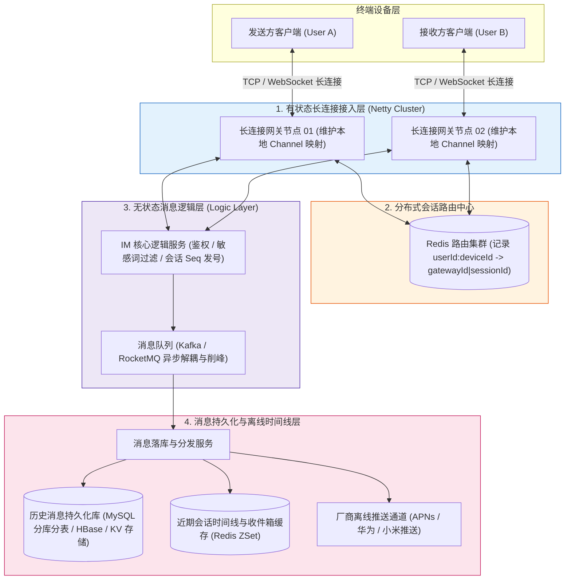
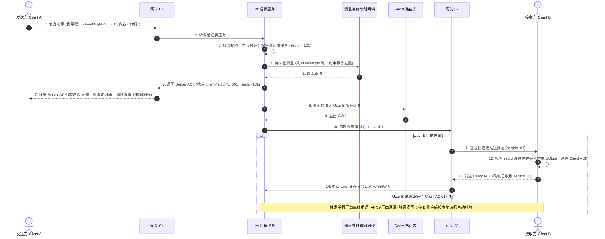
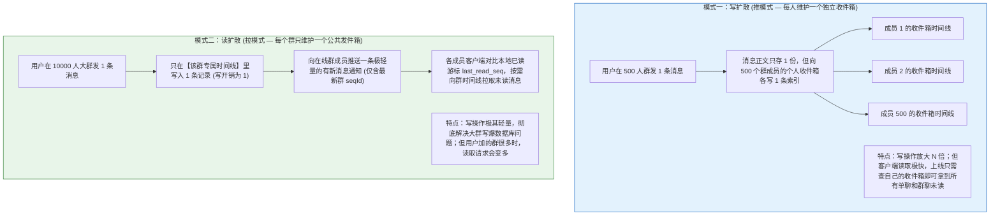

# 💬 百万长连接即时通讯（IM）系统设计：长连接路由、可靠投递与读写扩散

> **前置知识**：[[00-系统设计全景与心智模型]]、[[01-高并发架构设计]]、[[../01-Java核心/11-IO与NIO|IO与NIO模型]]、[[../06-中间件/01-消息队列基础与核心问题处理|消息可靠性与顺序保证]]

---

## 1. 核心难点：设计一个微信/钉钉级别的 IM 系统难在哪里？

日常开发中我们写的最多的是短连接 HTTP 接口：客户端发一个请求，服务端查完数据库返回响应，交互就结束了。但在即时通讯（IM，如微信、飞书、直播间弹幕）场景中，服务端必须随时主动把消息推送到用户手机上，这就带来了三个完全不同的核心工程难点：

1. **百万级长连接怎么维护与跨机器寻址？**
   一台服务器能维护的长连接数量是有上限的。当有几百万用户同时在线、分散连接在几十台网关机器上时，用户 A 给用户 B 发了一条消息，系统怎么在几毫秒内知道用户 B 当前连在哪台网关机器上，并把消息精准投递过去？如果用户进了电梯网络断了但连接还没彻底关闭（假死连接），怎么及时发现？
2. **弱网环境下，怎么保证消息“不丢、不重、不乱序”？**
   移动网络随时会抖动、断线重连。为什么底层用了可靠的 TCP 协议，应用层还是会丢消息？如果客户端超时重发导致服务端收到两条一模一样的消息怎么去重？如果两条消息因为网络多线程并发到达顺序反了，怎么保证聊天框里的消息顺序绝对不错乱？
3. **几千人的大群聊天，怎么避免“写放大”把数据库瞬间打挂？**
   在 2 人单聊里，发一条消息写一次收件箱很轻松；但如果在一个 5000 人的大群里，某人发了一条消息，难道要在瞬间往 5000 个人的收件箱里各写一条记录吗？如果有 100 个人同时在群里说话，瞬间产生 $100 \times 5000 = 50\text{ 万}$ 次数据库写入，任何存储都会直接崩溃。

下面我们围绕这三个核心难点，一步步推导分布式 IM 系统的架构演进。

---

## 2. 总体架构：连接状态与业务逻辑彻底分离

为了让系统能够水平支撑数百万乃至上千万用户同时在线，IM 架构的第一步是将**有状态的长连接接入层（Gateway）**与**无状态的业务处理层（Logic Service）**彻底拆开：



为什么这样分层？
- **长连接网关层（Netty）**：只负责维护客户端的 TCP/WebSocket Socket 连接、TLS 加解密、心跳保活和二进制协议编解码，**绝对不写复杂的业务 SQL**。这样网关非常轻量，单机经过内核参数调优即可稳定保持数十万条长连接，而且业务代码天天发版重启时，网关层完全不用重启，用户的长连接也就不会频繁断开。
- **Redis 路由中心**：当用户 B 连上“网关节点 02”时，网关 02 会在本机内存保存 `userId -> Netty Channel` 的映射，同时在 Redis 中写入一条全局路由：`im:route:userB:ios -> GW2|session_998`。当用户 A 在“网关 01”发消息给 B 时，逻辑服务一查 Redis 就知道 B 在“网关 02”，直接通过内网 RPC 把消息推给网关 02 下发即可。

---

## 3. 难点一突破：连接管理、跨网关路由与心跳保活

### 3.1 为什么不能靠操作系统的 TCP KeepAlive 检测断线？
很多初学者会问：“TCP 协议本身不是自带 KeepAlive 保活探测吗？为什么还要在应用层自己写心跳包？”
1. **默认周期太长**：Linux 操作系统的 TCP KeepAlive 默认要在连接空闲 **2 小时（7200 秒）** 后才发第一次探测包。而在移动蜂窝网络下，运营商的 NAT 网关为了节省端口资源，往往在连接空闲几分钟没有任何数据包经过时，就直接把映射表项静默删掉了。此时服务端操作系统还以为连接是 `ESTABLISHED` 正常状态，往里面写消息根本发不出去。
2. **无法检测应用进程假死**：TCP KeepAlive 由操作系统内核自动回复。如果客户端 App 发生了主线程死锁或内存溢出卡死，只要手机没关机，内核照样回复 TCP KeepAlive，但用户界面根本收不到消息。

因此，IM 系统必须在应用层实现**双向心跳机制**：客户端每隔约 **30 秒**（结合网络环境动态调整）向网关发送一个极小（仅几个字节）的 `PING` 帧，网关回复 `PONG` 并刷新 Redis 路由过期时间；如果连续 3 个周期（如 90 秒）未收到心跳，网关主动关闭残留 Channel 并清理路由。

### 3.2 代码实战：带并发保护的 Redis 会话路由表
在网络抖动时，经常出现“客户端断线后立即重连到了新网关 GW2，随后旧网关 GW1 才检测到超时触发断开回调”。如果 GW1 断开时不加判断直接 `DEL` 删除 Redis 里的路由，就会把刚连上 GW2 的新路由给误删掉！

正确做法是：**每次连接生成唯一的 `sessionId`，注销或续期时使用 Lua 脚本对比 `gatewayId|sessionId` 完全一致才允许操作**：

```java
package com.example.im.router;

import lombok.RequiredArgsConstructor;
import lombok.extern.slf4j.Slf4j;
import org.springframework.data.redis.core.StringRedisTemplate;
import org.springframework.data.redis.core.script.DefaultRedisScript;
import org.springframework.stereotype.Service;

import java.time.Duration;
import java.util.Collections;

@Slf4j
@Service
@RequiredArgsConstructor
public class SessionRegistryService {

    private final StringRedisTemplate redisTemplate;
    private static final String ROUTE_PREFIX = "im:route:user:";

    // 仅当 Redis 中记录的路由值与当前欲注销的连接完全一致时，才原子执行删除
    private static final DefaultRedisScript<Long> SAFE_UNREGISTER_SCRIPT = new DefaultRedisScript<>(
            "if redis.call('GET', KEYS[1]) == ARGV[1] then " +
            "    return redis.call('DEL', KEYS[1]) " +
            "else " +
            "    return 0 " +
            "end", Long.class);

    /**
     * 1. 客户端登录长连接网关时，注册路由（支持同一用户多端同时在线：按 deviceId 区分）
     */
    public void registerSession(String userId, String deviceId, String gatewayId, String sessionId) {
        String key = ROUTE_PREFIX + userId + ":" + deviceId;
        String routeValue = gatewayId + "|" + sessionId;
        // 设置 90 秒过期，客户端每 30 秒发送应用层心跳时续期
        redisTemplate.opsForValue().set(key, routeValue, Duration.ofSeconds(90));
        log.info("用户 [{}] 设备 [{}] 已挂载至网关 [{}], 会话 [{}]", userId, deviceId, gatewayId, sessionId);
    }

    /**
     * 2. 寻址：查询目标用户当前挂载在哪台网关实例上
     */
    public String findGatewayForUser(String userId, String deviceId) {
        String key = ROUTE_PREFIX + userId + ":" + deviceId;
        String value = redisTemplate.opsForValue().get(key);
        if (value == null) {
            return null;
        }
        int sepIndex = value.indexOf('|');
        return sepIndex > 0 ? value.substring(0, sepIndex) : value;
    }

    /**
     * 3. 连接断开时安全注销路由（防止旧连接延迟关闭误删新连接路由）
     */
    public void unregisterSession(String userId, String deviceId, String gatewayId, String sessionId) {
        String key = ROUTE_PREFIX + userId + ":" + deviceId;
        String expectedValue = gatewayId + "|" + sessionId;
        redisTemplate.execute(SAFE_UNREGISTER_SCRIPT, Collections.singletonList(key), expectedValue);
    }
}
```

---

## 4. 难点二突破：如何保证消息“不丢、不重、不乱序”？

### 4.1 为什么 TCP 已经可靠了，还需要应用层 ACK？
TCP 的 ACK 确认包是由操作系统内核协议栈自动回复的。当服务端通过 Socket 把消息发给客户端时，即使客户端收到了 TCP ACK，也只能说明数据包到达了手机操作系统的网卡缓冲区——如果下一毫秒 App 崩溃闪退，或者网关在把消息转交给后台逻辑服务落库前宕机了，消息照样会丢失。

因此，IM 必须构建一套**应用层端到端可靠传输协议**，将“不丢、不重、不乱”拆解为三个紧密咬合的机制：



### 4.2 三大保障机制详解
1. **怎么保证“绝对不丢”（应用层双向 ACK + 离线拉取兜底）**：
   - **上半程（A $\to$ 服务端）**：客户端 A 点击发送后启动一个定时器（如 3 秒）。服务端只有把消息可靠写入存储（或可靠写入消息队列）后，才向 A 返回 `Server ACK`。如果 A 超时没收到 `Server ACK`，会自动携带原来的 `clientMsgId` 重发。
   - **下半程（服务端 $\to$ B）**：服务端把消息推给 B 后，等待 B 返回应用层 `Client ACK`。如果 B 正好进电梯断网没回 ACK，服务端无需无限重试阻塞内存，因为消息已经安全躺在数据库和时间线里了——当 B 走出电梯重连上线时，会拿着自己本地保存的最新序号（比如 `last_seq = 100`）向服务端发起一次增量拉取（`pull_after_seq = 100`），把漏掉的 `101` 补齐。
2. **怎么保证“绝对不重”（`clientMsgId` 幂等去重）**：
   - 当网络发生抖动时，服务端其实已经收到了消息并落了库，但回给 A 的 `Server ACK` 在半路丢了。此时 A 超时重发，服务端就会收到两次一模一样的消息。
   - 解法：客户端在生成消息的那一刻，必须在本地生成一个全局唯一的 **`clientMsgId`**（如 UUID 或结合用户 ID 的单调序列）。服务端在持久化时，以 `(sender_id, clientMsgId)` 作为唯一幂等键：发现该 `clientMsgId` 已经处理过时，不再重复插入，而是直接查出上次生成的 `seqId` 再次返回 `Server ACK`。同时接收端 B 也会根据 `msgId` 或 `seqId` 在本地 SQLite 中去重。
3. **怎么保证“绝对不乱序”（会话级单调递增 `seqId`）**：
   - 为什么不能用客户端的本地时间或者服务器机器时间来给消息排序？因为不同手机、不同服务器的时钟必然存在几毫秒到几秒的偏差（时钟回拨或漂移），按时间戳排序会导致“回复的话排在了提问前面”。
   - 解法：为每一个聊天会话（无论是单聊还是群聊）维护一个独立的**单调递增序列号发号器（`seqId`）**。该会话里的每一条新消息依次拿到 `seqId = 101, 102, 103...`。接收端 B 严格按照 `seqId` 升序排列渲染；如果 B 收到了 `100` 之后直接收到了 `102`，立刻就能发现中间漏了 `101`（出现空洞），先暂存 `102` 并主动向服务端补拉 `101`，对齐后再一起展示。

---

## 5. 难点三突破：群聊架构选型——写扩散 vs 读扩散

在单聊中，一条消息只有发送方和接收方两个人；但在群聊中，一个群可能有 200 人、2000 人甚至直播间里的 10 万人。消息怎么存、怎么分发，主要有两种模型：**写扩散（推模式）**与**读扩散（拉模式）**。



### 5.1 工程落地：推拉结合（写扩散与读扩散协同）
在真实工业级 IM 系统中，不会一刀切只用一种模式，而是根据群规模采用**推拉结合**：
1. **单聊与普通小群（如 500 人以内）——采用写扩散**：
   - 消息内容表（`im_msg_body`）只存 1 份消息正文，节省磁盘；
   - 为群内每个成员的收件箱时间线（`im_user_timeline`）各插入一条很窄的索引记录（只存 `user_id, msg_id, seq_id`）。
   - 这样当用户打开 App 时，只需要按游标查询自己的 `im_user_timeline` 一张表，就能一次性拉回所有单聊和小群的离线未读消息，同步体验极快。
2. **超大群（如几千人企业大群、万人直播间弹幕）——采用读扩散**：
   - 如果 1 万人的群还用写扩散，发一条消息要写 1 万行索引，写放大完全不可接受。
   - 此时切换为**读扩散**：消息只往该群自己的时间线表（`im_group_timeline`）里写 **1 行**！
   - 服务端只给当前在线的群成员推送一条几十字节的轻量级信令（告诉客户端：“群 `G88` 最新消息序号已经到 `520` 了”）。
   - 客户端收到信令或用户点开该群时，对比自己本地记录的已读位置（比如 `515`），主动发起请求拉取 `516 ~ 520` 这 5 条增量消息。为了防止大群断网恢复瞬间几千人同时拉取打穿数据库（惊群效应），近期群消息会缓存在 Redis `ZSet` 中，且客户端重连拉取会加上 `1~3 秒` 的随机延迟抖动。

---

## 6. 高频面试追问

> [!question]- Q1：群聊里常有“已读回执”功能（显示“32人未读，18人已读，点击可看谁已读”），这在后端是怎么设计的？
> 1. **区分“已送达”与“已读”**：客户端收到消息只回 `Client ACK`（代表送达手机）；只有当用户真正点进该群聊天框、消息在屏幕上曝光时，客户端才会向服务端发送一条**阅读回执上报请求**（携带 `groupId`、`msgId` 或当前读到的最大 `readSeqId`）。
> 2. **计数与列表存储**：
>    - 对于几百人的办公群（如钉钉/飞书），可以在 Redis 中为每条需要回执的消息维护一个已读集合（如 `Set` 或按群成员内部序号映射的 `Bitmap`），用户已读时执行 `SADD` 并异步批量落库；未读名单只需用“群成员全集”减去“已读集合”即可算出。
>    - 如果只需要展示“某人读到了哪条消息”，则只需维护每个成员在该群的 `last_read_seq` 游标，凡是 `last_read_seq >= 当前消息 seqId` 的成员即为已读，大幅减少写放大。

> [!question]- Q2：一台 Linux 网关服务器要想稳定支撑几十万甚至上百万并发长连接（C1000K 问题），需要做哪些核心调优？
> 1. **突破操作系统文件描述符限制**：在 Linux 中每条 Socket 连接都要占用一个文件句柄（File Descriptor）。默认的 `ulimit -n 1024` 连两千个人都撑不住。需要修改 `/etc/security/limits.conf` 与内核参数 `fs.file-max`、`fs.nr_open`，将单进程打开文件数上限调大到 `1,000,000` 以上。
> 2. **控制单连接内核 TCP 缓冲区内存占用**：百万连接最大的瓶颈往往是**内存**。如果每条连接的内核读写缓冲区（`tcp_rmem` / `tcp_wmem`）占用 32KB，100 万条连接光在内核态就要吃掉 32GB 内存！因此需要调小缓冲区初始与最小阈值（如 4KB），并在应用层使用 Netty 的池化堆外内存（`PooledDirectByteBuf`）按需分配、用完即还。
> 3. **非阻塞事件驱动与背压保护**：采用 Netty 基于 Linux `epoll` 的 Reactor 线程模型，严禁在 I/O EventLoop 线程内执行任何阻塞操作；同时设置高低水位线（`WRITE_BUFFER_WATER_MARK`），当某个慢客户端网络拥塞导致发送缓冲区积压超标时，暂停向其写入或断开重连，防止单个慢连接把网关堆外内存撑爆（OOM）。

> [!question]- Q3：如果用户同时在手机和电脑（多端登录）上聊微信，怎么保证手机上发的消息，自己的电脑上也能实时同步看到？
> 1. **多设备独立路由注册**：在前面我们设计的 Redis 路由表中，Key 的结构是 `im:route:{userId}:{deviceId}`（或使用一个 Hash 结构 `HSET im:route:{userId} {deviceId} {gatewayId|sessionId}`）。当用户 A 同时登录了 iPhone 和 Mac 时，路由表里会同时记录这两个在线设备。
> 2. **发送方多端同步（Self-Sync）**：当用户 A 在 iPhone 上给用户 B 发了一条消息，逻辑服务完成持久化并生成会话 `seqId` 后，除了寻址投递给接收方用户 B 的所有在线设备外，还会查询发送方用户 A 自己名下除了当前发送设备（iPhone）之外的其他在线设备（Mac），将该消息同样推送一份给 Mac 端。这样用户在手机上发的话、以及已读状态变更，在电脑端都能毫秒级同步展现。

---

## 7. 一分钟复盘记忆卡

```text
======================= 即时通讯 IM 核心记忆口诀 =======================
网关有状连 Netty，逻辑无状好扩容。
路由映射存 Redis，Lua 校验防误删；
TCP 保活太迟钝，三十秒级应用心。
不丢靠双向 ACK，离线重连按游标；
不重全凭客户端 ID，不乱依靠会话 Seq。
单聊小群写扩散，万人大群读扩散！
======================================================================
```

---

## 🔗 关联笔记

- [[00-系统设计全景与心智模型]] - 系统设计容量估算与分层架构
- [[01-高并发架构设计]] - 异步削峰与无状态水平扩展
- [[07-订单系统设计]] - 状态机与幂等设计对比
- [[_index]] - 返回系统设计专题索引
