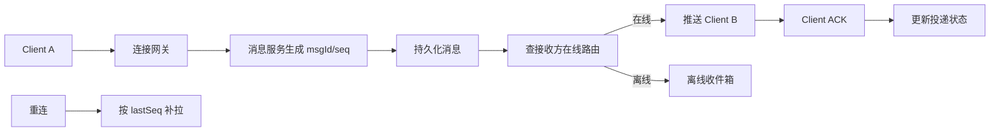

# 即时通讯系统设计

> [!abstract] 一句话总结
> 即时通讯系统核心是长连接接入、用户在线状态、消息投递、离线存储、ACK、重连补拉和多端同步。

## 📌 精准定位

- 负责低延迟消息收发、连接管理、可靠投递和会话状态。
- 不负责保证所有消息绝对实时，弱网下靠 ACK 和补拉收敛。
- 关键边界：在线推送和消息存储要解耦，连接层不能承担复杂业务事务。

## 🧩 核心概念

| 概念 | 具体含义 | 精通要点 |
| ---- | -------- | -------- |
| 长连接网关 | WebSocket/TCP 连接和心跳。 | 无状态接入配连接路由表。 |
| 消息 ID/Seq | 会话内递增序号。 | 支持去重、排序、补拉。 |
| ACK | 客户端确认收到或已读。 | 服务端据此重试或更新状态。 |
| 离线消息 | 用户不在线时持久化。 | 上线按 seq 补拉。 |

## ⚙️ 工作原理 / 主流程



1. 客户端登录后建立长连接，网关维护 userId、deviceId、connectionId。
2. 消息服务按会话生成单调 seq，先持久化再投递。
3. 在线用户通过路由表找到所在网关。
4. 客户端 ACK 后更新投递状态，未 ACK 靠重试或补拉。
5. 重连携带 lastSeq，服务端返回缺失消息。

## 💻 代码 / 配置 / 伪代码

```text
单聊消息表：
conversation_id, seq, msg_id, sender_id, receiver_id, body, status, created_at
唯一约束：(conversation_id, seq)、(msg_id)
客户端 ACK：ack(conversation_id, device_id, last_received_seq)
```

## 🔍 源码入口 / 关键组件

- WebSocket/Netty
- Redis/ZooKeeper 在线路由
- 消息存储 MySQL 分表/Cassandra/Kafka
- Push gateway / MQ
- 在线连接数、心跳超时、投递延迟、补拉量

## ⚠️ 生产坑与注意事项

- 只靠在线推送不落库，网关重启丢消息。
- 全局递增 seq 造成写热点。
- 已送达、已读、已同步 ACK 语义混乱。
- 弱网重连没有补拉导致断层。
- 万人群逐成员同步写被放大。

## 🧭 排查路径

- 消息丢失按 msgId 查持久化、路由、推送、ACK、补拉。
- 乱序检查会话 seq 和客户端排序。
- 连接暴涨看心跳、重连风暴、网关容量。
- 群聊慢看扩散时机、收件箱和热点群分片。

## 🎯 面试问题

> [!question] 高频问题
> - Q: 如何不丢消息？
>   - A: 先持久化再投递，客户端 ACK，失败重试，重连按 seq 补拉。
> - Q: 在线状态怎么维护？
>   - A: 长连接心跳更新路由表，断开或超时清理。
> - Q: 顺序怎么保证？
>   - A: 会话内递增 seq，客户端排序和补缺。
> - Q: 群聊扩散怎么选？
>   - A: 小群写扩散，大群读扩散或混合。
> - Q: 多端同步怎么做？
>   - A: 每个设备维护同步位点，按 conversation seq 补拉。

## ✅ 精通检查清单

- 能画出主流程，并标出最容易失败的节点。
- 能说出至少 3 个源码入口或关键组件。
- 能写出最小配置、SQL、伪代码或状态机。
- 能结合生产故障说明监控指标、排查命令和修复动作。
- 能和相邻方案做取舍对比，而不是只背定义。

## 🔗 关联笔记

- [[_index]]
- [[20-Java后端/00-总览/学习仪表盘]]

## 📚 参考资料

- WebSocket RFC 6455
- Designing Data-Intensive Applications: Messaging
