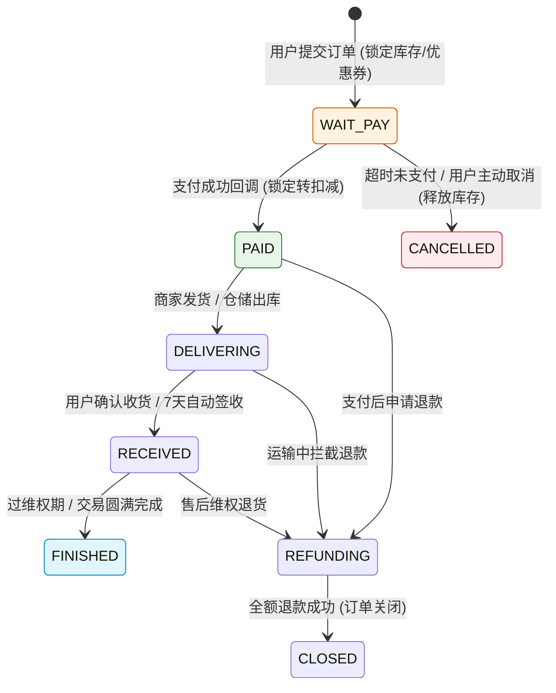
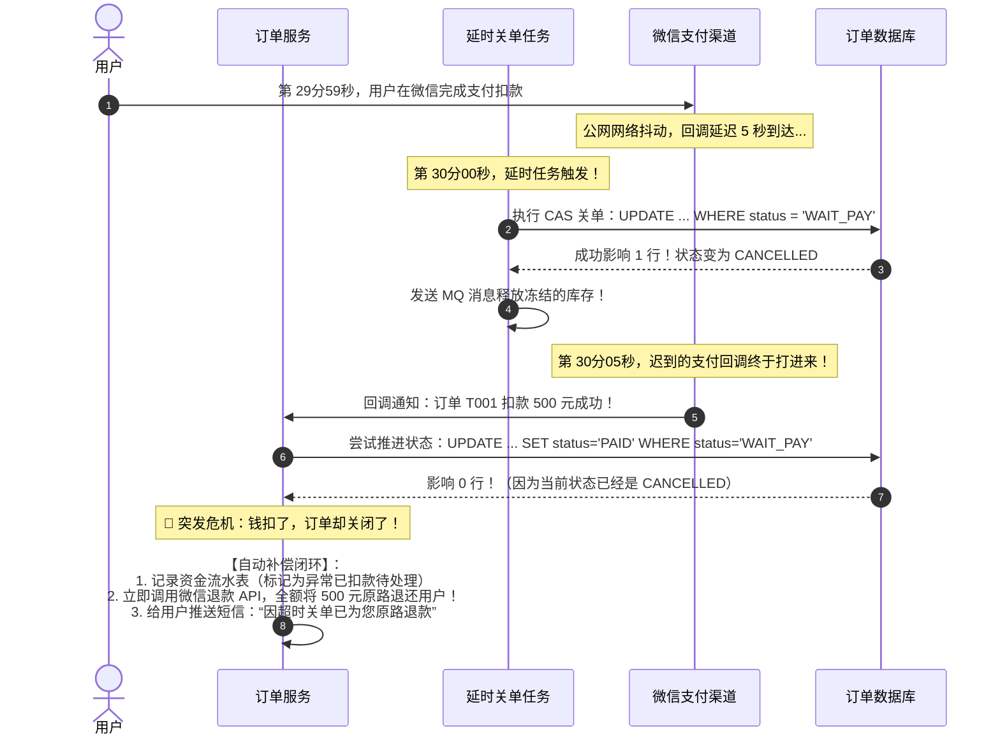
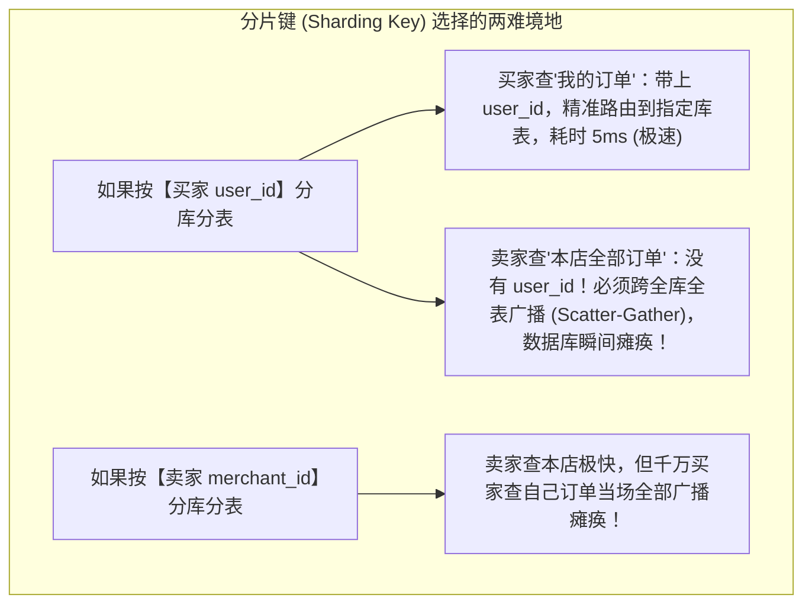

# 📦 亿级高并发订单系统架构设计：状态机、分库分表与对账闭环

> [!abstract] 一句话总结
> 订单系统的核心第一性原理是**“构建具有不可逆防重特性的确定性有限状态机（FSM），通过‘分片基因法 + 异构索引’化解买家/卖家双维度查询矛盾，以‘CAS 条件更新 + 支付逆向对账’治理关单与回调并发冲突”**。

---

## 🗣️ 白话版（先建立直觉）

如果把网上买东西比作**“签一份严肃的跨国商业合同”**：
- 很多初学者以为“下单”就是往 MySQL 的 `order` 表里 `INSERT` 一条数据；
- 实际上，一笔看似简单的订单背后牵扯着巨大的**利益与时序死锁**：
  1. **资产扣减**：要扣减真实的物理库存、核销用户的百元代金券、扣减用户的账户积分；
  2. **支付拉扯**：用户在微信里输密码付了 500 元。突然，微信的支付回调在公网上延迟了 5 秒；此时后台的“30分钟超时自动取消订单”定时任务刚好准时执行，把订单改成“已关闭”，并把库存重新还给了库房！
  3. **可怕的事故爆发**：5 秒后，微信发来通知：“钱已经扣成功了！”用户看着银行卡扣款短信，再打开 App 一看：“订单已取消，商品已售罄”。用户直接投诉到消费者协会！
- **更头疼的查询分裂**：
  - 买家张三打开手机，要以 10 毫秒的速度看到“我的所有历史订单”（按买家查）；
  - 卖家李四打开商家电脑，也要以 10 毫秒的速度看到“今天本店所有买家买走的东西”（按卖家查）。
  数据库如果按买家切分，卖家一查就要把全公司 100 台数据库挨个扫一遍，系统当场崩掉！

**订单系统，就是为了在这些混乱的跨网络延时、多方利益纠葛、并发竞争中，确保“钱不差一分、货不少一件、账目永远平整”的商业契约运转中枢！**

---

## 📌 第一性原理：订单状态机的不可逆与幂等跃迁

订单本质是一个**严格受控的有限状态机（Finite State Machine，FSM）**：



### 状态机流转的三大物理铁律
1. **单向不可逆性**：`PAID`（已支付）绝对不能逆流回 `WAIT_PAY`；`FINISHED`（已完成）绝对不能再次触发取消；
2. **状态更新 CAS 幂等化**：严禁无条件 `UPDATE orders SET status = 'PAID'`！必须携带前置状态条件：
   ```sql
   UPDATE orders SET status = 'PAID', paid_at = NOW() 
   WHERE order_no = 'T20260811001' AND status = 'WAIT_PAY';
   ```
   如果受影响行数为 0，说明该订单已经被别的线程抢先处理，当前操作直接幂等拦截！
3. **订单、支付单、退款单三单分离**：订单记录**交易意图**，支付单记录**资金流入动作**，退款单记录**资金流出动作**。一笔订单可以多次发起支付，也可以支持部分多次退款，三者绝不能混为一张表！

---

## ⚡ 核心致命死局：超时自动关单 vs 支付回调晚到

这是大厂面试最爱深挖的**终极并发冲突场景**：



> [!IMPORTANT]
> **破局关键**：必须接受“外部支付系统的扣款”是不受本地数据库事务控制的客观事实。
> 当发现订单已被取消但钱已扣成功时，**系统绝对不能假装看不见，必须进入自动化对账退款逆向闭环**，或生成客服工单，确保资损为零！

---

## 🗺️ 分库分表破局：买家维度 vs 卖家维度的双向矛盾

当订单量突破数千万甚至数亿时，单台 MySQL 必然面临物理极限，必须分库分表。
但此时会遭遇系统设计的**最大经典困境**：



### 工业界三大破局战法
1. **战法一：基因法（Gene Sharding - 最推荐！）**
   - 规则：在生成订单号 `order_no` 时，**将 `user_id` 的后 4 位（二进制或十进制分片基因）嵌入到 `order_no` 的末尾**！
   - 例如：买家 ID 为 `12345678`（后 4 位 `5678`，路由到第 6 库），生成的订单号为 `202608110001` + `5678` = `2026081100015678`；
   - **效果**：无论根据 `user_id` 查，还是根据 `order_no` 查，都能通过提取末尾 4 位**瞬间精准路由到同一个单库单表，彻底消除跨库广播**！
2. **战法二：CQRS 异构索引宽表（解耦卖家端与复杂分析）**
   - 核心交易库（OLTP）一律严格按 `user_id` 分库分表，保障买家高并发下单、付款的绝对极速写入；
   - 通过 **Canal / Flink CDC** 监听 MySQL Binlog，将订单变更准实时（毫秒级）同步至 **Elasticsearch** 或分布式数仓；
   - 卖家后台、运营管理端的所有多条件复杂查询（按时间段、按商品类目、按商家 ID 筛选），**100% 走 Elasticsearch 异构索引表**，绝不触碰核心交易库的一根毫毛！

---

## 💻 工业级实战：防止重复提交与幂等支付核心服务

```java
package com.example.order.service;

import lombok.extern.slf4j.Slf4j;
import org.springframework.data.redis.core.StringRedisTemplate;
import org.springframework.jdbc.core.JdbcTemplate;
import org.springframework.stereotype.Service;
import org.springframework.transaction.annotation.Transactional;

import java.time.Duration;

@Slf4j
@Service
public class OrderPaymentCallbackService {

    private final JdbcTemplate jdbcTemplate;
    private final StringRedisTemplate redisTemplate;
    private final PaymentRefundClient refundClient;

    public OrderPaymentCallbackService(JdbcTemplate jdbcTemplate, StringRedisTemplate redisTemplate, PaymentRefundClient refundClient) {
        this.jdbcTemplate = jdbcTemplate;
        this.redisTemplate = redisTemplate;
        this.refundClient = refundClient;
    }

    /**
     * 处理支付渠道异步通知（保证严格幂等与并发安全）
     */
    @Transactional(rollbackFor = Exception.class)
    public boolean handlePaymentCallback(String orderNo, String channelPaymentNo, double paidAmount) {
        // 1. 防重复处理：基于 Redis 的防重幂等锁
        String idempotentKey = "pay:callback:" + channelPaymentNo;
        Boolean lockSuccess = redisTemplate.opsForValue().setIfAbsent(idempotentKey, "1", Duration.ofHours(2));
        if (Boolean.FALSE.equals(lockSuccess)) {
            log.info("该支付通知流水 [{}] 正在处理或已处理完成，直接幂等返回成功", channelPaymentNo);
            return true;
        }

        // 2. CAS 乐观推进订单状态：仅在 WAIT_PAY 状态下才更新为 PAID
        String updateOrderSql = """
            UPDATE orders 
            SET status = 'PAID', paid_amount = ?, channel_trade_no = ?, paid_at = NOW() 
            WHERE order_no = ? AND status = 'WAIT_PAY'
            """;
        int affectedRows = jdbcTemplate.update(updateOrderSql, paidAmount, channelPaymentNo, orderNo);

        if (affectedRows == 1) {
            log.info("订单 [{}] 成功由 WAIT_PAY 推进至 PAID 状态！发送履约出库事件", orderNo);
            // 发送消息通知仓储服务开始出库发货...
            return true;
        }

        // 3. 若影响行数为 0：说明订单可能已被取消（超时关单），或已被重复支付
        log.warn("订单 [{}] 状态推进失败 (影响 0 行)，开始进入逆向核对...", orderNo);
        String queryStatusSql = "SELECT status FROM orders WHERE order_no = ?";
        String currentStatus = jdbcTemplate.queryForObject(queryStatusSql, String.class, orderNo);

        if ("CANCELLED".equals(currentStatus)) {
            log.error("🚨 警告：订单 [{}] 已经超时关闭，但渠道扣款成功！触发自动原路退款", orderNo);
            // 记录异常扣款流水，并调用第三方支付接口退款
            refundClient.autoRefund(orderNo, channelPaymentNo, paidAmount, "超时关单自动逆向退还");
            return true;
        }

        return true;
    }
}
```

---

## ⚠️ 生产避坑指南与致命陷阱

### 1. 致命漏洞：浮点数精度丢失引发“一分钱差错”
- **反例**：金额使用 `double` 或 `float` 计算。$19.9 \times 3$ 在浮点数运算中会变成 `59.699999999999996`。
- **后果**：与第三方支付网关对账时，因为差了一分钱导致对账单天天报警。
- **铁律**：**涉及金钱的地方，Java 代码中必须 100% 使用 `BigDecimal`（且严禁使用 `new BigDecimal(double)`，必须用 `BigDecimal.valueOf()` 或 `new BigDecimal(String)`），数据库中一律存储为 `DECIMAL(12, 2)` 或以“分”为单位的 `BIGINT`！**

### 2. 致命设计：延时关单直接用轮询扫表
- **反例**：写一个定时任务每 5 秒 `SELECT * FROM orders WHERE status='WAIT_PAY' AND created_at < NOW() - 30分钟`。
- **后果**：订单量一旦过千万，每次扫表直接导致全表索引扫描慢查询，CPU 瞬间被打满 100%。
- **正解**：**采用事件驱动的延时队列**！下单成功后，向 **RocketMQ 投递延时等级消息**（或使用 Redis Redisson RDelayedQueue / Kafka 延时时间轮），30 分钟到期精准唤醒，定向处理单条订单！

---

## 🎯 大厂高频面试 30 秒绝杀

> [!question]- Q1：在订单系统中，超时未支付自动关单与晚到的支付回调并发冲突，你们是如何从架构层面彻底解决的？
> 实施“CAS 状态条件更新 + 逆向自动退款闭环”：
> 1. **CAS 乐观锁推进**：关单任务与支付回调更新状态时，SQL 必须显式携带 `WHERE status = 'WAIT_PAY'` 前置条件。依靠单行排他锁，两者必然有且仅有一个能执行成功；
> 2. **晚到回调逆向补偿**：若关单任务抢先执行将订单变更为 `CANCELLED` 并释放了库存，迟到的支付回调 CAS 更新必然影响 0 行。此时后端立刻反查订单当前状态，一旦确认为 `CANCELLED`，代码自动判定为“超时扣款事故”，在写入异常审计台账的同时，立即异步调用支付网关的原路退款 API（Refund）将款项退还给用户，彻底消除资损与客诉。

> [!question]- Q2：电商订单分库分表后，买家端与卖家端存在查询维度冲突，你们是如何设计的？
> 采用**“分片基因法 + CQRS 异构索引”组合拳**：
> - **买家端（核心交易高并发写）**：在生成 16 位以上订单号时，提取买家 `user_id` 的后 4 位作为分片基因嵌入订单号末尾。无论通过买家 ID 还是订单号查询，都能瞬间精准哈希路由至指定单库单表，消灭跨库广播；
> - **卖家端（多维度复杂读）**：核心 OLTP 库不承载卖家端的统计与多条件筛选。通过 Canal 监听 MySQL Binlog 准实时解析并将订单数据同步至 Elasticsearch。商家后台的复杂查询一律由 ES 承接，实现交易写链路与运营读链路的物理隔离。

> [!question]- Q3：如何防止用户在网络卡顿下连续点击“提交订单”导致重复下单？
> 实施“防重令牌（Token）+ 数据库唯一约束双保险”：
> 1. **前置 Token 校验**：进入商品结算页时，服务端向前端颁发一个全局唯一的 `order_token` 并存入 Redis。用户提交下单时必须携带该 Token，服务端在 Lua 脚本中执行 `GET` 校验并在原子操作中 `DEL` 删除。手抖连发的后续请求因 Token 已被消耗当场被拦截；
> 2. **底层唯一索引兜底**：订单表中为 `(user_id, order_token)` 或客户端生成的唯一防重请求号建立 `UNIQUE KEY` 唯一索引。即使高并发击穿了缓存层，底层数据库的唯一键冲突也会抛出 DuplicateKey 异常并安全回滚事务，杜绝重复落单。

---

## 🪝 一分钟复盘记忆卡

```
┌────────────────────────────────────────────────────────┐
│               订单系统架构设计 极速通关卡               │
├────────────────────────────────────────────────────────┤
│  1. 状态机法则：单向不可逆，更新必须带 CAS 前置状态   │
│  2. 并发冲突解：关单赢了但钱扣了，触发自动退款逆向闭环 │
│  3. 分片防广播：买家端嵌入基因法，卖家端走 ES 异构索引 │
│  4. 关单避坑：严禁定时扫全表，采用 RocketMQ 延时消息  │
│  5. 财务铁律：金额必须 BigDecimal，三单分离（单/付/退）│
└────────────────────────────────────────────────────────┘
```

---

## 🔗 关联笔记

- [[00-系统设计全景与心智模型]] - 系统设计整体心智与容量估算
- [[01-高并发架构设计]] - 高并发三板斧与异步削峰
- [[04-秒杀系统设计]] - 秒杀场景下的极端库存扣减实战
- [[_index]] - 返回系统设计专题索引
