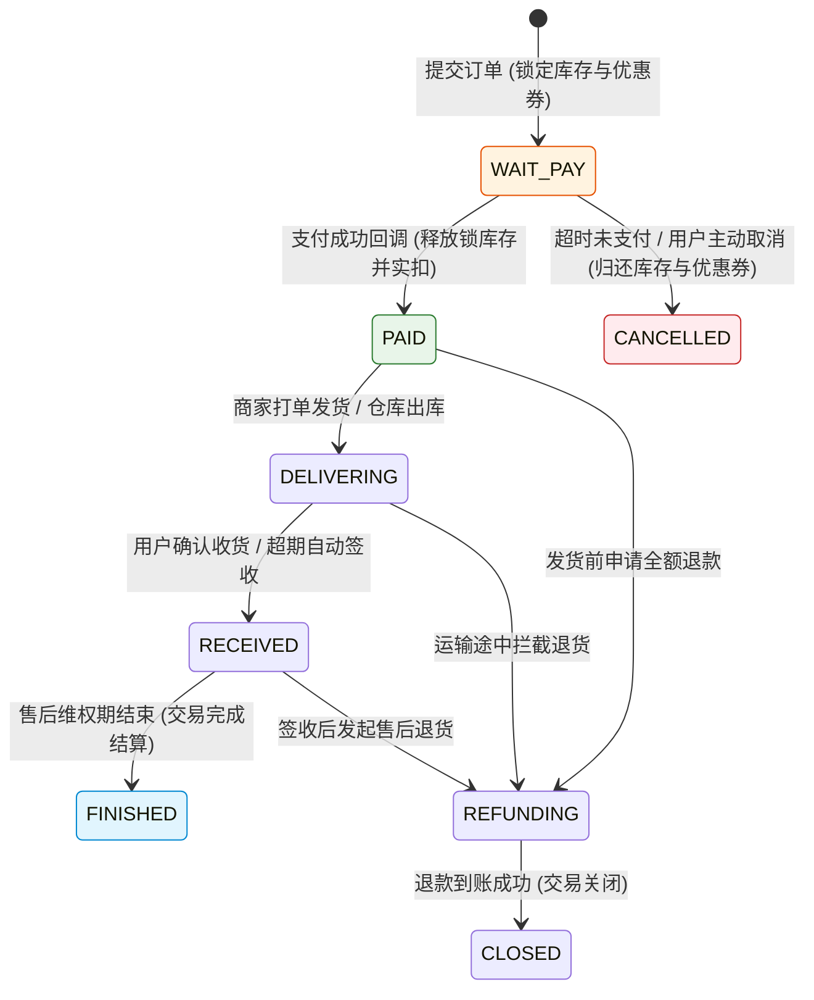
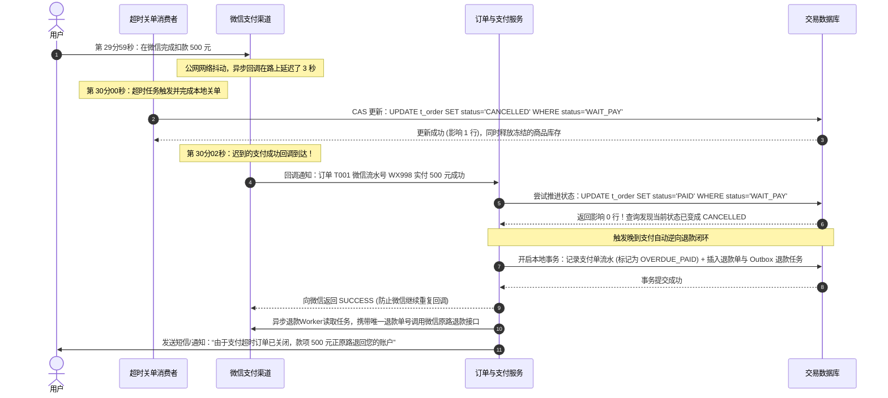
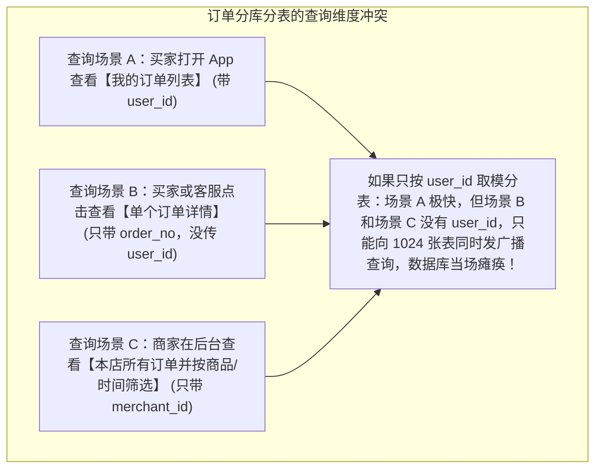

# 📦 亿级订单系统架构设计：状态机防重、关单并发与分库分表

> **前置知识**：[[00-系统设计全景与心智模型]]、[[01-高并发架构设计]]、[[04-秒杀系统设计]]、[[../05-数据库与存储/08-分库分表与读写分离|分库分表与读写分离]]

---

## 1. 核心难点：为什么订单系统被称为交易业务的“心脏”？

在电商、外卖或票务平台中，订单系统连接着上游的购物车、库存、优惠券，以及下游的微信/支付宝渠道、商家发货系统与财务对账。把订单表建出来很容易，但在高并发、大数据量下把订单系统做稳，必须解决以下三个核心工程难点：

1. **状态流转复杂，并发或重试下极易出现“状态错乱”**：
   一笔订单会经历“待支付、已支付、已取消、待发货、已发货、已签收、售后退款中、已关闭”等十几种状态。当用户点击取消订单的同时支付回调正好到达，或者第三方支付渠道因为网络抖动重复发送了 3 次支付成功回调，怎么保证订单状态严格按合法路径单向流转，绝不出现“已取消的订单又变成已支付”或“重复扣减库存、重复发券”？
2. **超时自动关单与“压哨支付回调”的并发冲突**：
   订单通常有 15 或 30 分钟的支付倒计时。如果用户在第 29 分 59 秒刚刚在微信里输入完密码扣款成功，但微信的支付结果通知因为公网抖动晚到了 3 秒；而在第 30 分 00 秒，系统定时关单任务准时触发把订单关掉了。结果出现**“用户的钱真的扣了，但订单却显示已取消”**，这种资金事故怎么从架构上彻底解决？
3. **亿级订单分库分表后，买家与卖家怎么同时快速查询？**
   当订单表累积到几亿行必须分库分表时：如果按买家的 `user_id` 分片，买家查“我的订单”很快，但商家在后台查“我店里的订单”或者用户直接拿 `order_no` 查详情时，没有 `user_id` 就会触发全库全表扫描（Scatter-Gather），瞬间把几十个分表全部查挂；反过来按商家分片，买家查询又会全库广播。这个两难矛盾怎么破？

下面我们顺着这三个核心难点，一步步推导工业级订单系统的设计方案。

---

## 2. 难点一突破：确定性有限状态机（FSM）与三单分离

### 2.1 用有限状态机锁死合法流转路径
为了防止代码里到处写满散乱的 `if (order.getStatus() == ...)`，订单系统的第一铁律是将订单生命周期建模为**单向不可逆的确定性有限状态机（Finite State Machine, FSM）**：只有满足“当前前置状态（From State）+ 触发事件（Event）”，才能跃迁到唯一的“目标状态（To State）”。



### 2.2 状态落库的三个硬性工程规范
1. **每次状态更新必须带前置状态条件（CAS 更新）**：
   在数据库中修改订单状态时，**绝对禁止不带前置状态直接执行 `UPDATE orders SET status = 'PAID' WHERE order_no = '...'`**！必须把状态机要求的前置状态写进 `WHERE` 条件里：
   ```sql
   UPDATE t_order
   SET status = 'PAID',
       paid_at = NOW(),
       version = version + 1
   WHERE order_no = '2026093000018214'
     AND status = 'WAIT_PAY';
   ```
   依靠 InnoDB 的行级排他锁，即使“用户点击取消”和“支付成功回调”在同一毫秒打到数据库，也必然只有一个 SQL 能匹配到 `status = 'WAIT_PAY'` 并返回影响行数 `1`，另一个返回 `0`。
2. **影响行数为 0 时必须查明原因，区分“幂等成功”与“状态冲突”**：
   当上述 `UPDATE` 返回影响行数为 `0` 时，不能简单吞掉异常或直接报错，而应立即查出当前订单的真实状态：
   - 如果查出来当前已经是 `PAID`，且关联的支付渠道流水号一致，说明这是支付渠道的重试回调，直接按**幂等成功**返回 `SUCCESS` 即可；
   - 如果查出来当前已经是 `CANCELLED`（说明订单已被关单），则说明发生了“关单与支付撞车”，立即转入第 3 节的异常退款补偿流程。
3. **订单、支付单、退款单“三单分离”**：
   切忌把所有支付流水号、退款金额全塞在 `t_order` 一张表里。在生产系统中必须拆分为三张表：
   - **订单表（`t_order`）**：只记录买家的购买意向、商品快照和履约状态；
   - **支付单表（`t_payment_order`）**：记录每一次向微信/支付宝发起的扣款尝试（一笔订单可能先用微信支付失败，再换支付宝支付成功，产生多条支付单）；
   - **退款单表（`t_refund_order`）**：记录每一次资金逆向退回（一笔包含 3 件商品的订单可能分三次部分退款）。三单职责清晰，财务对账才不会变成一团乱麻。

---

## 3. 难点二突破：超时自动关单 vs 晚到支付回调的并发闭环

用户在最后 1 秒付款成功，而关单定时任务恰好在同一刻执行，这是订单系统最高频也最致命的并发竞态场景。

### 3.1 完整防资损架构：关单前先查渠道 + 晚到回调自动逆向退款
要彻底解决这一冲突，我们需要在“主动关单时”和“收到迟到回调时”做双向闭环设计：

1. **防患于未然（关单任务执行前先调渠道查单与关单接口）**：
   当 30 分钟延时消息到期触发关单时，不要上来就直接改本地数据库状态。先调用微信/支付宝的**查询订单接口**：如果发现用户在渠道侧其实已经付完钱了，只是异步回调还没到，关单任务直接把本地订单补推为 `PAID`（已支付）！如果查出来确实未支付，先调用渠道的 **`closeOrder` 关闭支付单接口**，封死用户继续付款的通道，然后再把本地订单 CAS 更新为 `CANCELLED` 并释放库存。
2. **终极兜底（如果极端时间差下还是发生了“本地已关单、渠道扣了款”怎么办？）**：
   即便先查了渠道，在微秒级网络交错下（或渠道不支持先关单再查），仍有可能出现本地刚把订单改成 `CANCELLED` 并把库存卖给了别人，下一秒微信的“扣款成功回调”就到了。此时库存已经没了，订单绝对不能强行复活成 `PAID`，**唯一正确的解法是：记录异常资金流水，并在同一事务中触发异步原路自动退款**！



### 3.2 代码实战：幂等且防资损的支付回调处理服务

在编写支付回调代码时，有三个核心工程细节：
- 第一，入参必须经过严格的**渠道签名验证（Verify Signature）**并核对实付金额与订单金额完全一致，严防黑客伪造回调报文实现“一分钱买手机”；
- 第二，通过支付单表的 `(channel, channel_trade_no)` 唯一索引做幂等防重；
- 第三，不要在数据库本地事务内部直接发起耗时的第三方 HTTP 退款请求，而是先在本地事务中写入退款任务表（Outbox 本地消息表模式），事务提交后再由后台异步执行退款并查单确认。

```java
@Service
@RequiredArgsConstructor
@Slf4j
public class PaymentCallbackService {

    private final OrderRepository orderRepository;
    private final PaymentReceiptRepository paymentRepository;
    private final RefundTaskOutboxRepository outboxRepository;

    /**
     * 处理第三方支付渠道回调（调用本方法前已完成渠道公钥验签）
     */
    @Transactional(rollbackFor = Exception.class)
    public void handleVerifiedCallback(VerifiedPaymentNotice notice) {
        // 1. 锁定并查询订单，校验金额、币种、商户号是否与订单完全匹配（金额统一使用整数“分”或 BigDecimal 比较）
        Order order = orderRepository.selectByOrderNoForUpdate(notice.getOrderNo());
        if (order == null) {
            throw new BusinessException("回调关联订单不存在: " + notice.getOrderNo());
        }
        if (order.getPayAmountInCents() != notice.getPaidAmountInCents()) {
            log.error("严重告警：支付金额不匹配！订单号:{}, 应付:{}分, 实付:{}分",
                    order.getOrderNo(), order.getPayAmountInCents(), notice.getPaidAmountInCents());
            throw new SecurityException("支付金额校验失败");
        }

        // 2. 幂等校验：检查该笔渠道支付流水号是否已经处理过（底层表对 channel + trade_no 建有唯一索引）
        PaymentReceipt existing = paymentRepository.findByChannelAndTradeNo(notice.getChannel(), notice.getTradeNo());
        if (existing != null) {
            log.info("重复的支付回调通知，直接幂等返回成功，渠道流水号: {}", notice.getTradeNo());
            return;
        }

        // 3. 插入支付成功流水记录
        paymentRepository.insertSuccessReceipt(notice);

        // 4. 判断当前订单状态，决定是正常流转为 PAID 还是触发异常退款补偿
        if ("WAIT_PAY".equals(order.getStatus())) {
            int updated = orderRepository.casUpdateStatus(order.getOrderNo(), "WAIT_PAY", "PAID", notice.getPaidTime());
            if (updated == 1) {
                // 正常推进成功：同事务写入订单已支付事件，触发后续仓库发货与积分发放
                outboxRepository.insertEvent("ORDER_PAID", order.getOrderNo());
                return;
            }
        }

        // 5. 走到这里说明订单已处于 CANCELLED（超时被关单）或 PAID（用户换了个渠道重复付了一笔）
        log.warn("检测到关单后晚到支付或重复多渠道支付！订单号:{}, 当前状态:{}, 自动生成原路退款任务",
                order.getOrderNo(), order.getStatus());
        outboxRepository.insertAutoRefundTask(order.getOrderNo(), notice.getChannel(),
                notice.getTradeNo(), notice.getPaidAmountInCents(), "超时关单后晚到支付自动原路退款");
    }
}
```

---

## 4. 难点三突破：亿级订单分库分表——买家与卖家双维度查询怎么兼顾？

当订单表数据持续增长到数亿行，单表 B+ 树索引变深、磁盘 I/O 与备份恢复压力过大时，我们需要对订单表进行水平分库分表（例如拆分为 16 个库、每个库 64 张表，共 1024 张分表）。

但拆分时立刻会遇到一个经典难题：**分片键（Sharding Key）到底选什么？**



为了同时搞定这三个查询场景，工业界采用 **“基因法嵌入订单号（解决场景 A + B）+ CQRS 异构索引宽表（解决场景 C）”** 的标准组合拳：

### 4.1 基因法（Gene Sharding）：让 `user_id` 和 `order_no` 落入同一张分表
怎样才能在只拿到 `order_no`（没拿到 `user_id`）时，也知道这笔订单存在哪张分表里？
答案非常简单：**在生成订单号 `order_no` 时，直接把买家的分表路由编号（即“分片基因”）拼接到订单号的固定位置（通常是末尾几位）！**

假设我们总共拆了 1024 张表（$2^{10} = 1024$，编号 `0000` ~ `1023`），路由规则为 `tableIndex = userId % 1024`：
1. **生成订单号时**：
   买家 `userId = 88991234` 下单，计算 `88991234 % 1024 = 0258`。我们在组装 19 位唯一订单号时，前 15 位由“日期时间 + 分布式自增序列”组成，**最后 4 位固定填上 `0258`**，生成订单号 `2026093015309910258`。
2. **按 `user_id` 查列表时**：
   计算 `88991234 % 1024 = 258`，精准路由到第 258 号分表。
3. **只按 `order_no` 查详情或更新状态时**：
   直接截取订单号最后 4 位得到 `0258`，同样 100% 精准路由到第 258 号分表！无需查任何中间映射表，彻底消灭跨库广播。

```text
┌─────────────────── 19 位基因法订单号结构示例 ───────────────────┐
│   20260930        1530991              0258                     │
│  [8位年月日]   [7位毫秒内发号序列]   [4位分片基因: userId % 1024] │
└─────────────────────────────────────────────────────────────────┘
```

### 4.2 异构索引与读写分离（CQRS）：解决卖家维度与运营复杂查询
解决了买家侧的查询后，商家按 `merchant_id` 查询本店订单、或者客服按“收货人手机号后四位 + 下单时间范围 + 商品名称”组合筛选怎么办？

这类多条件组合查询本就不适合在 OLTP 交易主库上直接做 `LIKE` 或跨库聚合。我们通过 **Canal / Debezium 实时监听 MySQL 的 Binlog**，将订单变更准实时（延迟通常在百毫秒至 1 秒内）同步到两个地方：
1. **Elasticsearch 订单检索宽表**：将订单主表、商品明细、买家昵称、手机号打平存入 ES，天然支持商家后台、运营客服的任意多条件模糊搜索、分页与聚合统计。
2. **卖家维度异构分片表（可选）**：如果商家端对列表读取有极高并发且要求极低延迟，也可以通过 MQ 异步复制一份按 `merchant_id` 分片的卖家只读订单表。注意：当商家点击“确认发货”或“同意退款”执行写操作时，由于已知该订单的 `order_no`（内含买家分片基因），写请求依然直接路由回买家主库执行事务，确保权威数据源唯一！

---

## 5. 生产避坑指南：防重提交、金额精度与关单调度

### 5.1 如何防止用户在弱网下狂点“提交订单”产生重复订单？
采用 **“前置防重 Token + 数据库唯一约束”** 双重保障：
1. **进入结算页时颁发一次性 Token**：当用户从购物车点击“去结算”进入确认订单页面时，后端生成一个全局唯一的 `submit_token` 存入 Redis（如 `order:token:{userId}:{token}`，有效期 15 分钟）并返回给前端。
2. **提交订单时 Lua 原子核销**：用户点击“提交订单”时必须在请求头或参数中带上该 `submit_token`。网关或订单服务通过一行 Redis Lua 脚本执行“检查 Key 是否存在并立即删除（`GET` + `DEL`）”。如果用户手抖连点三次，只有第一次能删成功放行，后面两次发现 Token 已不存在，直接拦截提示“请勿重复提交”。
3. **数据库唯一索引兜底**：在订单表中对 `(user_id, submit_token)` 建立唯一索引 `uk_user_token`，作为防止任何极端穿透导致重复建单的最后铁闸。

### 5.2 财务金额计算的铁律：严禁使用 `float` / `double`
在 Java 中，二进制浮点数无法精确表示十进制的 `0.1`。如果直接写 `19.9 * 3`，`double` 算出来的结果是 `59.699999999999996`，四舍五入稍有偏差就会导致订单金额与微信支付实付金额差 1 分钱，引发财务对账报警。
- **正确做法一（推荐）**：在系统内部传输和计算时，统一使用 `long` 或 `int` 存放最小货币单位**“分”**（例如 19.90 元存为整数 `1990` 分），数据库字段用 `BIGINT`，纯整数加减乘除快且精确。
- **正确做法二**：使用 `BigDecimal`（且必须用字符串构造函数 `new BigDecimal("19.90")` 初始化，严禁用 `new BigDecimal(19.90)`），数据库字段对应使用 `DECIMAL(12, 2)`，并在涉及优惠券分摊除不尽时明确采用 `RoundingMode.HALF_UP` 并把尾差补在最后一件商品上。

### 5.3 超时自动关单怎么调度最稳妥？
如果只靠一个定时任务每分钟去全表 `SELECT * FROM t_order WHERE status = 'WAIT_PAY' AND created_at < NOW() - 30分钟`，当未支付订单很多或没有建立联合索引时，会给数据库造成沉重的扫描压力；而如果只靠 RocketMQ 延时消息，万一某条消息在极端故障下投递失败，订单就会一直卡在 `WAIT_PAY` 锁死库存。
- **生产最佳实践（延时消息为主 + 索引分批补扫兜底）**：
  1. **主力触发**：下单成功时发送一条 RocketMQ 30 分钟延时消息，到期后毫秒级精准触发关单，承担 99.9% 的正常关单工作。
  2. **定时兜底**：在订单表上建立 `(status, expire_time, id)` 联合索引，后台低频定时任务每 5 分钟按游标分批（每次 `LIMIT 500`）扫描那些**已经超过过期时间 1 分钟以上**（即延时消息漏掉的）仍处于 `WAIT_PAY` 的记录进行补偿关单。

---

## 6. 高频面试追问

> [!question]- Q1：超时自动关单和晚到的支付回调发生并发冲突时，完整的处理流程是什么？
> 1. **数据库层并发互斥**：关单任务和支付回调在更新订单表时，都必须使用带前置状态的 CAS 语句 `UPDATE t_order SET status = ... WHERE order_no = ? AND status = 'WAIT_PAY'`。利用数据库单行排他锁，保证两者绝不会相互覆盖。
> 2. **主动关单前先核实渠道**：关单任务触发时，先调用支付渠道的查单接口确认用户确实未付款，并调用渠道关单接口禁止后续付款，然后才将本地状态改为 `CANCELLED` 并释放库存。
> 3. **晚到支付自动逆向退款兜底**：如果支付成功回调到达时发现 CAS 更新返回 `0` 行（订单已被关单且库存已释放），绝对不能忽略该回调，而是要在同一个本地数据库事务中记录异常支付流水并插入一条自动退款任务，事务提交后向支付渠道返回 `SUCCESS`，同时由后台异步 Worker 调用渠道退款接口将钱原路退还给用户并发送通知。

> [!question]- Q2：订单表按 `user_id` 分库分表后，为什么要用“基因法”生成订单号？商家查订单怎么办？
> 1. **基因法解决单号直查**：在很多链路（如支付回调、物流回调、客服按单号查详情）中，入参只有 `order_no` 而没有 `user_id`。我们在生成订单号时，把 `user_id % 分表数` 算出的分片编号直接编码进订单号的末尾几位（称为分片基因）。这样无论是拿 `user_id` 还是拿 `order_no`，都能直接算出同一个分表编号，实现 100% 单表精准路由，避免向全部分表发起广播查询。
> 2. **CQRS 异构索引解决商家与复杂查询**：商家按 `merchant_id` 查询以及运营后台的多条件筛选，通过 Canal 监听交易主库的 Binlog，准实时同步到 Elasticsearch 检索宽表（或按 `merchant_id` 分片的卖家读库）中承载，做到高并发交易写与多维复杂读彻底隔离。

> [!question]- Q3：如果一笔订单包含了 3 件不同商品，用了 1 张满 300 减 30 的跨店满减券，用户收货后只退其中 1 件商品，退款金额怎么算才不会让平台亏钱或少退？
> 1. **下单时计算“优惠分摊（Proration）”**：绝对不能等用户申请退款时才去临时算该退多少钱。在下单锁券的那一刻，就必须按各商品原价占订单总原价的比例，把 30 元优惠券金额精确分摊到每一件商品明细行（`t_order_item`）上，记录每件商品的 `real_pay_amount`（实付分摊金额）。
> 2. **尾差兜底原则**：如果按比例计算除不尽（例如三件商品各 100 元，分摊 10 元优惠券，前两件各分摊 `3.33` 元），**最后一件商品的分摊金额必须用“总优惠金额减去前面所有商品已分摊金额之和”算出**（即 $10 - 3.33 - 3.33 = 3.34$ 元）。
> 3. **退款时按明细实付额退回**：后续用户无论退哪一件商品，直接退还该商品明细行上记录的 `real_pay_amount`，就算把 3 件商品分三次全部退完，累计退出的总金额也 100% 严格等于用户当初的实付总金额，绝不会多退一分钱或少退一分钱。

---

## 7. 一分钟复盘记忆卡

```text
======================= 订单系统核心记忆口诀 =======================
订单流转状态机，单向跃迁不可逆。
更新必带前状态（CAS），订单支付退款离（三单分离）。
关单先调渠道查，晚到回调原路退；
买家分表嵌基因，单号查询免广播；
卖家检索走 ES，Binlog 同步读写离；
提交防重双保险（Token+唯一键），金额精确用整分。
======================================================================
```

---

## 🔗 关联笔记

- [[00-系统设计全景与心智模型]] - 系统设计容量估算与总体方法论
- [[01-高并发架构设计]] - 异步削峰与热点行锁拆分
- [[04-秒杀系统设计]] - 秒杀建单与库存扣减衔接
- [[_index]] - 返回系统设计专题索引
