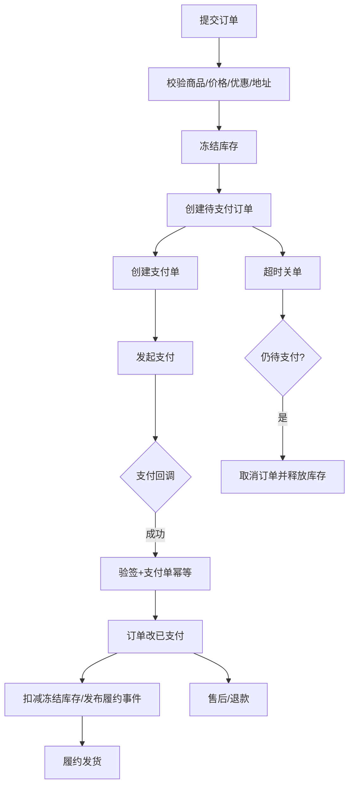
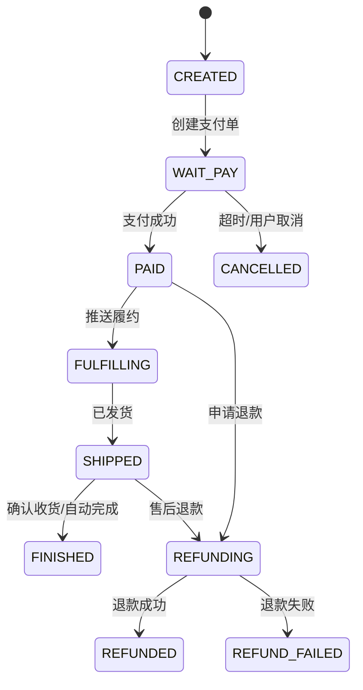
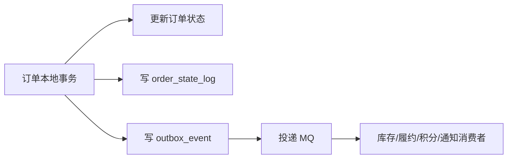

# 订单系统设计

> [!abstract] 一句话总结
> 订单系统是交易状态机，核心是创建、库存、优惠、支付、履约、取消、退款等状态在并发和分布式异常下可追踪、可补偿、可对账。

## 📌 精准定位

- 负责交易主链路和订单生命周期管理。
- 不负责把库存、支付、物流细节塞进一个服务，边界要清晰。
- 关键边界：订单状态只能按状态机流转，外部回调和定时任务都要幂等。
- 面试重点：订单状态机、支付回调幂等、超时关单并发、库存冻结释放、分布式一致性和对账补偿。

## 🧮 容量估算

| 维度 | 示例估算 | 设计含义 |
| ---- | -------- | -------- |
| 下单 QPS | 普通 500，峰值 5000 | 下单链路要短事务，避免同步调用过多下游 |
| 支付回调 | 支付峰值后集中回调 | 回调必须幂等，可异步推进履约 |
| 订单数据 | 年千万级 | 后续考虑按用户/时间分库分表和冷热归档 |
| 状态日志 | 订单状态变更数约订单数数倍 | 单独状态日志表，便于追踪和审计 |
| 超时关单 | 延迟消息或扫描 | 要和支付回调互斥 |

## 🧩 核心概念

| 概念 | 具体含义 | 精通要点 |
| ---- | -------- | -------- |
| 订单状态机 | 待支付、已支付、已取消、已发货、已完成、退款中。 | 状态流转必须条件更新。 |
| 库存锁定 | 创建订单冻结库存，取消或超时释放。 | 防止支付前超卖。 |
| 支付回调 | 异步、可能重复、可能乱序。 | 验签、幂等、状态机。 |
| 超时关单 | 延迟消息或扫描。 | 和支付成功并发互斥。 |
| 订单快照 | 商品、价格、优惠、地址快照。 | 保留交易发生时的事实。 |
| 对账补偿 | 对支付、库存、履约状态做校验。 | 处理异步链路最终一致。 |

## ⚙️ 工作原理 / 主流程



1. 创建订单前锁定商品、价格、优惠、收货信息快照。
2. 库存服务冻结可售库存，取消或超时释放。
3. 订单表写入待支付状态，并生成支付单。
4. 支付回调验签后按支付单幂等处理。
5. 履约、积分、通知走异步事件，失败进入补偿。
6. 退款/售后有独立状态机，不要简单回退订单状态。

## 🧾 订单状态机



状态更新必须使用条件更新：

```sql
UPDATE t_order
SET status = 'PAID', paid_at = NOW()
WHERE order_id = ? AND status = 'WAIT_PAY';
```

受影响行数为 1 才说明状态推进成功；重复回调或关单已成功时为 0。

## 🗄️ 核心表设计

```sql
CREATE TABLE orders (
  id BIGINT PRIMARY KEY,
  order_no VARCHAR(64) NOT NULL,
  user_id BIGINT NOT NULL,
  status VARCHAR(32) NOT NULL,
  total_amount DECIMAL(18,2) NOT NULL,
  pay_amount DECIMAL(18,2) NOT NULL,
  snapshot JSON NOT NULL,
  idempotency_key VARCHAR(128) NOT NULL,
  created_at DATETIME NOT NULL,
  paid_at DATETIME NULL,
  closed_at DATETIME NULL,
  UNIQUE KEY uk_order_no(order_no),
  UNIQUE KEY uk_user_idem(user_id, idempotency_key)
);

CREATE TABLE payment_order (
  id BIGINT PRIMARY KEY,
  order_no VARCHAR(64) NOT NULL,
  pay_no VARCHAR(64) NOT NULL,
  channel VARCHAR(32) NOT NULL,
  amount DECIMAL(18,2) NOT NULL,
  status VARCHAR(32) NOT NULL,
  callback_body JSON NULL,
  created_at DATETIME NOT NULL,
  paid_at DATETIME NULL,
  UNIQUE KEY uk_pay_no(pay_no),
  UNIQUE KEY uk_order_channel(order_no, channel)
);

CREATE TABLE order_state_log (
  id BIGINT PRIMARY KEY,
  order_no VARCHAR(64) NOT NULL,
  from_status VARCHAR(32),
  to_status VARCHAR(32) NOT NULL,
  event_type VARCHAR(64) NOT NULL,
  operator VARCHAR(64),
  created_at DATETIME NOT NULL
);
```

## 🔐 幂等设计

| 场景 | 幂等键 | 兜底 |
| ---- | ------ | ---- |
| 重复提交订单 | `user_id + idempotency_key` | 唯一索引返回已有订单 |
| 支付回调重复 | `pay_no` | 支付单唯一索引 + 状态机 |
| MQ 事件重复 | `event_type + biz_key` | 消费者幂等表 |
| 超时关单重复 | `order_no + close_event` | 状态条件更新 |
| 退款重复 | `refund_no` | 退款单唯一索引 |

## 📬 异步事件与 Outbox

订单本地事务内写业务表和 outbox：



这样可以避免“订单状态更新成功但事件丢失”。消费者必须幂等，因为 outbox 重试可能重复投递。

## 🚨 关键并发场景

### 1. 支付回调 vs 超时关单

两个动作都只能从 `WAIT_PAY` 流转：

```sql
-- 支付成功
UPDATE orders
SET status = 'PAID', paid_at = NOW()
WHERE order_no = ? AND status = 'WAIT_PAY';

-- 超时关单
UPDATE orders
SET status = 'CANCELLED', closed_at = NOW()
WHERE order_no = ? AND status = 'WAIT_PAY';
```

谁更新成功，谁获得状态流转权。失败方看到影响行数为 0 后停止后续动作。

### 2. 库存冻结成功但订单创建失败

方案：

- 库存冻结记录带 `order_no`。
- 订单创建失败后发送释放库存补偿。
- 定时任务扫描“冻结超时但无订单”的库存记录。

### 3. 支付成功但履约失败

方案：

- 订单进入 `PAID` 或 `FULFILLING`。
- 履约事件可重试。
- 多次失败进入人工处理或退款流程。
- 不要直接把已支付订单回滚成待支付。

## 🧭 排查路径

- 支付成功订单未更新：查支付回调、验签、支付单状态、订单状态条件更新、outbox。
- 库存不释放：查关单消息、订单状态、库存冻结记录、库存流水。
- 重复订单：查提交幂等键、唯一约束、前端重试和网关重试。
- 金额不一致：对比订单快照、优惠快照、支付单金额和支付渠道回调金额。
- 履约未发货：查 outbox 投递、MQ lag、履约消费者日志、DLQ。

## 🎯 面试问题

> [!question] 高频问题
> - Q: 订单系统核心是什么？
>   - A: 交易状态机，以及订单、库存、支付、履约、售后之间的最终一致协作。
> - Q: 如何防重复下单？
>   - A: 提交幂等键、唯一约束、创建状态校验，重复请求返回已有订单。
> - Q: 支付回调怎么处理？
>   - A: 验签、校验金额、按支付单幂等、条件更新订单状态、写状态日志和 outbox 事件。
> - Q: 关单和支付并发怎么办？
>   - A: 都用 `WHERE status='WAIT_PAY'` 条件更新，只有一个能成功。
> - Q: 为什么要订单快照？
>   - A: 商品、价格、优惠、地址会变化，订单必须保留交易发生时的事实。
> - Q: 跨服务一致性怎么做？
>   - A: 本地事务 + outbox/MQ + 消费者幂等 + 补偿对账，不把所有服务塞进一个强事务。

## 🎤 面试 3 层回答

### 30 秒版

订单系统本质是状态机。关键是创建、支付、关单、履约、退款都必须按合法状态流转，并通过幂等、条件更新、Outbox、补偿和对账解决分布式异常。

### 2 分钟版

我会先明确订单服务边界：订单保存交易事实和状态，不把库存、支付、物流都塞进来。创建订单时保存商品、价格、优惠、地址快照，冻结库存并创建支付单。支付回调必须验签、校验金额、幂等处理，用条件更新把订单从待支付改为已支付。超时关单也只允许待支付取消，所以能和支付回调互斥。履约、积分、通知通过 outbox/MQ 异步推进，失败进入补偿和对账。

### 项目版

可以关联 [[../09-项目实战/03-项目-订单履约系统]]，重点讲订单状态机、支付回调、库存冻结释放、Outbox、补偿任务和失败注入。

## ✅ 精通检查清单

- 能画出订单状态机。
- 能说明支付回调和超时关单并发处理。
- 能设计订单表、支付单、状态日志和 outbox。
- 能解释订单快照、库存冻结、履约补偿。
- 能结合项目讲 DB+MQ 一致性和消费者幂等。

## 🔗 关联笔记

- [[_index]]
- [[20-Java后端/00-总览/学习仪表盘]]
- [[../09-项目实战/03-项目-订单履约系统]]
- [[../07-分布式与微服务/03-分布式事务-2PC-TCC-Saga]]
- [[../06-中间件/03-消息可靠性-顺序-幂等]]
- [[../05-数据库与存储/03-MySQL锁机制]]

## 📚 参考资料

- Microservices Patterns: Transactional Outbox
- Domain-Driven Design: Aggregate and State Machine
- Enterprise Integration Patterns
