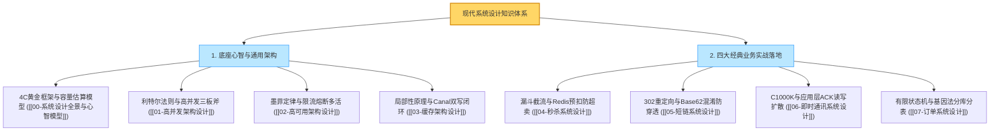

# 系统设计：本章总结与大厂通关复盘宝典

> **前置知识**：[[00-系统设计全景与心智模型]] 至 [[07-订单系统设计]] 全量篇目

---

## 1. 系统设计全景知识图谱（一张图贯通）

系统设计不是堆砌名词，而是**根据真实业务场景和物理约束，在一致性、可用性、吞吐量和成本之间进行权衡取舍（Trade-off）的艺术**。



---

## 2. 生产级架构设计“通关十诫”

在面对任何系统设计考题或生产系统架构评审时，牢记这十条底线铁律：

1. **先算容量，后画架构**：不给 QPS、DAU 和数据存储周期的架构方案都是耍流氓。永远用利特尔法则（$L = \lambda W$）和存储膨胀模型自证合理性。
2. **读写分离，动静边缘**：90% 的流量是读，将静态资源坚决推送到 CDN，动态读走多级缓存，持久化数据库只承担核心写与最终一致性读取。
3. **缓存可以丢，底线在数据库**：缓存永远只能作为“读取加速器”，绝不能作为唯一的业务事实来源。关键库存与资金扣减，必须靠数据库行锁与 CAS 条件兜底。
4. **状态下沉，应用无状态**：只要加机器就能提升性能的前提是应用层不维护有状态的 Local Session 或不可恢复内存数据。
5. **异步解耦，削峰填谷**：数据库写能力有限时，MQ 是最好的蓄水池；但必须有幂等消费、消费延迟监控与死信队列（DLQ）机制。
6. **防重幂等，唯一索引是唯一信仰**：分布式环境下重试是常态，防重不能单靠 Redis，持久化存储的唯一复合索引（Unique Key）是终极防线。
7. **隔离舱壁，局部故障不传染**：核心业务与边缘弱依赖（推荐、积分、统计）必须物理隔离线程池与数据源，慢调用及时熔断。
8. **探针自知，存活不查外部库**：K8s Liveness 探针只管进程死活，千万不要连数据库探活，否则引发雪崩式全集群自杀。
9. **对账闭环，发现比预防更重要**：分布式网络没有 100% 的绝对强一致，必须建立实时与离线对账系统，自动化发现不一致并逆向补偿。
10. **KISS 原则，不要过度设计**：能用单机 MySQL 搞定的场景不要上分库分表；日活 1 万的系统不要照搬淘宝异地多活。

---

## 3. 大厂系统设计 30 秒面试绝杀 10 连问

### Q1：如何估算一个系统的带宽与服务器资源需求？
> **答题标杆**：按“二八原则”推导峰值。假设 DAU 1000 万，80% 访问集中在 20% 时间（约 5 小时），平均每人 20 次请求，则总请求 2 亿次。峰值 QPS = $(2\text{亿} \times 0.8) / (5 \times 3600 \times 0.2) \approx 44,444$。单次请求包体按 10KB 估算，峰值网络带宽需求为 $44,444 \times 10\text{KB} \times 8 \approx 3.5\text{ Gbps}$。若单台应用实例能抗 1000 QPS，需规划约 45 台实例，加上 30% 安全余量，需配置约 60 台服务器。

### Q2：为什么分布式系统里“先写 DB，再删 Cache”比“先删 Cache，再写 DB”安全得多？
> **答题标杆**：“先删缓存再写 DB”在并发读写下，读线程会回源拿到尚未提交的 DB 旧值并重新回填缓存，导致缓存永久为脏数据。而“先写 DB 再删 Cache”要产生脏数据，必须要求“写 DB + 删 Cache”夹在“读 DB 和写 Cache”微秒级的间隙里完成，概率极低。生产中配合 Canal 监听 Binlog 投递 MQ 异步重试删除，可彻底保障最终一致性。

### Q3：为什么短链跳转使用 HTTP 302 临时重定向，而不是 301 永久重定向？
> **答题标杆**：301 会被浏览器硬缓存到本地磁盘，后续用户再次点击短链直接从浏览器缓存跳转目标页，根本不会再经过短链服务器，导致短链系统的 PV/UV 统计、来源分析、风控拦截和 AB 测试等核心商业埋点功能彻底失效；302 每次都强制经过短链服务器，确保数据统计与动态管控 100% 准确。

### Q4：自增发号器生成的短链存在被黑客批量顺序遍历爬取的风险，如何彻底解决？
> **答题标杆**：不能使用无规律的纯随机生成（碰撞率高、查重慢）。最佳实践是：**分布式自增发号器 + 64位 Feistel 伪随机置换算法（可逆混淆密码学算法）+ Base62 编码**。自增 ID 经 Feistel 混淆后在数论上保持绝对的一对一双射映射（0 碰撞），但呈现高度离散、均匀分布的伪随机序列，黑客完全无法猜测下一个有效短链。

### Q5：在即时通讯（IM）中，为什么 TCP 的 ACK 无法证明消息已经可靠送达？
> **答题标杆**：TCP 的 ACK 是传输层协议栈行为，它只代表数据包已经到达接收端的操作系统内核缓冲区，绝不代表应用层进程已经从缓冲区读取、解析、写入本地 SQLite 数据库或渲染到用户屏幕（应用随时可能 Crash 或 OOM）。因此 IM 必须设计**应用层端到端双向 ACK 机制**。

### Q6：万人大群聊天如果采用“写扩散”（推模式）会发生什么灾难？如何破局？
> **答题标杆**：万人群发一条消息，服务端需要瞬间执行 10,000 次写扩散投递，导致系统写爆炸和存储雪崩。破局采用**推拉结合机制（读扩散）**：万人大群只存一份消息实体到群消息收件箱（写扩散为 1）；然后仅向在线群成员推送轻量级的“有新消息通知信号”（版本号/新位点），客户端唤醒后按需拉取新消息，将写压力彻底瓦解。

### Q7：订单超时关单和用户晚到支付回调并发发生时，产生“订单已关闭但钱已扣走”，如何妥善处理？
> **答题标杆**：
> 1. **状态机 CAS 条件更新**：关单和支付推进订单状态必须带条件（`WHERE status = 'WAIT_PAY'`），确保只有一个线程能胜出。
> 2. **不可逆性与自动逆向退款**：若关单抢先提交，晚到的支付回调发现状态已不是 `WAIT_PAY`，绝不强行将订单改回支付成功；而是记录一条异常支付流水，并在当前回调事务中自动调用第三方支付渠道的“原路退款 API”，将款项退还用户，并在前端和短信中明确提示，形成完美的闭环。

### Q8：买家按用户 ID 查自己的历史订单，卖家按商家 ID 查店铺订单，分库分表后如何兼顾两者的超高并发查询？
> **答题标杆**：采用**双写异构索引方案**。核心交易库采用“分片基因法”，将 `userId` 的最后几位二进制基因嵌入到 `orderNo` 中，买家通过 `userId` 或 `orderNo` 都能精准路由单库单表，保障核心下单毫秒级吞吐；同时，利用 Canal/Flink 实时监听数据库 Binlog，将订单数据异步准实时打入 Elasticsearch（以 `merchantId` 为路由键）或大数据宽表，供商家后台复杂多条件筛选，交易与查询物理彻底隔离。

### Q9：什么是重试风暴？在生产中如何避免重试把下游打死？
> **答题标杆**：下游服务发生抖动变慢时，调用链上每一层上游服务（网关、聚合层、业务层）都配置了固定超时重试，导致调用次数被乘法级放大（如 $3 \times 3 \times 3 = 27$ 倍），下游本已超载，被海量重试请求直接踩踏致死。治理原则：
> 1. **指数退避加随机抖动（Exponential Backoff with Full Jitter）**；
> 2. **重试预算（Retry Budget）**，重试流量占比不能超过总流量的 10%；
> 3. **非幂等接口绝对禁止重试**；
> 4. **只在最靠近调用方的一层做一次重试**，禁止链路层层透传重试。

### Q10：K8s 的 Liveness 探针和 Readiness 探针有什么本质区别？配置错误会导致什么灾难？
> **答题标杆**：Liveness（存活探针）判定容器生死，失败会立即强制重启容器；Readiness（就绪探针）判定容器是否能接流量，失败仅将其从 Service 负载均衡列表中摘除，不杀容器。若在 Liveness 中配置了检查外部数据库或 Redis，当夜间数据库维护中断 10 秒时，全集群所有微服务 Pod 的 Liveness 探测全部失败，K8s 判定全员暴毙，同一秒将成百上千个微服务 Pod 全部杀死并触发集体重启风暴，系统彻底雪崩。

---

## 4. 系统设计终极心智复盘卡

```text
======================= 系统设计终极复盘口诀 =======================
先明场景后架构，容量估算走在前。
利特尔律定并发，墨菲定律备冗余。
动静分离CDN挡，旁路缓存Canal删；
漏斗模型抗秒杀，动态哈希藏网关；
短链重定向选302，Feistel混淆防枚举；
IM端到端双ACK，大群读扩小写推；
订单状态单向转，关单晚退闭环钱；
基因分库保买家，异构宽表供商家；
莫恋高深搞过度，KISS法则定乾坤！
======================================================================
```
