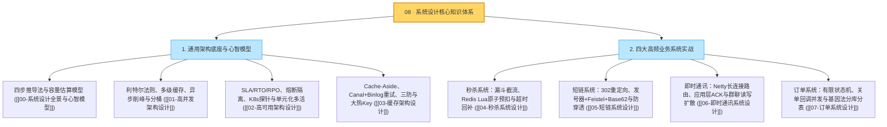

# 系统设计：本章总结与全景复盘指南

> **前置知识**：[[00-系统设计全景与心智模型]] 至 [[07-订单系统设计]] 全量篇目

---

## 1. 系统设计全景知识图谱（一张图串联核心难点与解法）

系统设计的核心从来不是死记硬背中间件名词，而是**先看清业务场景下的核心矛盾（流量积压在哪、锁冲突在哪、数据不一致风险在哪），再用最匹配的工程机制去化解它**。



---

## 2. 四大实战系统的“核心矛盾与架构演进”速查表

在复习或准备面试时，只要抓住下面这张表里的“核心难点 $\to$ 关键解法”，就能在 1 分钟内理清整套架构脉络：

| 系统场景 | 最核心的业务难点是什么？ | 架构是如何一步步演进解决的？ |
| :--- | :--- | :--- |
| **秒杀系统** ([[04-秒杀系统设计]]) | 瞬间几十万人抢几百件商品，直接打数据库必挂；并发扣减极易超卖，异常中断又会导致少卖。 | ① **边缘拦截**：CDN 缓存静态页，本地时间差倒计时，动态路径防刷；② **内存预扣**：Redis Lua 脚本单线程原子校验限购、扣减库存并记预留流水；③ **异步闭环**：MQ 削峰匀速落库，数据库 `WHERE stock >= 1` 兜底，超时未付延迟回补。 |
| **短链系统** ([[05-短链系统设计]]) | 怎么把长网址变成不冲突且不可预测的 6 位短码？十万并发点击时怎么在几毫秒内完成跳转并防穿透？ | ① **协议选型**：选用 `302 Found` + `Cache-Control: no-store` 防止浏览器死缓存，保留点击统计与封禁能力；② **无碰撞生成**：分布式发号器拿唯一递增 ID → Feistel 置换打乱 → Base62 编码；③ **极速跳转**：布隆过滤器拦非法扫描，Redis 缓存毫秒返回，点击埋点异步入 Kafka + ClickHouse。 |
| **即时通讯 IM** ([[06-即时通讯系统设计]]) | 百万长连接怎么维护与跨机寻址？弱网断连下消息怎么不丢、不重、不乱序？万人大群怎么避免写爆数据库？ | ① **连接与寻址**：Netty 网关管连接，Redis 存 `userId:deviceId -> gatewayId\|sessionId` 路由，30s 应用层心跳保活；② **可靠三要素**：应用层双向 ACK + 离线游标补拉（防丢）、`clientMsgId` 唯一索引（防重）、会话递增 `seqId`（防乱）；③ **推拉结合**：单聊与小群走写扩散（每人一个收件箱），几千人大群走读扩散（只写一份群时间线，通知后拉取）。 |
| **订单系统** ([[07-订单系统设计]]) | 复杂状态怎么防止乱序和并发覆盖？超时关单和晚到支付回调撞车怎么办？分库分表后买卖双方怎么同时快查？ | ① **状态机与三单分离**：严格定义状态跃迁，SQL 强制带 `WHERE status = '前态'`，订单/支付单/退款单分离；② **关单并发闭环**：关单前先查渠道并关渠道单；若仍收到晚到扣款回调，同事务记流水并触发自动原路退款；③ **双维度路由**：按 `user_id` 分表并将分片基因嵌入 `order_no` 末尾；商家与多条件检索通过 Binlog 同步至 ES 宽表。 |

---

## 3. 生产级架构设计“十大工程铁律”

1. **先算容量再画图，拒绝过度设计**：动笔前先估算日常 QPS、高峰 QPS 和年增存储量。单机 MySQL 能稳定支撑的业务不要盲目上分库分表，同城双活能满足容灾目标的不要强上异地多活。
2. **用利特尔法则（$L = \lambda \times W$）盯紧在途请求**：高并发雪崩往往不是因为入口 QPS 变高，而是因为下游响应耗时 $W$ 变长，导致在途并发数 $L$ 瞬间暴涨把线程池和数据库连接池占满。
3. **写操作幂等是分布式系统的底线**：网络超时和重试随时会发生，任何扣款、下单、发消息、状态推进接口，都必须基于唯一业务单号（唯一索引或状态机前置条件）实现严格幂等。
4. **缓存永远只是加速层，数据库才是最终守门员**：Redis 预扣或缓存标记能挡住 99% 的并发冲击，但最终资金扣减、物理库存扣减和订单落库，必须由数据库本地事务与条件更新（如 `WHERE available_stock >= 1`）做最后兜底。
5. **旁路缓存优先“先写数据库，再删缓存”**：直接更新缓存易引发并发写覆盖，先删缓存易在并发读时回填旧值；通过提交数据库事务后删除缓存，并配合 Canal 监听 Binlog + MQ 重试，可可靠保障最终一致性。
6. **核心链路与非核心弱依赖必须舱壁隔离**：下单支付主链路与积分、推荐、消息通知等弱依赖必须隔离线程池，并配置严格的超时时间与慢调用熔断，绝不允许一个边缘接口变慢拖垮整个应用。
7. **容器存活探针（Liveness）严禁检查外部数据库**：Kubernetes 的 `livenessProbe` 只用来判断容器进程自身是否卡死；一旦在里面检查共享的 MySQL 或 Redis，数据库短暂闪断就会触发全集群 Pod 同时自杀重启。
8. **重试机制必须受控，严防重试风暴**：整条调用链只由一层负责重试，采用“指数退避 + 随机抖动（Jitter）”打散重试时间，并配置重试预算上限（如不超过总流量的 10%）。
9. **跨系统交互必须有异步对账与补偿闭环**：无论架构多么完善，跨 Redis、MQ 或第三方支付网关的操作都可能因为断电或网络分区处于中间态，必须配齐定时巡检、渠道查单与逆向补偿任务。
10. **财务与金额计算零容忍浮点数**：所有涉及金钱的字段和计算，一律使用整数最小单位“分”（`BIGINT`/`long`）或字符串初始化的 `BigDecimal`，优惠券分摊必须做好尾差减法兜底。

---

## 4. 大厂系统设计高频面试追问 10 连问

> [!question]- Q1：给你一个日活（DAU）1000 万的系统，怎么在面试中快速推导出需要的 QPS、带宽和服务器数量？
> 1. **算全天总请求与平均 QPS**：假设 1000 万 DAU 每人每天平均发起 20 次请求，全天总请求量为 $2\text{ 亿次}$。一天有 $86,400\text{ 秒}$，全天平均 $\text{QPS} = 2\text{ 亿} / 86400 \approx 2,315\text{ QPS}$。
> 2. **算业务高峰期 QPS**：按照二八规律，80% 的流量集中在白天 20% 的时间（约 4.8 小时）内，高峰期平均 $\text{QPS} = (2\text{ 亿} \times 0.8) / (86400 \times 0.2) \approx 9,260\text{ QPS}$。如果存在整点促销等脉冲，瞬时峰值可按高峰均值的 $3 \sim 5$ 倍进一步评估。
> 3. **算带宽与机器实例数**：若单次响应 JSON 平均大小为 $10\text{ KB}$（约 $80\text{ Kb}$），在 $10,000\text{ QPS}$ 下出口带宽约为 $10000 \times 80\text{ Kb} \approx 800\text{ Mbps}$。若经过压测单台 4核8G 的无状态应用实例在满足 P99 延迟要求下可稳定承载 $1,500\text{ QPS}$，则承载 $10,000\text{ QPS}$ 至少需要 $7$ 台实例，算上跨可用区容灾余量通常部署 $10 \sim 12$ 台。

> [!question]- Q2：在 Cache-Aside 模式下，“先写数据库，再删缓存”还有没有可能出现脏数据？怎么彻底兜底？
> 1. **为什么它是标准做法**：相比于“先删缓存再写库”（极易被并发读线程把数据库未提交前的旧值回填进缓存），“先写库提交事务、再删缓存”把不一致窗口压缩到了极小——只有当缓存恰好在同一刻自然过期，且读线程查完旧库后发生长 GC 卡顿，晚于写线程更新数据库并删完缓存才执行回填时，才会短暂写入旧值。
> 2. **如何解决删缓存失败与最终一致**：为了防止写完数据库后应用宕机导致 `DEL` 缓存没执行，生产上通过 **Canal 监听 MySQL Binlog 投递 MQ**，由消费者异步删除缓存，失败则利用 MQ 重试直到成功；同时为所有缓存配置合理的 TTL 过期时间。对于账户余额扣减等完全不能容忍任何毫秒级延迟的场景，则直接走数据库主库当前读。

> [!question]- Q3：短链系统跳转时，301 和 302 状态码到底该怎么选？
> 1. **`301`（永久重定向）的隐患**：浏览器收到 `301` 后会把短链到长链的映射直接缓存在用户本地。后续用户再次点击时，浏览器直接跳往目标长链，请求根本不会到达短链服务器。这会导致后台完全无法统计真实的点击次数（PV/UV）、地区和设备分布，且一旦目标网址变更或因违规需要紧急封禁，对已缓存的用户无法生效。
> 2. **`302`（临时重定向）的优势**：工业界普遍选用 **`302 Found`** 并配合 `Cache-Control: no-store` 响应头，确保每次点击都经过短链服务端完成状态校验与异步日志采集，同时依靠服务端的 Redis 缓存将跳转响应耗时控制在几毫秒内。

> [!question]- Q4：短链生成为什么推荐“分布式发号器 + Feistel 置换 + Base62”，而不是直接哈希？
> 1. **彻底告别哈希碰撞**：无论是 MD5 截断还是 MurmurHash，把无限集合的长 URL 映射到 6 位字符空间都必然存在碰撞概率，需要查库判重并加盐重试。而分布式发号器分配的 64 位/32 位整数 ID 全局唯一，完整转为 62 进制（`0-9a-zA-Z`）是严格的一一对应关系，从数学上保证 **100% 零碰撞**。
> 2. **解决自增规律暴露问题**：直接把连续递增的 ID 转成 Base62 会导致相邻短码极其相似，容易被外部脚本遍历枚举。在编码前先经过 4 轮 **Feistel 有限域可逆置换**，将连续整数一对一打乱成离散整数再转 Base62，既保持了零冲突，又让生成的短码外观随机不可预测（注意数据库 `short_code` 列需使用 `ascii_bin` 区分大小写）。

> [!question]- Q5：TCP 协议本身已经有 ACK 确认和重传机制了，为什么 IM 系统还必须在应用层自己设计一套 ACK、重试和 `seqId`？
> 1. **TCP ACK 不代表业务处理完成**：TCP 的确认包由操作系统内核协议栈自动回复。数据包到达手机网卡缓冲区后内核就会回 ACK，但如果此时 App 进程正好崩溃、或者服务端网关收到包后在写入数据库前宕机，消息就会丢失。因此必须由应用层在消息真正落库后返回 `Server ACK`，客户端存入本地库后返回 `Client ACK`，断线重连再按游标补拉未读。
> 2. **防重与防乱序**：重试会导致同一条消息被服务端收到多次，因此客户端发送时必须生成全局唯一的 `clientMsgId` 供服务端做唯一索引幂等去重；同时由于不同设备的本地时钟存在偏差，不能按时间戳排序，必须由服务端为每个会话分配单调递增的 `seqId`，接收端按 `seqId` 严格排序并检测空洞补齐。

> [!question]- Q6：在 IM 系统中，几百人的普通群和几万人的超级大群（或直播间），消息分发模型有什么区别？
> 1. **普通小群采用“写扩散（推模式）”**：群内发一条消息，消息正文只存一份，但往群里每个成员的个人收件箱时间线各写一条轻量索引。优点是用户上线时只需查自己的收件箱就能拉回所有单聊和群聊未读消息，读取速度极快。
> 2. **万人大群采用“读扩散（拉模式）”**：如果 1 万人的大群还用写扩散，发一条消息要写 1 万次数据库，瞬间造成严重的写放大。因此大群改为只在**该群专属的发件箱时间线**里写 1 条记录，然后通过长连接向在线成员广播一条几十字节的“新消息序号通知”，各客户端对比自己本地的 `last_read_seq` 游标，按需向 Redis 群时间线缓存拉取增量消息。

> [!question]- Q7：订单超时自动关单和微信/支付宝的晚到支付成功回调撞在一起了，怎么保证不出错、不丢钱？
> 1. **数据库 CAS 互斥**：关单任务和支付回调更新订单状态时，SQL 均强制携带 `WHERE order_no = ? AND status = 'WAIT_PAY'`。依靠 InnoDB 行锁，两者必然只有一个能更新成功（返回影响行数 1）。
> 2. **关单前先查渠道并关单**：定时关单任务触发时，先调用支付渠道的查单接口；若用户其实已支付则直接补推为 `PAID`；若确实未支付，先调用渠道的关闭订单接口封死支付通道，再将本地订单改为 `CANCELLED` 并释放库存。
> 3. **晚到回调自动触发原路退款**：如果极端时间差下本地已经关单释放了库存，随后又收到了支付成功回调（此时 CAS 更新 `PAID` 返回 0 行），系统会在同一个本地事务里记录异常支付流水并写入一条**自动原路退款任务**，事务提交后向渠道返回 `SUCCESS`，再由异步 Worker 调用退款接口把钱退还给用户并发送通知。

> [!question]- Q8：亿级订单表分库分表后，如何同时支持“买家按 `user_id` 查列表”、“按 `order_no` 查详情”和“卖家按 `merchant_id` 查店铺订单”？
> 1. **基因法兼顾 `user_id` 与 `order_no`**：交易主库按买家的 `user_id % 分表数` 进行路由。在生成全局唯一订单号 `order_no` 时，将 `user_id % 分表数` 算出的分片编号直接作为固定末尾位（分片基因）嵌入订单号中。这样无论按 `user_id` 还是只拿 `order_no` 查询，都能提取出完全相同的分表号，实现单表直达、零跨库广播。
> 2. **CQRS 异构索引兼顾卖家与复杂筛选**：通过 Canal 监听交易库 Binlog，将订单变更准实时同步到 **Elasticsearch 检索宽表**（或按 `merchant_id` 分片的卖家读库）。商家查本店订单、客服多条件组合搜索全部走 ES 宽表；而商家点击发货或同意退款等写操作，则根据 `order_no` 中的分片基因回到交易主库执行。

> [!question]- Q9：为什么微服务调用链中配置不当的“失败自动重试”会引发全站雪崩？怎么安全地做重试？
> 1. **级联指数放大效应**：如果网关、订单服务、库存服务三层都配置了“失败后尝试 3 次”，一旦底层数据库出现短暂慢查询，打到数据库上的请求量会被瞬间放大为 $3 \times 3 \times 3 = 27$ 倍（重试风暴），直接把原本只是轻微抖动的数据库彻底打死。
> 2. **安全重试四准则**：第一，整条链路只允许最靠近下游的那一层负责重试，并传递全链路超时截止时间（Deadline）；第二，采用**指数退避加随机抖动（Exponential Backoff + Jitter）**分散重试脉冲；第三，设置**重试预算（Retry Budget）**，当实例整体重试比例超过 10% 时说明下游已故障，立即停止重试并熔断；第四，只有下游接口具备幂等保障时才允许对写操作重试。

> [!question]- Q10：Kubernetes 的 `startupProbe`、`livenessProbe` 和 `readinessProbe` 三个探针各管什么？配置时最容易踩的坑是什么？
> 1. **三者职责边界**：
>    - `startupProbe`（启动探针）：给 Spring Boot 等慢启动应用提供冷启动保护期，在它成功前不执行另外两个探针；
>    - `livenessProbe`（存活探针）：检查应用进程自身是否陷入死锁或假死，连续失败达到阈值时，K8s 会直接**杀死并重启容器**；
>    - `readinessProbe`（就绪探针）：检查实例当前是否准备好接收流量，失败时仅将该 Pod **从 Service 负载均衡列表中摘除**，不会重启容器。
> 2. **头号大坑**：**严禁在 `livenessProbe` 存活探针中检查外部数据库、Redis 或下游微服务连接！** 否则一旦数据库发生几十秒的主从切换闪断，所有微服务 Pod 的存活探针会同时失败，导致全集群所有容器在同一秒集体自杀重启，引发灾难性的雪崩停机。

---

## 5. 系统设计终极复盘记忆卡

```text
======================= 系统设计终极复盘口诀 =======================
先明边界算容量，利特尔律控在途（L = QPS × W）。
读靠多级缓存挡，写靠队列削洪峰，单行热点拆子桶。
旁路缓存先写库，Binlog 订阅异步删；
穿透布隆加空值，击穿互斥雪崩散。
秒杀漏斗层层截，Lua 预扣带流水，底线条件扣数据库；
短链跳转选 302，发号置换 Base62，字段排序二进制；
IM 路由存 Redis，应用层 ACK 配 Seq，小群写扩大群拉；
订单状态单向转，关单晚付原路退，基因分表异构搜；
存活探针莫查库，重试退避加预算，KISS 原则定乾坤！
======================================================================
```
