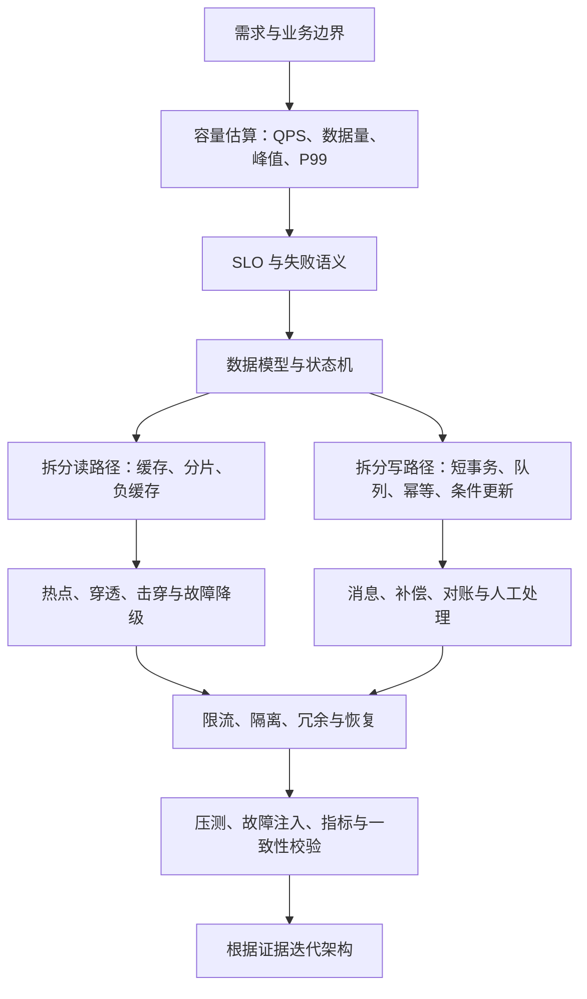

# 系统设计：本章总结与复习

> [!abstract] 一句话总结
> 系统设计不是堆组件，而是从容量、SLO 和业务事实出发，画清读写路径与状态机，逐项处理热点、一致性和故障，再用压测、指标、对账与演练证明方案成立。

## 核心知识概览

| 模块 | 核心问题 | 关键结论 | 对应笔记 |
| --- | --- | --- | --- |
| 高并发 | 目标峰值下怎样维持吞吐与尾延迟 | 先估算 QPS、P99 和瓶颈，再组合入口削峰、无状态扩展、缓存、异步、分片、限流与压测 | [[01-高并发架构设计]] |
| 高可用 | 故障发生后怎样限制影响并恢复 | 用 SLO/错误预算量化目标，以冗余、隔离、自动恢复、降级、备份恢复和故障演练形成闭环 | [[02-高可用架构设计]] |
| 缓存 | 如何降低读成本又控制不一致 | 先声明新鲜度和读写路径，再设计 key/TTL/容量/热点/失效；常用 cache-aside 是写 DB 后删缓存 | [[03-缓存架构设计]] |
| 秒杀 | 瞬时热点流量下怎样不超卖 | 静态化与限流挡无效流量，Redis Lua 原子预扣，MQ 异步落库，DB 唯一约束和对账补偿兜底 | [[04-秒杀系统设计]] |
| 短链 | 高比例跳转读怎样保持低延迟 | 短码生成需处理冲突和枚举风险；映射缓存、负缓存、302 跳转、异步统计和风控共同保护主读路径 | [[05-短链系统设计]] |
| 即时通讯 | 弱网与断线下消息怎样可靠收敛 | 长连接接入和消息存储解耦，以会话 seq、先持久化、在线投递、ACK、离线收件箱和重连补拉保证连续性 | [[06-即时通讯系统设计]] |
| 订单 | 交易生命周期怎样在并发异常下正确推进 | 订单是状态机；快照保存交易事实，条件更新解决竞态，Outbox/MQ、幂等、补偿和对账实现跨服务最终一致 | [[07-订单系统设计]] |

## 全章主线

## 快速复习

1. 系统设计先定目标而不是先选中间件：明确峰值 QPS/TPS、数据规模、P95/P99、错误率、核心接口、可接受的不一致窗口和拒绝语义。
2. 高并发的完整路径是入口削峰、应用无状态、读缓存、写异步、数据分片和过载保护；横向扩容若仍受 DB 热点行、Redis hotkey 或 MQ 单分区限制，不会解决共享瓶颈。
3. 高可用不是“有主备”就结束。冗余必须消除共同故障点，并为每类故障定义检测、摘流/切换、降级、恢复验证和复盘；备份必须经过恢复演练。
4. 缓存设计要同时回答读路径、写路径、一致性、容量和故障行为。常用写法是 DB 事务提交后删除 Redis，再广播 L1 失效；TTL 抖动、singleflight、预热和逻辑过期用于热点治理。
5. 秒杀的核心是把进入落库链路的请求压缩到库存量级：Lua 同时校验库存和已购标记，获得资格后异步创建订单，DB 唯一索引、状态条件更新和库存流水继续兜底。
6. 秒杀不仅要防超卖，也要处理少卖和资格悬挂；Redis 扣减后 MQ 失败需 Outbox 重试或回补，最终用订单、流水与 Redis 库存三方对账。
7. 短链跳转远比创建更关键：Redis 命中后快速 302，miss 回源 DB 并对不存在 code 做短 TTL 负缓存；访问统计异步化，创建端要做 URL 校验、黑名单与限频。
8. 即时通讯不承诺弱网下绝对实时，而是以 `msgId/seq`、先存后推、ACK 和按 `lastSeq` 补拉最终补齐；连接路由、消息存储和复杂业务应分层，群聊还要权衡写扩散与读扩散。
9. 订单必须保留商品、价格、优惠和地址快照。支付回调与超时关单都只允许从 `WAIT_PAY` 条件更新，受影响行数决定谁获得状态流转权。
10. 好的设计回答四件事：正常请求怎么走、瓶颈在哪里、依赖失败时用户看到什么、用哪些指标/SQL/演练证明没有超卖、重复、丢消息或不可恢复状态。

## 自测问题

1. 给定 DAU、活动时长和峰值系数，如何估算入口 QPS、应用实例数以及缓存、MQ、数据库各自需要承受的量？
2. Redis 整体不可用或一个热点 key 失效时，如何保护数据库，并分别为核心接口和非核心接口定义用户可见行为？
3. 秒杀中“Redis 扣减成功但 MQ 发送失败”和“消费者重复消费”分别会造成什么后果，幂等、Outbox、回补和对账如何分工？
4. 为什么短链通常选择 302 而不是 301？如何同时处理不存在短码、恶意枚举、统计准确性和跳转 P99？
5. 即时通讯从持久化到 ACK 的哪个环节都可能失败；客户端重连后如何用 seq 判断缺口、去重并恢复顺序？
6. 订单支付回调、超时关单和履约失败同时存在时，状态机、条件更新、Outbox 和补偿任务分别守住哪一层正确性？

## 下一章衔接

下一章进入 [[../09-项目实战/_index|Java 项目实战]]：把本章的架构图转换为接口、表结构、缓存 key、消息与状态机，再通过压测、失败注入、日志指标和一致性校验留下可复现的工程证据。

## 相关编号双链

- 通用设计框架：[[01-高并发架构设计]] · [[02-高可用架构设计]] · [[03-缓存架构设计]]
- 典型系统案例：[[04-秒杀系统设计]] · [[05-短链系统设计]] · [[06-即时通讯系统设计]] · [[07-订单系统设计]]
