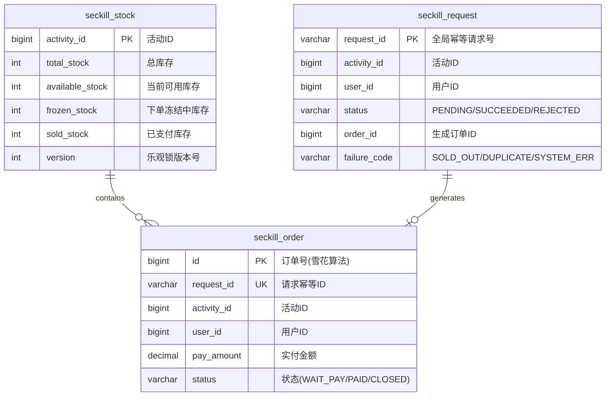
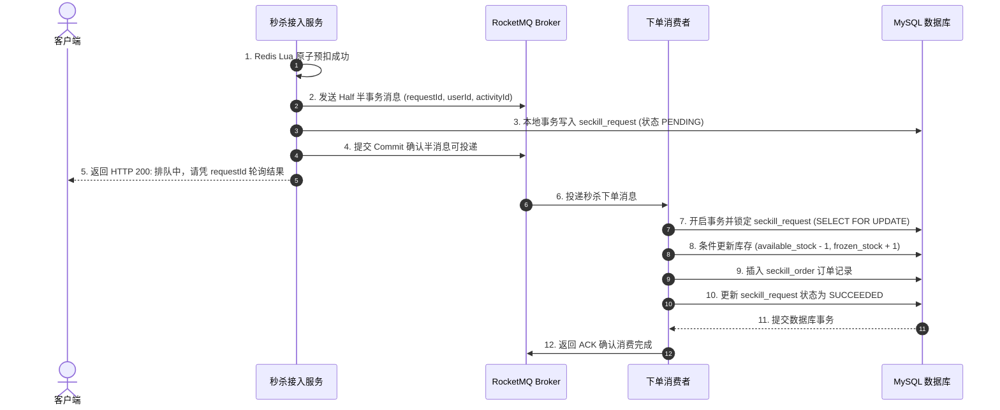
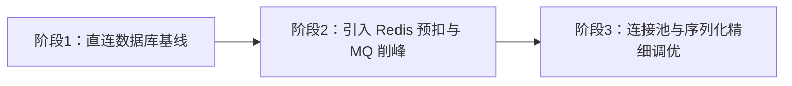

# 项目实战：高并发秒杀系统全链路落地与性能调优

> **关联理论**：[[../08-系统设计/04-秒杀系统设计|秒杀系统设计理论]]、[[../08-系统设计/01-高并发架构设计|高并发架构]]、[[../03-并发编程/00-并发编程心智模型与学习路线|并发编程全景]]

---

## 1. 业务背景与项目全貌

### 1.1 业务痛点分析
秒杀业务的核心特点是**瞬时并发极高、库存数量极少、读写冲突高度集中**。如果让数万名用户的下单请求直接穿透到 MySQL 数据库执行扣减：
1. **数据库连接池与线程迅速耗尽**：大量请求争夺同一商品行的排他锁（Row Lock），导致事务排队阻塞，进而拖垮整个应用集群。
2. **超卖与少卖风险**：在高并发交错执行下，如果缺少严格的原子扣减与防重机制，极易出现库存扣成负数（超卖）或异常中断后库存无法释放（少卖）。
3. **脚本刷单冲击**：自动化脚本会在活动开启瞬间发起高频请求，挤占正常用户的购买机会。

### 1.2 架构演进与 STAR 复盘参考
围绕“前端拦截、缓存预扣、异步削峰、数据库兜底”的分层设计思路，本项目的核心架构要点可归纳如下：

```text
【项目名称】：基于 Spring Boot 3 + Redis Cluster + RocketMQ 的高并发秒杀系统
【业务痛点】：大促热点商品抢购期间瞬时流量集中，传统直连数据库扣减方案存在严重行锁争用，易引发接口超时与服务雪崩。
【核心方案】：
  1. 流量分层过滤：静态资源推送至 CDN，接入层结合令牌桶限流与人机校验拦截高频刷单请求；
  2. 内存原子预扣：采用 Redis Cluster Hash Tag 绑定同一活动的库存 Key 与已购用户集合 Key，通过 Lua 脚本在单次原子操作内完成资格校验、库存预扣与预留记录登记；
  3. 异步削峰落库：引入 RocketMQ 事务消息，将同步下单转化为异步消费落库，配合定时补偿任务解决“Redis 预扣成功但消息未送达”的悬挂问题；
  4. 数据库强一致兜底：MySQL 库存表拆分为可用、冻结与已售三个字段，利用 WHERE available_stock >= 1 条件更新与订单唯一索引，确保极端情况下绝不超卖。
【达成效果】：将热点库存扣减从数据库行锁竞争移至 Redis 内存原子执行，通过 MQ 将瞬时脉冲流量拉平为数据库可承受的匀速写入，保障账实一致。
```

---

## 2. 数据库物理架构与一致性模型设计

秒杀系统的数据安全底线是：**即使前端缓存层发生故障或数据丢失，关系型数据库依然能通过自身的约束保证库存与订单的强一致性**。

### 2.1 核心表关系设计



### 2.2 核心表 DDL 定义

在以下表结构中，`seckill_stock` 遵循严格的库存平衡公式：`total_stock = available_stock + frozen_stock + sold_stock`。`seckill_order` 通过 `(activity_id, user_id)` 联合唯一索引在物理层面限制同一活动中每人最多生成一笔订单。

```sql
-- 1. 秒杀商品库存表（恒等关系：total_stock = available_stock + frozen_stock + sold_stock）
CREATE TABLE `seckill_stock` (
  `activity_id` BIGINT NOT NULL COMMENT '秒杀活动ID',
  `total_stock` INT NOT NULL COMMENT '初始总库存',
  `available_stock` INT NOT NULL COMMENT '当前可售库存',
  `frozen_stock` INT NOT NULL DEFAULT 0 COMMENT '已下单未支付的冻结库存',
  `sold_stock` INT NOT NULL DEFAULT 0 COMMENT '已支付完成的库存',
  `version` INT NOT NULL DEFAULT 0 COMMENT '乐观锁版本号',
  PRIMARY KEY (`activity_id`)
) ENGINE=InnoDB DEFAULT CHARSET=utf8mb4;

-- 2. 秒杀主订单表（联合唯一索引保障一人一单）
CREATE TABLE `seckill_order` (
  `id` BIGINT NOT NULL COMMENT '全局分布式订单ID',
  `request_id` VARCHAR(64) NOT NULL COMMENT '单次抢购请求幂等ID',
  `activity_id` BIGINT NOT NULL COMMENT '秒杀活动ID',
  `user_id` BIGINT NOT NULL COMMENT '买家UID',
  `pay_amount` DECIMAL(10,2) NOT NULL COMMENT '应付金额',
  `status` VARCHAR(32) NOT NULL COMMENT 'WAIT_PAY, PAID, CLOSED',
  `create_time` DATETIME NOT NULL DEFAULT CURRENT_TIMESTAMP,
  PRIMARY KEY (`id`),
  UNIQUE KEY `uk_request_id` (`request_id`),
  UNIQUE KEY `uk_activity_user` (`activity_id`, `user_id`)
) ENGINE=InnoDB DEFAULT CHARSET=utf8mb4;

-- 3. 异步抢购请求状态表（用于事务消息回查与前端排队轮询）
CREATE TABLE `seckill_request` (
  `request_id` VARCHAR(64) NOT NULL COMMENT '请求唯一ID',
  `activity_id` BIGINT NOT NULL,
  `user_id` BIGINT NOT NULL,
  `status` VARCHAR(32) NOT NULL COMMENT 'PENDING, SUCCEEDED, REJECTED',
  `order_id` BIGINT DEFAULT NULL,
  `failure_code` VARCHAR(64) DEFAULT NULL COMMENT 'SOLD_OUT, DUPLICATE_PURCHASE',
  `update_time` DATETIME NOT NULL DEFAULT CURRENT_TIMESTAMP ON UPDATE CURRENT_TIMESTAMP,
  PRIMARY KEY (`request_id`)
) ENGINE=InnoDB DEFAULT CHARSET=utf8mb4;
```

---

## 3. 核心业务链路与代码实现

整个秒杀下单链路分为两个阶段：**第一阶段在 Redis 中完成高速资格预扣，第二阶段通过 RocketMQ 事务消息异步完成数据库扣减与订单创建**。

### 3.1 阶段一：Redis Cluster + Lua 原子预扣资格

为什么必须使用 Lua 脚本？如果先在 Java 代码中调用 `SISMEMBER` 判断用户是否买过，再调用 `GET` 判断库存，最后调用 `DECR` 扣减，在高并发下多个线程会同时通过前两步检查，导致严重的超卖或一人多单。将这些操作封装进 Lua 脚本后，Redis 单线程会将其作为一个整体原子执行，中间不会穿插其他客户端的命令。

同时，在 Redis Cluster 集群模式下，脚本涉及的所有 Key 必须位于同一个哈希槽（Hash Slot）中，因此我们使用 `{activityId}` 作为 Hash Tag 统一路由。

```java
@Service
@RequiredArgsConstructor
@Slf4j
public class SeckillPreDeductService {

    private final StringRedisTemplate redisTemplate;

    private static final DefaultRedisScript<Long> SECKILL_SCRIPT;
    static {
        SECKILL_SCRIPT = new DefaultRedisScript<>();
        SECKILL_SCRIPT.setScriptText(
            "local stockKey = KEYS[1] " +
            "local usersKey = KEYS[2] " +
            "local reservesKey = KEYS[3] " +
            "local pendingKey = KEYS[4] " +
            "local userId = ARGV[1] " +
            "local buyNum = tonumber(ARGV[2]) " +
            "local reqId = ARGV[3] " +
            "local nowMs = tonumber(ARGV[4]) " +
            // 1. 校验限购数量
            "if not buyNum or buyNum ~= 1 then return -3 end " +
            // 2. 一人一单校验：检查用户是否已在已购集合中
            "if redis.call('SISMEMBER', usersKey, userId) == 1 then " +
            "   return -2 " + // 返回 -2: 重复抢购
            "end " +
            // 3. 可用库存校验
            "local currStock = tonumber(redis.call('GET', stockKey) or '0') " +
            "if currStock < buyNum then " +
            "   return -1 " + // 返回 -1: 库存不足
            "end " +
            // 4. 扣减库存、记录已购用户，并写入预留索引供后续对账
            "redis.call('DECRBY', stockKey, buyNum) " +
            "redis.call('SADD', usersKey, userId) " +
            "redis.call('HSET', reservesKey, reqId, userId .. ':PENDING') " +
            "redis.call('ZADD', pendingKey, nowMs, reqId) " +
            "return 1 " // 返回 1: 预扣成功
        );
        SECKILL_SCRIPT.setResultType(Long.class);
    }

    public SeckillResult preDeduct(Long activityId, Long userId, String requestId) {
        // 使用 Hash Tag {activityId} 确保 4 个 Key 落在同一个 Redis Cluster 槽位
        String prefix = "seckill:{" + activityId + "}:";
        List<String> keys = Arrays.asList(
                prefix + "stock",
                prefix + "users",
                prefix + "reserves",
                prefix + "pending"
        );

        Long code = redisTemplate.execute(
                SECKILL_SCRIPT,
                keys,
                String.valueOf(userId),
                "1",
                requestId,
                String.valueOf(System.currentTimeMillis())
        );

        if (code == null || code == -3) {
            return SeckillResult.fail("SYSTEM_BUSY", "系统繁忙，请稍后再试");
        }
        if (code == -2) {
            return SeckillResult.fail("DUPLICATE_ORDER", "每人限购一件，请勿重复抢购");
        }
        if (code == -1) {
            return SeckillResult.fail("SOLD_OUT", "商品已售罄");
        }
        return SeckillResult.success();
    }
}
```

> **设计细节说明**：脚本除了扣减 `stock` 和记录 `users` 外，还向 `reserves`（Hash）和 `pending`（ZSet，按时间戳排序）写入了预留记录。这样设计是为了应对“Redis 预扣成功，但应用节点在发 MQ 前突然宕机”的极端情况——后台补偿任务可以扫描 `pending` 中超时未完结的 `requestId`，核实数据库确无订单后安全回补 Redis 库存。

---

### 3.2 阶段二：RocketMQ 事务消息驱动异步落库

Redis 预扣成功后，应用不直接同步执行沉重的订单创建逻辑，而是发送一条 RocketMQ 半事务消息（Half Message），在本地事务中插入一条轻量级的 `seckill_request(PENDING)` 记录后立即返回前端“排队中”。真正的库存冻结与订单生成由下游消费者按数据库承受能力平稳处理。



#### 下单消费者核心代码实现：

```java
@Component
@RequiredArgsConstructor
@Slf4j
public class SeckillOrderConsumer {

    private final TransactionTemplate transactionTemplate;
    private final SeckillRequestMapper requestMapper;
    private final SeckillStockMapper stockMapper;
    private final SeckillOrderMapper orderMapper;

    public void onMessage(SeckillOrderMessage message) {
        String reqId = message.getRequestId();
        try {
            transactionTemplate.executeWithoutResult(tx -> {
                // 1. 悲观锁锁定请求记录，保证幂等消费（若状态已非 PENDING 则直接跳过）
                SeckillRequest req = requestMapper.selectForUpdate(reqId);
                if (req == null || !"PENDING".equals(req.getStatus())) {
                    return;
                }

                // 2. 数据库兜底扣减：UPDATE seckill_stock SET available_stock = available_stock - 1,
                //    frozen_stock = frozen_stock + 1 WHERE activity_id = ? AND available_stock >= 1
                int updated = stockMapper.freezeAvailableStock(req.getActivityId(), 1);
                if (updated == 0) {
                    requestMapper.updateStatus(reqId, "REJECTED", null, "SOLD_OUT");
                    return;
                }

                // 3. 创建秒杀订单并更新请求回执为成功
                SeckillOrder order = buildOrder(req, message.getPayAmount());
                orderMapper.insert(order);
                requestMapper.updateStatus(reqId, "SUCCEEDED", order.getId(), null);
            });
        } catch (DuplicateKeyException ex) {
            // 触发 uk_activity_user 唯一约束冲突时，将请求标记为重复抢购
            log.warn("检测到重复下单请求, reqId={}, userId={}", reqId, message.getUserId());
            requestMapper.updateStatus(reqId, "REJECTED", null, "DUPLICATE_PURCHASE");
        }
    }
}
```

---

## 4. 性能压测与全链路调优推进

为了验证架构的承载能力，我们在压测环境中（JMeter 施压集群 -> Nginx -> 2 台 8C16G 秒杀应用 -> 3主3从 Redis Cluster + MySQL 8.0）模拟 10 万用户抢购 1,000 件商品，分三个阶段逐步消除性能瓶颈：



| 调优阶段 | 核心瓶颈定位 | 改造与调优措施 | 典型吞吐量 (QPS) | P99 响应延迟 | 库存准确性 |
| :--- | :--- | :--- | :--- | :--- | :--- |
| **阶段 1：初始基线** | 所有请求直接开启 MySQL 事务扣减单行记录，InnoDB 行锁等待严重，Tomcat 200 线程迅速打满 | 分析慢查询与锁等待，准备剥离同步数据库写操作 | ~450 | > 1,800 ms | 零超卖（大量超时） |
| **阶段 2：读写分离与削峰** | 数据库不再是前置瓶颈，但高并发下频繁创建对象及同步等待 MQ 响应仍有耗时 | 引入 Redis + Lua 内存原子预扣，配合 RocketMQ 异步落库 | ~12,000 | ~65 ms | 零超卖、零少卖 |
| **阶段 3：连接池与参数调优** | 消费者并发写库时 HikariCP 连接数过大（100）引发数据库 CPU 上下文切换偏高 | 将单实例 HikariCP 连接池收敛至 20，预热编译 Lua 脚本 SHA1 | ~18,500 | ~22 ms | 零超卖、零少卖 |

---

## 5. 面试高频追问解析

> [!question]- 追问 1：如果 Redis 预扣库存成功了，但发送 RocketMQ 消息超时或应用突然宕机，会导致“少卖”吗？怎么解决？
> 如果因为发送超时就直接去 Redis 执行 `INCRBY` 把库存加回来，是非常危险的——因为超时不代表消息没发出去，一旦消息其实已经到达 Broker，直接回补会导致**超卖**。
> 正确的解决思路是**“预留登记 + 延时对账补偿”**：
> 1. **原子记录预留状态**：在阶段一的 Lua 脚本中，扣减库存的同时将 `requestId` 写入 Redis 的 `pending` 有序集合（ZSet，分值为当前时间戳）。
> 2. **后台定时对账**：定时任务扫描 `pending` 集合中超过一定时间（如 30 秒）仍未完结的 `requestId`，去 MySQL 查询 `seckill_request` 表。
> 3. **安全取消与幂等回补**：如果在数据库中没有查到该记录，或者尝试将该记录原子更新为 `REJECTED` 成功（防止与晚到的消费者并发冲突），则确认为悬挂预扣，此时再通过 Lua 脚本将 Redis 库存加 1 并移除该用户的已购标记，从而彻底消除少卖且不会引起超卖。

> [!question]- 追问 2：如果某个超级爆款商品有 5 万件库存，单 Key 承受不住几十万 QPS 的读写冲击怎么办？
> 可以采用**库存分桶（Sharded Inventory Keys）**方案将单点压力分散到多个 Redis 分片上：
> 1. **物理拆桶**：将商品 `1001` 的 5 万件库存拆分为 10 个子 Key，例如 `seckill:{1001_0}:stock` 到 `seckill:{1001_9}:stock`，每个桶分配 5,000 件库存。由于 Hash Tag 不同，这 10 个桶会分散到 Redis Cluster 的不同主节点上。
> 2. **稳定路由**：用户请求到来时，按照 `userId % 10` 路由到固定分桶执行扣减。
> 3. **尾盘合并或重试**：当某个分桶库存扣完而其他分桶还有余量时，客户端或服务端可按次序探测其他未空的桶，同时依靠全局用户限购校验保障一人一单。

> [!question]- 追问 3：为什么把 HikariCP 数据库连接池从 100 调小到 20，数据库写入吞吐量反而提升了？
> 数据库服务器的 CPU 核心数和磁盘 I/O 并发能力是有物理上限的。假设 MySQL 部署在 8 核机器上，同一时刻最多只能并行执行 8 个线程的指令。当连接池设置为 100 时，100 个活跃连接同时在数据库内部争抢行锁和 CPU 时间片，导致操作系统产生密集的**线程上下文切换（Context Switch）**，大量 CPU 时间被消耗在线程挂起与唤醒的内核调度上。
> 按照 HikariCP 官方推荐的经验公式（`连接数 = CPU 核心数 * 2 + 有效磁盘数`），将连接池调整到 16~20 左右，能够大幅减少数据库内部的锁竞争与上下文切换，让 CPU 专注于执行 SQL 本身，因此吞吐量不降反升。

> [!question]- 追问 4：如何防止黑客绕过前端页面，直接用脚本在活动开启瞬间调用下单接口？
> 需要在接入层构建三道防线：
> 1. **动态下单令牌（秒杀 Path 隐藏）**：秒杀开始前，前端无法直接获知下单 URL。活动时间到达后，用户点击“抢购”需先请求令牌接口（服务端校验活动已开始且通过人机验证），获取一个绑定了当前 `userId`、`activityId` 且带短有效期签名的一次性 Token，下单时必须携带该 Token。
> 2. **人机验证码削峰**：在获取下单令牌前弹出滑块拼图或点选验证码，既能拦截自动化脚本，又能将数万人在同一毫秒的点击分散到 1~5 秒的时间窗口内，平滑流量洪峰。
> 3. **网关层细粒度限流**：在 API 网关层按 `userId` 和 `IP` 配置令牌桶限流（例如同一用户每秒最多请求 1 次），对高频异常请求直接返回 429 状态码。

> [!question]- 追问 5：用户抢到订单后 15 分钟内未支付，系统如何安全地自动关单并回补库存？
> 采用**RocketMQ 延时消息 + 状态机条件更新（CAS）**实现：
> 1. **发送延时消息**：消费者创建订单成功后，投递一条 15 分钟延时的关单检查消息。
> 2. **先核验支付渠道**：延时消息到期后，若本地订单仍为 `WAIT_PAY`，先调用微信/支付宝查单接口核实真实支付状态，并调用关单接口关闭第三方支付单，防止用户在最后一秒支付成功。
> 3. **CAS 条件关单与库存返还**：执行 `UPDATE seckill_order SET status = 'CLOSED' WHERE id = ? AND status = 'WAIT_PAY'`。只有当返回影响行数为 1 时（证明本次操作成功将订单从待支付改为已关闭），才在同事务中将 MySQL 的 `frozen_stock - 1, available_stock + 1`，并同步回补 Redis 可用库存。

---

## 6. 核心要点复盘清单

- **流量漏斗原则**：逐层过滤无效请求（CDN 承接静态资源 -> 网关限流与验证码 -> Redis 拦截绝大多数超额请求 -> MQ 削峰 -> 数据库平稳落盘）。
- **Redis 原子性保障**：检查库存、判断是否重复购买、扣减库存必须放在同一个 Lua 脚本中执行，并用 `{activityId}` Hash Tag 保证集群槽位一致。
- **异步一致性闭环**：通过 RocketMQ 事务消息保障“本地请求记录落库”与“消息投递”的一致性，利用预留集合与定时对账任务解决缓存预扣悬挂问题。
- **数据库底线设计**：库存表通过 `WHERE available_stock >= 1` 防止扣成负数，订单表通过 `(activity_id, user_id)` 唯一索引在物理层杜绝重复下单。
