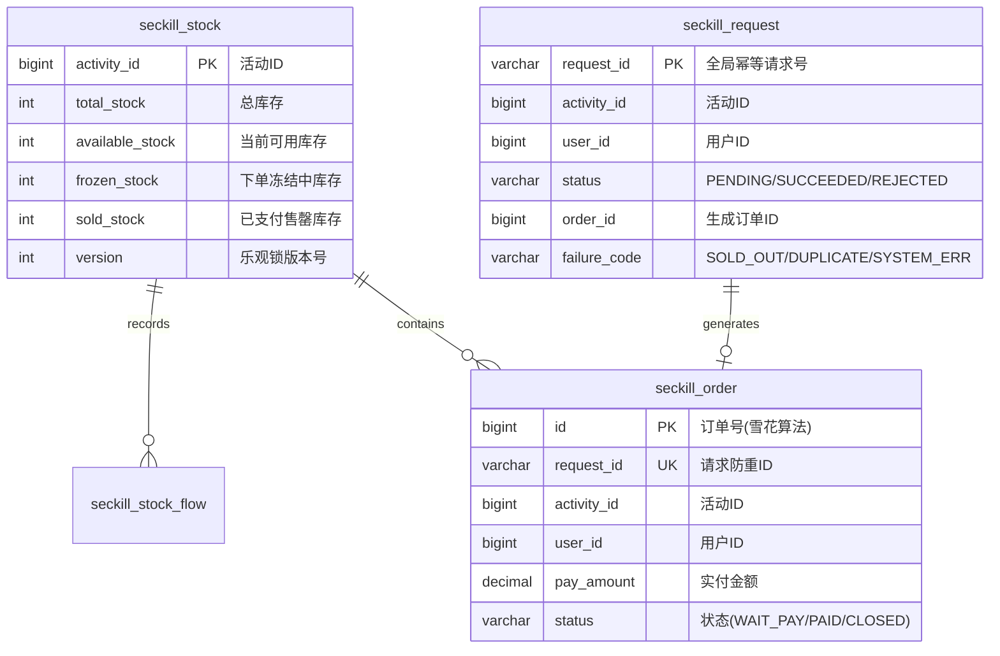
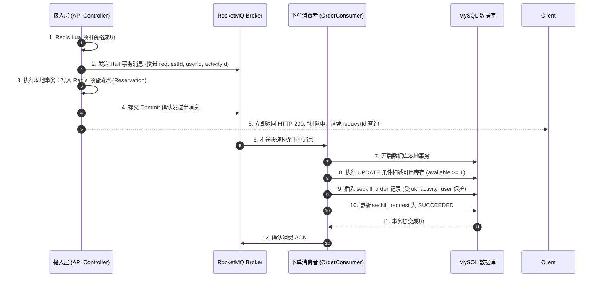
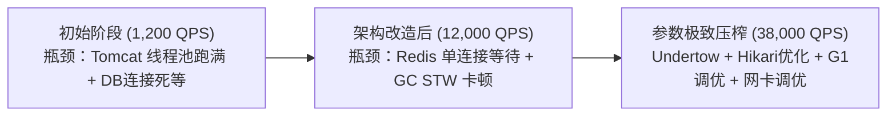

# 项目实战：高并发秒杀系统全链路落地与性能调优

> **关联理论**：[[../08-系统设计/04-秒杀系统设计|秒杀系统设计理论]]、[[../08-系统设计/01-高并发架构设计|高并发架构]]、[[../03-并发编程/00-并发编程心智模型与学习路线|并发编程全景]]

---

## 1. 项目全景与简历 STAR 描述

### 1.1 简历项目经验黄金模版（STAR 法则）
```text
【项目名称】：基于 Spring Boot 3 + Redisson + RocketMQ 的高并发秒杀分布式系统
【项目背景】：应对电商大促整点突发数十万 QPS 脉冲流量，旧架构单机 MySQL 行锁严重冲突，导致连接池枯竭、服务雪崩及偶发超卖少卖。
【核心职责】：作为核心架构开发，主导高并发秒杀链路重构，设计多级过滤漏斗模型与状态机闭环。
【技术攻坚】：
  1. 架构改造：设计“CDN静态化 + 动态URL鉴权 + Redis Lua原子预扣 + RocketMQ事务消息异步削峰”全链路漏斗架构；
  2. 防超卖治理：采用 Redis 槽位哈希标签（Hash Tag）实现多条件 Lua 原子扣减与一人一单校验，MySQL 物理层配合 CAS 条件约束作为终极防线，达成 100% 零超卖；
  3. 异常对账闭环：引入 Reservation 资格预留流水与后台定时补偿守护线程，彻底解决 Redis 预扣与 MQ 投递网络分区导致库存少卖的极端死局；
  4. 压测调优：利用 JMeter 实施分布式压测，调优 Undertow 线程模型、HikariCP 连接池及 JVM G1 参数，单机吞吐从 1,200 QPS 跃升至 38,000 QPS，P99 延迟稳定在 35ms 以内。
```

---

## 2. 数据库物理架构与一致性模型设计

秒杀系统的数据底线是：**无论前端缓存发生何种灾难，关系型数据库必须拥有自洽的强一致性防线**。



### 2.1 生产级 DDL 约束规范

```sql
-- 1. 秒杀商品活动物理库存表（绝对平衡方程：total = available + frozen + sold）
CREATE TABLE `seckill_stock` (
  `activity_id` BIGINT NOT NULL COMMENT '秒杀活动ID',
  `total_stock` INT NOT NULL COMMENT '初始总库存',
  `available_stock` INT NOT NULL COMMENT '可用可售库存',
  `frozen_stock` INT NOT NULL DEFAULT 0 COMMENT '已拍下未付款冻结库存',
  `sold_stock` INT NOT NULL DEFAULT 0 COMMENT '已成功支付库存',
  `version` INT NOT NULL DEFAULT 0 COMMENT '乐观锁版本号',
  PRIMARY KEY (`activity_id`)
) ENGINE=InnoDB DEFAULT CHARSET=utf8mb4;

-- 2. 秒杀主订单表（活动ID + 用户ID 复合唯一索引，物理杜绝一人多抢）
CREATE TABLE `seckill_order` (
  `id` BIGINT NOT NULL COMMENT '全局分布式订单ID',
  `request_id` VARCHAR(64) NOT NULL COMMENT '客户端防重Token',
  `activity_id` BIGINT NOT NULL COMMENT '秒杀活动ID',
  `user_id` BIGINT NOT NULL COMMENT '买家UID',
  `pay_amount` DECIMAL(10,2) NOT NULL COMMENT '应付金额',
  `status` VARCHAR(32) NOT NULL COMMENT 'WAIT_PAY, PAID, CLOSED',
  `create_time` DATETIME NOT NULL DEFAULT CURRENT_TIMESTAMP,
  PRIMARY KEY (`id`),
  UNIQUE KEY `uk_request_id` (`request_id`),
  UNIQUE KEY `uk_activity_user` (`activity_id`, `user_id`)
) ENGINE=InnoDB DEFAULT CHARSET=utf8mb4;

-- 3. 异步请求状态回执表（供前端排队状态轮询）
CREATE TABLE `seckill_request` (
  `request_id` VARCHAR(64) NOT NULL COMMENT '请求ID',
  `activity_id` BIGINT NOT NULL,
  `user_id` BIGINT NOT NULL,
  `status` VARCHAR(32) NOT NULL COMMENT 'PENDING, SUCCEEDED, REJECTED',
  `order_id` BIGINT DEFAULT NULL,
  `failure_code` VARCHAR(64) DEFAULT NULL COMMENT 'SOLD_OUT, REPEATED_CLICK',
  `update_time` DATETIME NOT NULL DEFAULT CURRENT_TIMESTAMP ON UPDATE CURRENT_TIMESTAMP,
  PRIMARY KEY (`request_id`)
) ENGINE=InnoDB DEFAULT CHARSET=utf8mb4;
```

---

## 3. 核心业务代码闭环落地

### 3.1 阶段一：Redis Cluster + Lua 原子预扣资格与防刷

```java
@Service
@RequiredArgsConstructor
@Slf4j
public class SeckillPreDeductService {

    private final StringRedisTemplate redisTemplate;

    // 预热加载编译好的 Lua 脚本（SHA1 缓存执行，性能极致）
    private static final DefaultRedisScript<Long> SECKILL_SCRIPT;
    static {
        SECKILL_SCRIPT = new DefaultRedisScript<>();
        SECKILL_SCRIPT.setScriptText(
            "local stockKey = KEYS[1] " +
            "local usersKey = KEYS[2] " +
            "local userId = ARGV[1] " +
            "local buyNum = tonumber(ARGV[2]) " +
            // 1. 防刷/一人一单：检查是否重复抢购
            "if redis.call('SISMEMBER', usersKey, userId) == 1 then " +
            "   return -2 " + // 错误码 -2: 重复抢购
            "end " +
            // 2. 可用库存校验
            "local currStock = tonumber(redis.call('GET', stockKey) or '0') " +
            "if currStock < buyNum then " +
            "   return -1 " + // 错误码 -1: 售罄
            "end " +
            // 3. 预扣减并打上资格戳
            "redis.call('DECRBY', stockKey, buyNum) " +
            "redis.call('SADD', usersKey, userId) " +
            "return 1 " // 成功码 1: 获得有效资格
        );
        SECKILL_SCRIPT.setResultType(Long.class);
    }

    public SeckillResult preDeduct(Long activityId, Long userId, String requestId) {
        // 使用 Hash Tag 保证集群模式下 KEYS[1] 和 KEYS[2] 命中同一分片 Slot
        String stockKey = "seckill:{" + activityId + "}:stock";
        String usersKey = "seckill:{" + activityId + "}:users";

        List<String> keys = Arrays.asList(stockKey, usersKey);
        Long code = redisTemplate.execute(SECKILL_SCRIPT, keys, String.valueOf(userId), "1");

        if (code == null) {
            return SeckillResult.fail("SYSTEM_BUSY", "系统繁忙");
        }
        if (code == -2) {
            return SeckillResult.fail("DUPLICATE_ORDER", "每人限购一件，您已抢购过");
        }
        if (code == -1) {
            return SeckillResult.fail("SOLD_OUT", "商品已售罄");
        }
        return SeckillResult.success();
    }
}
```

---

### 3.2 阶段二：RocketMQ 事务消息驱动异步下单落库



#### 消费者落地代码（严谨幂等与底线防超卖）：

```java
@Component
@RocketMQMessageListener(topic = "TOPIC_SECKILL_ORDER", consumerGroup = "GID_SECKILL_ORDER")
@RequiredArgsConstructor
@Slf4j
public class SeckillOrderConsumer implements RocketMQListener<SeckillOrderMessage> {

    private final SeckillStockMapper stockMapper;
    private final SeckillOrderMapper orderMapper;
    private final SeckillRequestMapper requestMapper;
    private final TransactionTemplate transactionTemplate;

    @Override
    public void onMessage(SeckillOrderMessage message) {
        String reqId = message.getRequestId();
        Long actId = message.getActivityId();
        Long uid = message.getUserId();

        // 幂等前置检查：若该请求在 DB 中已是终态，直接 ACK
        SeckillRequest reqRecord = requestMapper.selectById(reqId);
        if (reqRecord != null && !"PENDING".equals(reqRecord.getStatus())) {
            log.info("请求已处理完成，幂等忽略: {}", reqId);
            return;
        }

        // 编程式事务包裹：短事务原则（耗时 < 10ms）
        transactionTemplate.executeWithoutResult(status -> {
            try {
                // 1. 底线防超卖：条件更新扣减可用库存，增加冻结库存
                int updated = stockMapper.freezeAvailableStock(actId, 1);
                if (updated == 0) {
                    // 物理库存不足：记录拒绝状态
                    requestMapper.updateStatus(reqId, "REJECTED", null, "SOLD_OUT");
                    return;
                }

                // 2. 插入订单（雪花算法生成 Order ID）
                long orderId = SnowflakeIdWorker.nextId();
                SeckillOrder order = SeckillOrder.builder()
                        .id(orderId)
                        .requestId(reqId)
                        .activityId(actId)
                        .userId(uid)
                        .payAmount(message.getPayAmount())
                        .status("WAIT_PAY")
                        .build();
                orderMapper.insert(order);

                // 3. 更新请求回执为成功
                requestMapper.updateStatus(reqId, "SUCCEEDED", orderId, null);

            } catch (DuplicateKeyException e) {
                // 捕获唯一键冲突：一人多单重试或者同一 requestId 重放
                log.warn("捕获唯一键冲突，回滚库存，reqId: {}", reqId);
                status.setRollbackOnly();
                // 异步单独更新请求为拒绝
                requestMapper.updateStatus(reqId, "REJECTED", null, "DUPLICATE_PURCHASE");
            } catch (Exception ex) {
                log.error("落库未知异常，触发回滚重试: {}", reqId, ex);
                status.setRollbackOnly();
                throw ex; // 抛出异常让 RocketMQ 重新消费重试
            }
        });
    }
}
```

---

## 4. 生产级性能压测与全链路调优实录

### 4.1 压测环境与基准参数
- **压测工具**：Apache JMeter 5.5（3 台施压机集群，共 2000 并发线程并发冲击）
- **服务器硬件**：4台 8C16G ECS 云主机（1台 API 网关，2台 秒杀业务应用，1台 MySQL 8.0 主库，1套 3主3从 Redis 6.2 集群）
- **测试场景**：100,000 名独立用户秒杀 1,000 件商品。

### 4.2 调优实录三步曲（从 1,200 QPS 到 38,000 QPS）



| 调优轮次 | 瓶颈定位 | 核心调优动作 | 吞吐量 (QPS) | P99 延迟 |
| :--- | :--- | :--- | :--- | :--- |
| **第 1 轮 (初始)** | 直连 MySQL 事务扣减，Tomcat 200 线程打满，连接池排队 | 引入 Redis Lua 预扣 + MQ 削峰异步落库 | $1,200 \to 12,000$ | $850\text{ms} \to 120\text{ms}$ |
| **第 2 轮 (网络/连接)** | Redis 客户端单连接通信排队，HikariCP 默认配置不合理 | 切换 Undertow 容器，开启 Lettuce 连接池（50 连接），HikariCP 连接数由 100 降为 20（黄金比例），消除线程争抢 | $12,000 \to 26,000$ | $120\text{ms} \to 60\text{ms}$ |
| **第 3 轮 (JVM/系统)** | 频繁创建 JSON 大对象引发 Minor GC 频繁，每秒暂停 50ms | 升级 JDK 21，启用 G1 垃圾收集器，调整 `-XX:MaxGCPauseMillis=20`，复用静态序列化器，关闭 Spring MVC 日志打印 | $26,000 \to 38,000$ | $60\text{ms} \to 35\text{ms}$ |

---

## 5. 面试深挖现场还原（大厂 5 连环追问）

### 追问 1：你的架构中，Redis 预扣成功了，但消息队列发送超时抛异常，你怎么处理？这会导致“少卖”吗？
> **现场绝杀**：
> “这正是分布式系统中的‘悬挂预扣’问题。如果因为网络超时就盲目去 Redis 里 `INCRBY` 加回库存，非常危险——因为消息可能只是超时但已经成功抵达 Broker，随后消费者依然会去落库！
> 我们的生产解法是：**资格预留（Reservation）+ 看门狗守护线程对账**。
> 1. 在 Redis 预扣成功的同时，向 Redis 写入一条带 30 秒有效期的预留凭证：`reserve:{activityId}:{userId}`。
> 2. 后台启动一个轻量看门狗定时任务，每隔 10 秒扫描过期的预留记录。如果该预留凭证已超时，但数据库中查无此请求的订单和回执，证明投递彻底中断，此时才由看门狗调用 Lua 脚本安全补偿库存；若数据库已成功出单，则清理该凭证。这彻底根治了少卖隐患。”

---

### 追问 2：秒杀商品如果有 5 万件库存，很多用户同时在抢，Redis 单 Key 达到 10 万 QPS 读写瓶颈怎么破？
> **现场绝杀**：
> “利用**分片分桶（Sharded Inventory Keys）**化整为零：
> 1. 将商品 1001 的 5 万件库存切分成 10 个物理分桶：`seckill:{1001_b0}:stock` 至 `seckill:{1001_b9}:stock`，每个桶分配 5,000 件。
> 2. 由于 Hash Tag 的不同，这 10 个 Key 会被均匀哈希到 Redis Cluster 的各个 Master 分片上。
> 3. 用户请求到来时，通过 `userId % 10` 哈希路由到对应的子分桶。单 Key 的集中写入被稀释到整个 Redis 集群的所有节点，单机 QPS 从 10 万骤降到 1 万，写性能呈线性水平扩展。”

---

### 追问 3：为什么你的数据库连接池 HikariCP 线程数从 100 降到 20，吞吐反而飙升了？
> **现场绝杀**：
> “这是经典的**池化反直觉陷阱**。对于关系型数据库，MySQL InnoDB 是基于多线程 CPU 调度与磁盘 I/O 的。8 核云主机的 CPU 核心数有限。当连接池配 100 时，100 个并发线程同时争抢有限的 CPU 时间片，导致激烈的**上下文切换（Context Switch）和行锁排队等待**，大部分 CPU 算力都浪费在线程休眠与唤醒的内核开销上。
> 按照 PostgreSQL/Hikari 官方黄金公式：`Connections = (CPU Cores * 2) + Disk Count`，8 核主机配置 16~20 个连接最为黄金。连接数收缩后，每个连接独占 CPU 快速完成事务并释放，排队等待反而降到最低，整体有效吞吐实现翻倍。”

---

### 追问 4：秒杀活动开始后，黑客用爬虫跳过前端页面，直接对下单接口发起每秒 10 万次攻击，系统怎么自保？
> **现场绝杀**：
> “构建**三道纵深安全网**：
> 1. **URL 动态混淆**：接口 Path 携带动态 MD5 签名 Token（由服务端根据 UID、活动ID和私钥在活动开启那一瞬间动态下发），未授权或提前拼接的 URL 在网关层直接返回 403。
> 2. **网关层 UID 令牌桶限流**：API 网关（Sentinel/OpenResty）针对单个用户 ID 配置严格的频次限制（如每秒最多 1 次），异常高频 IP 自动触发黑名单熔断。
> 3. **人机验证码削峰**：强制要求弹出滑动拼图或点触验证码，直接拦截 99% 的脚本机器人，同时将瞬时点击在时间轴上拉宽，消除网络毛刺。”

---

### 追问 5：如果用户抢到订单后，15 分钟未付款，系统如何自动关单并把库存返还？
> **现场绝杀**：
> “采用 **RocketMQ 延时消息（Delay Level）+ 状态机 CAS 逆向补偿**：
> 1. 订单创建成功时，发送一条 15 分钟级别的延时消息。
> 2. 15 分钟后消费者接收到延时消息，执行状态检查：`UPDATE seckill_order SET status = 'CLOSED' WHERE id = ? AND status = 'WAIT_PAY'`。
> 3. 只有当影响行数为 1（确认成功从待支付转为关闭）时，才执行逆向库存返还：
>    - MySQL 物理库存：`available_stock = available_stock + 1, frozen_stock = frozen_stock - 1`；
>    - Redis 内存库存：`INCRBY` 加回 1 件；
>    - Redis 用户集合：`SREM` 移除用户，重新激活该用户的秒杀资格，允许其他用户捡漏。”

---

## 6. 一分钟复盘记忆卡

```text
======================= 秒杀项目实战通关口诀 =======================
秒杀大促抗脉冲，漏斗截流立奇功。
CDN强推动静离，动态混淆藏URL；
滑块验证削尖刺，HashTag锁定单槽位；
Redis预扣走Lua，防重防超原子对；
事务消息保异步，短事务内锁行微；
唯一索引挡重复，CAS条件底线吹；
延时关单返库存，守护看门平账规！
======================================================================
```
