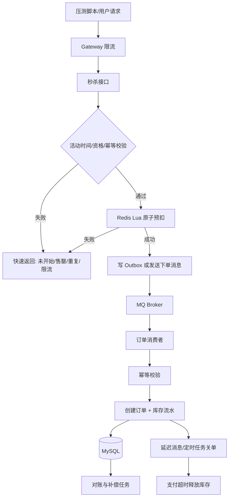
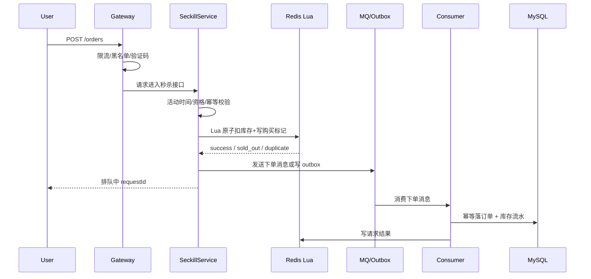
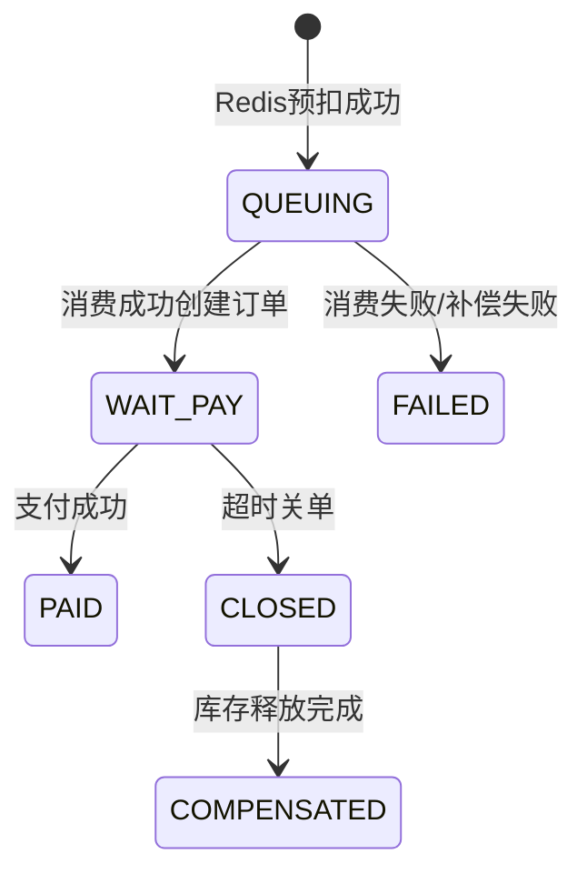

# 项目-高并发秒杀系统

> [!info] 项目简介
> 训练限流、库存扣减、异步下单、幂等、防超卖、补偿和压测分析。面试目标不是只说“用了 Redis 和 MQ”，而是能证明在高并发下如何保证库存正确、链路可观测、异常可补偿。

## 📌 项目背景

秒杀活动的特点是库存少、流量突刺、热点集中、用户重复请求多。如果所有请求都直接进入数据库，会造成连接池耗尽、行锁竞争、接口超时甚至超卖。本项目用“入口削峰 + Redis 原子预扣 + MQ 异步下单 + DB 兜底 + 对账补偿”的方式，把瞬时流量压缩到数据库可承受范围内。

## 🎯 项目目标

- 支持“活动预热 -> 秒杀下单 -> 异步创建订单 -> 查询结果 -> 支付超时关单 -> 库存补偿”的最小闭环。
- 证明不会超卖：Redis Lua 预扣、MQ 异步落库、数据库唯一约束/条件更新三层兜底。
- 证明可恢复：Redis 扣减成功但 MQ 失败、消费失败、重复消费、支付超时等异常都有补偿路径。
- 形成面试证据：记录 QPS、P95/P99、拒绝率、成功订单数、重复订单数、MQ lag、库存一致性校验 SQL 和限流触发日志。

## 🛠️ 技术栈

| 类别 | 选型 |
| ---- | ---- |
| 主技术栈 | Spring Boot + Redis Lua + RocketMQ/Kafka + MySQL + Sentinel/Resilience4j |
| 核心模块 | 活动管理、库存预热、资格校验、秒杀下单、订单落库、超时关单、库存对账 |
| 验证工具 | JMeter/Gatling、Redis MONITOR、MQ 消费位点、MySQL 一致性校验 SQL、应用指标 |

## 🏗️ 架构设计



## 🔌 接口设计

| 接口 | 方法 | 作用 | 关键点 |
| ---- | ---- | ---- | ------ |
| `/api/seckill/activities/{id}/preheat` | POST | 活动预热 | 把活动状态、库存、版本写入 Redis |
| `/api/seckill/{activityId}/orders` | POST | 秒杀下单 | 返回 `排队中/售罄/重复/限流`，不直接同步落库 |
| `/api/seckill/orders/{requestId}` | GET | 查询排队结果 | 查询资格、订单状态和失败原因 |
| `/api/seckill/orders/{orderId}/pay` | POST | 模拟支付 | 支付成功更新订单状态，和关单互斥 |
| `/api/seckill/orders/{orderId}/close` | POST | 模拟关单 | 超时未支付释放库存，记录补偿流水 |

## 🗄️ 表结构设计

```sql
CREATE TABLE seckill_activity (
  id BIGINT PRIMARY KEY,
  sku_id BIGINT NOT NULL,
  start_time DATETIME NOT NULL,
  end_time DATETIME NOT NULL,
  total_stock INT NOT NULL,
  status VARCHAR(32) NOT NULL,
  version BIGINT NOT NULL DEFAULT 0,
  created_at DATETIME NOT NULL,
  updated_at DATETIME NOT NULL
);

CREATE TABLE seckill_stock (
  activity_id BIGINT PRIMARY KEY,
  total_stock INT NOT NULL,
  available_stock INT NOT NULL,
  frozen_stock INT NOT NULL DEFAULT 0,
  sold_stock INT NOT NULL DEFAULT 0,
  version BIGINT NOT NULL DEFAULT 0
);

CREATE TABLE seckill_order (
  id BIGINT PRIMARY KEY,
  request_id VARCHAR(64) NOT NULL,
  activity_id BIGINT NOT NULL,
  user_id BIGINT NOT NULL,
  status VARCHAR(32) NOT NULL,
  created_at DATETIME NOT NULL,
  paid_at DATETIME NULL,
  closed_at DATETIME NULL,
  UNIQUE KEY uk_activity_user(activity_id, user_id),
  UNIQUE KEY uk_request(request_id)
);

CREATE TABLE seckill_stock_flow (
  id BIGINT PRIMARY KEY,
  activity_id BIGINT NOT NULL,
  order_id BIGINT NULL,
  request_id VARCHAR(64) NOT NULL,
  flow_type VARCHAR(32) NOT NULL,
  quantity INT NOT NULL,
  created_at DATETIME NOT NULL,
  UNIQUE KEY uk_request_flow(request_id, flow_type)
);

CREATE TABLE outbox_event (
  id BIGINT PRIMARY KEY,
  event_type VARCHAR(64) NOT NULL,
  biz_key VARCHAR(128) NOT NULL,
  payload JSON NOT NULL,
  status VARCHAR(32) NOT NULL,
  retry_count INT NOT NULL DEFAULT 0,
  next_retry_time DATETIME NULL,
  created_at DATETIME NOT NULL,
  updated_at DATETIME NOT NULL,
  UNIQUE KEY uk_biz_event(event_type, biz_key)
);
```

## 🔑 Redis Key 设计

| Key | 示例 | 类型 | TTL | 说明 |
| --- | ---- | ---- | --- | ---- |
| 活动状态 | `seckill:activity:{id}:status` | String | 活动结束后 1 天 | `PREHEATED/RUNNING/SOLD_OUT/END` |
| 库存 | `seckill:stock:{id}` | String | 活动结束后 1 天 | Lua 原子扣减 |
| 已购用户 | `seckill:buyers:{id}` | Set/Bitmap | 活动结束后 1 天 | 防重复购买 |
| 请求结果 | `seckill:result:{requestId}` | Hash/String | 30 分钟 | 排队中、成功、失败原因 |
| 限流计数 | `seckill:rate:{activityId}:{second}` | String | 秒级 | 简单窗口限流 |

## ⚙️ 核心流程

### 1. 活动预热

1. 校验活动状态和库存。
2. 写入 `seckill:stock:{activityId}`。
3. 写入活动状态和版本号。
4. 清理历史购买标记和请求结果。
5. 记录预热日志，方便排查 Redis 与 DB 库存不一致。

### 2. 秒杀下单



### 3. Lua 原子扣减

```lua
-- KEYS[1] stock key
-- KEYS[2] buyers key
-- ARGV[1] userId
local bought = redis.call('SISMEMBER', KEYS[2], ARGV[1])
if bought == 1 then
  return -2
end

local stock = tonumber(redis.call('GET', KEYS[1]) or '0')
if stock <= 0 then
  return -1
end

redis.call('DECR', KEYS[1])
redis.call('SADD', KEYS[2], ARGV[1])
return 1
```

## 🧱 幂等与一致性设计

| 风险 | 方案 | 兜底 |
| ---- | ---- | ---- |
| 用户重复点击 | Redis 已购标记 + DB 唯一索引 | `uk_activity_user(activity_id,user_id)` |
| 接口超时重试 | `requestId` 幂等 | `uk_request(request_id)` |
| Redis 扣减成功但 MQ 失败 | Outbox 本地消息表或发送确认重试 | 扫描失败事件，失败则回补库存和购买标记 |
| 消费者重复消费 | 订单唯一键 + 库存流水唯一键 | 消费失败重试必须可幂等 |
| DB 落库失败 | 消息重试 + DLQ + 人工补偿 | 对账任务校验 Redis 扣减数与订单数 |
| 支付成功和超时关单并发 | 状态机条件更新 | `WHERE status='WAIT_PAY'` 互斥 |

## 🧾 订单状态机



状态更新必须使用条件更新：

```sql
UPDATE seckill_order
SET status = 'PAID', paid_at = NOW()
WHERE id = ? AND status = 'WAIT_PAY';
```

## 📊 压测与验收方案

### 压测场景

| 场景 | 配置 | 验收口径 |
| ---- | ---- | -------- |
| 基础正确性 | 库存 100，请求 1000 | 成功订单数 = 100，无重复用户 |
| 高并发压测 | 库存 1000，请求 10000/50000 | 无超卖，P95/P99 可记录，限流生效 |
| 重复点击 | 同一用户并发 20 次 | 最多一个订单 |
| MQ 消费失败 | 人工让消费者抛异常 | 能重试，最终成功或进入 DLQ |
| 支付/关单并发 | 同订单支付与关单同时触发 | 只能一个状态成功 |

### 关键指标

- 接口 QPS、P95、P99、错误率、限流拒绝率。
- Redis CPU、命令耗时、库存 key 剩余量。
- MQ lag、消费 TPS、重试次数、DLQ 数量。
- MySQL TPS、慢 SQL、锁等待、唯一键冲突次数。
- 一致性指标：`成功订单数 + Redis剩余库存 + 已补偿库存 = 初始库存`。

### 一致性校验 SQL

```sql
SELECT activity_id, COUNT(*) AS paid_or_wait_orders
FROM seckill_order
WHERE activity_id = ? AND status IN ('WAIT_PAY', 'PAID')
GROUP BY activity_id;

SELECT activity_id,
       total_stock,
       available_stock,
       frozen_stock,
       sold_stock,
       total_stock - available_stock - frozen_stock - sold_stock AS diff
FROM seckill_stock
WHERE activity_id = ?;

SELECT activity_id, user_id, COUNT(*) c
FROM seckill_order
GROUP BY activity_id, user_id
HAVING c > 1;
```

## 🐛 典型故障复盘模板

### 故障 1：Redis 预扣成功但 MQ 发送失败

- **现象**：用户返回排队中，但订单长时间查不到。
- **根因**：发送 MQ 超时，业务没有记录 outbox，导致资格悬挂。
- **修复**：Redis 扣减成功后写 outbox，由后台任务投递；若投递超过重试上限，回补库存并删除购买标记。
- **验证**：模拟 MQ 不可用，确认 outbox 重试和回补日志存在，最终库存一致。

### 故障 2：消费者重复消费

- **现象**：消息重试后消费者再次创建订单。
- **根因**：只按 `messageId` 去重，生产重试生成了不同 `messageId`。
- **修复**：用业务 `requestId` 和 `(activity_id,user_id)` 唯一键做幂等。
- **验证**：同一消息重复投递 10 次，最终只有 1 条订单和 1 条库存流水。

### 故障 3：支付成功与超时关单并发

- **现象**：支付回调成功，但关单任务也释放库存。
- **根因**：状态更新没有条件约束。
- **修复**：支付和关单都使用 `WHERE status='WAIT_PAY'` 条件更新，更新行数为 0 时不再执行后续动作。
- **验证**：并发触发支付和关单，最终状态只能是 `PAID` 或 `CLOSED` 之一。

## 🎤 面试 3 层回答

### 30 秒版

这个秒杀系统的核心是把数据库前置保护起来：入口限流削峰，Redis Lua 原子预扣库存，MQ 异步创建订单，数据库唯一约束和条件更新兜底，最后通过 outbox、重试、DLQ 和对账任务保证异常可恢复。

### 2 分钟版

我会先做活动预热，把库存和活动状态放到 Redis。用户请求进来后，网关限流，服务端校验活动时间、资格和幂等 token，然后用 Lua 一次完成“库存大于 0、用户未买、扣库存、写购买标记”。扣减成功只代表拿到下单资格，真正订单通过 MQ 异步落库。消费者侧用 `requestId`、`activity_id + user_id` 唯一索引和库存流水做幂等。支付超时关单和支付成功用状态机条件更新互斥。最后用压测和一致性 SQL 证明没有超卖和重复下单。

### 项目版

这个项目我重点证明三件事：第一，高并发入口不会把 DB 打穿，通过限流和 Redis 预扣削峰；第二，不会超卖，Redis、MQ 消费者和 DB 唯一约束三层兜底；第三，异常可恢复，比如 MQ 失败用 outbox 重试或回补，消费失败进入 DLQ，对账任务校验订单数、库存数和流水数是否一致。

## 🎯 高频追问

> [!question] 高频问题
> - Q: 为什么先扣 Redis，不直接扣数据库？
>   - A: 秒杀是瞬时高并发热点写，直接打 DB 会造成行锁竞争和连接池耗尽。Redis Lua 可以把绝大多数无效请求挡在数据库前面，但 DB 仍要用唯一约束和条件更新兜底。
> - Q: Redis 扣减成功但 MQ 发送失败怎么办？
>   - A: 不能只依赖同步发送。可用 outbox 本地消息表或事务消息；超过重试上限要回补库存和购买标记，并把请求结果标记失败。
> - Q: 如何防止重复下单？
>   - A: 接口层 requestId 幂等、Redis 已购标记、消费者幂等表、DB `(activity_id,user_id)` 唯一索引，多层兜底。
> - Q: 如何证明没有超卖？
>   - A: 固定库存压测后校验成功订单数、库存流水、Redis 剩余库存和 DB 库存字段；成功订单数不能超过初始库存，重复用户数必须为 0。
> - Q: 热点 key 扛不住怎么办？
>   - A: 入口限流、库存分片、分段放量、本地只读缓存活动状态、必要时队列化请求。库存分片要额外做汇总和少卖补偿。

## 📋 开发任务拆解

- [ ] 建表：活动表、库存表、订单表、库存流水表、outbox 表，订单表加 `(activity_id,user_id)` 唯一索引。
- [ ] 实现库存预热：活动开始前把库存写入 Redis，记录版本号和预热时间。
- [ ] 实现秒杀接口：校验时间窗、用户资格、幂等 token，用 Lua 原子扣减库存。
- [ ] 实现异步下单：消息体带 `requestId`，消费者先查幂等再落库。
- [ ] 实现补偿：消费失败重试，DLQ，库存回补，支付超时关闭订单。
- [ ] 压测验收：固定库存 1000，压测 10 倍请求，验证成功订单数等于扣减库存数且无重复用户。

## 🧠 关键技术点

- [[../06-中间件/03-消息可靠性-顺序-幂等]]
- [[../05-数据库与存储/05-Redis数据结构与应用]]
- [[../05-数据库与存储/03-MySQL锁机制]]
- [[../04-Spring生态/03-Spring事务管理]]
- [[../07-分布式与微服务/06-限流-熔断-降级]]
- 面试抓手：为什么先 Redis 扣库存、MQ 消息丢失怎么补偿、数据库如何兜底防超卖、热点 key 如何拆分。

## 📊 成果与复盘

- 演示入口：`POST /api/seckill/{activityId}/orders`，返回排队中/成功/售罄/限流。
- 性能数据：记录 QPS、P95、P99、Redis CPU、MQ lag、订单落库 TPS、库存一致性 SQL。
- 复盘证据：保留 Lua 脚本、消费者幂等代码、限流配置、压测报告和一次 MQ 失败补偿记录。

## 🔗 关联笔记

- [[_index]]
- [[../08-系统设计/04-秒杀系统设计]]
- [[../06-中间件/03-消息可靠性-顺序-幂等]]

## 📚 参考资料

- Redis 官方文档：Lua scripting 与事务语义。
- RocketMQ / Kafka 官方文档：生产者重试、消费者确认和消息顺序。
- MySQL 官方文档：唯一索引、事务隔离和 InnoDB 锁。
- Sentinel / Resilience4j 官方文档：限流、熔断和降级配置。
