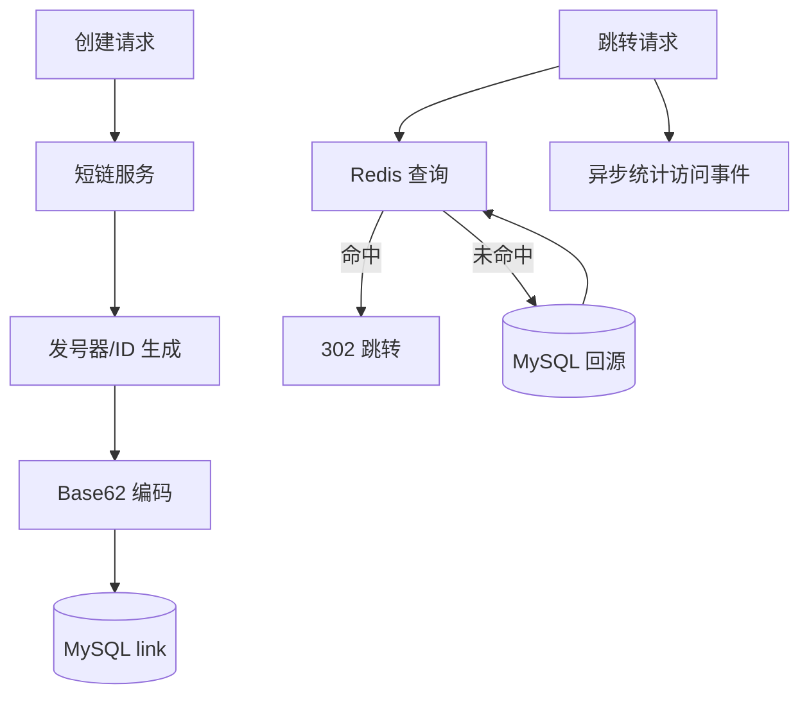

# 项目-短链服务

> [!info] 项目简介
> 掌握短码生成、跳转性能、缓存、防刷、数据归档和容量估算。

## 🎯 项目目标

- 支持长链创建、短链跳转、访问统计、过期回收和黑名单拦截。
- 说清短码生成策略：号段发号/雪花 ID + Base62，避免随机碰撞带来的重试风暴。
- 给出容量估算：短码长度、日新增链接数、跳转 QPS、Redis 命中率和 MySQL 分片策略。

## 🛠️ 技术栈

| 类别 | 选型 |
| ---- | ---- |
| 主技术栈 | Spring Boot + MySQL + Redis + BloomFilter + 分库分表 |
| 核心模块 | 短码生成、链接存储、跳转缓存、访问统计、防刷风控、过期归档 |
| 验证工具 | 压测脚本、缓存命中率指标、慢 SQL、热点短链访问日志 |

## 🏗️ 架构设计

## 📋 开发任务拆解

- [ ] 建表：`short_link`、`link_access_log`、`domain_blacklist`，短码唯一索引，按 create_time 或 code hash 分片。
- [ ] 实现创建接口：校验域名、生成 code、写库、预热 Redis。
- [ ] 实现跳转接口：Redis 命中直接 302；未命中回源 MySQL，空结果写 BloomFilter/空值缓存。
- [ ] 实现统计链路：访问日志异步写入，按小时聚合 PV/UV/IP。
- [ ] 实现风控：同 IP 创建频率限制、黑名单域名拒绝、异常跳转告警。
- [ ] 压测验收：跳转接口缓存命中率高于 95%，热点短链 P95 稳定，数据库回源不被打穿。

## 🧠 关键技术点

- [[../08-系统设计/05-短链系统设计]]
- [[../05-数据库与存储/07-缓存穿透-击穿-雪崩]]
- [[../05-数据库与存储/08-分库分表与读写分离]]
- 面试抓手：短码如何避免碰撞、热点短链怎么扛、缓存穿透怎么处理、访问统计为什么异步。

## 🐛 问题记录

| 日期 | 问题 | 解决方案 |
| ---- | ---- | -------- |
| 2026-07-04 | 初版计划缺少容量和跳转验证 | 增加短码、缓存、统计和防刷验收口径 |

## 📊 成果与复盘

- 演示入口：`POST /api/links` 创建短链，`GET /{code}` 返回 302 跳转。
- 性能数据：记录跳转 QPS、P95、缓存命中率、MySQL 回源比例、短码冲突次数。
- 复盘证据：保留容量估算表、分片规则、防刷配置和热点短链压测报告。

## 🔗 关联笔记

- [[_index]]

## 📚 参考资料

- System Design Primer：URL Shortener 设计案例。
- Redis 官方文档：缓存、过期策略和 Bloom Filter/模块生态。
- MySQL 官方文档：索引、分区和执行计划。
- Google SRE Book：容量规划、错误预算和过载保护。
