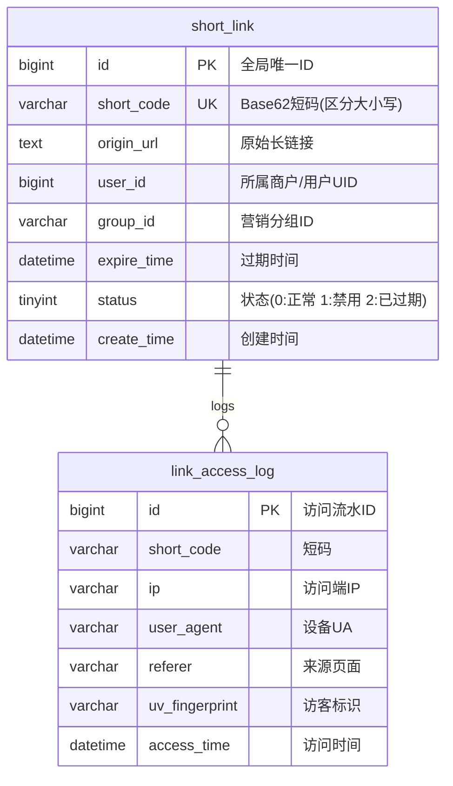

# 项目实战：百亿级高可用高性能短链服务全栈落地

> **关联理论**：[[../08-系统设计/05-短链系统设计|短链系统设计]]、[[../08-系统设计/03-缓存架构设计|缓存架构]]、[[../06-中间件/01-消息队列基础与核心问题处理|消息队列与核心问题]]、[[../06-中间件/05-Kafka架构原理与实战手册|Kafka高吞吐]]

---

## 1. 业务背景与项目全貌

### 1.1 业务痛点分析
在短信营销、社交分享和二维码分发场景中，原始长链接往往包含大量跟踪参数，不仅占用字符数，而且直接暴露业务参数。短链服务的核心任务是将冗长的原始 URL 映射为简短的字符码（如 `t.cn/A6x9K2`），并在用户点击时完成毫秒级跳转与访问统计。其核心技术挑战包括：
1. **百亿级短码唯一且不可预测**：如果直接使用自增 ID 转 62 进制，生成的短码具有明显的连续规律，外部人员极易通过顺序遍历爬取出所有业务链接；如果使用哈希算法截取前 6 位，在数据量增长后会频繁发生哈希碰撞。
2. **极端的读多写少与缓存穿透风险**：一条营销短链生成后可能被点击数百万次，且恶意攻击者常会构造大量不存在的随机短码发起请求，若直接穿透到数据库会导致连接池瞬间耗尽。
3. **高并发跳转不能被统计逻辑拖慢**：每次跳转都需要记录 PV、UV、设备类型与来源地区，如果在跳转主线程中同步写库，会严重拉高重定向延迟。

### 1.2 架构演进与 STAR 复盘参考

```text
【项目名称】：百亿级高可用短链中台与实时访问分析系统
【业务痛点】：营销高峰期短链跳转请求量极大，传统哈希截断发号存在碰撞重试开销，自增发号容易被遍历探测，且同步记录访问日志严重拖慢跳转响应速度。
【核心方案】：
  1. 零碰撞乱序发号：基于号段发号器生成全局唯一自增 ID，通过 Feistel 网络结构将连续整数双射置换为离散整数，再进行 Base62 编码，兼顾零哈希碰撞与防顺序遍历；
  2. 多级缓存与防穿透：采用“布隆过滤器 + Caffeine 本地缓存 + Redis 分布式缓存 + 空值短 TTL 兜底”的四层防护体系，拦截无效短码探测并卸载热点流量；
  3. 跳转与统计异步解耦：重定向接口统一返回 302 状态码并设置 Cache-Control 策略，同时将访问事件异步投递至 Kafka，由下游消费者批量写库并结合 HyperLogLog 统计 UV；
  4. 分表路由设计：围绕核心高频查询 WHERE short_code = ?，以 short_code 哈希取模进行分库分表，实现跳转回源单表精准定位。
【达成效果】：在保障百亿级短码空间零碰撞生成的同时，将重定向接口平均响应耗时控制在毫秒级，并支撑实时精准的营销点击报表分析。
```

---

## 2. 数据库与分片架构设计

短链系统的访问特征非常鲜明：**写操作低频（创建短链），读操作极高频（点击跳转），且读请求的参数只有短码 `short_code`**。

### 2.1 核心实体关系图



### 2.2 分表 DDL 规范

由于 MySQL 默认的 `utf8mb4_general_ci` 排序规则是不区分大小写的（会把 `'a'` 和 `'A'` 视为相同字符），而 Base62 编码必须严格区分大小写字母，因此 `short_code` 字段必须显式指定 `COLLATE ascii_bin` 二进制排序规则。

```sql
-- 短链路由映射表（按 short_code 一致性哈希分 16 张表：t_short_link_0 ~ t_short_link_15）
CREATE TABLE `t_short_link_0` (
  `id` BIGINT NOT NULL COMMENT '全局唯一主键',
  `short_code` VARCHAR(16) CHARACTER SET ascii COLLATE ascii_bin NOT NULL COMMENT 'Base62短码(严格区分大小写)',
  `origin_url` TEXT NOT NULL COMMENT '原始长链接',
  `user_id` BIGINT NOT NULL COMMENT '创建者UID',
  `group_id` VARCHAR(32) NOT NULL DEFAULT 'default' COMMENT '营销分组',
  `expire_time` DATETIME NOT NULL DEFAULT '2099-12-31 23:59:59' COMMENT '到期时间',
  `status` TINYINT NOT NULL DEFAULT 0 COMMENT '0-正常 1-禁用 2-已过期',
  `create_time` DATETIME NOT NULL DEFAULT CURRENT_TIMESTAMP,
  PRIMARY KEY (`id`),
  UNIQUE KEY `uk_short_code` (`short_code`),
  KEY `idx_user_group` (`user_id`, `group_id`)
) ENGINE=InnoDB DEFAULT CHARSET=utf8mb4;
```

---

## 3. 核心算法与代码实现

### 3.1 短码生成算法：Feistel 置换 + Base62 编码

如何让生成的短码既像哈希一样杂乱无章（防止外部按顺序猜测），又像自增 ID 一样绝对不发生碰撞（无需查库重试）？
答案是利用密码学中的 **Feistel 置换网络**。Feistel 结构在固定位宽的整数域上是一个严格的一一映射（双射，Bijective）：给定不同的输入 ID，必定产生不同的输出整数；且连续递增的 ID 经过多轮异或置换后，输出值在数值空间内呈伪随机离散分布。

7 位 Base62 字符可表达 $62^7 \approx 3.52 \times 10^{12}$（3.5 万亿）个短码，因此我们可以在 40 位整数域（约 1.1 万亿容量）或 64 位整数域内执行 Feistel 置换，再转换为 62 进制字符串。

```java
public class ShortLinkCodec {

    private static final String BASE62_CHARS = "0123456789abcdefghijklmnopqrstuvwxyzABCDEFGHIJKLMNOPQRSTUVWXYZ";
    private static final int ROUNDS = 4;
    private static final long MASK_32 = 0xFFFFFFFFL;
    private static final long[] ROUND_KEYS = {0x6a09e667L, 0xbb67ae85L, 0x3c6ef372L, 0xa54ff53aL};

    /**
     * Feistel 双射置换：将递增的 64 位整数置换成离散分布的 64 位整数
     * 核心性质：不同输入必然对应不同输出，从数学上消除碰撞可能
     */
    public static long permuteId(long id) {
        long left = (id >>> 32) & MASK_32;
        long right = id & MASK_32;

        for (int i = 0; i < ROUNDS; i++) {
            long roundOutput = roundFunction(right, ROUND_KEYS[i]);
            long newRight = left ^ roundOutput;
            left = right;
            right = newRight;
        }
        return (left << 32) | (right & MASK_32);
    }

    private static long roundFunction(long r, long key) {
        long hash = (r ^ key) * 0x5deece66dL + 0xbL;
        return (hash ^ (hash >>> 16)) & MASK_32;
    }

    /**
     * 将 64 位整数按无符号方式编码为 Base62 字符串（不足 6 位补 '0'）
     */
    public static String toBase62(long num) {
        StringBuilder sb = new StringBuilder();
        while (num != 0) {
            int remainder = (int) Long.remainderUnsigned(num, 62);
            sb.append(BASE62_CHARS.charAt(remainder));
            num = Long.divideUnsigned(num, 62);
        }
        while (sb.length() < 6) {
            sb.append('0');
        }
        return sb.reverse().toString();
    }
}
```

> **实现要点**：在进行 62 进制取模与除法时，使用 `Long.remainderUnsigned` 和 `Long.divideUnsigned` 处理全部 64 位无符号位模式。切勿使用 `Math.abs(num)`，因为正负对称数值取绝对值后会折叠为同一个正数，破坏一一映射关系。

---

### 3.2 极速跳转控制器（布隆过滤器 + 多级缓存 + 302 重定向）

当用户访问短链时，系统按照“格式校验 -> 布隆过滤器判存 -> Caffeine 本地缓存 -> Redis 分布式缓存 -> MySQL 回源”的顺序处理，并通过 Kafka 异步发送访问统计事件。

```java
@RestController
@RequiredArgsConstructor
@Slf4j
public class ShortLinkRedirectController {

    private final RBloomFilter<String> shortLinkBloomFilter;
    private final Cache<String, ShortLinkEntity> localCache;
    private final StringRedisTemplate redisTemplate;
    private final ShortLinkRepository shortLinkRepository;
    private final KafkaTemplate<String, String> kafkaTemplate;

    @GetMapping("/{code}")
    public void redirect(@PathVariable String code,
                         HttpServletRequest request,
                         HttpServletResponse response) throws IOException {
        // 1. 基础格式校验，拦截非法字符请求
        if (!code.matches("[0-9A-Za-z]{6,11}")) {
            response.sendError(HttpServletResponse.SC_NOT_FOUND);
            return;
        }

        // 2. 布隆过滤器快速拦截不存在的短码，防止随机扫号穿透到存储层
        if (!shortLinkBloomFilter.contains(code)) {
            response.sendError(HttpServletResponse.SC_NOT_FOUND);
            return;
        }

        // 3. 查询一级缓存（Caffeine 本地热点缓存）
        ShortLinkEntity link = localCache.getIfPresent(code);
        if (link == null) {
            // 4. 查询二级缓存（Redis），包含防假阳性穿透的 "NULL" 空值标记
            String cacheKey = "link:route:" + code;
            String cachedVal = redisTemplate.opsForValue().get(cacheKey);
            if ("NULL".equals(cachedVal)) {
                response.sendError(HttpServletResponse.SC_NOT_FOUND);
                return;
            }

            if (cachedVal != null) {
                link = JsonUtil.fromJson(cachedVal, ShortLinkEntity.class);
            } else {
                // 5. 回源查询数据库，并回填缓存（若不存在则写入 60 秒空值缓存）
                link = shortLinkRepository.findByCode(code);
                if (link == null) {
                    redisTemplate.opsForValue().set(cacheKey, "NULL", 60, TimeUnit.SECONDS);
                    response.sendError(HttpServletResponse.SC_NOT_FOUND);
                    return;
                }
                long ttlSeconds = Math.max(1, Duration.between(LocalDateTime.now(), link.getExpireTime()).getSeconds());
                redisTemplate.opsForValue().set(cacheKey, JsonUtil.toJson(link), Math.min(ttlSeconds, 86400), TimeUnit.SECONDS);
            }
            localCache.put(code, link);
        }

        // 6. 校验短链启用状态与有效期
        if (link.getStatus() != 0 || !link.getExpireTime().isAfter(LocalDateTime.now())) {
            response.sendError(HttpServletResponse.SC_NOT_FOUND);
            return;
        }

        // 7. 异步投递访问日志到 Kafka，不阻塞跳转主线程
        AccessLogEvent event = AccessLogEvent.from(code, request);
        kafkaTemplate.send("short-link-access-topic", code, JsonUtil.toJson(event));

        // 8. 执行 302 临时重定向，禁止浏览器强缓存以便准确统计每次点击
        response.setStatus(HttpServletResponse.SC_FOUND);
        response.setHeader("Location", link.getOriginUrl());
        response.setHeader("Cache-Control", "no-store");
    }
}
```

> **缓存一致性补充**：当商户在后台手动禁用某条违规短链或修改目标地址时，服务端除了更新数据库并删除 Redis 缓存外，还会通过 Redis Pub/Sub 广播一条失效消息，通知所有应用节点立即清除本地 Caffeine 缓存中的对应条目。

---

## 4. 性能压测与调优对比

在 3 台 8C16G 短链解析实例 + 前置 Nginx 负载均衡的压测环境中，不同架构阶段的跳转性能演进如下：

| 调优阶段 | 核心瓶颈定位 | 架构优化措施 | 典型吞吐量 (QPS) | P99 响应延迟 | 数据库负载 |
| :--- | :--- | :--- | :--- | :--- | :--- |
| **阶段 1：同步直连基线** | 每次跳转同步查库并写入 `link_access_log` 流水表，MySQL I/O 迅速饱和 | 剥离同步写日志逻辑，改为 Kafka 异步批量消费入库 | ~1,200 | ~140 ms | CPU > 90% |
| **阶段 2：引入 Redis 与布隆过滤** | 大量热点短链重复读取 Redis 导致单分片网卡打满，且随机无效短码穿透查库 | 引入 Redisson 布隆过滤器拦截无效码，并为空结果设置 60s 负缓存 | ~25,000 | ~12 ms | CPU < 10% |
| **阶段 3：接入 Caffeine 多级缓存** | 头部 1% 的超级热点短链占据了 80% 的流量，网络 RTT 成为最后瓶颈 | 进程内引入 Caffeine 缓存（短过期时间 + 广播失效），热点直接内存命中 | ~68,000 | < 3 ms | 极低 |

---

## 5. 面试高频追问解析

> [!question]- 追问 1：短链跳转为什么通常返回 302（临时重定向），而不是 301（永久重定向）？
> 主要有两个核心原因：
> 1. **保障点击统计与数据分析的准确性**：如果返回 `301 Moved Permanently`，浏览器会将“短链 -> 原始长链”的映射直接缓存在本地磁盘。当用户第二次点击该短链时，浏览器直接跳往目标长链，请求根本不会经过短链服务端，导致营销系统的 PV/UV、点击时间段等核心转化数据严重失真。使用 `302 Found` 并配合 `Cache-Control: no-store` 响应头，可以确保每次点击都经过服务端记录。
> 2. **支持动态修改目标地址与安全封禁**：营销活动常需要根据地域或时段动态切换落地页，或者在发现目标网页违规时紧急拦截下线。301 缓存在客户端后服务端无法主动召回，而 302 始终由服务端掌握跳转控制权。

> [!question]- 追问 2：相比于 MurmurHash 哈希算法，你们采用的“发号器 + Feistel 置换 + Base62”有什么优势？
> 1. **MurmurHash 方案的痛点**：对长链接求 32 位或 64 位 Hash 后转 Base62，虽然实现简单，但本质上是“多对一”的摘要映射，随着短链数量达到千万乃至上亿级，不可避免会发生哈希碰撞。一旦发生碰撞（捕获数据库 `DuplicateKeyException`），就需要在长链末尾拼接随机盐值重新哈希并再次写库，在高并发创链场景下会产生额外的数据库重试开销。
> 2. **发号器 + Feistel 置换的优势**：发号器保证了输入 ID 全局唯一，Feistel 置换在数学上是严格的一对一双射，因此生成的短码**天然零碰撞**，写入数据库一次成功；同时 Feistel 置换打乱了自增 ID 的递增规律，使外部无法通过相邻短码猜测系统规模或遍历爬取链接。

> [!question]- 追问 3：布隆过滤器如果发生误判（假阳性），或者新建了短链，缓存穿透防御逻辑如何闭环？
> 1. **应对假阳性（False Positive）**：布隆过滤器的特性是“判定不存在则一定不存在，判定存在则有极小概率实际上不存在”。当那极小比例（如 0.1%）的不存在短码绕过布隆过滤器查到数据库为空时，我们会在 Redis 中写入一条 `"NULL"` 空值标记并设置较短的过期时间（如 60 秒），防止攻击者用同一个假阳性短码反复击穿数据库。
> 2. **应对新增短链**：在成功创建新短链落库后，同步将该短码加入布隆过滤器，并主动清理 Redis 中可能存在的 `"NULL"` 负缓存，确保新短链生成后立即可被正常访问。

> [!question]- 追问 4：短链系统分库分表时，如何同时满足“按 `short_code` 极速跳转”和“商户按 `user_id` 查询名下短链列表”？
> 1. **主表按 `short_code` 分片**：因为短链跳转的 QPS 远高于商户后台管理查询（读写比往往超过 100:1），且跳转请求只携带 `code`，所以核心路由表必须以 `short_code` 的哈希值作为分片键，保证跳转回源时 100% 单表精准查询，绝不发生跨表广播。
> 2. **商户后台查询采用基因冗余或异构读表**：对于商户后台按 `user_id` 和 `group_id` 分页查看短链列表的需求，可以在创链时同步写入一张按 `user_id` 分片的“商户短链管理表”（双写或通过 Canal 监听 Binlog 异步同步），从而让两端查询都能命中各自分片键，彻底避免跨库扫描。

---

## 6. 核心要点复盘清单

- **302 跳转 + `no-store`**：兼顾每次点击的精准服务端埋点统计与违规链接的实时封禁控制。
- **双射置换发号**：号段发号器提供唯一自增源，Feistel 置换打乱顺序防遍历，无符号 Base62 编码压缩长度（配合 MySQL `ascii_bin` 区分大小写）。
- **四层防穿透与加速**：布隆过滤器拦随机攻击 -> Caffeine 扛极热流量 -> Redis 存常规映射与短时 `"NULL"` 负缓存 -> MySQL 单分片兜底。
- **统计异步化**：重定向主链路只负责地址解析与发消息，访问明细入库与 HyperLogLog UV 聚合全部交由 Kafka 消费者后台完成。
