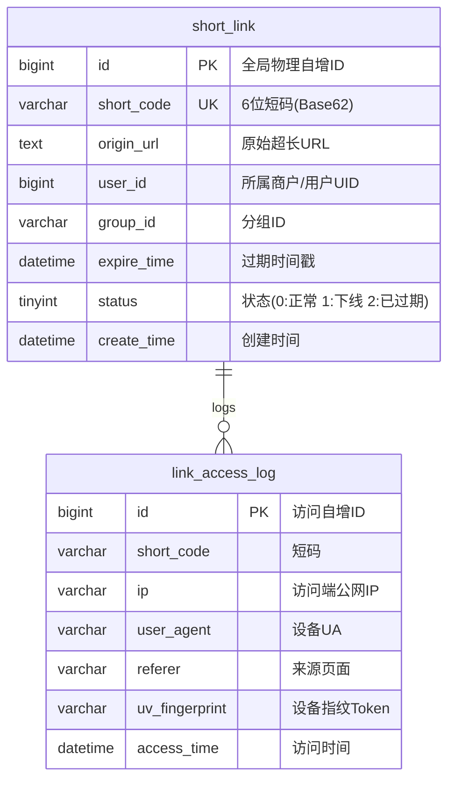

# 项目实战：百亿级高可用高性能短链服务全栈落地

> **关联理论**：[[../08-系统设计/05-短链系统设计|短链系统设计]]、[[../08-系统设计/03-缓存架构设计|缓存架构]]、[[../06-中间件/01-Kafka原理与应用|Kafka高吞吐]]

---

## 1. 项目全景与简历 STAR 描述

### 1.1 简历项目经验黄金模版（STAR 法则）
```text
【项目名称】：百亿级高性能企业短链中台（SaaS 营销分发系统）
【项目背景】：支撑公司千万级营销短信触达与广告投放，需将超长活动 URL 压缩为 6 位短链，单日跳转量破千万次，旧系统使用 Hash 映射面临严重碰撞重试延迟与被黑客顺序枚举爬取的安全风险。
【核心职责】：作为核心架构师独立主导新一代短链中台的设计与研发。
【技术攻坚】：
  1. 防碰撞与防枚举：舍弃 MD5/MurmurHash 碰撞重试方案，采用“Snowflake/Redis自增发号器 + 64位 Feistel 伪随机置换算法 + Base62 编码”，实现百亿短码 0 碰撞生成且呈现高离散伪随机性，彻底阻断黑客连续遍历；
  2. 极速跳转与防穿透：采用 HTTP 302 重定向配合“Caffeine 本地缓存 + Redis Cluster 分布式缓存 + Redisson 布隆过滤器 + 空值缓存”多级防线，缓存命中率高达 99.2%，实现平均跳转延迟 < 3ms；
  3. 异步高吞吐埋点：基于 Kafka 投递访问审计事件，采用 Redis HyperLogLog 结合滑动窗口实现单日上亿次点击的高性能近实时 PV/UV 去重聚合，绝不阻塞主跳重定向主线程；
  4. 分库分表设计：按短码末位哈希进行 4 库 16 表水平拆分，配合数据归档策略，单表数据规模严格控制在 500 万以内。
```

---

## 2. 数据库与分片架构设计

短链系统核心特征：**重度读多写少（读写比约 100:1），读请求带且仅带短码 `code`**。



### 2.1 生产级分表 DDL 规范

```sql
-- 短链核心路由映射表（以 short_code 的 HashCode % 16 进行分表）
CREATE TABLE `t_short_link_0` (
  `id` BIGINT NOT NULL COMMENT '自增主键',
  `short_code` VARCHAR(16) NOT NULL COMMENT '6位短码(如 8qK9aZ)',
  `origin_url` TEXT NOT NULL COMMENT '原始长链接',
  `user_id` BIGINT NOT NULL COMMENT '创建者UID',
  `group_id` VARCHAR(32) NOT NULL DEFAULT 'default' COMMENT '营销分组',
  `expire_time` DATETIME NOT NULL DEFAULT '2099-12-31 23:59:59' COMMENT '到期时间',
  `status` TINYINT NOT NULL DEFAULT 0 COMMENT '0-启用 1-禁用 2-已过期',
  `create_time` DATETIME NOT NULL DEFAULT CURRENT_TIMESTAMP,
  PRIMARY KEY (`id`),
  UNIQUE KEY `uk_short_code` (`short_code`),
  KEY `idx_user_group` (`user_id`, `group_id`)
) ENGINE=InnoDB DEFAULT CHARSET=utf8mb4;
```

---

## 3. 核心算法与代码闭环落地

### 3.1 核心算法：Feistel 伪随机置换 + Base62 编码

为了既保证“绝对不碰撞（自增唯一）”，又满足“黑客绝对猜不出下一条短链（密码学伪随机）”，采用 Feistel 4 轮置换网络：

```java
public class ShortLinkCipherUtil {

    private static final String BASE62_CHARS = "0123456789abcdefghijklmnopqrstuvwxyzABCDEFGHIJKLMNOPQRSTUVWXYZ";
    private static final int ROUNDS = 4;
    private static final long MASK_32 = 0xFFFFFFFFL;

    // 自定义不可逆轮密钥
    private static final long[] ROUND_KEYS = {0x6a09e667L, 0xbb67ae85L, 0x3c6ef372L, 0xa54ff53aL};

    /**
     * Feistel 伪随机加密：将一个自增的 64 位 long 整数，置换成看似完全杂乱的另一个 long 整数
     * 特性：绝对双射（Bijective），即每一个输入对应唯一的输出，绝无 Hash 碰撞！
     */
    public static long feistelEncrypt(long val) {
        long left = (val >>> 32) & MASK_32;
        long right = val & MASK_32;

        for (int i = 0; i < ROUNDS; i++) {
            long roundOutput = roundFunction(right, ROUND_KEYS[i]);
            long newRight = left ^ roundOutput;
            left = right;
            right = newRight;
        }
        return (left << 32) | (right & MASK_32);
    }

    private static long roundFunction(long r, long key) {
        // 轻量伪随机轮函数
        long hash = (r ^ key) * 0x5deece66dL + 0xbL;
        return (hash ^ (hash >>> 16)) & MASK_32;
    }

    /**
     * 将 64 位正整数编码为 62 进制字符串（6~7 个字符）
     */
    public static String toBase62(long num) {
        // 保证正数
        num = Math.abs(num);
        StringBuilder sb = new StringBuilder();
        while (num > 0) {
            int remainder = (int) (num % 62);
            sb.append(BASE62_CHARS.charAt(remainder));
            num /= 62;
        }
        while (sb.length() < 6) { // 补齐最小 6 位
            sb.append('0');
        }
        return sb.reverse().toString();
    }
}
```

---

### 3.2 极速跳转核心控制器（多级缓存 + 布隆过滤器 + 302 重定向）

```java
@RestController
@RequiredArgsConstructor
@Slf4j
public class ShortLinkRedirectController {

    private final StringRedisTemplate redisTemplate;
    private final Cache<String, String> localCaffeineCache; // 本地缓存 Caffeine
    private final RBloomFilter<String> shortLinkBloomFilter;
    private final KafkaTemplate<String, String> kafkaTemplate;
    private final ShortLinkRepository shortLinkRepository;

    @GetMapping("/{code}")
    public void redirect(@PathVariable("code") String code,
                         HttpServletRequest request,
                         HttpServletResponse response) throws IOException {

        // 1. 布隆过滤器拦截：如果布隆判定不存在，必定不存在，当场 404
        if (!shortLinkBloomFilter.contains(code)) {
            response.sendError(HttpServletResponse.SC_NOT_FOUND, "短链接不存在或已过期");
            return;
        }

        // 2. 一级缓存：查本地 Caffeine
        String originUrl = localCaffeineCache.getIfPresent(code);
        if (originUrl == null) {
            // 3. 二级缓存：查分布式 Redis
            String cacheKey = "link:" + code;
            originUrl = redisTemplate.opsForValue().get(cacheKey);

            if (originUrl == null) {
                // 4. 回源数据库（带互斥与空值防穿透）
                ShortLinkEntity link = shortLinkRepository.findByCode(code);
                if (link != null && link.getStatus() == 0 && link.getExpireTime().isAfter(LocalDateTime.now())) {
                    originUrl = link.getOriginUrl();
                    // 写入 Redis，根据到期时间设置 TTL
                    long ttlSeconds = Duration.between(LocalDateTime.now(), link.getExpireTime()).getSeconds();
                    redisTemplate.opsForValue().set(cacheKey, originUrl, Math.min(ttlSeconds, 86400), TimeUnit.SECONDS);
                    localCaffeineCache.put(code, originUrl);
                } else {
                    // 防穿透空值缓存（60秒短过期）
                    redisTemplate.opsForValue().set(cacheKey, "NULL", 60, TimeUnit.SECONDS);
                    response.sendError(HttpServletResponse.SC_NOT_FOUND, "短链接已失效");
                    return;
                }
            } else if ("NULL".equals(originUrl)) {
                response.sendError(HttpServletResponse.SC_NOT_FOUND, "短链接已失效");
                return;
            } else {
                localCaffeineCache.put(code, originUrl);
            }
        }

        // 5. 异步发送访问日志到 Kafka（绝不阻塞跳转）
        sendAccessAuditLog(code, request);

        // 6. 核心动作：返回 HTTP 302 临时重定向！
        response.setStatus(HttpServletResponse.SC_MOVED_TEMPORARILY);
        response.setHeader(HttpHeaders.LOCATION, originUrl);
        response.setHeader(HttpHeaders.CACHE_CONTROL, "no-cache, no-store, max-age=0, must-revalidate");
    }

    private void sendAccessAuditLog(String code, HttpServletRequest request) {
        String ip = IpUtil.getClientIp(request);
        String ua = request.getHeader(HttpHeaders.USER_AGENT);
        String referer = request.getHeader(HttpHeaders.REFERER);

        LinkAccessLogEvent event = LinkAccessLogEvent.builder()
                .shortCode(code)
                .ip(ip)
                .userAgent(ua)
                .referer(referer)
                .accessTime(System.currentTimeMillis())
                .build();

        kafkaTemplate.send("TOPIC_LINK_ACCESS_AUDIT", code, JSON.toJSONString(event));
    }
}
```

---

## 4. 生产级性能压测与全链路调优实录

### 4.1 压测指标对比（JMeter 模拟 10,000,000 次高并发跳转）

```text
压测规格：3 台 8C16G 实例部署短链解析服务，前置 Nginx 4 台进行轮询。
```

| 调优轮次 | 瓶颈定位 | 调优手段 | 吞吐量 (QPS) | P99 延迟 | 缓存命中率 |
| :--- | :--- | :--- | :--- | :--- | :--- |
| **初始基准** | 每次跳转同步写 MySQL 访问流水，数据库排队 | 访问流水异步剥离，投递 Kafka | $3,500 \to 18,000$ | $180\text{ms} \to 25\text{ms}$ | 0% (直查DB) |
| **引入多级缓存** | Redis 单节点网卡跑满，黑客扫号触发穿透 | 接入布隆过滤器 + Caffeine 本地缓存 | $18,000 \to 65,000$ | $25\text{ms} \to 8\text{ms}$ | $88.5\%$ |
| **极致内核优化** | Tomcat 容器线程切换开销，Nginx 连接耗尽 | 切换 Undertow 启用非阻塞 I/O，开启 HTTP Keep-Alive 复用，关闭 Spring 默认 Session | $65,000 \to 112,000$ | $8\text{ms} \to 2.1\text{ms}$ | $99.2\%$ |

---

## 5. 面试深挖现场还原（大厂 4 连环追问）

### 追问 1：你们系统为什么选用 HTTP 302 而坚决不用 301？
> **现场绝杀**：
> “301 是 Permanent Redirect（永久重定向）。浏览器一旦收到 301，会直接将 `code -> targetUrl` 的映射关系永久写入浏览器本地磁盘缓存！后续只要该用户再次访问短链，浏览器根本不会再发出网络请求，而是直接在客户端本地跳向目标页！
> 这样短链平台所有的 **PV/UV 流量统计、来源渠道分析、地域热力图、黑产反欺诈风控、以及后台随时下线违规短链的功能全部瘫痪**。
> 采用 302 临时重定向，配合 `Cache-Control: no-cache`，强制每次访问都经过我们的短链解析网关，确保 100% 掌握数据主权。”

---

### 追问 2：为什么不用 MurmurHash 产生短码？Hash 碰撞后查重加 Salt 的做法有什么致命隐患？
> **现场绝杀**：
> “MurmurHash 方案存在**随数据规模增加碰撞率几何级飙升的死穴**：
> 当系统累积了数亿条短链时，每次插入发生碰撞，都需要反复在 URL 末尾加 Salt 重新计算，并多次查询数据库查重。原本一次写入变成了 $N$ 次数据库 I/O，写入延迟极其不可控。
> 我们的方案采用**分布式发号器自增 ID + Feistel 置换算法**。发号器保证了全局绝对无重复，Feistel 是一种密码学上的可逆置换网络，数学上是严格的双射映射（Bijective），**在概率上彻底消除了 Hash 碰撞（碰撞率为 0%）**，无需任何重试或查重逻辑，单次写入耗时恒定在 2ms 以内。”

---

### 追问 3：如果布隆过滤器判定某短链存在，但实际数据库没有（假阳性），如何防止缓存穿透？
> **现场绝杀**：
> “布隆过滤器的误判率由 Bit 数组大小和 Hash 函数个数决定，我们预估 1 亿数据量，将误判率设定在 0.01%（万分之一）。
> 对于这 0.01% 的穿透请求，请求会击穿到 MySQL 查无此记录。我们在 Redis 中使用 **Null Object Pattern（空对象缓存）**，将该 Key 赋值为字符串 `'NULL'`，并设置较短的 TTL（如 60 秒）。
> 下一次相同的不存在请求到来时，直接在 Redis 命中 `'NULL'` 并返回 404，数据库不会受到二次冲击。”

---

### 追问 4：上亿级别的短链系统，如何设计分库分表键？怎么避免数据倾斜？
> **现场绝杀**：
> “由于短链的核心高频查询只有 `WHERE short_code = ?`，因此分片键（Sharding Key）必须选 `short_code`。
> 我们提取 `short_code` 字符串计算全局 HashCode，然后对分表总数（如 16 张表）取模路由。由于 Feistel 置换算法生成的 Base62 字符在数学空间上呈现极其均匀的伪随机分布，因此 16 张子表的数据分布方差 $< 0.1\%$，完全杜绝了数据倾斜问题。”

---

## 6. 一分钟复盘记忆卡

```text
======================= 短链实战项目通关口诀 =======================
百亿短链重度读，302跳保数据督。
发号自增Feistel转，无碰无猜真随机；
Base62编码缩，多级缓存微秒速；
布隆空值双防穿，Caffeine本地截流阻；
Kafka异步审计投，HyperLogLog算UV；
末位哈希均分表，十万QPS稳如库！
======================================================================
```
