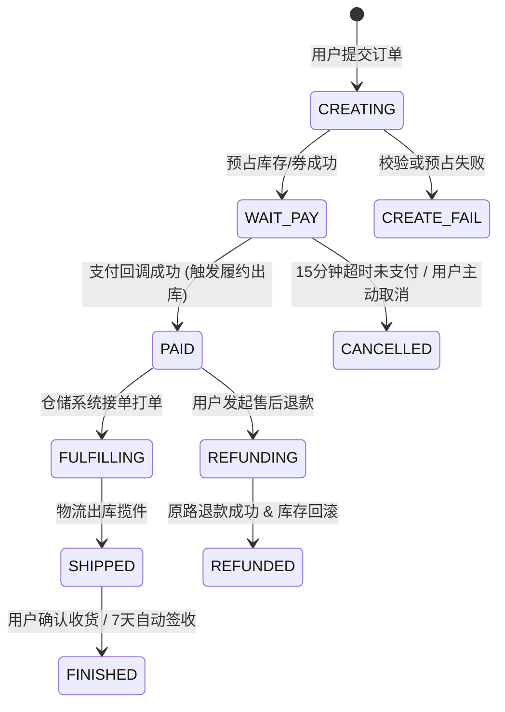
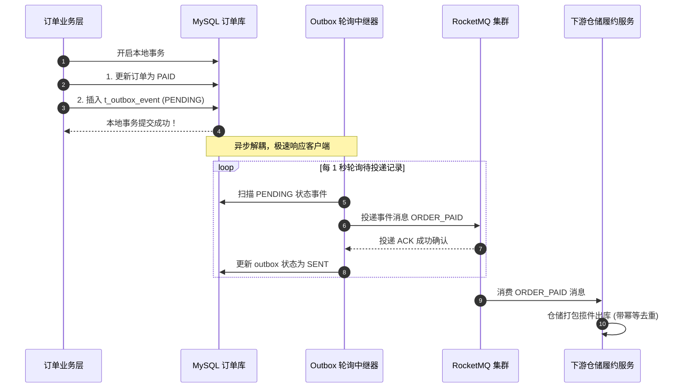
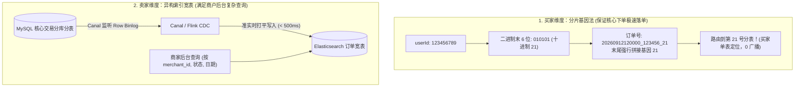

# 项目实战：千万级高可用订单履约与状态机系统全栈落地

> **关联理论**：[[../08-系统设计/07-订单系统设计|订单系统设计]]、[[../07-分布式与微服务/03-分布式事务-2PC-TCC-Saga|分布式事务]]、[[../05-数据库与存储/08-分库分表与读写分离|分库分表]]

---

## 1. 项目全景与简历 STAR 描述

### 1.1 简历项目经验黄金模版（STAR 法则）
```text
【项目名称】：千万级电商分布式订单履约与支付对账中台
【项目背景】：支撑公司全渠道电商业务，日均订单量 200 万笔，链路横跨商品、库存、优惠券、支付、风控与仓储物流。旧系统存在分布式事务长链路死锁、超时关单与晚到支付并发导致“钱扣了但单关了”的客诉死局，以及商家端跨库慢查询严重的问题。
【核心职责】：作为核心交易团队主程，主导订单中心微服务重构与状态机引擎落地。
【技术攻坚】：
  1. 状态机规范化：设计轻量级单向不可逆状态机（FSM），利用“CAS 条件更新 + 严格状态流转拓扑”，彻底杜绝状态乱序跳变与多线程并发覆盖；
  2. 分布式最终一致性：基于 Transactional Outbox（事务发件箱）模式结合 RocketMQ 半事务消息，确保“订单状态推进”与“下游仓储物流派发”达成 100% 最终一致性；
  3. 竞态并发自动闭环：针对“超时关单与微信支付回调晚到”并发冲突，采用数据库行锁判定与自动触发逆向退款工作流，实现资损风险 0 发生；
  4. 分片基因法与异构索引：以买家 userId 基因嵌入 orderNo 末尾完成 8 库 64 表水平拆分，同时利用 Canal 监听 Binlog 准实时同步至 Elasticsearch 宽表，完美兼顾买家与商家端万级 QPS 复杂检索。
```

---

## 2. 状态机与物理模型设计

### 2.1 订单生命周期单向不可逆状态机（FSM）



---

### 2.2 生产级数据库 DDL 设计

```sql
-- 1. 核心订单主表（按 order_no 进行基因分片）
CREATE TABLE `t_order` (
  `id` BIGINT NOT NULL COMMENT '主键ID',
  `order_no` VARCHAR(64) NOT NULL COMMENT '订单号(含分片基因)',
  `user_id` BIGINT NOT NULL COMMENT '买家ID',
  `merchant_id` BIGINT NOT NULL COMMENT '商户ID',
  `total_amount` DECIMAL(12, 2) NOT NULL COMMENT '订单总金额',
  `pay_amount` DECIMAL(12, 2) NOT NULL COMMENT '实付金额',
  `status` VARCHAR(32) NOT NULL COMMENT '状态: WAIT_PAY, PAID, CANCELLED, SHIPPED...',
  `version` INT NOT NULL DEFAULT 0 COMMENT '乐观锁版本',
  `expire_time` DATETIME NOT NULL COMMENT '支付截止时间',
  `create_time` DATETIME NOT NULL DEFAULT CURRENT_TIMESTAMP,
  PRIMARY KEY (`id`),
  UNIQUE KEY `uk_order_no` (`order_no`),
  KEY `idx_user_id` (`user_id`)
) ENGINE=InnoDB DEFAULT CHARSET=utf8mb4;

-- 2. 事务发件箱表（Transactional Outbox，保障跨服务可靠通知）
CREATE TABLE `t_outbox_event` (
  `id` BIGINT NOT NULL AUTO_INCREMENT,
  `event_id` VARCHAR(64) NOT NULL COMMENT '事件全局唯一ID',
  `biz_key` VARCHAR(64) NOT NULL COMMENT '关联业务键(order_no)',
  `event_type` VARCHAR(64) NOT NULL COMMENT '事件类型: ORDER_PAID, ORDER_CANCELLED',
  `payload` JSON NOT NULL COMMENT '消息体数据',
  `status` VARCHAR(16) NOT NULL DEFAULT 'PENDING' COMMENT 'PENDING, SENT, FAILED',
  `retry_count` INT NOT NULL DEFAULT 0,
  `create_time` DATETIME NOT NULL DEFAULT CURRENT_TIMESTAMP,
  PRIMARY KEY (`id`),
  UNIQUE KEY `uk_event_id` (`event_id`),
  KEY `idx_status_retry` (`status`, `retry_count`)
) ENGINE=InnoDB DEFAULT CHARSET=utf8mb4;
```

---

## 3. 核心并发控制与一致性代码实战

### 3.1 支付成功 vs 超时关单并发竞态处理（自动退款闭环）

这是大厂最严苛的资金安全考题：**当 15 分钟关单定时任务与第三方支付回调在同一毫秒到达时，如何做到绝对不发生资损？**

```java
@Service
@RequiredArgsConstructor
@Slf4j
public class OrderPaymentCallbackService {

    private final OrderMapper orderMapper;
    private final OutboxEventMapper outboxEventMapper;
    private final PaymentRefundClient refundClient;
    private final TransactionTemplate transactionTemplate;

    /**
     * 处理支付渠道异步回调（微信/支付宝）
     */
    public boolean handlePaymentCallback(PaymentCallbackDTO callback) {
        String orderNo = callback.getOrderNo();
        String channelTxNo = callback.getChannelTxNo();
        BigDecimal paidAmount = callback.getAmount();

        // 1. 尝试原子更新订单状态为 PAID（核心防线：必须满足 status = 'WAIT_PAY'）
        int rows = orderMapper.updateStatusToPaid(orderNo, "PAID", "WAIT_PAY", channelTxNo);

        if (rows == 1) {
            // 场景 A：抢占成功！订单正常流转为已支付，写入 Outbox 发送履约事件
            transactionTemplate.executeWithoutResult(status -> {
                OutboxEvent event = OutboxEvent.builder()
                        .eventId(UUID.randomUUID().toString())
                        .bizKey(orderNo)
                        .eventType("ORDER_PAID")
                        .payload(JSON.toJSONString(callback))
                        .status("PENDING")
                        .build();
                outboxEventMapper.insert(event);
            });
            log.info("订单支付成功，已触发后续履约流转: {}", orderNo);
            return true;
        }

        // 2. 场景 B：更新受阻（rows == 0），说明此时订单已经不是 WAIT_PAY 了！
        OrderEntity currentOrder = orderMapper.findByOrderNo(orderNo);
        if (currentOrder == null) {
            log.error("致命异常：收到未知订单的支付回调: {}", orderNo);
            return false;
        }

        // 3. 幂等校验：如果已经是 PAID，说明是渠道网络重发回调，直接 ACK
        if ("PAID".equals(currentOrder.getStatus())) {
            log.info("订单已是支付状态，幂等忽略重复回调: {}", orderNo);
            return true;
        }

        // 4. 核心冲突分支：订单已被超时关闭（CANCELLED），但外部渠道确实扣走了用户的钱！
        if ("CANCELLED".equals(currentOrder.getStatus())) {
            log.warn("【资损预警触发】订单已关闭，但渠道扣款成功！立即启动自动逆向退款闭环: {}", orderNo);
            
            // 严禁强行将订单改回 PAID！必须走全自动原路退款
            RefundApplyDTO refundRequest = RefundApplyDTO.builder()
                    .orderNo(orderNo)
                    .channelTxNo(channelTxNo)
                    .refundAmount(paidAmount)
                    .reason("超时关单晚到退款")
                    .build();
            
            // 调用外部支付网关发起原路退款
            RefundResult result = refundClient.executeAutoRefund(refundRequest);
            if (result.isSuccess()) {
                log.info("自动原路退款成功完成，资金闭环建立: {}", orderNo);
                return true;
            } else {
                // 退款失败进入人工告警队列，由运营介入
                log.error("自动退款渠道异常，进入死信待办对账单: {}", orderNo);
                return false;
            }
        }

        return false;
    }
}
```

配套的原子 CAS SQL（利用 InnoDB 行排他锁保证串行安全）：

```sql
UPDATE t_order 
SET status = #{targetStatus}, 
    channel_tx_no = #{channelTxNo},
    pay_time = NOW(),
    version = version + 1
WHERE order_no = #{orderNo} 
  AND status = #{expectStatus}; -- 必须等于 WAIT_PAY 才能推进！
```

---

### 3.2 分布式最终一致性：Transactional Outbox 投递引擎

为了避免分布式事务（如 2PC/XA）造成的超长锁表，我们采用**本地事务发件箱（Outbox）模式**：



---

## 4. 分库分表：分片基因法实战

### 4.1 双端查询困局
- **买家端**：高频查询“我的历史订单”（带 `user_id`）或通过特定 `order_no` 查看详情。
- **卖家端**：商户后台需查看“本店所有订单”（带 `merchant_id`）。
- **矛盾**：若按 `user_id` 分库分表，商户查询必须跨全部 64 张子表做笛卡尔积广播查询（Scatter-Gather），数据库瞬间打爆！

### 4.2 破局之道：买家基因嵌入 + 卖家 Elasticsearch 异构索引



---

## 5. 面试深挖现场还原（大厂 5 连环追问）

> [!question]- 追问 1：如果一个订单包含 3 个商家的 5 种商品，如何保证扣减库存与下单的分布式事务一致性？
> 这涉及**主子订单架构（Parent-Child Order Pattern）**与 **TCC/Saga 柔性事务**：
> 1. **拆单模型**：用户提交的是聚合父订单，下单核心服务在内存中按商家拆分为独立的子订单。
> 2. **预占阶段（Try）**：依次调用各商家的库存服务执行‘预占冻结’（`available - N, frozen + N`），若其中某商品库存不足，立即触发 Saga 逆向补偿工作流，释放前面已预占的其他子订单库存，父订单声明创建失败。
> 3. **确认阶段（Confirm）**：当全部子订单预占与优惠券锁定成功后，一并持久化为待支付订单，进入单向状态机。

> [!question]- 追问 2：你们为什么不用 Seata AT 模式，而选择了 Transactional Outbox 模式？
> Seata AT 模式虽然对业务无侵入，但在大促交易的核心链路上有两大硬伤：
> 1. **全局锁争用与长事务开销**：Seata 在一阶段本地事务提交前，必须向 TC（Transaction Coordinator）注册全局行锁；在二阶段异步提交前，该全局锁一直被持有。面对超高并发下单，全局锁网络往返（RTT）会极大拉长数据库本地行锁的持有时间，导致吞吐断崖式下跌。
> 2. **TC 单点依赖风险**：TC 集群一旦发生网络分区或性能抖动，整个交易主干道全线阻塞。
> 采用 **Transactional Outbox 模式**，状态变更与事件记录完全在同一个单库本地短事务中搞定，耗时 $< 5\text{ms}$，零外部网络 RTT，下游履约异步化，达到了性能与可用性的极致平衡。

> [!question]- 追问 3：晚到支付回调如果退款接口也调用失败了怎么办？
> 这是典型的**退款悬挂（Pending Refund）异常**。
> 1. 我们绝对不会把这种技术失败向用户掩盖，也不会无限在当前请求中重试导致支付渠道超时。
> 2. 我们在本地落下一条状态为 `REFUND_PENDING` 的退款任务记录。
> 3. 后台启动定时对账任务（基于 Elastic-Job / XXL-JOB），每隔 1 分钟扫描未完成的退款单，采用指数退避算法再次向支付网关发起重试查询与退款。
> 4. 若重试 5 次依然受阻（例如渠道账户余额不足），自动升级为 P1 级告警，推送到财务与运营值班大屏，由人工介入走离线绿色通道退款，**做到 100% 账实相符**。

> [!question]- 追问 4：Canal 同步订单到 Elasticsearch 有延迟（约 500ms），商家刚被下单刷新页面看不到怎么办？
> 采用**读写分离延时补偿三板斧**：
> 1. **UI 乐观交互**：商家端通过 WebSocket 接收订单创建通知，前端在内存中优先插入一条‘新订单到达’的占位卡片。
> 2. **短时间路由主库**：商家若手工点击强制刷新，前端携带一个短暂的时间戳标记，网关层判定该商户有最近 1 秒内的新单产生时，降级走带有 `merchant_id` 联合索引的 MySQL 从库查询，或者短暂查 Redis 缓存的最近 50 条商户订单 ID。
> 3. **500ms 后的自然对齐**：对于商家的日常管理后台，半秒钟的数据可见性延迟在业务上是完全合规且可接受的，通过架构将 99.9% 的复杂筛选卸载到 ES，彻底保护了 MySQL 核心交易库的安全。

> [!question]- 追问 5：订单状态机如何防止多线程乱序更新（例如 SHIPPED 消息比 PAID 消息先到）？
> 1. **前置状态矩阵守门**：状态机配置严格的合法流转白名单（例如允许 `WAIT_PAY -> PAID`，允许 `PAID -> SHIPPED`，严禁 `WAIT_PAY -> SHIPPED`）。
> 2. **数据库底层 CAS 防线**：SQL 必须指定原状态：`UPDATE t_order SET status = 'SHIPPED' WHERE order_no = ? AND status = 'PAID'`。若乱序导致先执行发货更新，因条件不满足影响行数为 0，更新失败回滚并抛出状态流转异常，MQ 触发延时重试，直到正确的上一前置状态处理完成为止。

---

## 6. 一分钟复盘记忆卡

```text
======================= 订单履约项目通关口诀 =======================
订单履约生命长，状态不可逆向狂。
CAS条件更新稳，乱序跳变行锁防；
关单晚付莫慌乱，原路退款闭环强；
发件箱表Outbox走，本地短事零锁殃；
分片基因嵌订单，买家单表毫秒量；
卖家异构宽表查，Canal同步ES航；
账实相符对账在，千万交易立如墙！
======================================================================
```
