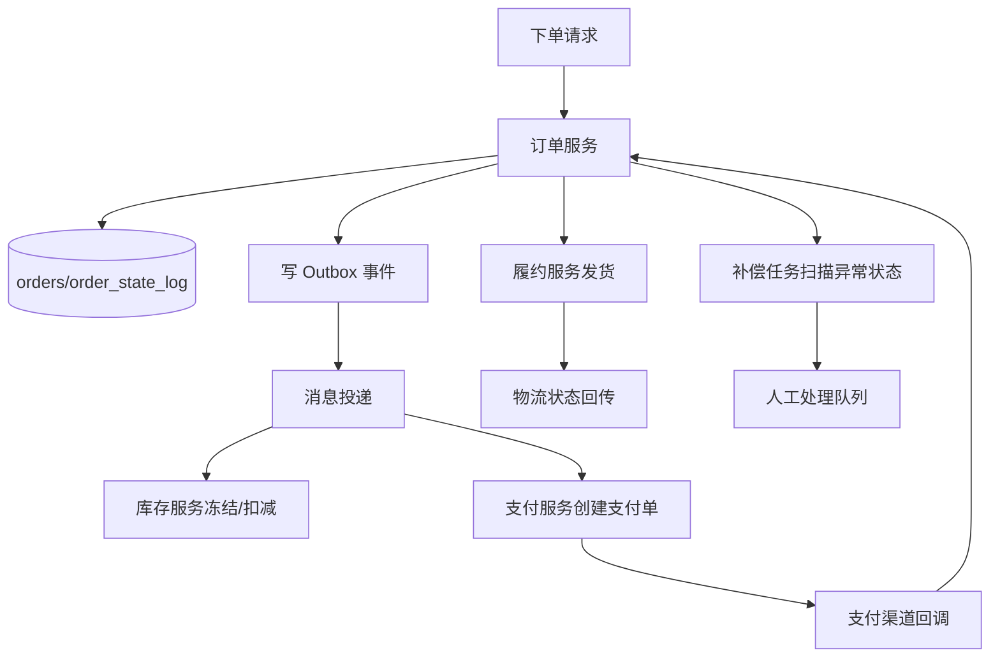
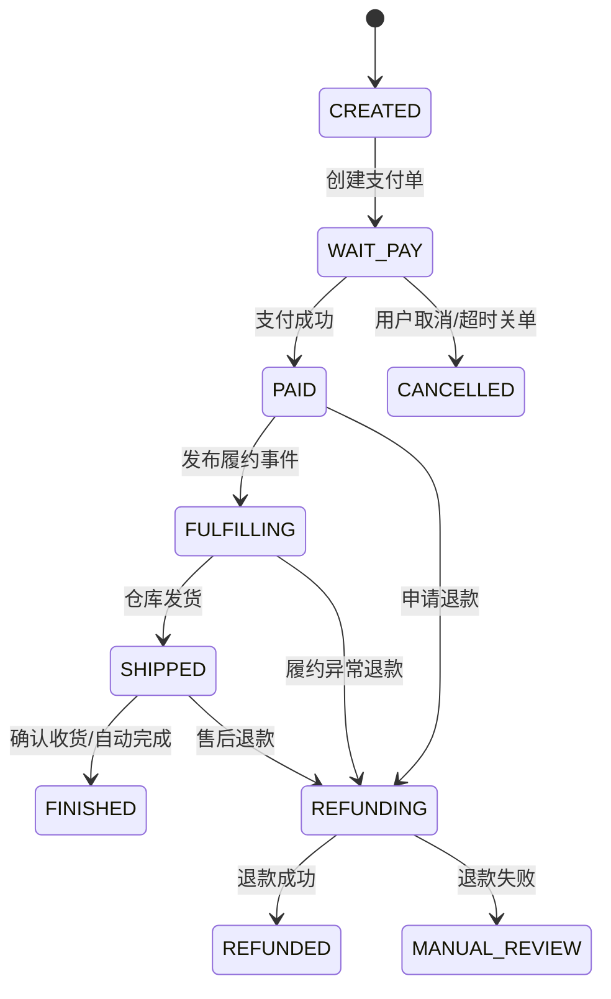
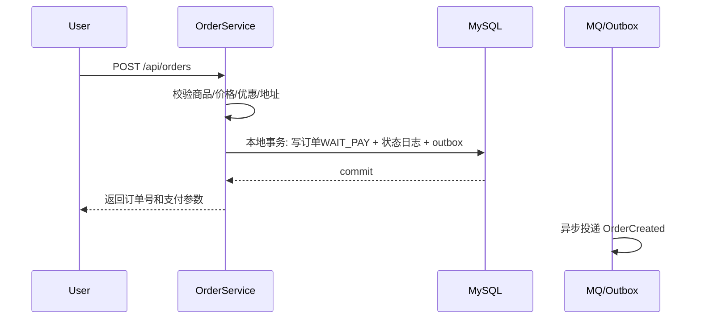
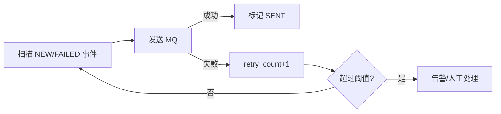

# 项目-订单履约系统

> [!info] 项目简介
> 训练订单状态机、分布式事务、消息一致性、补偿机制和对账能力。面试目标是证明自己能处理真实交易链路中的支付回调、库存冻结、履约发货、退款售后和异常恢复。

## 🎯 项目目标

- 支持“创建订单 -> 支付成功 -> 库存锁定/扣减 -> 发货 -> 完成/取消/退款”的完整状态机。
- 处理跨服务一致性：本地事务 + Outbox/事务消息 + 幂等消费 + 补偿任务，不把分布式事务讲成口号。
- 形成失败路径证据：重复支付、库存扣减失败、消息延迟、补偿重试、人工介入记录。
- 形成面试表达：能讲清为什么用状态机、为什么用 Outbox、支付和关单并发如何处理、补偿如何避免越补越乱。

## 🛠️ 技术栈

| 类别 | 选型 |
| ---- | ---- |
| 主技术栈 | Spring Boot + MySQL + RocketMQ/Kafka + Redis + Saga/TCC 思想 |
| 核心模块 | 订单状态机、库存服务、支付回调、履约发货、Outbox、补偿调度、对账任务 |
| 验证工具 | 状态迁移测试、消息重放脚本、补偿任务日志、链路 Trace、失败注入脚本 |

## 🏗️ 架构设计



## 🧾 订单状态机



所有状态迁移都必须：

- 校验当前状态是否合法。
- 使用条件更新保证并发安全。
- 写入 `order_state_log`。
- 必要时写入 outbox 事件。

## 🗄️ 核心表设计

```sql
CREATE TABLE orders (
  id BIGINT PRIMARY KEY,
  order_no VARCHAR(64) NOT NULL,
  user_id BIGINT NOT NULL,
  status VARCHAR(32) NOT NULL,
  total_amount DECIMAL(18,2) NOT NULL,
  pay_amount DECIMAL(18,2) NOT NULL,
  snapshot JSON NOT NULL,
  idempotency_key VARCHAR(128) NOT NULL,
  created_at DATETIME NOT NULL,
  paid_at DATETIME NULL,
  closed_at DATETIME NULL,
  UNIQUE KEY uk_order_no(order_no),
  UNIQUE KEY uk_user_idem(user_id, idempotency_key)
);

CREATE TABLE order_state_log (
  id BIGINT PRIMARY KEY,
  order_no VARCHAR(64) NOT NULL,
  from_status VARCHAR(32),
  to_status VARCHAR(32) NOT NULL,
  event_type VARCHAR(64) NOT NULL,
  operator VARCHAR(64),
  reason TEXT,
  created_at DATETIME NOT NULL
);

CREATE TABLE outbox_event (
  id BIGINT PRIMARY KEY,
  event_type VARCHAR(64) NOT NULL,
  biz_key VARCHAR(128) NOT NULL,
  payload JSON NOT NULL,
  status VARCHAR(32) NOT NULL,
  retry_count INT NOT NULL DEFAULT 0,
  next_retry_time DATETIME NULL,
  created_at DATETIME NOT NULL,
  updated_at DATETIME NOT NULL,
  UNIQUE KEY uk_event_biz(event_type, biz_key)
);

CREATE TABLE compensation_task (
  id BIGINT PRIMARY KEY,
  task_type VARCHAR(64) NOT NULL,
  biz_key VARCHAR(128) NOT NULL,
  status VARCHAR(32) NOT NULL,
  retry_count INT NOT NULL DEFAULT 0,
  next_retry_time DATETIME NULL,
  last_error TEXT,
  created_at DATETIME NOT NULL,
  updated_at DATETIME NOT NULL,
  UNIQUE KEY uk_task_biz(task_type, biz_key)
);
```

## 🔁 核心流程

### 1. 创建订单



### 2. 支付回调

```sql
UPDATE orders
SET status = 'PAID', paid_at = NOW()
WHERE order_no = ? AND status = 'WAIT_PAY';
```

- 回调必须验签。
- 校验支付金额和订单金额。
- 根据更新行数判断是否首次成功。
- 首次成功后写 outbox：`OrderPaid`。

### 3. 超时关单

- 延迟消息触发关单。
- 只允许 `WAIT_PAY -> CANCELLED`。
- 关单成功后发布 `OrderClosed`，释放库存。
- 如果订单已支付，关单更新行数为 0，不做释放库存。

### 4. 履约发货

- 消费 `OrderPaid` 事件。
- 幂等创建履约单。
- 仓库发货成功后推进订单到 `SHIPPED`。
- 履约失败进入补偿或人工处理。

## 📬 Outbox 设计

订单本地事务内同时写订单和 outbox：

```java
@Transactional(rollbackFor = Exception.class)
public void markPaid(PayCallback callback) {
    int updated = orderMapper.markPaid(callback.orderNo());
    if (updated == 1) {
        stateLogMapper.insert(...);
        outboxMapper.insert(OrderPaidEvent.of(callback.orderNo()));
    }
}
```

Outbox 投递任务：



## 🧱 幂等与补偿

| 场景 | 幂等方案 | 补偿方案 |
| ---- | -------- | -------- |
| 重复下单 | `user_id + idempotency_key` 唯一 | 返回已有订单 |
| 重复支付回调 | `pay_no` 唯一 + 状态条件更新 | 忽略重复回调 |
| OrderPaid 重复消费 | 消费者幂等表 | 重复直接 ack |
| 库存冻结失败 | 订单状态转 `CANCELLED` 或 `MANUAL_REVIEW` | 释放已冻结资源 |
| 履约失败 | 履约单状态机 | 重试/人工/退款 |
| Outbox 投递失败 | retry_count + next_retry_time | 告警和人工重放 |

## 🧪 失败注入用例

| 用例 | 注入方式 | 期望结果 |
| ---- | -------- | -------- |
| 支付回调重复 | 同一 payNo 回调 10 次 | 订单只从 WAIT_PAY 到 PAID 一次 |
| 支付和关单并发 | 同时触发回调和关单 | 最终 PAID 或 CANCELLED 二选一 |
| Outbox 投递失败 | 关闭 MQ | outbox 重试，不丢事件 |
| 消费者处理失败 | 消费者抛异常 | MQ 重试，超过阈值进入 DLQ |
| 履约失败 | 仓储接口返回失败 | 进入补偿任务或人工处理 |
| 库存释放失败 | 库存服务不可用 | compensation_task 重试 |

## 📊 指标与观测

- 订单创建成功率。
- 支付回调处理耗时和失败率。
- 状态迁移失败次数。
- Outbox 堆积数、投递失败率、最大延迟。
- MQ lag、DLQ 数量。
- 补偿任务成功率、重试次数、人工介入数。
- 支付成功但未履约数量。
- 关单后库存未释放数量。

## 🧭 排查路径

- 支付成功订单未更新：查支付回调日志、验签、支付单、订单状态、状态更新行数。
- 订单已支付但未发货：查 outbox、MQ lag、履约消费者、履约单状态。
- 库存未释放：查 `OrderClosed` 事件、库存流水、补偿任务。
- 重复扣库存/重复发货：查消费者幂等表、业务唯一键和状态机条件更新。
- 补偿失败：查 compensation_task、last_error、retry_count 和人工队列。

## 🎤 面试 3 层回答

### 30 秒版

订单履约系统的核心是状态机和最终一致。订单、支付、库存、履约不放在一个大事务里，而是用本地事务 + outbox + MQ + 幂等消费 + 补偿对账推进状态。

### 2 分钟版

创建订单时保存订单快照并进入待支付状态，同时写状态日志和 outbox。支付回调验签后用条件更新把订单改为已支付，首次成功才发布履约事件。超时关单也只允许待支付订单取消，所以能和支付回调并发互斥。履约、库存、积分通过 MQ 异步处理，消费者用业务 key 幂等。任何一步失败都进入补偿任务，超过重试阈值转人工处理。

### 项目版

这个项目最能体现 5 年后端经验的地方是失败路径：重复支付、关单并发、MQ 失败、库存释放失败、履约失败都能通过状态机、outbox、补偿任务和审计日志定位和恢复。

## 🎯 高频追问

> [!question] 高频问题
> - Q: 为什么不用一个分布式大事务？
>   - A: 订单履约是长流程，强事务会长时间持锁、降低可用性。更适合状态机 + 最终一致 + 补偿。
> - Q: 支付回调重复怎么办？
>   - A: 验签、校验金额、支付单幂等、订单状态条件更新，重复回调更新行数为 0。
> - Q: 关单和支付并发怎么办？
>   - A: 都只能从 WAIT_PAY 流转，使用条件更新保证只有一个成功。
> - Q: Outbox 投递成功但标记 SENT 失败怎么办？
>   - A: 会重复投递，所以消费者必须幂等。
> - Q: 补偿任务如何避免越补越乱？
>   - A: 补偿也要状态机、幂等键、重试上限、审计日志和人工处理入口。

## 📋 开发任务拆解

- [ ] 建表：`orders`、`order_state_log`、`outbox_event`、`compensation_task`，状态迁移写审计日志。
- [ ] 实现状态机：只允许合法迁移，重复请求按业务幂等返回当前状态。
- [ ] 实现 Outbox：订单本地事务内写事件，后台投递 MQ，失败可重试。
- [ ] 实现补偿：扫描超时未支付、库存锁定失败、支付成功但订单未更新等异常状态。
- [ ] 实现回放：支持按 eventId 重放消息，消费者用业务键去重。
- [ ] 验收：构造 6 条失败路径，证明最终状态可收敛且不会重复扣库存/重复发货。

## 🧠 关键技术点

- [[../08-系统设计/07-订单系统设计]]
- [[../07-分布式与微服务/03-分布式事务-2PC-TCC-Saga]]
- [[../06-中间件/03-消息可靠性-顺序-幂等]]
- [[../05-数据库与存储/02-事务与隔离级别]]
- [[../04-Spring生态/03-Spring事务管理]]
- 面试抓手：为什么选 Saga/Outbox、状态机如何防非法迁移、补偿任务如何避免越补越乱。

## 📊 成果与复盘

- 演示入口：`POST /api/orders`、`POST /api/payments/callback`、`POST /api/orders/{id}/ship`。
- 性能数据：记录状态迁移耗时、消息堆积、补偿成功率、重复请求拦截次数。
- 复盘证据：保留状态机图、失败注入脚本、Outbox 投递日志和补偿任务执行记录。

## 🔗 关联笔记

- [[_index]]
- [[../08-系统设计/07-订单系统设计]]

## 📚 参考资料

- Microservices.io：Saga Pattern 与 Transactional Outbox Pattern。
- RocketMQ / Kafka 官方文档：事务消息、消费重试和死信队列。
- MySQL 官方文档：事务隔离、行锁和唯一约束。
- Enterprise Integration Patterns：消息幂等、重试和补偿相关模式。
