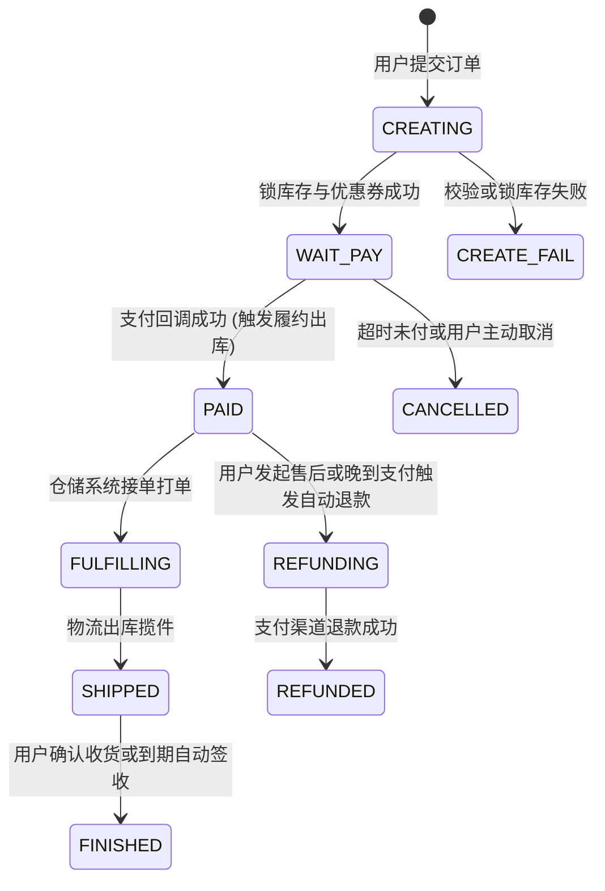
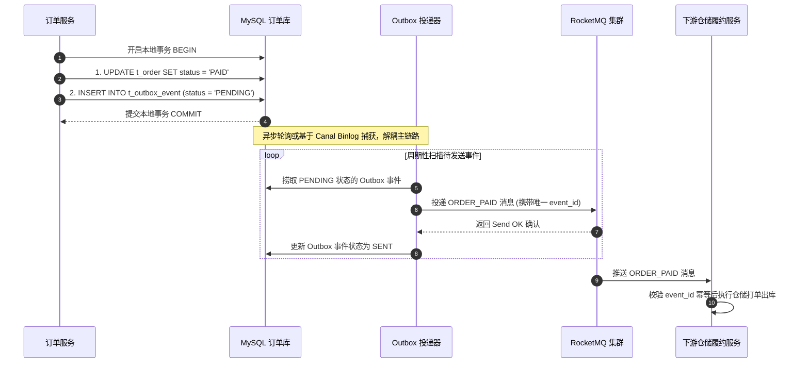
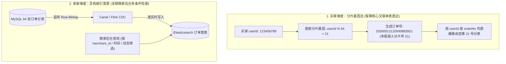

# 项目实战：千万级高可用订单履约与状态机系统全栈落地

> **关联理论**：[[../08-系统设计/07-订单系统设计|订单系统设计]]、[[../07-分布式与微服务/03-分布式事务-2PC-TCC-Saga|分布式事务]]、[[../05-数据库与存储/08-分库分表与读写分离|分库分表]]

---

## 1. 业务背景与项目全貌

### 1.1 业务痛点分析
订单履约系统处于电商交易的核心枢纽位置，上游承接购物车与支付渠道，下游驱动库存扣减、仓储打单、物流揽收与财务清结算。随着日订单量增长至百万级、累计订单达亿级，系统面临三大核心挑战：
1. **并发状态流转冲突（“钱扣了但单关了”）**：当用户在订单到期前最后一秒完成支付，微信/支付宝的异步支付回调与系统内部的 15 分钟超时关单任务可能同时到达。如果用简单的 `SET status = ?` 覆盖更新，极易出现“订单被标记为已取消，但用户资金已被扣走”的严重资损事故。
2. **跨服务通知丢失风险**：订单支付成功后，必须可靠通知仓储发货、积分中心加积分。若在本地事务提交后直接同步发 MQ，一旦网络抖动或进程重启导致消息丢失，就会出现“用户付了钱却一直不发货”的履约中断。
3. **分库分表下的买家与卖家双维度查询矛盾**：数据量破亿后若按买家 `user_id` 分库分表，买家查自己的订单很快，但通过 `order_no` 查详情或商家后台按 `merchant_id` 查店铺订单时，就会触发全库全表广播扫描（Scatter-Gather），拖垮数据库。

### 1.2 架构演进与 STAR 复盘参考

```text
【项目名称】：千万级电商分布式订单履约与交易状态中台
【业务痛点】：订单生命周期分支复杂，超时关单与晚到支付回调存在并发竞态导致账实不符；同时单表数据破亿后，买家端与商家端的多维查询诉求引发跨分片慢查询。
【核心方案】：
  1. 单向有限状态机（FSM）：收敛全部订单状态变更入口，基于“当前状态 + 触发事件 -> 目标状态”建立流转矩阵，底层结合数据库乐观锁与前置状态条件更新（CAS），杜绝非法跳变与状态倒退；
  2. 关单与晚到支付闭环：关单前先向支付渠道核实并关闭支付单；若支付回调晚于关单到达，在同一事务内记录支付流水并生成自动退款任务，实现资金原路退回闭环；
  3. 事务发件箱（Transactional Outbox）：将订单状态更新与领域事件写入同一数据库本地事务，由独立投递组件异步推送至 RocketMQ，保障下游仓储履约 100% 可靠触发；
  4. 分片基因法与异构索引：将 user_id 的末 6 位分片基因嵌入订单号 order_no，使买家按 UID 或订单号查询均能单表直达；同时通过 Canal 监听 Binlog 实时同步至 Elasticsearch 宽表，支撑商家后台多条件复合检索。
【达成效果】：彻底消除高并发下的订单状态覆盖与资金悬挂问题，买家端核心查询 100% 命中单分片，商家后台复杂搜索响应时间稳定在百毫秒以内。
```

---

## 2. 状态机与物理模型设计

### 2.1 订单生命周期有限状态机（FSM）

订单状态流转必须遵循**单向不可逆**原则：任何终态（如 `CANCELLED`、`FINISHED`、`REFUNDED`）一旦达成，绝不允许回退到中间状态。



---

### 2.2 核心数据库表 DDL 设计

```sql
-- 1. 核心订单主表（按 user_id / order_no 基因分片）
CREATE TABLE `t_order` (
  `id` BIGINT NOT NULL COMMENT '主键ID',
  `order_no` VARCHAR(64) NOT NULL COMMENT '订单号(末尾嵌入买家分片基因)',
  `user_id` BIGINT NOT NULL COMMENT '买家ID',
  `merchant_id` BIGINT NOT NULL COMMENT '商户ID',
  `total_amount` DECIMAL(12, 2) NOT NULL COMMENT '订单总金额',
  `pay_amount` DECIMAL(12, 2) NOT NULL DEFAULT 0 COMMENT '实付金额',
  `currency` CHAR(3) NOT NULL DEFAULT 'CNY' COMMENT '币种',
  `channel_tx_no` VARCHAR(128) DEFAULT NULL COMMENT '支付渠道交易流水号',
  `pay_time` DATETIME DEFAULT NULL COMMENT '支付完成时间',
  `status` VARCHAR(32) NOT NULL COMMENT 'WAIT_PAY, PAID, CANCELLED, FULFILLING, SHIPPED, FINISHED',
  `version` INT NOT NULL DEFAULT 0 COMMENT '乐观锁版本号',
  `expire_time` DATETIME NOT NULL COMMENT '支付截止时间',
  `create_time` DATETIME NOT NULL DEFAULT CURRENT_TIMESTAMP,
  PRIMARY KEY (`id`),
  UNIQUE KEY `uk_order_no` (`order_no`),
  KEY `idx_user_id` (`user_id`)
) ENGINE=InnoDB DEFAULT CHARSET=utf8mb4;

-- 2. 事务发件箱表（Transactional Outbox，与订单表同库同分片）
CREATE TABLE `t_outbox_event` (
  `id` BIGINT NOT NULL AUTO_INCREMENT,
  `event_id` VARCHAR(64) NOT NULL COMMENT '事件全局唯一ID(供下游幂等消费)',
  `biz_key` VARCHAR(64) NOT NULL COMMENT '关联业务键(order_no)',
  `event_type` VARCHAR(64) NOT NULL COMMENT '事件类型: ORDER_PAID, ORDER_CANCELLED, AUTO_REFUND',
  `payload` JSON NOT NULL COMMENT '事件消息体',
  `status` VARCHAR(16) NOT NULL DEFAULT 'PENDING' COMMENT 'PENDING, SENT, FAILED',
  `retry_count` INT NOT NULL DEFAULT 0,
  `create_time` DATETIME NOT NULL DEFAULT CURRENT_TIMESTAMP,
  PRIMARY KEY (`id`),
  UNIQUE KEY `uk_event_id` (`event_id`),
  KEY `idx_status_retry` (`status`, `retry_count`)
) ENGINE=InnoDB DEFAULT CHARSET=utf8mb4;
```

---

## 3. 核心并发控制与一致性代码实现

### 3.1 支付回调 vs 超时关单并发竞态处理（自动退款闭环）

当支付渠道回调到达时，首先在入口层完成签名验证，随后进入本地事务：通过 `SELECT ... FOR UPDATE` 或条件 `UPDATE` 检查当前订单状态。
- 如果订单处于 `WAIT_PAY` 状态，正常推进为 `PAID`，并在同事务写入 `ORDER_PAID` 发件箱事件通知仓储发货；
- 如果订单已经被超时任务关闭（处于 `CANCELLED` 状态），说明发生了“晚到支付”，此时不能把已关闭的订单强行改回已支付（因为库存可能已经释放并被别人买走），而是**记录支付流水并在同事务写入一条 `AUTO_REFUND` 自动退款事件**，由退款服务异步调用支付渠道原路退钱。

```java
@Service
@RequiredArgsConstructor
@Slf4j
public class OrderPaymentCallbackService {

    private final TransactionTemplate transactionTemplate;
    private final OrderMapper orderMapper;
    private final PaymentReceiptMapper receiptMapper;
    private final OutboxEventMapper outboxEventMapper;

    public boolean handlePaymentCallback(VerifiedPaymentCallback callback) {
        transactionTemplate.executeWithoutResult(tx -> {
            // 1. 锁定订单行并校验商户、币种与应付金额是否一致
            OrderEntity order = orderMapper.findByOrderNoForUpdate(callback.getOrderNo());
            validateOrderAndAmount(order, callback);

            // 2. 幂等校验：检查该渠道流水号是否已处理过
            PaymentReceipt existing = receiptMapper.findByChannelTxNo(
                    callback.getChannel(), callback.getChannelTxNo());
            if (existing != null) {
                return;
            }
            receiptMapper.insert(callback);

            // 3. 按当前订单状态分支处理
            if ("WAIT_PAY".equals(order.getStatus())) {
                // 正常支付：CAS 推进状态为 PAID，并写入履约出库事件
                int rows = orderMapper.compareAndSetStatus(
                        order.getOrderNo(), "WAIT_PAY", "PAID", callback.getChannelTxNo());
                if (rows != 1) {
                    throw new IllegalStateException("订单状态并发更新冲突: " + order.getOrderNo());
                }
                outboxEventMapper.insertEvent(order.getOrderNo(), "ORDER_PAID", callback);
            } else if ("CANCELLED".equals(order.getStatus())) {
                // 晚到支付（订单已超时关闭）：生成自动原路退款事件，保障资金不悬挂
                log.warn("检测到已关单订单收到晚到支付回调，触发自动退款: orderNo={}, txNo={}",
                        order.getOrderNo(), callback.getChannelTxNo());
                outboxEventMapper.insertEvent(order.getOrderNo(), "AUTO_REFUND", callback);
            }
        });
        return true;
    }
}
```

配套的状态机条件更新 SQL（必须携带前置期望状态 `expectStatus`）：

```sql
UPDATE t_order
SET status = #{targetStatus},
    channel_tx_no = #{channelTxNo},
    pay_time = NOW(),
    version = version + 1
WHERE order_no = #{orderNo}
  AND status = #{expectStatus};
```

---

### 3.2 分布式最终一致性：Transactional Outbox 投递引擎

为什么不直接在 `updateStatus` 后调用 `mqProducer.send()`？因为数据库事务提交与 MQ 网络发送无法合并为一个原子操作：如果先发消息再提交事务，事务回滚会产生幽灵消息；如果先提交事务再发消息，应用重启会导致消息永久丢失。

采用 **Transactional Outbox（本地事务发件箱）** 模式，业务表 `t_order` 与事件表 `t_outbox_event` 位于同一个数据库分片中，共享同一个本地事务提交。



---

## 4. 分库分表：分片基因法与异构索引设计

### 4.1 业务查询诉求分析
- **买家端（C 端高频）**：查询“我的订单列表”（条件含 `user_id`）或点击查看“订单详情”（条件仅含 `order_no`）。
- **卖家端（B 端复杂查询）**：商户在后台按 `merchant_id`、下单时间范围、收货人手机号、商品名称等多条件组合筛选订单。

如果单纯按 `user_id % 64` 分表，买家查列表能直接路由，但只传 `order_no` 查详情时无法得知 `user_id`，就会退化为 64 张表全表广播；而商户按 `merchant_id` 查询更是每次都要跨所有分片聚合。

### 4.2 解决方案：买家基因嵌入订单号 + 卖家 Elasticsearch 异构宽表

1. **分片基因法（解决 `order_no` 单点路由）**：
   假设分库分表总数为 64（$2^6$），那么 `user_id % 64` 本质上只取决于 `user_id` 二进制表示的**最后 6 个比特位（分片基因）**。我们在生成订单号 `order_no` 时，直接将 `user_id % 64` 的两位数编号（00~63）拼接到订单号末尾。这样，无论是拿到 `user_id` 还是只拿到 `order_no`，都能解析出完全相同的分片编号，实现 100% 单表精准路由。
2. **CDC 异构索引（解决卖家多维检索）**：
   通过 Canal 或 Flink CDC 监听 MySQL 的 Row 模式 Binlog，将分散在 64 张表中的订单数据实时准同步构建到 Elasticsearch 订单宽表中（以 `merchant_id` 作为 ES Routing 路由键），由 ES 承接商家后台的所有多条件筛选与分页查询。



---

## 5. 面试高频追问解析

> [!question]- 追问 1：如果用户在购物车同时勾选了 3 个不同商家的 5 件商品一并提交，订单系统如何拆单并保证库存扣减的一致性？
> 采用**父子订单模型（Parent-Child Order）**配合资源预留机制：
> 1. **收银台父单与履约子单分离**：用户提交时生成一个虚拟的交易父单（`parent_order_no`），用于向支付渠道发起单次合并收款；同时在内部按 `merchant_id` 拆分为 3 笔独立的履约子订单（`sub_order`），方便后续不同商家各自发货与独立售后。
> 2. **TCC 思想预留库存**：创单阶段调用库存服务冻结 5 件商品的库存。如果其中任意一件商品库存不足，整体回滚并释放已冻结商品；全部冻结成功后，父子订单落库并进入 `WAIT_PAY` 状态。支付成功后再异步将冻结库存转为已售。

> [!question]- 追问 2：为什么你们在核心下单链路选择了本地事务表（Transactional Outbox），而不是直接用 Seata AT 模式？
> Seata AT 模式适合并发度不高的内部管理系统，但在高并发核心交易链路上存在明显的性能制约：
> 1. **全局锁延长行锁等待**：Seata AT 在一阶段提交前需要向 TC（事务协调器）跨网络注册全局锁，在二阶段完成前全局锁持续持有。如果遇到热点商品或大促高峰，网络 RTT 和全局锁排队会显著延长数据库锁竞争，导致吞吐量大幅下降。
> 2. **异步解耦更契合履约业务**：订单支付成功后，通知仓库打单、发放积分本质上并不需要和支付回调在同一个毫秒内强同步完成。使用 Transactional Outbox 将跨服务调用转化为本地单库事务提交 + 异步可靠投递，既消除了分布式锁协调开销，又能在下游仓储服务短暂升级或抖动时依靠 MQ 缓冲自愈。

> [!question]- 追问 3：晚到支付触发自动退款时，如果调用微信/支付宝退款接口失败了（比如网络超时或商户号余额不足），怎么保证钱一定退给用户？
> 1. **退款任务先落库**：我们在支付回调事务中并不是直接同步调用外部 HTTP 退款接口，而是写入一条状态为 `PENDING` 的退款单与 Outbox 事件，确保“需要退款”这一事实已被持久化记录。
> 2. **幂等重试与退避**：退款执行器消费事件时，携带唯一的退款单号（`out_refund_no`）调用渠道退款接口。若因网络超时失败，利用指数退避策略每隔 1m、5m、15m 自动重试（渠道对相同退款单号具备天然幂等性，不会重复退钱）。
> 3. **异常升级与对账兜底**：若因商户结算账户余额不足等业务原因连续重试失败，系统自动将退款单标记为 `MANUAL_INTERVENTION` 并触发告警推送至财务运营后台，同时每日凌晨的渠道资金对账任务会二次核对“多收款记录”，确保每笔差错账目闭环清零。

> [!question]- 追问 4：Canal 同步 MySQL 到 Elasticsearch 存在百毫秒到秒级的延迟，如果商家刚收到新订单通知，立即刷新后台列表查不到怎么办？
> 可以通过**实时通知携带单号 + 详情回源主库**组合解决：
> 1. **WebSocket 推送实时卡片**：当买家下单或支付成功时，通过 WebSocket 向商家工作台推送一条包含 `order_no` 与摘要信息的通知，前端直接在列表顶部渲染出新订单提示。
> 2. **按单号直查分片库**：当商家点击该新订单查看详情或执行接单操作时，后端接口携带 `order_no`（内含分片基因）直接查询或更新 MySQL 对应的分片主表，不依赖 Elasticsearch 的同步进度，从而兼顾列表检索的高吞吐与单笔操作的强实时性。

> [!question]- 追问 5：分布式环境下，如果下游消息乱序到达（例如 `SHIPPED` 已发货消息比 `PAID` 已支付消息先到），状态机如何防御？
> 1. **状态流转矩阵拦截**：状态机在内存和数据库层均严格校验前置状态。更新为 `SHIPPED` 的 SQL 必须带上 `WHERE order_no = ? AND status IN ('PAID', 'FULFILLING')`。
> 2. **触发短暂延迟重试**：当 `SHIPPED` 消息先到达时，此时数据库里的订单状态仍是 `WAIT_PAY`，条件 `UPDATE` 返回影响行数为 `0`。消费者检测到前置状态未就绪（而非订单已取消），会抛出可重试异常，交由 RocketMQ 重试队列延迟数秒后再次投递；待 `PAID` 消息处理完毕后，重试到达的 `SHIPPED` 消息即可正常推进状态。

---

## 6. 核心要点复盘清单

- **单向有限状态机**：用前置状态条件更新（`WHERE order_no = ? AND status = ?`）替代无条件覆盖，从根源上阻止并发状态倒退与乱序更新。
- **晚到支付自动退款**：超时关单先查渠道并关闭支付单；若关单后仍收到成功支付回调，同事务落库支付流水并触发异步原路退款。
- **Transactional Outbox**：业务表更新与本地消息表写入在同一个数据库事务中完成，由中继组件异步投递 MQ，下游按 `event_id` 幂等消费。
- **基因分片 + ES 异构**：订单号末尾嵌入 `user_id` 分片基因解决买家单表定位；利用 Canal 同步 Binlog 至 Elasticsearch 解决卖家多维复杂检索。
