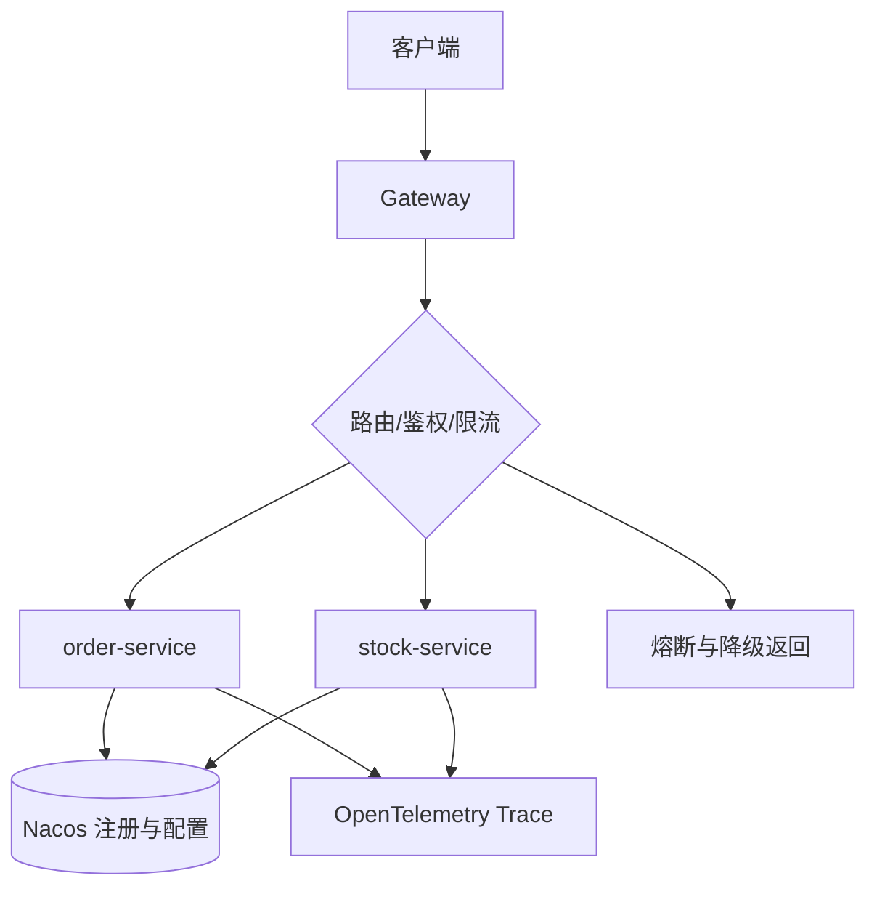

# 项目-微服务治理脚手架

> [!info] 项目简介
> 搭建服务注册、配置、网关、限流、链路追踪和灰度发布基础设施。

## 🎯 项目目标

- 搭建可复用微服务底座：注册发现、配置中心、网关路由、限流熔断、链路追踪和统一日志。
- 给出治理闭环：服务异常时能看到 Trace、指标、日志，并能通过限流/熔断保护下游。
- 沉淀接入规范：新服务如何接入 Nacos、配置、网关、观测和灰度规则。

## 🛠️ 技术栈

| 类别 | 选型 |
| ---- | ---- |
| 主技术栈 | Spring Cloud Alibaba + Nacos + Gateway + OpenTelemetry |
| 核心模块 | 服务注册、动态配置、网关路由、限流熔断、Trace 传播、灰度发布 |
| 验证工具 | Nacos 控制台、Gateway 日志、Prometheus 指标、Trace 查询、故障注入脚本 |

## 🏗️ 架构设计

## 📋 开发任务拆解

- [ ] 建两个样例服务：`order-service` 调 `stock-service`，验证服务发现和负载均衡。
- [ ] 接入 Nacos 配置：动态调整超时、限流阈值和灰度标记，记录刷新日志。
- [ ] 配置 Gateway：路由、鉴权、请求 ID、统一错误码和按 path 限流。
- [ ] 接入 Trace：跨服务传递 traceId/spanId，日志自动打印 traceId。
- [ ] 故障注入：让 stock-service 慢响应/报错，验证熔断、降级和告警。
- [ ] 验收：新增一个 demo-service，按接入文档 30 分钟内完成注册、路由、配置和观测。

## 🧠 关键技术点

- [[../04-Spring生态/08-SpringCloud组件概览]]
- [[../06-中间件/04-注册中心-Nacos]]
- [[../06-中间件/06-API网关]]
- [[../07-分布式与微服务/08-链路追踪]]
- 面试抓手：服务发现和负载均衡如何配合、配置刷新有什么坑、Trace 上下文如何跨线程/跨服务传播。

## 🐛 问题记录

| 日期 | 问题 | 解决方案 |
| ---- | ---- | -------- |
| 2026-07-04 | 初版计划缺少治理闭环 | 增加注册、配置、网关、Trace 和故障注入验收口径 |

## 📊 成果与复盘

- 演示入口：`GET /api/orders/{id}` 经 Gateway 调用 order-service，再联动 stock-service。
- 性能数据：记录网关 QPS/P95、下游错误率、熔断次数、配置刷新耗时、Trace 采样率。
- 复盘证据：保留服务接入文档、Gateway 配置、Nacos 配置变更记录和一次故障注入报告。

## 🔗 关联笔记

- [[_index]]

## 📚 参考资料

- Spring Cloud Gateway 官方文档：路由、过滤器和限流。
- Nacos 官方文档：服务注册发现与动态配置。
- OpenTelemetry 官方文档：Trace 上下文传播、采样和导出。
- Google SRE Book：监控、告警和故障演练。
