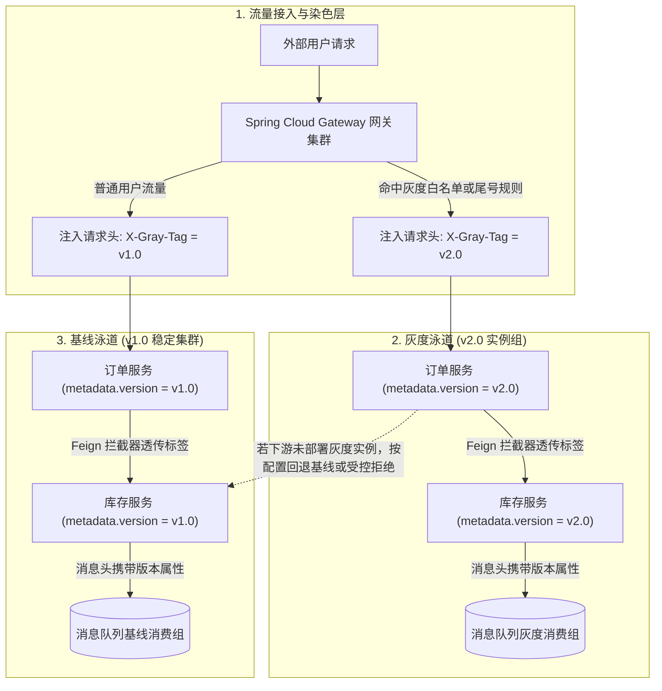
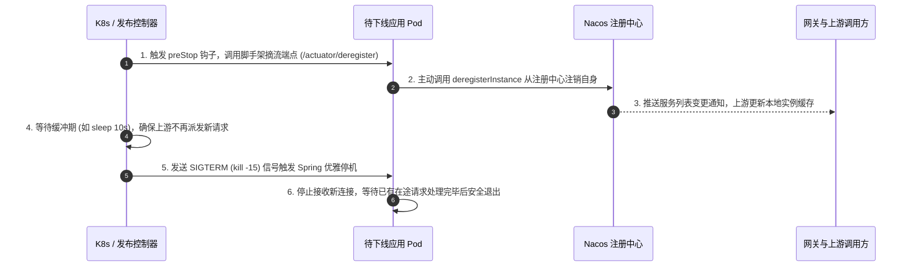

# 项目实战：企业级微服务治理脚手架与全链路灰度平台

> **关联理论**：[[../04-Spring生态/08-SpringCloud组件概览|SpringCloud概览]]、[[../07-分布式与微服务/07-服务治理与负载均衡|注册与配置中心]]、[[../07-分布式与微服务/06-限流-熔断-降级|限流熔断]]

---

## 1. 业务背景与项目全貌

### 1.1 业务痛点分析
随着业务微服务数量增长到数十个乃至上百个，如果每个业务团队各自配置网关路由、Feign 拦截器、链路追踪和上下线脚本，往往会出现以下治理难题：
1. **新版本发布影响面不可控**：新功能上线时，如果直接在生产集群全量替换或随机负载均衡，一旦新代码存在隐蔽 Bug，所有线上用户都会受到波及。由于调用链跨越多个微服务（网关 -> 订单 -> 库存 -> MQ），单点灰度无法防止流量在中途跳回旧版本或污染基线数据。
2. **滚动发布期间出现短暂报错**：容器启动时，Spring Boot 尚未完成连接池预热便涌入大流量导致超时；容器销毁时，Nacos 心跳剔除与上游负载均衡列表刷新存在数秒延迟，导致请求打向已关闭的节点，报 `Connection Refused` 错误。
3. **跨服务与跨线程上下文丢失**：排查线上问题时，网关生成的 `TraceId` 或灰度标签在经过 OpenFeign 远程调用、异步线程池或消息队列后丢失，导致日志与调用链断裂。

### 1.2 架构演进与 STAR 复盘参考

```text
【项目名称】：基于 Spring Boot 3 + Spring Cloud Alibaba 的微服务统一治理脚手架（Platform Starter）
【业务痛点】：多微服务协作下缺乏统一的灰度验证通道，滚动发布期间偶发流量报错，且跨服务与异步线程调用时链路追踪上下文易丢失。
【核心方案】：
  1. 统一 Starter 自动装配：基于 Spring Boot 3 AutoConfiguration 封装公共治理组件，业务服务引入依赖即可自动接入统一响应封装、全局异常处理与链路上下文传播；
  2. 全链路泳道灰度（Gray Lane）：在 Gateway 网关层根据认证用户特征或规则对流量打标（X-Gray-Tag），通过 OpenFeign 请求拦截器、线程上下文装饰器与 MQ 消息属性向全链路透传，并自定义 Spring Cloud LoadBalancer 严格按实例元数据匹配路由；
  3. 优雅上下线闭环：整合 Kubernetes preStop 钩子与自定义摘流端点，下线前先从 Nacos 注销实例并等待上游缓存刷新，再触发 Spring 优雅停机排空在途请求；
  4. 可观测性集成：打通 Micrometer Tracing / OpenTelemetry 与 Logback MDC，实现指标报警、调用链 Span 与应用日志的联动检索。
【达成效果】：业务微服务零代码侵入即可具备全链路泳道灰度能力，实现应用滚动发布期间的平滑零报错切换，显著缩短跨服务故障定位耗时。
```

---

## 2. 微服务全链路泳道染色架构

全链路灰度的核心思想是**“流量染色 + 严格泳道路由”**：请求在入口网关处被打上版本标签（如 `v2.0`），后续经过的每一个 HTTP/RPC 服务和消息队列都识别并透传该标签，优先或严格路由到带有对应 `version` 元数据的实例。



---

## 3. 核心脚手架源码实现

### 3.1 模块一：网关全局流量染色（Gateway GlobalFilter）

网关作为流量入口，首先清除外部客户端可能伪造的内部治理请求头，然后根据已认证的用户身份匹配 Nacos 动态灰度规则，将计算出的版本标签写入转发请求头与 Reactor 上下文中。

```java
@Component
@Order(0)
@Slf4j
public class GrayTrafficDyeingGlobalFilter implements GlobalFilter {

    public static final String HEADER_GRAY_TAG = "X-Gray-Tag";

    @Override
    public Mono<Void> filter(ServerWebExchange exchange, GatewayFilterChain chain) {
        ServerHttpRequest request = exchange.getRequest();

        // 1. 提取前置认证过滤器解析出的可信用户 ID
        String userId = exchange.getAttribute("authenticatedUserId");
        String grayTag = "v1.0";

        // 2. 匹配灰度规则（实际工程中可对接 Nacos 配置中心动态读取白名单或比例）
        if (userId != null && userId.endsWith("9")) {
            grayTag = "v2.0";
            log.info("请求命中灰度泳道: userId={}, grayTag={}", userId, grayTag);
        }

        // 3. 覆写请求头（防止客户端伪造 X-Gray-Tag），并写入 Reactor Context 供响应式链路读取
        final String selectedTag = grayTag;
        ServerHttpRequest mutatedRequest = request.mutate()
                .headers(headers -> headers.set(HEADER_GRAY_TAG, selectedTag))
                .build();

        return chain.filter(exchange.mutate().request(mutatedRequest).build())
                .contextWrite(ctx -> ctx.put(HEADER_GRAY_TAG, selectedTag));
    }
}
```

---

### 3.2 模块二：服务间调用标签透传（OpenFeign RequestInterceptor）

当上游服务（如订单服务）通过 OpenFeign 调用下游服务（如库存服务）时，脚手架内置的拦截器会自动从当前 Servlet 请求上下文中提取 `X-Gray-Tag`，并附加到新发起的 Feign 请求头中，无需业务开发人员手动传参。

```java
@Configuration(proxyBeanMethods = false)
public class FeignGrayHeaderInterceptor implements RequestInterceptor {

    private static final String HEADER_GRAY_TAG = "X-Gray-Tag";

    @Override
    public void apply(RequestTemplate template) {
        ServletRequestAttributes attributes =
                (ServletRequestAttributes) RequestContextHolder.getRequestAttributes();

        if (attributes != null) {
            HttpServletRequest request = attributes.getRequest();
            String grayTag = request.getHeader(HEADER_GRAY_TAG);
            if (StringUtils.isNotBlank(grayTag)) {
                template.header(HEADER_GRAY_TAG, grayTag);
            }
        }
    }
}
```

---

### 3.3 模块三：基于 Spring Cloud LoadBalancer 的灰度路由筛选器

下游服务注册到 Nacos 时，在 `spring.cloud.nacos.discovery.metadata.version` 中声明自身版本（如 `v1.0` 或 `v2.0`）。客户端负载均衡器根据请求头中的 `X-Gray-Tag` 筛选出匹配版本的实例列表进行调用。

```java
public class GrayVersionLoadBalancer implements ReactorServiceInstanceLoadBalancer {

    private final ObjectProvider<ServiceInstanceListSupplier> supplierProvider;
    private final String serviceId;
    private final boolean fallbackToBase;

    public GrayVersionLoadBalancer(
            ObjectProvider<ServiceInstanceListSupplier> supplierProvider,
            String serviceId,
            boolean fallbackToBase) {
        this.supplierProvider = supplierProvider;
        this.serviceId = serviceId;
        this.fallbackToBase = fallbackToBase;
    }

    @Override
    public Mono<Response<ServiceInstance>> choose(Request request) {
        ServiceInstanceListSupplier supplier = supplierProvider.getIfAvailable();
        if (supplier == null) {
            return Mono.just(new EmptyResponse());
        }
        return supplier.get(request).next().map(instances -> selectInstance(request, instances));
    }

    private Response<ServiceInstance> selectInstance(Request request, List<ServiceInstance> instances) {
        if (CollectionUtils.isEmpty(instances)) {
            return new EmptyResponse();
        }

        // 1. 从请求上下文提取目标灰度标签
        String targetTag = "v1.0";
        if (request.getContext() instanceof RequestDataContext context) {
            String headerTag = context.getClientRequest().getHeaders().getFirst("X-Gray-Tag");
            if (StringUtils.isNotBlank(headerTag)) {
                targetTag = headerTag;
            }
        }

        // 2. 按 Nacos 实例元数据中的 version 字段过滤匹配实例与基线实例
        List<ServiceInstance> matchedInstances = new ArrayList<>();
        List<ServiceInstance> baseInstances = new ArrayList<>();

        for (ServiceInstance instance : instances) {
            String instanceVersion = instance.getMetadata().getOrDefault("version", "v1.0");
            if (targetTag.equals(instanceVersion)) {
                matchedInstances.add(instance);
            }
            if ("v1.0".equals(instanceVersion)) {
                baseInstances.add(instance);
            }
        }

        // 3. 若命中对应版本实例则从中随机选择；若某中间服务未部署灰度实例，按配置决定回退基线或直接拒绝
        List<ServiceInstance> candidates = matchedInstances;
        if (candidates.isEmpty() && fallbackToBase) {
            candidates = baseInstances;
        }
        if (candidates.isEmpty()) {
            return new EmptyResponse();
        }

        int index = ThreadLocalRandom.current().nextInt(candidates.size());
        return new DefaultResponse(candidates.get(index));
    }
}
```

> **自动装配说明**：在自定义 Starter 中，可通过 `@LoadBalancerClients(defaultConfiguration = GrayLoadBalancerConfiguration.class)` 将上述负载均衡策略注册为全局默认实现，使所有 `@FeignClient` 自动生效。

---

## 4. 生产级优雅上下线与预热机制

### 4.1 滚动发布期间为什么会报错？
1. **上线冷启动抖动**：新 Pod 启动并注册到 Nacos 后，如果立刻承接全量并发，此时 JIT 尚未将热点代码编译为机器码、数据库连接池与 Redis 连接池尚未建立，会导致前几秒的请求延迟飙升甚至超时。
2. **下线残余流量报错**：直接停止容器时，虽然实例向 Nacos 发送了注销请求，但网关和其他微服务的本地服务列表缓存通常有数秒的刷新间隔。在此时间窗口内，上游依然会把请求发往正在关闭的 Pod，导致连接被拒绝。

### 4.2 优雅下线标准时序

为了实现零报错发布，脚手架结合容器生命周期钩子（`preStop`）与 Spring Boot 内置优雅停机（`server.shutdown=graceful`）设计了标准四步下线流程：



对应的 Spring Boot `application.yml` 核心配置如下：

```yaml
server:
  shutdown: graceful # 开启优雅停机

spring:
  lifecycle:
    timeout-per-shutdown-phase: 30s # 为在途请求预留最多 30 秒排空时间
```

---

## 5. 面试高频追问解析

> [!question]- 追问 1：Spring Cloud Gateway 是基于 WebFlux 响应式模型的，如果在全局过滤器里直接执行同步阻塞调用（如 JDBC 查询或 RestTemplate），会有什么后果？
> Spring Cloud Gateway 底层运行在 Netty 的 EventLoop（事件循环线程组）之上。EventLoop 线程数量非常少（默认通常为 CPU 核心数），每个线程以非阻塞多路复用的方式同时服务成百上千个网络连接。
> 如果在过滤器中执行同步阻塞 I/O，该 EventLoop 线程就会被挂起等待，导致绑定在该线程上的所有其他用户的请求全部卡死排队，几秒内即可导致整个网关吞吐量跌零。因此在 Gateway 中必须使用异步非阻塞客户端（如 `WebClient`、Reactive Redis），或者将必须执行的阻塞操作显式调度到独立的弹性线程池（`Schedulers.boundedElastic()`）中执行。

> [!question]- 追问 2：全链路灰度中，除了 HTTP/Feign 调用外，异步消息队列（MQ）如何防止灰度消息被基线实例消费？
> 消息队列的灰度隔离主要有两种落地方式：
> 1. **Topic / 消费组物理隔离（推荐用于核心交易）**：脚手架封装 MQ Producer 与 Consumer 启动器。当应用处于灰度环境（如配置了 `env.lane=v2.0`）时，自动在 Topic 或 Consumer Group 名称后追加 `_v2_0` 后缀，使灰度生产者发出的消息只进入灰度队列，由灰度消费者独立消费。
> 2. **消息头属性过滤（适用于轻量级灰度）**：发送消息时在 Message Property 中注入 `X-Gray-Tag=v2.0`；RocketMQ 消费者利用 Tag 或 SQL92 属性过滤语法，让灰度消费组只订阅带 `v2.0` 标记的消息，基线消费组只订阅 `v1.0` 消息。

> [!question]- 追问 3：当业务代码在微服务内部使用了线程池或 `CompletableFuture` 时，如何保证灰度标签和 `TraceId` 不会在子线程中丢失？
> 标准 `ThreadLocal` 绑定在当前线程对象上，当任务提交给线程池复用线程执行时，子线程无法自动读取父线程的 `ThreadLocal` 值。
> 脚手架通过**统一线程装饰器（`TaskDecorator`）或阿里的 `TransmittableThreadLocal`（TTL）**解决该问题：
> 1. 在主线程向线程池提交 `Runnable/Callable` 任务的那一刻，装饰器自动抓取主线程当前的灰度标签与 MDC `TraceId` 快照；
> 2. 当线程池中的工作线程开始执行 `run()` 方法前，将快照注入子线程的上下文；
> 3. 在 `finally` 块中严格清理或还原该工作线程原本的上下文，防止线程池复用线程时发生数据串号。

> [!question]- 追问 4：如果链路为 A -> B -> C，现在只给 A 和 C 部署了 `v2.0` 灰度节点，中间的 B 服务没有改动（只有 `v1.0` 基线节点），灰度流量怎么走通？
> 这正是全链路灰度中常见的**“借道基线，标签不丢”**场景：
> 1. **路由回退（Fallback to Baseline）**：当 A(`v2.0`) 调用 B 时，负载均衡器发现 B 服务下没有任何 `v2.0` 实例，此时自动回退选择 B 的 `v1.0` 基线实例发起调用。
> 2. **透传原始标签**：B(`v1.0`) 虽然是基线代码，但因为它同样引入了统一治理脚手架，其内置的 Servlet Filter 与 Feign 拦截器依然会原封不动地将请求头中的 `X-Gray-Tag: v2.0` 向下游传递给 C。
> 3. **重新命中灰度**：当请求从 B(`v1.0`) 到达 C 时，负载均衡器根据保留的 `v2.0` 标签，再次精准路由到 C 的 `v2.0` 灰度实例，从而在不额外部署 B 灰度副本的前提下跑通全链路。

> [!question]- 追问 5：如果 Nacos 注册中心集群发生短暂网络分区不可达，业务微服务之间的调用会立刻瘫痪吗？
> 不会立刻瘫痪。Nacos 客户端内置了**本地内存缓存 + 磁盘快照文件（Failover 机制）**双重保护：
> 1. 当 Nacos 服务端短暂失联时，微服务客户端会继续使用本地内存中已缓存的下游服务实例列表进行负载均衡调用；
> 2. 即使此时某个微服务实例发生重启，它也能从本地磁盘快照目录读取上次缓存的服务列表完成启动；
> 3. 配合脚手架集成的负载均衡重试与熔断机制（自动隔离调用超时的故障实例），可以在注册中心恢复前维持现有集群的平稳通信。

---

## 6. 核心要点复盘清单

- **流量入口收口**：网关统一校验身份并生成 `X-Gray-Tag`，同时覆盖外部同名请求头，防止客户端伪造染色标签。
- **跨组件透明传播**：HTTP 调用靠 `RequestInterceptor` 传 Header，跨线程靠 `TaskDecorator` / TTL 传上下文，MQ 靠消息属性或消费组隔离。
- **元数据匹配路由**：自定义 `ReactorServiceInstanceLoadBalancer`，比对请求标签与 Nacos 实例 `metadata.version`，支持无灰度实例时自动借道基线。
- **零报错滚动发布**：下线遵循“先调接口从 Nacos 注销 -> 等待上游刷新缓存 -> 发送 SIGTERM 排空在途请求”；上线配合冷启动预热逐步放量。
