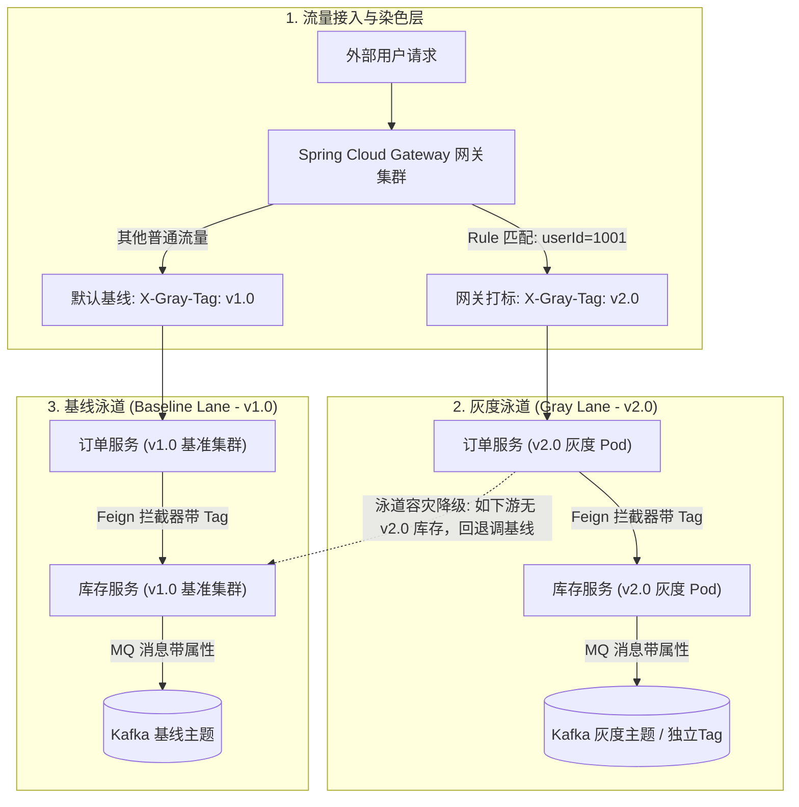
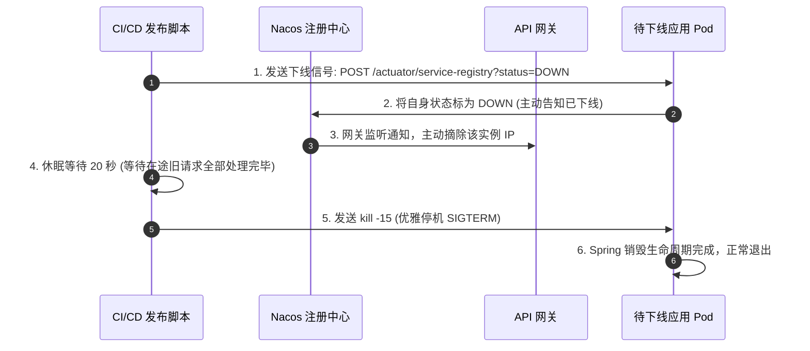

# 项目实战：企业级微服务治理脚手架与全链路灰度平台

> **关联理论**：[[../04-Spring生态/08-SpringCloud组件概览|SpringCloud概览]]、[[../07-分布式与微服务/07-服务治理与负载均衡|注册与配置中心]]、[[../07-分布式与微服务/06-限流-熔断-降级|限流熔断]]

---

## 1. 项目全景与简历 STAR 描述

### 1.1 简历项目经验黄金模版（STAR 法则）
```text
【项目名称】：基于 Spring Boot 3 + Spring Cloud Alibaba 的企业级微服务统一治理脚手架（Platform Starter）
【项目背景】：公司内部 30+ 个微服务技术栈参差不齐，服务间调用缺乏统一超时重试与熔断规范，生产频发级联雪崩；缺乏全链路染色与可观测性，排障耗时以小时计，且不支持生产版本平滑金丝雀灰度发布。
【核心职责】：作为基础架构组核心成员，主导自研微服务通用脚手架（`common-framework-starter`）并落地全链路治理。
【技术攻坚】：
  1. 架构统一与自动化：遵循 Spring Boot 3 自动配置与 SPI 规范，封装开箱即用的注册发现、动态配置、RPC 熔断限流与通用异常模型，新服务接入耗时由 3 天骤降至 15 分钟；
  2. 全链路流量染色（泳道架构）：在 API 网关层基于 HTTP Header/Cookie 解析灰度标签，通过 OpenTelemetry 上下文与 Feign/RocketMQ 拦截器实现全链路透明透传，保障灰度流量仅路由到打标灰度容器组；
  3. 客户端负载均衡与平滑无感发布：自定义 LoadBalancer 路由策略，结合 Nacos 实例元数据实现灰度隔离与就近路由；优化应用优雅下线与预热机制，消灭发布过程中的流量毛刺；
  4. 三位一体可观测性：集成 Micrometer Tracing 与 SkyWalking，通过 Logback MDC 机制注入 TraceId，实现从网关到数据库全链路指标（Metrics）、链路（Tracing）、日志（Logging）的一键式穿透追踪。
```

---

## 2. 微服务治理全景蓝图与泳道染色架构



---

## 3. 核心脚手架源码落地实战

### 3.1 模块一：网关全局流量染色与上下文注入（Gateway GlobalFilter）

```java
@Component
@Order(Ordered.HIGHEST_PRECEDENCE)
@Slf4j
public class GrayTrafficDyeingGlobalFilter implements GlobalFilter {

    private static final String HEADER_GRAY_TAG = "X-Gray-Tag";
    private static final String HEADER_TRACE_ID = "X-Trace-Id";

    @Override
    public Mono<Void> filter(ServerWebExchange exchange, GatewayFilterChain chain) {
        ServerHttpRequest request = exchange.getRequest();
        
        // 1. 生成或继承分布式全链路 TraceId
        String traceId = request.getHeaders().getFirst(HEADER_TRACE_ID);
        if (StringUtils.isBlank(traceId)) {
            traceId = UUID.randomUUID().toString().replace("-", "");
        }

        // 2. 灰度规则判定（可结合 Nacos 动态配置或用户白名单）
        String userId = request.getHeaders().getFirst("X-User-Id");
        String grayTag = "v1.0"; // 默认基线版本
        
        // 示例：用户 ID 末尾为 9 的走灰度新版本
        if (userId != null && userId.endsWith("9")) {
            grayTag = "v2.0";
            log.info("用户命中了灰度泳道: uid={}, tag={}", userId, grayTag);
        }

        // 3. 将标签与 TraceId 重新注入下游请求头（下游微服务可直接读取）
        ServerHttpRequest mutatedRequest = request.mutate()
                .header(HEADER_TRACE_ID, traceId)
                .header(HEADER_GRAY_TAG, grayTag)
                .build();

        // 4. 将 TraceId 存入 Reactor 上下文，便于当前网关日志打印
        MDC.put("traceId", traceId);

        return chain.filter(exchange.mutate().request(mutatedRequest).build())
                .doFinally(signalType -> MDC.clear());
    }
}
```

---

### 3.2 模块二：服务间调用透明透传（OpenFeign RequestInterceptor）

当订单服务调用库存服务时，必须把网关打上的 `X-Gray-Tag` 和 `X-Trace-Id` 自动带过去，杜绝开发手工传递：

```java
@Configuration(proxyBeanMethods = false)
public class FeignTraceAndGrayHeaderInterceptor implements RequestInterceptor {

    private static final String HEADER_GRAY_TAG = "X-Gray-Tag";
    private static final String HEADER_TRACE_ID = "X-Trace-Id";

    @Override
    public void apply(RequestTemplate template) {
        ServletRequestAttributes attributes = 
                (ServletRequestAttributes) RequestContextHolder.getRequestAttributes();
        
        if (attributes != null) {
            HttpServletRequest request = attributes.getRequest();
            
            // 1. 从当前 HTTP 请求中提取链路染色标签
            String grayTag = request.getHeader(HEADER_GRAY_TAG);
            if (StringUtils.isNotBlank(grayTag)) {
                template.header(HEADER_GRAY_TAG, grayTag);
            }
            
            // 2. 提取并透传全局 TraceId
            String traceId = request.getHeader(HEADER_TRACE_ID);
            if (StringUtils.isNotBlank(traceId)) {
                template.header(HEADER_TRACE_ID, traceId);
            }
        }
    }
}
```

---

### 3.3 模块三：基于 Spring Cloud LoadBalancer 的灰度路由筛选器

服务拿到 `X-Gray-Tag: v2.0` 后，如何只把请求路由给带 `version=v2.0` 元数据的实例？

```java
public class GrayVersionLoadBalancer implements ReactorServiceInstanceLoadBalancer {

    private final ObjectProvider<ServiceInstanceListSupplier> serviceInstanceListSupplierProvider;
    private final String serviceId;

    public GrayVersionLoadBalancer(ObjectProvider<ServiceInstanceListSupplier> serviceInstanceListSupplierProvider, String serviceId) {
        this.serviceInstanceListSupplierProvider = serviceInstanceListSupplierProvider;
        this.serviceId = serviceId;
    }

    @Override
    public Mono<Response<ServiceInstance>> choose(Request request) {
        ServiceInstanceListSupplier supplier = serviceInstanceListSupplierProvider.getIfAvailable();
        if (supplier == null) {
            return Mono.just(new EmptyResponse());
        }

        return supplier.get(request).next().map(instances -> processInstance(request, instances));
    }

    private Response<ServiceInstance> processInstance(Request request, List<ServiceInstance> instances) {
        if (CollectionUtils.isEmpty(instances)) {
            return new EmptyResponse();
        }

        // 1. 提取请求头中的目标灰度标签
        RequestDataContext context = (RequestDataContext) request.getContext();
        String targetTag = context.getClientRequest().getHeaders().getFirst("X-Gray-Tag");
        if (StringUtils.isBlank(targetTag)) {
            targetTag = "v1.0"; // 默认基线
        }

        // 2. 从 Nacos 注册列表按实例元数据 (metadata) 严格过滤
        List<ServiceInstance> matchedInstances = new ArrayList<>();
        List<ServiceInstance> baselineInstances = new ArrayList<>();

        for (ServiceInstance instance : instances) {
            String instanceVersion = instance.getMetadata().getOrDefault("version", "v1.0");
            if (targetTag.equals(instanceVersion)) {
                matchedInstances.add(instance);
            }
            if ("v1.0".equals(instanceVersion)) {
                baselineInstances.add(instance);
            }
        }

        // 3. 优先级策略：若有匹配灰度实例，轮询分发；若没有（回退容灾），降级走基线实例
        List<ServiceInstance> candidates = !matchedInstances.isEmpty() ? matchedInstances : baselineInstances;
        if (candidates.isEmpty()) {
            candidates = instances;
        }

        int index = ThreadLocalRandom.current().nextInt(candidates.size());
        return new DefaultResponse(candidates.get(index));
    }
}
```

---

## 4. 生产级优雅上下线与预热机制（Zero-Downtime Deployment）

### 4.1 传统部署发布过程中的“三大流量黑洞”
1. **上线黑洞（冷启动）**：Spring Boot 启动后立即注册到 Nacos，大量流量瞬间涌入。此时 JIT 编译未完成、数据库连接池未初始化，接口 RT 激增引发超时报警。
2. **下线黑洞（残余调用）**：`kill -9` 瞬间杀死进程，Nacos 感知到心跳丢失需要 $15 \sim 30$ 秒，上游服务在此期间继续向已死节点派发请求，全部报错 Connection Refused。
3. **注册反跳**：本地还在初始化加载数据，健康检查探针就过早放行。

### 4.2 工业级优雅发布四步曲



---

## 5. 面试深挖现场还原（大厂 5 连环追问）

### 追问 1：Spring Cloud Gateway 是基于 WebFlux 响应式的，在全局过滤器中调用阻塞式 JDBC 或同步 RestTemplate 会发生什么后果？
> **现场绝杀**：
> “这是反应式网关最致命的陷阱。
> Spring Cloud Gateway 底层使用 Netty EventLoop 事件循环线程池，默认线程数极少（仅等于 CPU 核心数，如 8 核机器只有 8 个线程）。
> 如果在 GlobalFilter 里面执行阻塞式调用（例如同步查 MySQL 或同步调用外部接口），会导致当前唯一的 EventLoop 线程被挂起阻塞。只要并发来 8 个慢请求，整个网关的 EventLoop 线程池瞬间被全部耗尽，**整个公司的所有路由转发全线卡死瘫痪**。
> 正确做法：必须全面使用非阻塞 API（如 `WebClient`、R2DBC），或者必须将阻塞逻辑切换到独立的弹性线程池中异步调度执行（如 `Mono.fromCallable(...).subscribeOn(Schedulers.boundedElastic())`）。”

---

### 追问 2：全链路灰度中，不仅 HTTP 调用要隔离，异步消息 MQ 如何实现灰度隔离？
> **现场绝杀**：
> “MQ 灰度隔离的核心是**消息属性打标与消费者按 Tag/SQL 属性过滤**：
> 1. **生产者打标**：订单服务发送 RocketMQ/Kafka 消息时，拦截器将当前线程上下文的 `X-Gray-Tag` 写入消息 User Properties（如 `msg.putUserProperty("version", "v2.0")`）。
> 2. **消费者分流**：
>    - 灰度消费集群（v2.0）只订阅过滤带有 `version = 'v2.0'` 的消息进行消费验证；
>    - 基线消费集群（v1.0）配置过滤规则，只消费没有版本标记或 `version = 'v1.0'` 的消息，严格杜绝灰度消息污染基准业务库。”

---

### 追问 3：为什么很多团队用了 `@RefreshScope` 动态刷新配置，结果数据源连接池没有重建，甚至还引发了内存泄露？
> **现场绝杀**：
> “`@RefreshScope` 的本质是**惰性代理机制**。被修饰的 Bean 会被包装成一个 CGLIB 代理对象，当 Nacos 触发刷新事件时，Spring 只是把这个 Bean 内部的目标缓存实例清空。只有当这个 Bean 下一次被业务方法调用时，才会重新调用构造函数创建新实例。
> 对于像 HikariCP 这样的复杂第三方外部基础设施，它不是一个简单的属性映射 Bean。直接刷新会导致旧连接池没有显式调用 `close()` 关闭，连接仍然被底层网络持有着，而新连接池又重新创建出几十个新连接，最终导致数据库连接数耗尽并引发 JVM Metaspace/堆内存泄露。
> 正确做法：对于数据源、Redis 连接工厂等重量级基础设施，绝对不能简单粗暴加 `@RefreshScope`，必须通过监听 `EnvironmentChangeEvent`，在代码中显式执行‘先销毁旧池、再构建新池’的平滑双缓冲切换逻辑。”

---

### 追问 4：全链路追踪中，如果请求链路中使用了 Java 多线程（如 `CompletableFuture` 或线程池），TraceId 丢失了怎么破？
> **现场绝杀**：
> “TraceId 默认保存在 MDC（底层是 `ThreadLocal`）中。当代码进入自定义线程池或 `CompletableFuture.runAsync()` 时，由于子线程不继承父线程的 `ThreadLocal`，TraceId 必然丢失。
> 我们的脚手架解决方案：
> 1. **线程池包装器（TtlExecutors）**：集成阿里开源的 `TransmittableThreadLocal`（TTL），将业务线程池用 `TtlExecutors.getTtlExecutorService(executor)` 进行包装。
> 2. **Runnable/Callable 装饰器**：在任务提交时自动抓取父线程的 MDC 快照，在子线程 `run()` 执行前还原快照，执行完毕在 finally 块中清除，确保多线程并发链路完全穿透连续。”

---

### 追问 5：Nacos 服务实例发生网络抖动秒级假死，如果上游每秒请求数百次，如何防止短时间内全报错？
> **现场绝杀**：
> “采用**本地缓存保护模式（Push-Pull 双保险）与熔断降级**：
> 1. **客户端内存服务列表快照**：Nacos Client 本地会把服务列表持久化在内存和本地磁盘文件上。即便 Nacos Server 突然宕机或网络中断，客户端仍然使用本地缓存列表路由，保障可用性不受影响。
> 2. **健康探测与自动摘除**：配置客户端快速失败机制，若调用连续失败 3 次，Sentinel/Resilience4j 自动开启实例级熔断，短暂将该死节点隔离 5 秒，并自动故障转移到同一集群下的其他存活健康节点。”

---

## 6. 一分钟复盘记忆卡

```text
======================= 微服务脚手架通关口诀 =======================
微服务建中台基，规范统一开箱提。
网关染色第一道，Trace与Tag头中立；
OpenFeign拦截器，全链透传不用移；
LoadBalancer自路由，元数据筛灰度集；
异步消息加属性，泳道隔离不乱离；
上线预热慢放量，下线先摘休眠起；
可观测性三位体，千台集群稳如仪！
======================================================================
```
