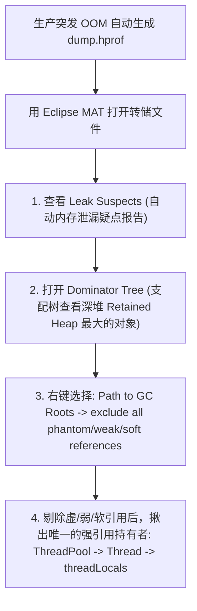
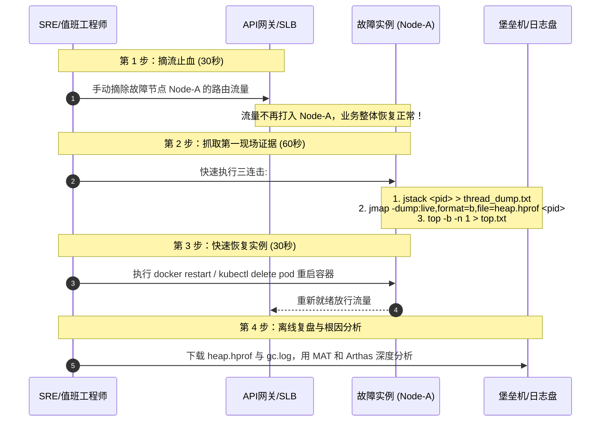

# 项目实战：生产级 JVM 故障排查演练与性能深度调优实录

> **关联理论**：[[../02-JVM/00-JVM全景与心智模型|JVM全景]]、[[../02-JVM/04-垃圾收集器-G1-ZGC|GC调优]]、[[../02-JVM/08-常用工具-jstat-jmap-jstack-Arthas|排障SOP]]

---

## 1. 项目全景与简历 STAR 描述

### 1.1 简历项目经验黄金模版（STAR 法则）
```text
【项目名称】：核心交易系统 JVM 深度性能调优与突发故障应急排障实战
【项目背景】：生产环境大促期间出现偶发性服务无响应与集群机器告警：个别节点 CPU 利用率瞬间飙升至 100%，或突发 Java Heap OOM 导致 Pod 被 K8s 强行杀死重启；G1 GC 存在偶发性并发模式失败（Concurrent Mode Failure），严重影响核心结算可用性。
【核心职责】：作为性能调优专项负责人，主导线上疑难杂症攻坚与全流程排障 SOP 制定。
【技术攻坚】：
  1. CPU 100% 闪电定位：构建标准排障工具链（top -H -> 十六进制转换 -> jstack / Arthas thread -n），精准锁定第三方正则表达式“灾难性指数级回溯”引发的死循环，修复后单节点 CPU 恢复至正常 15% 水位；
  2. 堆内存泄漏深度解剖：通过自动 Dump 的 hprof 文件，利用 Eclipse MAT 展开支配树（Dominator Tree）与 GC Roots 强引用溯源，揪出未显式 remove 的 ThreadLocal 静态线程局部缓存泄漏，根治 OOM 隐患；
  3. Netty 堆外内存防线：开启 JVM 原生内存追踪（NMT），定位 Netty ByteBuf 在特定异常分支下未执行 ReferenceCountUtil.release() 导致的 Direct Memory 泄漏；
  4. G1 收集器生产调优：针对超大对象（Humongous Objects）跨代分配痛点，动态调优 -XX:G1HeapRegionSize 与 -XX:InitiatingHeapOccupancyPercent (IHOP)，消除 Full GC，P99 停顿时间由 350ms 压降至 22ms。
```

---

## 2. 生产四大高危故障靶场与现场还原

```mermaid
mindmap
  root((JVM生产故障四大战役))
    战役1: CPU 100% 狂飙
      真凶: 死循环 / 正则灾难性回溯 / 极端频繁GC
      武器: top -H + jstack + Arthas thread -n
    战役2: 堆内存 OOM (Java Heap Space)
      真凶: ThreadLocal未清理 / 静态集合无界增长
      武器: jmap + MAT (Dominator Tree / GC Roots)
    战役3: 元空间 OOM (Metaspace OOM)
      真凶: CGLIB/Spring动态代理泛滥 / 类加载器无法卸载
      武器: jcmd VM.classloader_stats + Arthas classloader
    战役4: 堆外直接内存泄漏 (Direct Memory OOM)
      真凶: Netty ByteBuf 漏调 release() / JNI本地内存失控
      武器: -XX:NativeMemoryTracking=detail + jcmd VM.native_memory
```

---

## 3. 故障实战一：生产 CPU 100% 闪电定位排查

### 3.1 真实案发现场代码（灾难性回溯正则）
```java
// 生产真实踩坑：看似正常的邮箱/文本校验正则，并发输入特殊字符串时引发 CPU 100%
public class RegexCatastropheLab {
    // 嵌套量词导致的指数级回溯灾难：(a+)+
    private static final Pattern PATTERN = Pattern.compile("([a-zA-Z0-9]+)+$");

    public static void process(String userInput) {
        // 当恶意构造 "aaaaaaaaaaaaaaaaaaaaaaaaaaaa!" 时，回溯次数呈 2^N 爆炸式飙升
        PATTERN.matcher(userInput).matches();
    }
}
```

### 3.2 Linux 生产极速排障标准三步法（30 秒锁定真凶行）

```bash
# 1. 查找占用 CPU 最恐怖的进程 PID
top
# 假设发现 PID 为 28109 占用 CPU 99.8%

# 2. 查找该进程内最消耗 CPU 的具体线程 TID (LWP)
top -H -p 28109
# 假设发现占用最高的线程 TID 为 28145

# 3. 将线程 TID (十进制) 转换为十六进制 (jstack 的 nid 格式)
printf "%x\n" 28145
# 输出结果：6df1

# 4. 用 jstack 导出堆栈并精准 grep 锁定代码行号
jstack 28109 | grep -A 20 "0x6df1"
```

#### 抓捕到的现场实录输出：
```text
"http-nio-8080-exec-12" #35 daemon prio=5 os_prio=0 tid=0x00007f9c9001b800 nid=0x6df1 runnable [0x00007f9c5cdfe000]
   java.lang.Thread.State: RUNNABLE
        at java.util.regex.Pattern$Curly.match0(Pattern.java:4260)
        at java.util.regex.Pattern$Curly.match(Pattern.java:4234)
        at java.util.regex.Matcher.match(Matcher.java:1270)
        at java.util.regex.Matcher.matches(Matcher.java:604)
        at com.shop.trade.util.RegexCatastropheLab.process(RegexCatastropheLab.java:12)
        -- 真凶无所遁形！
```

> **Arthas 降维打击（单条命令破局）**：
> 在容器或生产环境中，若安装了阿里 Arthas，只需一条命令：
> `thread -n 3`（直接列出全 JVM 占用 CPU 前 3 名的线程及其当前完整堆栈代码）！

---

## 4. 故障实战二：堆内存泄漏（MAT 深入解剖）

### 4.1 典型隐蔽案发代码：ThreadLocal 泄露
Tomcat 线程池复用线程。若在 Filter 或 Interceptor 中往 `ThreadLocal` 写入上下文对象，请求结束后**忘记调用 `remove()`**，这些对象将伴随核心线程永远存活，越积越多导致 Full GC 频繁直至 OOM！

```java
public class UserContextFilter implements Filter {
    public static final ThreadLocal<UserSessionData> HOLDER = new ThreadLocal<>();

    @Override
    public void doFilter(ServletRequest req, ServletResponse res, FilterChain chain) {
        try {
            HOLDER.set(new UserSessionData(new byte[1024 * 512])); // 512KB 大对象
            chain.doFilter(req, res);
        } finally {
            // 致命疏忽：若漏掉此行，线程被归还线程池，强引用链永久存在！
            // HOLDER.remove(); 
        }
    }
}
```

### 4.2 Eclipse MAT 深入分析 SOP
生产配置必须加上自动 Dump 参数：
`-XX:+HeapDumpOnOutOfMemoryError -XX:HeapDumpPath=/var/log/jvm/heap_dump.hprof`



- **Shallow Heap vs Retained Heap**：
  - **浅堆（Shallow Heap）**：对象本身占用的内存大小。
  - **深堆（Retained Heap）**：该对象被 GC 回收后，**能连带被释放的所有对象的总内存大小**。在 Dominator Tree 中排名前列且深堆占用 80% 以上的对象，必定是内存泄漏的元凶！

---

## 5. 故障实战三：Netty 堆外直接内存泄漏排查

### 5.1 案发机制：DirectByteBuffer 堆外失控
- **现象**：JVM 堆内存很小（`-Xmx2g`），但宿主机物理内存（RSS）一路飙升到 10G，最终触发 Linux 内核的 **OOM Killer** 将 Java 进程直接无情 `kill -9` 杀死，没有产生任何 Java 堆栈日志。
- **排障命令链**：
  1. 启用 NMT 原生内存跟踪：`-XX:NativeMemoryTracking=detail`
  2. 线上比对内存增量基线：
     ```bash
     jcmd <PID> VM.native_memory baseline
     # 运行 10 分钟后比对
     jcmd <PID> VM.native_memory detail.diff
     ```
  3. 观察 `Internal` 或 `Direct Memory` 是否持续暴增。
- **Netty 泄漏根治**：
  开启 Netty 内存泄漏高级检测参数：`-Dio.netty.leakDetection.level=PARANOID`。
  控制台会精准打印未被释放的 ByteBuf 的原始分配堆栈，补充 `ReferenceCountUtil.release(byteBuf)` 即可解决。

---

## 6. 生产故障 3 分钟应急止血 SOP

当线上监控突然报警，告警短信如雪花般涌来，牢记**“先止血，保业务，再排查”**的铁律：



---

## 7. 面试深挖现场还原（大厂 5 连环追问）

### 追问 1：如果线上堆内存非常大（比如 32GB），直接执行 `jmap -dump` 会有什么致命危险？怎么安全 Dump？
> **现场绝杀**：
> “直接执行 `jmap -dump:live,format=b,file=...` 会引发**全 JVM 停顿（STW，Stop-The-World）**！对于 32GB 的大堆，执行 Dump 过程可能长达数分钟甚至十几分钟，会导致该节点上的所有业务请求彻底超时，被外部健康检查判定为宕机。
> **生产级安全策略**：
> 1. **严禁在承接流量的在线节点直接 Dump**：必须在网关或注册中心上执行**摘流操作**，让该节点脱离流量集群，变成‘隔离节点’后再行 Dump。
> 2. **利用操作系统 Core Dump 瞬间快照**：使用 Linux `gcore <PID>` 命令，利用 Copy-On-Write 机制在百毫秒内将进程内存做 Core 快照，然后立即恢复业务进程；随后在离线环境下使用 `jmap` 从 core 文件中恢复出 `.hprof` 堆转储文件进行离线分析。”

---

### 追问 2：为什么线上 JVM 内存配置时，通常建议把 `-Xms` 和 `-Xmx` 设成一模一样大？
> **现场绝杀**：
> “为了**彻底消灭堆内存扩容与缩容引发的 GC 抖动和内存震荡**。
> 如果 `-Xms` 和 `-Xmx` 不一致，当系统面临流量突增时，JVM 发现堆空间不足，会不断向操作系统申请申请虚拟内存并进行物理映射，同时触发一次 Full GC 来评估是否需要扩容；流量回落后又会触发收缩。这会导致：
> 1. 产生大量不必要的 GC 停顿与性能抖动；
> 2. 向操作系统申请物理内存需要耗费内核态调用时间。
> 将 `-Xms` 与 `-Xmx` 设为相同，JVM 在启动时直接一次性完成物理内存预热分配，避免运行期的动态扩容代价，运行状态最为平稳。”

---

### 追问 3：G1 垃圾收集器在什么情况下会退化为可怕的串行 Full GC？怎么调优规避？
> **现场绝杀**：
> “G1 退化为 Full GC 的两大核心诱因：
> 1. **并发模式失败（Concurrent Mode Failure）**：年轻代对象晋升到老年代的速度，远超过了 G1 并发标记和 Mixed GC 回收老年代的速度，老年代被彻底占满。
> 2. **晋升失败与大对象分配空间不足（Humongous Allocation Failure）**：短时间内分配了大量超过 Region 大小一半的巨型对象（Humongous Object），连续 Region 碎片过多，无法找到足够连续空间。
> **调优三板斧**：
> 1. 降低 IHOP 阈值（`-XX:InitiatingHeapOccupancyPercent=40`），让并发标记更早启动；
> 2. 调大 Region 块大小（`-XX:G1HeapRegionSize=16m` 或 `32m`），避免普通对象被当成巨型对象特殊对待；
> 3. 增加并发 GC 线程数（`-XX:ConcGCThreads`），提升并发清理速率。”

---

### 追问 4：频繁发生 Full GC，但是 Dump 出来的堆内存发现占用率很低（比如只占 20%），可能是什么原因？
> **现场绝杀**：
> “这是极其经典的排障场景，有以下三大根本诱因：
> 1. **代码中显式调用了 `System.gc()`**：第三方开源组件（如 RMI、NIO 分配堆外直接内存）在堆外内存不足时会触发 `System.gc()`。对策：启动参数必须加上 `-XX:+DisableExplicitGC`。
> 2. **Metaspace 元空间不足引发 Full GC**：老年代虽然很空，但永久代/元空间达到了高水位线（Metaspace Threshold），JVM 会强制触发 Full GC 尝试卸载不再使用的类。对策：调大 `-XX:MetaspaceSize`。
> 3. **巨型对象连续碎片分配失败**：G1 中老年代总空闲空间足够，但没有**连续的 Region 块**满足大对象分配，被迫触发 Full GC 进行空间碎片整理与压缩。”

---

### 追问 5： Arthas 的实现原理是什么？为什么它能做到不停机、无侵入动态监控正在运行的代码？
> **现场绝杀**：
> “Arthas 的核心黑科技是**基于 Java 虚拟机底层的 JVMTI（JVM Tool Interface）与 Java Agent 字节码动态增强技术（Byte Buddy / ASM）**：
> 1. **动态 Attach 挂载**：通过 HotSpot 的 `VirtualMachine.attach(pid)` 机制，在不重启目标 JVM 进程的前提下，将 Arthas Agent 动态加载进入目标进程。
> 2. **字节码重写（ClassFileTransformer）**：当用户执行 `watch`、`trace` 命令时，Arthas 会获取目标类的字节码，通过 ASM 字节码框架动态插入计时、入参出参采集探针代码，并通过 `Instrumentation.retransformClasses()` 重新编译载入 JVM 执行。
> 3. **零侵入与安全还原**：当用户退出 Arthas 执行 `stop` 命令时，它会主动撤销注入的探针字节码，将 Class 还原为初始状态，做到了对生产环境的极低扰动与零侵入。”

---

## 8. 一分钟复盘记忆卡

```text
======================= JVM排障实战通关口诀 =======================
CPU狂飙看线程，top-H转十六进制查；
jstack直取真凶行，Arthas神兵三秒达；
堆内泄漏看深堆，MAT支配GC寻；
ThreadLocal须清理，大对象碎G1惊；
堆外失控查NMT，Netty计数泄露平；
线上报警莫蛮干，摘流三击快止盈；
保留现场再重起，复盘根因见天明！
======================================================================
```
