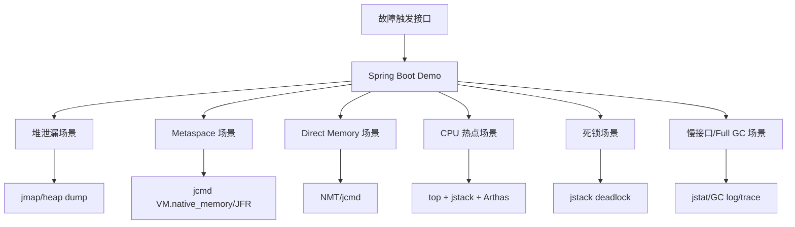
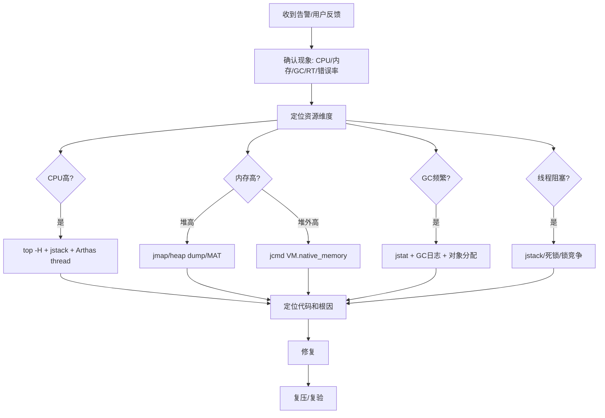

# 项目-JVM故障排查演练

> [!info] 项目简介
> 系统训练 CPU 飙高、内存泄漏、频繁 GC、线程死锁、Direct Memory、Metaspace 和慢接口排查。面试目标是把 JVM 八股转成“现象 -> 命令 -> 证据 -> 根因 -> 修复 -> 复验”的故障闭环。

## 🎯 项目目标

- 构造 7 类可复现故障：堆 OOM、Metaspace 增长、Direct Memory OOM、CPU 飙高、死锁、频繁 Full GC、慢接口。
- 训练固定排查路径：现象确认、指标定位、线程/堆/GC 证据、根因判断、修复验证。
- 输出面试证据：每个故障保留命令、截图/日志、分析结论、修复前后对比和 1 分钟表达稿。

## 🛠️ 技术栈

| 类别 | 选型 |
| ---- | ---- |
| 主技术栈 | JDK Tools + Arthas + JFR + Spring Boot 压测服务 |
| 故障场景 | 内存泄漏、线程死锁、CPU 热点、Full GC、慢 SQL/慢接口、堆外内存泄漏 |
| 验证工具 | jstat、jmap、jstack、jcmd、Arthas、JFR、VisualVM/GC 日志、GCeasy/GCViewer |

## 🏗️ 架构设计



## 🔌 故障触发接口

| 接口 | 故障 | 预期现象 | 主要工具 |
| ---- | ---- | -------- | -------- |
| `/fault/heap-leak` | 堆内存泄漏 | Old 区持续上涨，最终 OOM | `jmap -histo`、heap dump、MAT |
| `/fault/metaspace-leak` | 动态类加载过多 | Metaspace 增长，Full GC 后不下降 | `jcmd VM.native_memory`、JFR |
| `/fault/direct-memory-leak` | 堆外内存泄漏 | 进程 RSS 增长，堆不高 | NMT、`jcmd VM.native_memory` |
| `/fault/cpu-hot` | CPU 飙高 | 单核/多核 CPU 高，接口变慢 | `top -H`、`jstack`、Arthas `thread` |
| `/fault/deadlock` | 线程死锁 | 请求卡住，线程 BLOCKED | `jstack`、Arthas `thread -b` |
| `/fault/full-gc` | 频繁 Full GC | STW 增多，P99 抖动 | `jstat -gcutil`、GC log |
| `/fault/slow-api` | 慢接口 | RT 升高，线程池堆积 | Arthas `trace/watch`、JFR |

## ⚙️ JVM 启动参数

```bash
-Xms512m -Xmx512m \
-XX:+HeapDumpOnOutOfMemoryError \
-XX:HeapDumpPath=./dump \
-Xlog:gc*:file=./logs/gc.log:time,uptime,level,tags \
-XX:StartFlightRecording=filename=./logs/app.jfr,dumponexit=true,settings=profile
```

如果排查堆外内存，再增加：

```bash
-XX:NativeMemoryTracking=detail
```

## 🧭 通用排查流程



## 🐛 故障复盘 1：CPU 飙高

### 现象

- 应用 CPU 长时间 90%+。
- 接口 P95/P99 明显升高。
- 错误率可能不高，但吞吐下降。

### 排查命令

```bash
top
ps -mp <pid> -o THREAD,tid,time
printf '%x\n' <tid>
jstack <pid> > jstack.log
```

Arthas：

```bash
thread -n 5
thread <tid>
trace com.demo.service.HotService hotMethod
```

### 关键证据

- `top -H` 找到 CPU 最高线程。
- 线程 id 转十六进制后在 `jstack` 中定位到 `nid`。
- 栈顶方法长期停留在同一段业务代码，如死循环、复杂正则、大集合排序、JSON 序列化。

### 常见根因

- 死循环或递归退出条件错误。
- 大集合在请求线程内排序/分组。
- 正则回溯灾难。
- 日志/序列化对象过大。
- Full GC 线程占用 CPU，需要结合 GC 日志判断。

### 修复方案

- 修复循环条件或算法复杂度。
- 大任务异步化、分页、限流。
- 正则预编译并避免灾难性模式。
- 对热点方法加缓存或降级。

### 面试 1 分钟表达

CPU 飙高我会先用 `top -H` 找到热点线程，再把线程 id 转成十六进制，到 `jstack` 里看对应 `nid` 的 Java 栈。如果栈反复停在同一个业务方法，就结合 Arthas `trace` 或 `watch` 定位参数和耗时；如果是 GC 线程高，再切到 GC 日志和 `jstat` 分析。最后修复后要对比 CPU、P95/P99 和错误率。

## 🐛 故障复盘 2：堆 OOM

### 现象

- 日志出现 `java.lang.OutOfMemoryError: Java heap space`。
- Old 区持续上涨，Full GC 后无法回落。
- 应用频繁 Full GC 或直接退出。

### 排查命令

```bash
jstat -gcutil <pid> 1000 10
jmap -histo:live <pid> | head
jmap -dump:format=b,file=heap.hprof <pid>
```

### 关键证据

- `jstat` 看到 Old 区接近 100%。
- `jmap -histo` 中某类对象数量异常。
- MAT dominator tree 显示对象被静态集合、缓存、ThreadLocal 或未关闭资源引用。

### 常见根因

- 静态 Map/List 无限增长。
- 本地缓存没有容量和过期策略。
- ThreadLocal 未 remove。
- 大对象一次性加载到内存。
- 消息积压时把消息暂存在内存队列。

### 修复方案

- 缓存加最大容量、TTL、淘汰策略。
- 使用流式处理替代一次性加载。
- ThreadLocal 在 finally 中 remove。
- 队列加上限和拒绝策略。

### 面试 1 分钟表达

堆 OOM 不能只调大内存。我会先看 GC 日志和 `jstat` 判断 Old 区是否 Full GC 后仍不下降，再用 `jmap -histo` 和 heap dump 找数量异常或占用最大的对象，重点看 GC Roots，是静态集合、缓存、ThreadLocal 还是队列引用导致无法回收。修复后用同样压测验证 Old 区是否稳定。

## 🐛 故障复盘 3：Metaspace OOM

### 现象

- 日志出现 `OutOfMemoryError: Metaspace`。
- 堆占用不高，但类数量持续增长。
- Full GC 后 Metaspace 不明显下降。

### 排查命令

```bash
jcmd <pid> VM.classloader_stats
jcmd <pid> GC.class_histogram
jcmd <pid> VM.native_memory summary
```

### 常见根因

- 动态生成类过多，如 CGLIB、Groovy、ByteBuddy 使用不当。
- 类加载器泄漏，旧 ClassLoader 被线程、缓存或静态变量持有。
- 热部署场景未释放旧类加载器。

### 修复方案

- 缓存动态生成类，避免按请求生成新类。
- 清理持有 ClassLoader 的静态引用和线程上下文。
- 限制动态脚本/表达式编译数量。

## 🐛 故障复盘 4：Direct Memory OOM

### 现象

- 日志出现 `OutOfMemoryError: Direct buffer memory`。
- Java 堆看起来不高，但进程 RSS 持续增长。
- 常见于 Netty、NIO、文件传输、压缩解压。

### 排查命令

```bash
jcmd <pid> VM.native_memory summary
jcmd <pid> VM.native_memory detail
```

### 常见根因

- 直接内存 Buffer 未释放。
- Netty `ByteBuf` 引用计数未 release。
- 大量 NIO DirectByteBuffer 创建速度超过 Cleaner 回收速度。

### 修复方案

- 设置 `-XX:MaxDirectMemorySize`。
- 检查 ByteBuf release，开启 Netty leak detector。
- 复用 Buffer，避免请求级频繁分配。

## 🐛 故障复盘 5：线程死锁

### 现象

- 部分接口永久卡住。
- 线程状态出现 `BLOCKED`。
- 连接池、线程池可能逐步耗尽。

### 排查命令

```bash
jstack <pid> | grep -A 50 -i deadlock
```

Arthas：

```bash
thread -b
```

### 关键证据

`jstack` 会给出类似：线程 A 持有 lock1 等 lock2，线程 B 持有 lock2 等 lock1。

### 修复方案

- 固定加锁顺序。
- 缩小锁粒度和锁范围。
- 使用 `tryLock(timeout)` 避免永久等待。
- 避免在锁内调用远程服务或慢 IO。

### 面试 1 分钟表达

死锁我会直接用 `jstack` 或 Arthas `thread -b` 看是否有 deadlock 段，重点看两个线程分别持有哪些锁、等待哪些锁。修复不是简单重启，而是统一加锁顺序、缩小锁范围，必要时用带超时的锁，并避免锁内 RPC。

## 🐛 故障复盘 6：频繁 Full GC

### 现象

- GC 日志中 Full GC 次数增多。
- 接口 P99 抖动，偶发超时。
- CPU 可能被 GC 线程占用。

### 排查命令

```bash
jstat -gcutil <pid> 1000
jcmd <pid> GC.heap_info
```

### 判断路径

| 现象 | 可能原因 |
| ---- | -------- |
| Old 区持续上涨，Full GC 后不降 | 内存泄漏 |
| Young GC 频繁，对象快速晋升 | 新生代过小或分配过快 |
| Humongous 对象多 | 大对象分配，G1 region 不合适 |
| Full GC 后明显下降但很快又涨 | 瞬时大流量或批处理峰值 |

### 修复方案

- 先找对象分配和存活原因，再调参数。
- 减少大对象、批量分页处理。
- 调整堆大小、Young 区比例、G1 pause 目标要有压测依据。
- 对缓存和队列设置边界。

## 🐛 故障复盘 7：慢接口

### 现象

- 单个接口 RT 高，CPU/内存不一定异常。
- 线程池活跃数和队列长度上升。

### 排查命令

Arthas：

```bash
trace com.demo.controller.OrderController queryOrder
watch com.demo.service.OrderService query '{params, returnObj}' -x 2
monitor com.demo.service.OrderService query -c 5
```

### 常见根因

- 慢 SQL。
- 下游 RPC 超时重试。
- 线程池混用，慢任务拖垮快任务。
- 锁竞争。
- 日志同步写入过慢。

### 修复方案

- SQL 加索引或改写。
- 下游调用设置超时、熔断、降级。
- 按业务隔离线程池。
- 减少锁范围。

## 📋 开发任务拆解

- [ ] 实现故障接口：`/fault/heap-leak`、`/fault/metaspace-leak`、`/fault/direct-memory-leak`、`/fault/cpu-hot`、`/fault/deadlock`、`/fault/full-gc`、`/fault/slow-api`。
- [ ] 配置 JVM：小堆、GC 日志、HeapDumpOnOutOfMemoryError、JFR、NMT。
- [ ] 编写排查手册：每个场景列命令顺序和预期现象。
- [ ] 执行采集：保存 `jstat`、`jmap -histo`、`jstack`、Arthas `dashboard/thread/trace` 输出。
- [ ] 修复验证：移除泄漏引用、减少锁竞争、优化慢调用，再对比指标。
- [ ] 验收：每个故障能在 5 分钟内复现，并有一页复盘说明根因和修复。

## 🧠 关键技术点

- [[../02-JVM/07-OOM问题排查]]
- [[../02-JVM/08-常用工具-jstat-jmap-jstack-Arthas]]
- [[../02-JVM/06-JVM调优实战]]
- [[../03-并发编程/07-线程池原理与参数]]
- 面试抓手：CPU 飙高怎么定位到代码行、OOM heap dump 怎么看、死锁日志怎么看、频繁 GC 如何区分内存泄漏和分配过快。

## 📊 成果与复盘

- 演示入口：通过故障触发接口制造异常，再用 JDK/Arthas/JFR 定位。
- 性能数据：记录 GC 次数、停顿时间、堆占用、CPU 热点线程和定位命令输出。
- 复盘证据：保留 GC 日志、heap dump 摘要、线程栈、Arthas 输出和修复前后指标对比。

## 🎤 面试 3 层回答

### 30 秒版

JVM 排障我会先判断问题属于 CPU、堆、堆外、GC、线程阻塞还是慢调用，再选择对应工具。核心不是背命令，而是用命令拿到证据，定位到对象、线程、方法或 SQL，最后修复并复验指标。

### 2 分钟版

如果 CPU 高，我用 `top -H` 找线程，再用 `jstack` 和 Arthas 定位代码；如果堆 OOM，我看 GC 日志、`jmap -histo` 和 heap dump；如果堆不高但进程内存高，我查 NMT 和 Direct Memory；如果接口慢，我用 Arthas `trace` 分解耗时。每次排查都记录现象、证据、根因、修复和前后指标。

### 项目版

这个演练项目我会准备多个可复现故障接口，模拟 CPU 飙高、堆泄漏、死锁和 Full GC。面试时可以直接按一次故障复盘讲：当时什么指标报警，我用什么命令定位到哪个线程/对象/方法，最后做了什么改动，修复后 P99、GC 次数或 CPU 如何变化。

## 🔗 关联笔记

- [[_index]]
- [[../02-JVM/06-JVM调优实战]]
- [[../02-JVM/07-OOM问题排查]]
- [[../02-JVM/08-常用工具-jstat-jmap-jstack-Arthas]]

## 📚 参考资料

- Oracle / OpenJDK 工具文档：jcmd、jstat、jmap、jstack、JFR。
- Arthas 官方文档：dashboard、thread、trace、watch 常用命令。
- GCeasy / GCViewer 文档：GC 日志阅读和停顿分析。
- Java Performance: The Definitive Guide：JVM 性能诊断方法。
