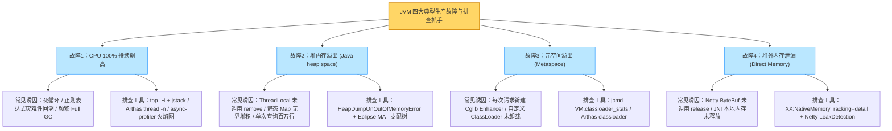
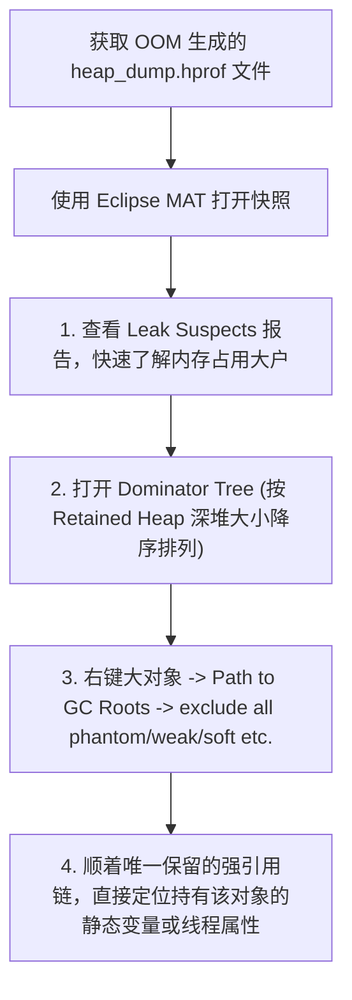
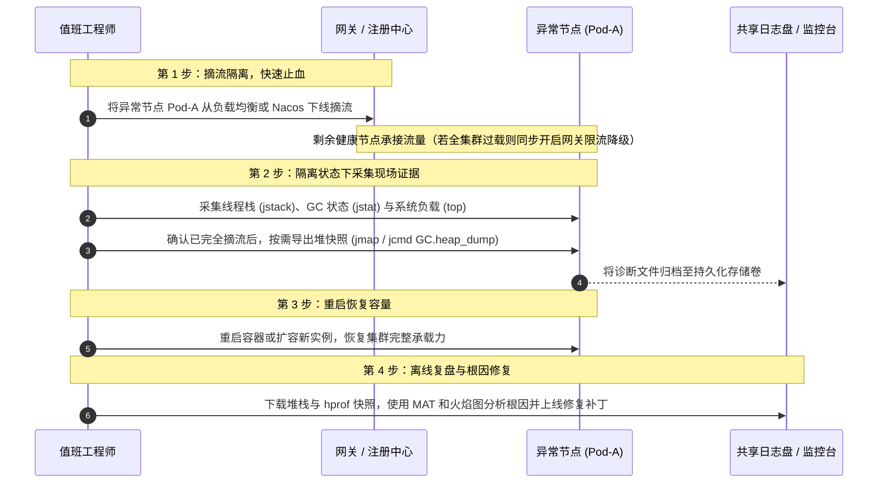

# 项目实战：生产级 JVM 故障排查演练与性能深度调优

> **关联理论**：[[../02-JVM/00-JVM全景与心智模型|JVM全景]]、[[../02-JVM/04-垃圾收集器-G1-ZGC|GC调优]]、[[../02-JVM/08-常用工具-jstat-jmap-jstack-Arthas|排障SOP]]

---

## 1. 业务背景与项目全貌

### 1.1 为什么需要系统化的 JVM 排障演练？
线上 Java 应用在经历大促峰值、复杂业务迭代或底层组件升级后，常会遇到四类棘手的运行期故障：
1. **CPU 使用率突增至 100%**：接口响应停滞，但由于没有抛出异常日志，仅看业务日志无法得知代码卡在何处。
2. **堆内存慢性泄漏（Heap OOM）**：老年代内存在每次 Full GC 后水位线持续抬升，运行数天后抛出 `OutOfMemoryError: Java heap space`。
3. **元空间溢出（Metaspace OOM）**：动态生成类（如不规范使用 CGLIB、Groovy 脚本或反射类加载器）未被卸载，撑爆元空间。
4. **堆外直接内存失控（Direct Memory Leak）**：JVM 堆内存占用平稳，但容器物理内存（RSS）持续上涨，最终触发 Linux 内核 OOM Killer 将进程强制杀死（`kill -9`），现场不留下一行 Java 异常日志。

### 1.2 演练复盘与 STAR 描述参考

```text
【项目名称】：核心服务 JVM 典型故障靶场演练与线上应急排障 SOP 建设
【业务痛点】：线上偶发容器无故重启（OOMKilled）、接口周期性毛刺与 CPU 飙高，传统排查方式依赖人工经验且容易在盲目重启中丢失故障第一现场。
【核心方案】：
  1. 标准化应急止血 SOP：确立“先摘流隔离、再轻量取证、后重启恢复、最终离线深挖”的四步准则，避免在线对大堆直接执行 jmap 引发全站雪崩；
  2. CPU 热点线程定位：通过 top -H 锁定高负载线程 TID，转换为十六进制 nid 后结合 jstack 堆栈与 Arthas thread/profiler 火焰图，快速定位正则灾难性回溯与死循环代码；
  3. 堆内与堆外泄漏排查：利用 Eclipse MAT 的 Dominator Tree（支配树）与排除弱引用后的 GC Roots 路径，定位未清理的 ThreadLocal 上下文与无界缓存；结合 NMT（Native Memory Tracking）与 Netty 内存泄漏检测机制修复 ByteBuf 未释放问题；
  4. G1 收集器参数调优：针对大对象分配引发的 Humongous 碎片化问题，优化对象生命周期与 Region 容量配置，消除非预期的退化 Full GC。
【达成效果】：形成团队标准化的线上 JVM 排障手册与容器启动参数基线，大幅缩短线上疑难故障的恢复耗时（MTTR）与根因定位周期。
```

---

## 2. 四大高频 JVM 故障全景图谱



---

## 3. 故障演练一：CPU 100% 热点线程定位

### 3.1 案发代码示例（正则表达式灾难性回溯）
除了明显的 `while(true)` 死循环外，线上更隐蔽的 CPU 杀手是**包含嵌套量词的正则表达式**。当输入字符串不匹配末尾规则时，NFA 正则引擎会发生指数级回溯计算，单次匹配即可将单核 CPU 跑满数分钟：

```java
public class RegexBacktrackingDemo {
    // 危险正则：嵌套量词 ([a-zA-Z0-9]+)+ 在匹配失败时会触发指数级回溯
    private static final Pattern BAD_PATTERN = Pattern.compile("^([a-zA-Z0-9]+)+$");

    public static boolean validateInput(String input) {
        // 当传入 "aaaaaaaaaaaaaaaaaaaaaaaaaaaa!" (末尾带感叹号导致不匹配) 时，CPU 瞬间飙升
        return BAD_PATTERN.matcher(input).matches();
    }
}
```

### 3.2 Linux 命令行定位四步法

当没有安装可视化 APM 工具时，使用原生命令即可在数秒内锁定问题代码行：

```bash
# 第 1 步：找到占用 CPU 最高的 Java 进程 PID（假设为 28109）
top -c

# 第 2 步：查看该进程内各个线程的 CPU 占用，找到最高的线程号 TID（假设为 28145）
top -H -p 28109

# 第 3 步：将十进制的 TID 转换为十六进制（对应 jstack 中的 nid）
printf "%x\n" 28145
# 输出：6df1

# 第 4 步：抓取线程栈并过滤出 nid=0x6df1 的线程上下文（建议间隔 2 秒抓两次确认是否为持续热点）
jstack 28109 | grep -A 20 "0x6df1"
```

#### 捕获到的线程堆栈输出：
```text
"http-nio-8080-exec-12" #35 daemon prio=5 os_prio=0 tid=0x00007f9c9001b800 nid=0x6df1 runnable [0x00007f9c5cdfe000]
   java.lang.Thread.State: RUNNABLE
        at java.util.regex.Pattern$Curly.match0(Pattern.java:4260)
        at java.util.regex.Pattern$Curly.match(Pattern.java:4234)
        at java.util.regex.Matcher.match(Matcher.java:1270)
        at java.util.regex.Matcher.matches(Matcher.java:604)
        at com.example.demo.RegexBacktrackingDemo.validateInput(RegexBacktrackingDemo.java:8)
```

> **Arthas 快捷指令**：如果环境已接入阿里 Arthas，直接执行 `thread -n 3` 即可一键打印当前最忙的前 3 个线程及其代码行号；或使用 `profiler start` / `profiler stop` 生成 CPU 火焰图。

---

## 4. 故障演练二：堆内存泄漏与 MAT 支配树剖析

### 4.1 典型泄漏场景：线程池复用下的 `ThreadLocal` 滞留
在 Web 应用中，Tomcat 工作线程是池化长期存活的。`ThreadLocal` 内部通过线程对象持有的 `ThreadLocalMap` 存储数据，其中 Key 是对 `ThreadLocal` 实例的弱引用（WeakReference），而 **Value 是强引用**。
如果在拦截器中向 `ThreadLocal` 存入了较大的业务上下文对象，但在请求结束时忘记调用 `remove()`，那么只要该工作线程不被销毁且没有再次调用该 `ThreadLocal` 的 `set()`，这个 Value 对象就会一直被工作线程强引用持有，无法被 GC 回收，同时还可能导致下一个复用该线程的请求读到脏数据。

```java
public class UserContextFilter implements Filter {
    private static final ThreadLocal<UserSessionContext> USER_CONTEXT = new ThreadLocal<>();

    @Override
    public void doFilter(ServletRequest req, ServletResponse res, FilterChain chain)
            throws IOException, ServletException {
        try {
            USER_CONTEXT.set(loadUserSession(req));
            chain.doFilter(req, res);
        } finally {
            // 关键防御：必须在 finally 中显式清理，切断 ThreadLocalMap 对 Value 的强引用
            USER_CONTEXT.remove();
        }
    }
}
```

### 4.2 Eclipse MAT 堆转储分析标准流程
生产环境建议在启动参数中预先配置 OOM 自动导出堆快照：
`-XX:+HeapDumpOnOutOfMemoryError -XX:HeapDumpPath=/var/log/jvm/heap_dump.hprof`

拿到 `.hprof` 文件后，使用 **Eclipse MAT（Memory Analyzer Tool）** 按以下四步定位根因：



- **核心概念区分（Shallow Heap vs Retained Heap）**：
  - **浅堆（Shallow Heap）**：对象自身结构（对象头 + 基本类型字段 + 引用指针本身）占用的字节数，不包含它引用的其他对象。例如一个 `HashMap` 实例自身的浅堆只有几十字节。
  - **深堆（Retained Heap）**：如果该对象被回收，能够连带一起被释放的所有下属对象的内存总和。排查内存泄漏时，**重点看 Retained Heap**。

---

## 5. 故障演练三：Netty 堆外直接内存泄漏排查

### 5.1 故障现象与成因
在使用 Netty、gRPC 或 Spring Cloud Gateway 的服务中，有时会观察到：JVM 堆内存最大值仅设置了 `-Xmx2g`，`jstat` 显示老年代占用只有 40%，但容器的总物理内存占用（RSS）却持续涨到 8GB，最终触发 Kubernetes Pod `OOMKilled`（Exit Code 137）。

这是因为 Netty 默认使用堆外直接内存（`DirectByteBuffer`）进行零拷贝网络读写。堆外内存不受 JVM 普通 GC 直接管理，而是依赖**引用计数（Reference Counting）**机制回收。如果业务处理器消费完 `ByteBuf` 后漏调了 `ReferenceCountUtil.release(buf)`，这部分堆外内存就会发生永久泄漏。

### 5.2 排查与修复手段
1. **开启 JVM 原生内存追踪（NMT）**：
   在 JVM 启动参数中加入 `-XX:NativeMemoryTracking=detail`，通过 `jcmd <PID> VM.native_memory baseline` 建立基线，运行一段时间后执行 `jcmd <PID> VM.native_memory detail.diff`，对比观察 `Internal`（含 Direct Buffer）或 `Thread`、`Metaspace` 等区域的内存增量。
2. **开启 Netty 内存泄漏检测**：
   在测试环境或灰度节点添加参数 `-Dio.netty.leakDetection.level=PARANOID`（生产环境默认是 `SIMPLE` 抽样检测）。当某个 `ByteBuf` 被 GC 回收前发现其引用计数仍大于 0 时，Netty 会在日志中打印出 `LEAK: ByteBuf.release() was not called`，并精准附带该 `ByteBuf` 被创建和最后一次被访问的代码堆栈，顺着堆栈即可补齐 `try-finally { ReferenceCountUtil.release(msg); }`。

---

## 6. 生产故障应急止血标准 SOP

线上突发告警时，首要原则是**“先恢复业务可用性，同时保留轻量现场，切忌在线盲目执行耗时操作”**：



---

## 7. 面试高频追问解析

> [!question]- 追问 1：如果线上机器配置了 32GB 的大堆内存，在故障发生时直接执行 `jmap -dump:live` 会有什么风险？应该怎么操作？
> 直接对正在承接流量的生产节点执行 `jmap -dump:live,format=b,file=heap.hprof` 会触发一次 Full GC 并导致**全进程长时间停顿（Stop-The-World）**。对于 32GB 的堆，磁盘写出和存活对象遍历可能耗时数十秒甚至数分钟，在此期间该节点所有请求全部超时，甚至可能引发上游线程池连锁阻塞。
> **正确的生产操作规范**：
> 1. **必须先摘流后 Dump**：先在注册中心或负载均衡器上将该节点权重置为 0（摘除流量），使它不再接收任何外部业务请求，然后再执行堆转储命令。
> 2. **优先使用轻量级诊断工具**：在不确定是否为内存泄漏前，先用几乎无停顿的 `jstat -gcutil`、`jstack` 或 JFR（Java Flight Recorder）定界问题，确认需要分析对象引用链时再在隔离节点上做 Heap Dump。

> [!question]- 追问 2：为什么服务端 JVM 启动参数通常建议将初始堆 `-Xms` 和最大堆 `-Xmx` 设置为相同的值？
> 1. **避免运行期动态扩缩容开销**：如果 `-Xms` 设得很小（如 1G）而 `-Xmx` 设为 8G，在流量高峰期堆内存不足时，JVM 需要频繁向操作系统申请扩展内存页并调整各分代边界，这会带来额外的 GC 停顿与系统抖动。
> 2. **保障容器环境的资源确定性**：在 Kubernetes 等容器化环境中，容器的内存 Limit 是固定的。将 `-Xms` 与 `-Xmx` 设为一致（通常占容器内存上限的 60%~70%，为元空间、线程栈、堆外内存和操作系统缓存预留 30%~40% 空间），能让内存占用在启动后保持可预测状态，方便容量规划。

> [!question]- 追问 3：G1 垃圾收集器在什么情况下会退化触发耗时的 Full GC？如何调优避免？
> G1 的设计目标是通过 Mixed GC（混合收集部分老年代 Region）来避免整堆 Full GC。但如果出现以下两种情况，G1 就会退化为 Full GC（日志中出现 `Pause Full (G1 Compaction Pause)`）：
> 1. **并发标记或转移跟不上分配速率（Evacuation Failure / To-space Exhausted）**：业务创建对象的速度太快，在老年代并发标记还没完成前，或者在复制存活对象时，整个堆已经没有空闲 Region 可供分配。
> 2. **巨型对象分配失败（Humongous Allocation Failure）**：在 G1 中，大小超过单个 Region 容量一半（例如 Region 为 4M，对象超过 2M）的对象被称为巨型对象，必须直接分配在**连续的多个空闲 Region** 中。当内存碎片较多、找不到连续空闲 Region 时，就会触发 Full GC 来压缩整理碎片。
> **调优方向**：
> - 排查业务代码中是否存在单次加载超大 JSON / 字节数组的行为，从源头拆分大对象；
> - 若业务确实存在合法的数 MB 级别对象，可通过 `-XX:G1HeapRegionSize` 适当调大 Region 尺寸（如从 2M 调至 8M 或 16M），使原本被判定为 Humongous 的对象降级为普通对象走常规 Eden 分配路径。

> [!question]- 追问 4：如果监控发现线上频繁发生 Full GC，但导出堆快照一看，老年代实际占用的内存却很少（比如不到 25%），可能是什么原因？
> 这种“堆很空却频繁 Full GC”的现象，通常由以下三个原因之一引起：
> 1. **元空间（Metaspace）扩容或达到上限**：虽然堆内存很空，但如果动态加载的类过多触发了 Metaspace 阈值，JVM 会触发 Full GC 尝试卸载无用类。查看 GC 日志中的触发原因是否为 `[Metadata GC Threshold]` 即可确认。
> 2. **代码或框架显式调用了 `System.gc()`**：例如部分 NIO 框架、RMI 定时回收或业务代码误调了 `System.gc()`（GC 日志会显示 `[System.gc()]`）。可通过排查调用源或添加 `-XX:+ExplicitGCInvokesConcurrent` 让其改为并发收集。
> 3. **G1 巨型对象连续空间不足**：老年代总体空闲比例很高，但空闲 Region 呈离散碎片状分布，此时突然申请一个需要连续几个 Region 的巨型对象，被迫触发 Full GC 进行碎片整理。

> [!question]- 追问 5：阿里 Arthas 为什么能够在不重启 Java 进程、不修改源码的情况下，实时监控任意方法的入参、返回值和耗时？
> Arthas 的底层核心是 **JDK 的 Attach API（JVMTI） + Java Agent（`Instrumentation`） + ASM 字节码增强**：
> 1. **动态挂载（Attach）**：当你启动 Arthas 并选择目标进程 PID 时，它通过 `VirtualMachine.attach(pid)` 建立进程间通信套接字，将 `arthas-agent.jar` 动态加载到正在运行的 JVM 中。
> 2. **字节码插桩与重转换**：当你执行 `watch` 或 `trace` 命令指定某个类和方法时，Arthas 注册自定义的 `ClassFileTransformer`，利用 ASM 框架在目标方法的字节码开头和结尾动态织入计时、参数捕获等切面指令，然后调用 `Instrumentation.retransformClasses()` 让新字节码立即在内存中生效。
> 3. **退出还原**：执行 `stop` 退出时，Arthas 会触发字节码重置，将修改过的类还原为原始字节码，从而实现运行时动态诊断与安全退出的闭环。

---

## 8. 核心要点复盘清单

- **CPU 100% 排查链**：`top` 找进程 PID -> `top -H -p <PID>` 找线程 TID -> `printf "%x"` 转十六进制 `nid` -> `jstack <PID> | grep -A 20 0x<nid>` 锁定代码行（或直接用 Arthas `thread -n 3`）。
- **堆内存 OOM 排查链**：开启 `-XX:+HeapDumpOnOutOfMemoryError` -> Eclipse MAT 打开 `.hprof` -> 查 `Dominator Tree` 最大深堆（Retained Heap） -> `Path to GC Roots`（排除软/弱/虚引用）锁定强引用源头。
- **堆外内存排查链**：结合 `-XX:NativeMemoryTracking=detail`（`jcmd <PID> VM.native_memory detail.diff`）与 `-Dio.netty.leakDetection.level=PARANOID` 定位未释放的 `ByteBuf`。
- **线上应急准则**：先摘流隔离故障节点恢复业务，在无流量状态下采集堆栈与快照，杜绝在线直接对大堆执行阻塞式 Dump。
