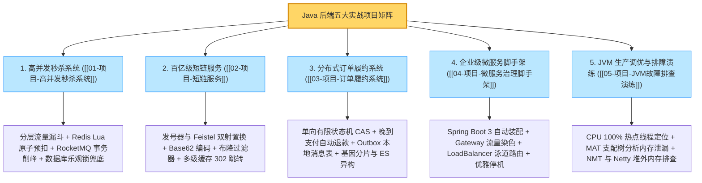

# Java 项目实战：五大核心项目全景复盘与面试指南

> **前置知识**：[[01-项目-高并发秒杀系统]] 至 [[05-项目-JVM故障排查演练]] 全量篇目

---

## 1. 五大实战项目全景知识图谱

本章的五个项目分别对应了后端工程中最具代表性的五类技术难题：**极端并发写（秒杀）、极端并发读（短链）、复杂状态与分布式事务（订单）、多服务协同治理（脚手架）以及底层运行期稳定性（JVM 排障）**。



---

## 2. 项目复盘与技术面试表达方法

在技术面试中介绍项目时，面试官重点考察三个维度：
1. **业务痛点与背景边界**：为什么要做这个改造？如果不做，原有架构在并发、数据规模或可维护性上会遇到什么具体问题？
2. **技术选型与权衡取舍（Trade-off）**：为什么选择方案 A 而不是方案 B？引入该方案后带来了什么新的边缘异常（如缓存与数据库不一致、消息重复投递），又是如何兜底闭环的？
3. **量化验证与工程结果**：通过压测或监控指标，改造前后的吞吐量（QPS）、P99 响应延迟、错误率以及机器资源利用率发生了怎样的改善？

### STAR 结构化陈述公式

```text
【S - 背景与痛点】：在什么业务场景下，面临怎样的并发量/数据量挑战，原有方案暴露出了什么瓶颈（如行锁争用、慢查询、雪崩风险）？
【T - 核心目标】：需要达成怎样的技术指标（如保障零超卖、消除跨分片广播、实现发布零报错）？
【A - 架构方案与细节】：分几步落地？核心表结构如何设计？并发冲突与分布式异常（超时、重试、悬挂）如何闭环？
【R - 量化成效】：压测或线上运行后，QPS、P99 延迟、数据库 CPU 负载及故障恢复时间（MTTR）取得了怎样的改善？
```

---

## 3. 项目实战高频面试 10 连问速查

> [!question]- Q1：秒杀系统中，如果 Redis Lua 预扣库存成功了，但应用在发送 MQ 消息前宕机，如何防止“少卖”？
> 不能因为发送异常就直接执行 `INCRBY` 回补，否则在网络超时但消息实际已送达时会引发超卖。正确做法是在 Lua 预扣库存的同时，原子写入一条带时间戳的 `requestId` 预留记录（ZSet）。后台定时任务扫描超时未完结的预留记录，去数据库核实确无订单且将请求状态安全置为已取消后，再幂等回补 Redis 库存。

> [!question]- Q2：短链跳转为什么普遍使用 302 临时重定向，而不是 301 永久重定向？
> 301 会被浏览器缓存在本地磁盘，导致后续点击直接跳往目标长链而不经过短链服务器，既无法统计真实的点击 PV/UV 报表，也无法在发现目标网页违规时动态修改或封禁链接。使用 302 并配合 `Cache-Control: no-store` 可以确保每次跳转都受服务端管控与统计。

> [!question]- Q3：短链生成采用“自增发号器 + Feistel 置换 + Base62”相比哈希算法有什么核心优势？
> 哈希算法（如 MurmurHash）截取固定长度属于多对一映射，数据量增大后必然存在碰撞概率，需要查库重试加盐；而发号器生成的 ID 全局唯一，经过 Feistel 双射置换后依然保持严格的一对一映射，既从数学上消除了碰撞重试开销，又打乱了自增序列的规律，防止外部按顺序遍历爬取。

> [!question]- Q4：订单超时关单任务与微信/支付宝的支付成功回调同时到达，如何防止“钱扣了但单被关了”？
> 首先，所有状态变更都通过携带前置状态的 CAS 条件更新（`WHERE order_no = ? AND status = 'WAIT_PAY'`）执行，依靠 InnoDB 行锁保证关单与支付回调串行生效。其次，关单前先向支付渠道查单并关闭支付通道；如果支付回调因网络延迟在订单关闭后才到达，系统检测到订单已处于 `CANCELLED` 状态，会在同一本地事务中记录支付流水并插入一条自动退款事件（Outbox），异步调用渠道原路退款。

> [!question]- Q5：订单表按买家 `user_id` 分库分表后，如何解决“按订单号查详情”和“卖家查店铺订单”的跨表扫描问题？
> 1. **买家端按单号查询（分片基因法）**：生成 `order_no` 时，将 `user_id % 分表数` 的基因编号直接嵌入订单号末尾，使解析 `order_no` 也能算出与 `user_id` 完全相同的分片路由，实现单表直达。
> 2. **卖家端多维检索（异构索引宽表）**：通过 Canal 监听 MySQL Binlog，将分片数据准实时同步至以 `merchant_id` 为路由键的 Elasticsearch 订单宽表，由 ES 承接商家后台的复合条件搜索。

> [!question]- Q6：为什么在 Spring Cloud Gateway 的过滤器中不能直接调用同步阻塞的 JDBC 或 RestTemplate？
> Gateway 基于 Netty WebFlux 响应式模型，其底层 EventLoop 线程数很少（通常与 CPU 核数相当），单个线程负责复用处理大量连接的读写事件。一旦在过滤器中执行同步阻塞调用，EventLoop 线程被挂起，会导致共享该线程的所有其他请求全部排队卡死。必须使用响应式非阻塞客户端（如 `WebClient`），或将阻塞操作显式提交到独立的有界弹性线程池。

> [!question]- Q7：全链路灰度发布中，请求经过异步线程池和消息队列（MQ）时如何保持灰度标签不丢失？
> 1. **HTTP/RPC 层**：网关鉴权后打上 `X-Gray-Tag`，下游通过 Servlet Filter 提取并由 OpenFeign `RequestInterceptor` 自动传递到下一跳请求头。
> 2. **异步线程池层**：通过 Spring `TaskDecorator` 或阿里 `TransmittableThreadLocal`（TTL）包装线程池，在提交任务时复制父线程上下文快照，子线程执行完毕后在 `finally` 中清理还原。
> 3. **消息队列层**：生产者将灰度标签写入 MQ 消息属性（Header/Property），消费者通过消费组物理隔离或按消息属性过滤，确保灰度消息只被灰度实例消费。

> [!question]- Q8：线上服务器 CPU 突然飙升到 100%，如何在不重启应用的情况下快速定位到具体代码行？
> 使用命令链：`top` 找到高负载 Java 进程 PID -> `top -H -p <PID>` 找到占用 CPU 最高的线程 TID -> `printf "%x\n" <TID>` 转为十六进制 `nid` -> `jstack <PID> | grep -A 20 0x<nid>` 查看该线程的实时调用栈（建议间隔几秒采样两次确认持续热点）；若已部署 Arthas，直接运行 `thread -n 3` 即可秒级定位。

> [!question]- Q9：使用 Eclipse MAT 分析 OOM 堆转储快照时，Shallow Heap 和 Retained Heap 有什么区别？
> Shallow Heap（浅堆）是对象本身结构占用的内存大小，不包含其引用的子对象；Retained Heap（深堆）是当该对象被 GC 回收后，能连带一起释放的所有关联对象的内存总和。排查内存泄漏时，应在 `Dominator Tree`（支配树）中按 **Retained Heap** 排序找到内存大户，再通过 `Path to GC Roots`（排除软/弱/虚引用）找到是谁一直强引用着它。

> [!question]- Q10：Java 进程的堆内存使用率很正常，但容器物理内存（RSS）持续上涨直至被系统 OOMKilled，如何排查？
> 这是典型的堆外内存（Native / Direct Memory）泄漏，常见于 Netty `ByteBuf` 未调用 `release()` 释放、未关闭的 `Deflater/Inflater` 压缩流或 JNI 调用。排查时可开启 `-XX:NativeMemoryTracking=detail`，使用 `jcmd <PID> VM.native_memory detail.diff` 观察堆外各区域增量；针对 Netty 服务，可在测试或灰度节点开启 `-Dio.netty.leakDetection.level=PARANOID`，根据日志打印的 `ByteBuf` 分配与访问轨迹修复遗漏的释放逻辑。

---

## 4. 五大项目核心设计原则清单

- **秒杀系统**：前端拦截削峰、Redis Lua 原子预扣、RocketMQ 事务消息异步化、数据库条件更新与唯一索引兜底、预留对账防少卖。
- **短链服务**：发号器配合 Feistel 双射置换实现无碰撞乱序短码、布隆过滤器与空值缓存防穿透、Caffeine + Redis 多级缓存加速 302 跳转、Kafka 异步统计。
- **订单履约**：单向状态机配合前置状态 CAS 更新、超时关单先核验渠道、晚到支付自动转入原路退款闭环、Outbox 本地消息表保最终一致、基因分片与 ES 异构分离读写。
- **微服务治理**：网关统一染色防伪造、Feign 拦截器与 TTL 跨组件透传、LoadBalancer 按元数据筛选泳道、下线先从注册中心摘流等待缓存刷新再优雅停机。
- **JVM 排障**：先摘流止血保业务再取证、CPU 飙高查热点线程 `nid`、堆内泄漏查 MAT 支配树强引用链、堆外泄漏查 NMT 增量与 Netty 引用计数。
