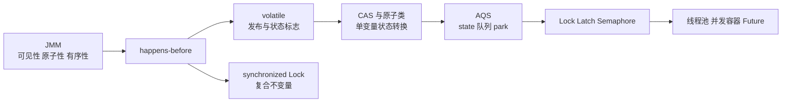
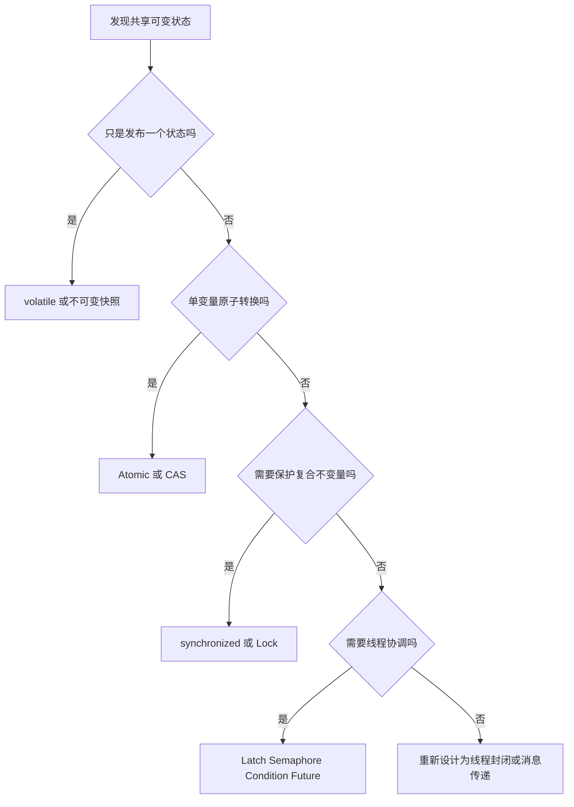

# JMM 到 JUC 并发工具的完整链路

> [!abstract] 一句话总结
> JMM 定义并发正确性的规则，volatile、CAS、锁、AQS、并发容器和线程池是在这些规则上提供不同强度的工程工具。

## 为什么需要这篇串联

[[20-Java后端/03-并发编程/02-Java内存模型JMM|JMM]] 不是一套可直接调用的 API，而是判断共享变量读写是否合法的规范。JUC 工具的价值，是把 happens-before、原子更新、互斥和线程协调封装成不容易用错的组件。

## 从规范到工具



## 各层解决的问题

| 层次 | 解决的问题 | 不能解决什么 | 对应笔记 |
| --- | --- | --- | --- |
| JMM | 定义线程间可见性与顺序规则 | 不替你选择同步方案 | [[20-Java后端/03-并发编程/02-Java内存模型JMM]] |
| volatile | 单变量发布、停止标志、读多写少状态 | `count++`、多变量一致性 | [[20-Java后端/03-并发编程/03-volatile与synchronized]] |
| CAS / Atomic | 单变量原子状态转换 | 多资源事务、带副作用的重试 | [[20-Java后端/03-并发编程/04-CAS与原子类]] |
| synchronized / Lock | 保护临界区和复合不变量 | 跨进程一致性 | [[20-Java后端/03-并发编程/06-ReentrantLock与读写锁]] |
| AQS | 复用 state、等待队列和唤醒机制 | 业务层并发策略 | [[20-Java后端/03-并发编程/05-AQS原理]] |
| 并发容器 | 封装高并发数据结构的同步细节 | 任意跨容器复合操作 | [[20-Java后端/03-并发编程/08-并发容器-ConcurrentHashMap]] |
| 线程池 / Future | 管理任务边界、并行度和结果交付 | 自动提供业务幂等和下游保护 | [[20-Java后端/03-并发编程/07-线程池原理与参数]]、[[20-Java后端/03-并发编程/09-CompletableFuture异步编程]] |

## 必须掌握的内存语义

1. 解锁 happens-before 后续对同一把锁的加锁，因此临界区内的写入可被后续持锁线程看到。
2. volatile 写 happens-before 后续对同一变量的 volatile 读，适合发布状态，但不把复合操作变成原子操作。
3. `Thread.start()` 之前的动作对新线程可见；线程内动作对成功返回的 `Thread.join()` 之后可见。
4. 提交任务前的动作对任务执行可见；任务动作通过 `Future.get()` 的完成边界交付给读取结果的线程。
5. `final` 字段有初始化安全语义，但前提是构造过程中没有发生 `this` 逃逸。

## 选型顺序



## 一个完整例子：异步更新后的安全读取

```java
ExecutorService pool = Executors.newFixedThreadPool(4);
OrderSnapshot snapshot = loadSnapshot();

Future<Result> future = pool.submit(() -> calculate(snapshot));
Result result = future.get();
```

- `snapshot` 最好不可变，避免任务执行期间被调用线程继续修改。
- 提交前初始化完成的数据对任务可见。
- `future.get()` 不只是等待结果，也是结果完成后的内存可见性边界。
- 线程池仍需有界队列、超时、拒绝策略和隔离，详见 [[06-线程池-CompletableFuture-MQ异步链路]]。

## 常见错误连接

- “用了 ConcurrentHashMap 就线程安全”：单次方法安全不代表 `先检查再写入两个结构` 的整体不变量安全。
- “CAS 一定比锁快”：高竞争会持续自旋；临界区长或竞争高时，阻塞锁可能更合适。
- “CompletableFuture 自动异步”：未指定执行器时可能进入公共池，阻塞任务会污染其他业务。
- “volatile 能刷新所有业务状态”：它只为特定读写建立顺序，业务多字段一致性仍需原子边界。

## 面试讲法

先讲 JMM 规定正确性，再讲 volatile/锁建立 happens-before，CAS 提供单变量原子更新，AQS 抽象同步器，最后落到 Lock、Latch、线程池和并发容器。回答时必须补一句：工具选型取决于共享状态范围、复合不变量、竞争程度和是否允许阻塞。

## 关联笔记

- [[20-Java后端/03-并发编程/_index|并发编程索引]]
- [[08-线上故障排查全链路]]

## 参考资料

- [Java Language Specification 17.4 - Memory Model](https://docs.oracle.com/javase/specs/jls/se21/html/jls-17.html#jls-17.4)
- [Java SE ExecutorService](https://docs.oracle.com/en/java/javase/21/docs/api/java.base/java/util/concurrent/ExecutorService.html)
- [Java Concurrency Utilities](https://docs.oracle.com/en/java/javase/21/docs/api/java.base/java/util/concurrent/package-summary.html)

