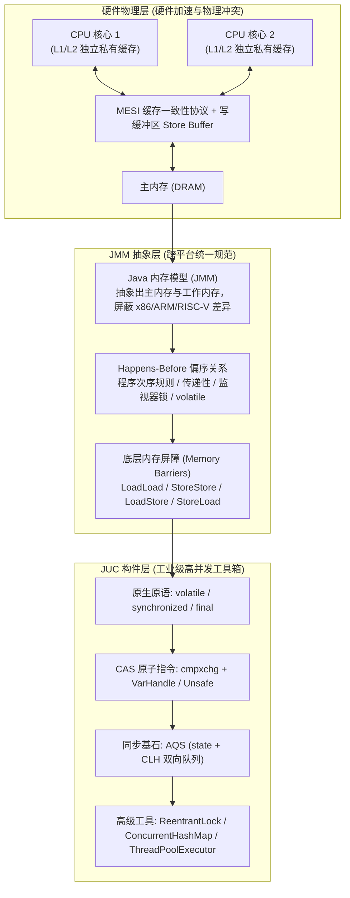

# JMM 到 JUC 并发工具的完整链路：从硬件屏障到高级并发构件

> **关联基础**：[[../03-并发编程/00-并发编程心智模型与学习路线|并发编程全景]]、[[../03-并发编程/02-Java内存模型JMM|JMM内存模型]]、[[../03-并发编程/05-AQS原理|AQS原理]]

---

## 1. 为什么需要 JMM？（第一性原理与硬件根基）

### 1.1 硬件三大矛盾与并发三大危机
在现代多核计算机体系中，CPU 计算速度（纳秒级）与主内存访问速度（数十纳秒）存在巨大鸿沟。为了压榨性能，计算机体系结构引入了三项关键技术，但同时也引发了并发编程的三大危机：

| 硬件加速技术 | 硬件层副作用 | 映射到 Java 并发层的问题 |
| :--- | :--- | :--- |
| **CPU 多级高速缓存 (L1/L2/L3)** | 核心各自持有一份缓存副本，写操作未能实时刷回主存 | **可见性问题（Visibility）**：线程 A 修改了变量，线程 B 看不见 |
| **CPU 乱序执行流水线 (Out-of-Order)** | CPU 为了指令流水线不阻塞，重排无依赖指令 | **有序性问题（Ordering）**：指令重排导致程序逻辑与时序错乱 |
| **操作系统多线程时间片抢占** | 线程随时可能在执行半截指令时被内核强制挂起 | **原子性问题（Atomicity）**：非原子复合操作（如 `count++`）被打断 |



---

## 2. JMM 到 JUC 的层级演进与技术贯通图谱

整个 Java 并发体系并非各个孤立 API 的堆砌，而是一座严密自洽的摩天大楼：

```mermaid
flowchart TD
    subgraph Layer1["第 1 层：硬件与机器指令层"]
        CPU_CAS["CPU lock cmpxchg 汇编指令"]
        CPU_MB["CPU 内存屏障指令 (mfence / lfence / sfence)"]
    end

    subgraph Layer2["第 2 层：JVM 内存模型契约 (JMM)"]
        HB_Rule["Happens-Before 规则集"]
        Four_Barriers["JMM 四类屏障 (LoadLoad, StoreStore, LoadStore, StoreLoad)"]
    end

    subgraph Layer3["第 3 层：Java 语言与基础支持"]
        VolatileKw["volatile 关键字 (可见性+禁重排)"]
        SyncKw["synchronized (内置管程 Monitor)"]
        UnsafeClass["sun.misc.Unsafe / VarHandle (直接内存与底层 CAS)"]
    end

    subgraph Layer4["第 4 层：JUC 核心抽象层 (AQS & 原子类)"]
        AtomicVars["AtomicInteger / AtomicReference / LongAdder"]
        AQS["AbstractQueuedSynchronizer (AQS 框架)<br/>volatile state + CLH 虚拟双向阻塞队列"]
    end

    subgraph Layer5["第 5 层：高级同步器与并发数据结构"]
        ExclusiveLock["独占锁: ReentrantLock"]
        SharedLock["共享锁/计数: Semaphore, CountDownLatch"]
        ReadWriteLock["读写分离锁: ReentrantReadWriteLock, StampedLock"]
        ConcurrentCollections["并发容器: ConcurrentHashMap, CopyOnWriteArrayList"]
        BlockingQueues["阻塞队列: ArrayBlockingQueue, LinkedBlockingQueue"]
    end

    subgraph Layer6["第 6 层：任务调度与执行编排"]
        ThreadPool["ThreadPoolExecutor (工作线程复用 + 拒绝策略)"]
        FutureTask["CompletableFuture (函数式异步编排)"]
        VirtualThread["JDK 21 虚拟线程 (Loom 协程轻量调度)"]
    end

    Layer1 --> Layer2
    Layer2 --> Layer3
    Layer3 --> Layer4
    Layer4 --> Layer5
    Layer5 --> Layer6
```



---

## 3. 核心机制跨层穿透解析

### 3.1 穿透一：从 `volatile` 到 JMM 内存屏障
为什么 `volatile boolean flag = true` 能让另一个线程立刻看见，并且禁止代码指令重排序？
- **硬件底层**：JVM 编译生成的汇编代码中，在对 `volatile` 变量执行写入操作时，会追加一条汇编前缀指令 `lock addl $0x0,(%esp)`。
- **CPU 动作**：
  1. 将写缓冲区（Store Buffer）中滞留的所有数据**强行刷新写回主存**；
  2. 通过缓存一致性协议（如 MESI），向总线发送信号，将其他所有 CPU 核心中该变量所在的**缓存行（Cache Line）强制置为 Invalid（失效）**。
  3. 当其他 CPU 核心下一次尝试读取该变量时，发现本地缓存失效，被迫从主存或 L3 共享缓存中拉取最新物理值！
- **JMM 软件屏障映射**：
  - 在每个 volatile 写操作前插入 `StoreStore` 屏障；写操作后插入 `StoreLoad` 屏障（代价最高但最彻底）。
  - 在每个 volatile 读操作后插入 `LoadLoad` 和 `LoadStore` 屏障。

### 3.2 穿透二：从 CAS 到无锁原子类（`Atomic*` 与 `LongAdder`）
- **单核 CAS**：直接执行 `cmpxchg` 指令。
- **多核并发 CAS**：汇编加上 `lock cmpxchg`。`lock` 前缀会锁住系统总线（或锁定对应缓存行），确保“比较并替换”这几个微操作在物理硬件上是一个不可分割的原子过程！
- **演进思考：为什么高并发下 `LongAdder` 吊打 `AtomicLong`？**
  - `AtomicLong` 底层采用无休止自旋重试（Spin Wait）。当 100 个线程激烈竞争同一个变量时，99 个线程都在疯狂 CAS 失败自旋，白白烧光 CPU 算力。
  - `LongAdder` 采用**空间换时间与分段累加思想（Cell[] 数组）**：内部根据当前线程哈希值分散到不同的 `Cell` 槽位，各线程只原子递增自己的分桶。最后统计时调用 `sum()` 遍历累加，**将锁冲突稀释了数十倍**！

### 3.3 穿透三：AQS（队列同步器）的统一设计哲学
AQS（`AbstractQueuedSynchronizer`）是整个 JUC 的灵魂，它的骨架极为纯粹，仅由三部分组成：
1. **一个原子状态变量 `private volatile int state`**：由 CAS 保证修改原子性。在 `ReentrantLock` 中代表重入次数（0代表未被加锁，1代表锁定，>1代表重入）；在 `Semaphore` 中代表可用许可证数；在 `CountDownLatch` 中代表倒数计数器。
2. **一个双向链表等待队列（CLH 变种队列）**：没有抢到锁的线程会被封装成 `Node` 节点，通过 CAS 自旋入队，并借助 `prev` 指针将前驱状态设置为 `SIGNAL`。
3. **精准阻塞与唤醒机制（`LockSupport.park()` / `unpark()`）**：不再使用低效且不可控的 `Thread.sleep()` 或繁重的管程 `Object.wait()`，而是通过内核级 POSIX 信号原语精准挂起与唤醒指定线程。

---

## 4. 大厂 30 秒面试绝杀（高频追问 3 连击）

> [!question]- Q1：从 JMM 规范与重排序角度解释，单例模式的双重检查锁定（DCL）为什么必须给实例变量加 `volatile`？
> 1. **核心原因：对象实例化的非原子性与指令重排序**。
> 2. 执行 `uniqueInstance = new Singleton()` 在 JVM 字节码层面分为三步：
>    - ① `memory = allocate()` 分配内存空间；
>    - ② `ctorInstance(memory)` 调用构造函数初始化对象；
>    - ③ `uniqueInstance = memory` 将引用指向分配的物理内存。
> 3. **指令重排风险**：编译器或 JIT 在没有依赖冲突时，可能将顺序重排为 `① -> ③ -> ②`。
> 4. **灾难并发**：当线程 A 执行完 ① 和 ③、但尚未执行 ②（对象仍是半初始化的垃圾数据）时，线程 B 进门执行第一次外层检查 `if (uniqueInstance == null)`，发现引用非空，直接将该半成品对象取走使用，当场引发严重的空指针或业务状态错乱异常！
> 5. **加 volatile 破局**：在变量赋值前后插入内存屏障，彻底禁止 ③ 和 ② 的指令重排序，确保对象完全初始化后才对其他线程可见。

> [!question]- Q2：AQS 为什么同时支持独占模式和共享模式？`ReentrantReadWriteLock` 是如何用单单一个 `int state` 变量同时表达读锁和写锁的？
> 1. **设计初衷**：并发场景下，某些资源天然需要独占互斥（写操作），而某些资源天然支持多线程共享读取。AQS 将排队和唤醒通用逻辑沉淀为框架，将加锁逻辑暴露为 `tryAcquire/tryRelease`（独占）与 `tryAcquireShared/tryReleaseShared`（共享）钩子方法。
> 2. **位拆分黑科技（Bit Slicing）**：`ReentrantReadWriteLock` 将 32 位的 `int state` 拆成高低两部分：
>    - **高 16 位（`state >>> 16`）**：表示**共享读锁**持有的总线程数（或重入数）；
>    - **低 16 位（`state & 0x0000FFFF`）**：表示**独占写锁**的重入次数。
> 3. 这种精巧设计使得读锁与写锁的状态流转在一个原子 CAS 操作中即可完成协同，消除了维护两套同步状态的并发一致性难题。

> [!question]- Q3：`Happens-Before` 原则和底层 CPU 内存屏障到底是什么关系？
> 1. **规范与实现的关系**：`Happens-Before` 是 JLS（Java 语言规范）面向**软件开发者**提供的**高层逻辑契约**。它向程序员承诺：“只要操作 A happens-before 操作 B，那么 A 的执行结果必定对 B 可见，且顺序在 B 之前”，免去了开发者直接面对硬件寄存器和总线的痛苦。
> 2. **底层硬件实现**：JVM 虚拟机实现（如 HotSpot）为了向开发者兑现这一高层契约，会在将字节码编译成机器汇编指令时，根据具体的底层 CPU 架构（x86 强内存模型或 ARM 弱内存模型），在合适的位置精确插入硬件特定的**内存屏障指令**（如 x86 下插入带 `lock` 前缀的指令或 `mfence`，ARM 下插入 `DMB` 指令）。
> 3. 简而言之：**Happens-Before 是契约承诺，内存屏障是兑现该承诺的物理工具**。

---

## 5. 一分钟复盘记忆卡

```text
======================= JMM到JUC链路通关口诀 =======================
多核缓存见无期，指令重排乱无序。
JMM契约立标尺，八大规则判先虚；
volatile屏障锁主存，禁止重排可见趋；
CAS底层加Lock前，无锁自旋原子全；
AQS架构统江山，state状态CLH连；
Park挂起精确唤，读写高低十六言；
层层递进到线程，并发大厦立如山！
======================================================================
```
