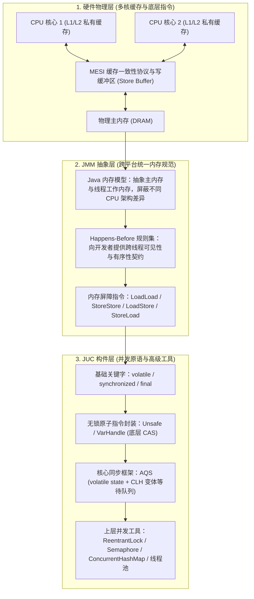
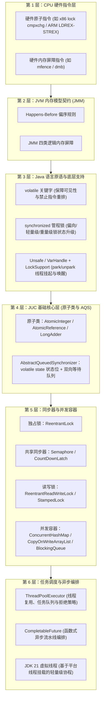

# JMM 到 JUC 并发工具的完整链路：从硬件缓存到高级并发构件

> **关联基础**：[[../03-并发编程/00-并发编程心智模型与学习路线|并发编程全景]]、[[../03-并发编程/02-Java内存模型JMM|JMM内存模型]]、[[../03-并发编程/05-AQS原理|AQS原理]]

---

## 1. 为什么需要 JMM？（硬件设计演进与并发三大问题）

### 1.1 硬件提速带来的并发挑战
在现代多核计算机体系中，CPU 寄存器的运算速度（纳秒以内）比主内存 DRAM 的读写速度（数十纳秒）快了近两个数量级。为了弥补这一速度鸿沟，硬件与编译器引入了多级高速缓存（L1/L2/L3 Cache）、写缓冲区（Store Buffer）以及指令乱序执行优化。然而，这些单线程下的提速手段在多线程并发访问共享变量时，直接引发了三大核心问题：

| 底层优化机制 | 物理层面的表现 | 映射到 Java 并发编程的问题 |
| :--- | :--- | :--- |
| **多核高速缓存与写缓冲区** | 每个 CPU 核心优先读写本地缓存与 Store Buffer，修改后未立即同步到其他核心 | **可见性问题（Visibility）**：一个线程修改了共享变量，另一个线程读取到的可能仍是过期的旧值 |
| **编译器与 CPU 乱序执行** | 在不影响单线程最终结果的前提下，重排无数据依赖的指令顺序以填满流水线 | **有序性问题（Ordering）**：代码实际生效顺序与编写顺序不一致，导致多线程协作逻辑错乱 |
| **分时调度与指令交错** | 高级语言的一条语句（如 `count++`）在底层对应“读-改-写”多条机器指令，执行中途可能被切换 | **原子性问题（Atomicity）**：多线程并发交叉执行复合操作，导致更新互相覆盖 |

### 1.2 从物理硬件到 JUC 工具的三层映射

由于不同 CPU 架构（如 x86、ARM）的缓存一致性强弱与内存屏障指令各不相同，Java 设计了 **JMM（Java Memory Model，Java 内存模型）** 这一跨平台抽象规范，屏蔽底层硬件差异，并在此基础上构建起完整的 `java.util.concurrent`（JUC）并发工具包：



---

## 2. 从底层指令到高层并发工具的六层演进图谱

整个 Java 并发体系是一座层层递进的工程大厦：下一层为上一层提供基础原语，上一层则对下一层进行封装与组合。



---

## 3. 核心机制跨层串联解析

### 3.1 第一环：从 `volatile` 关键字到内存屏障
在 JMM 中，对一个 `volatile` 变量的写操作，Happens-Before 于后续任意线程对该 `volatile` 变量的读操作。为了实现这一语义，JVM 编译器在生成机器码时会插入内存屏障：
1. **保障可见性**：在 `volatile` 写操作后插入 `StoreLoad` 屏障（在 x86 架构下通常编译为带 `lock` 前缀的指令），强制将当前 CPU 核心 Store Buffer 中的缓存修改刷新到共享缓存/主内存，并使其他核心缓存了该变量的缓存行失效（Invalidated），迫使其他线程读取时重新加载最新值。
2. **禁止指令重排序**：在 `volatile` 写之前插入 `StoreStore` 屏障，确保写之前的普通变量修改都已经完成且对外可见；在 `volatile` 读之后插入 `LoadLoad` 与 `LoadStore` 屏障，防止后续读写操作被重排到 `volatile` 读之前。
3. **能力边界**：`volatile` 只能保证单次读或单次写操作的可见性与有序性。对于 `count++` 这种“先读、再加 1、最后写回”的复合操作，多个线程依然会同时读到相同的值并互相覆盖，因此复合操作需要结合 CAS 原子类或锁来保证原子性。

### 3.2 第二环：从 CAS 到无锁原子类（`AtomicLong` 与 `LongAdder`）
`volatile` 解决了“看得到最新值”的问题，而 **CAS（Compare-And-Swap，比较并交换）** 解决了“无锁原子更新”的问题。
- **CAS 执行原理**：包含三个操作数——内存位置 `V`、预期原值 `A` 和新值 `B`。CPU 通过底层硬件原子指令判断内存位置 `V` 当前的值是否等于预期值 `A`，若相等则原子地更新为 `B`，否则不做修改并返回当前实际值。
- **从 `AtomicLong` 到 `LongAdder` 的演进**：
  - `AtomicLong` 内部围绕**单个** `volatile long value` 变量进行 CAS 循环重试。在低并发下效率很高，但在高并发统计场景下，几十个线程同时争抢修改同一个内存地址，会导致大量线程 CAS 失败并不断循环重试，消耗大量 CPU 时间。
  - `LongAdder` 采用了**分段热点分散（Striping）**的设计思想：内部包含一个基础值 `base` 和一个 `Cell[]` 数组。当无竞争时直接更新 `base`；一旦发生 CAS 竞争失败，不同线程会根据自身线程哈希值路由到 `Cell[]` 数组的不同槽位上各自累加，最终调用 `sum()` 时将 `base` 与所有 `Cell` 的值汇总求和。这种“以空间换时间”的策略大幅降低了高并发计数下的冲突率（适合监控统计，而需要严格全局递增序列号的场景仍使用 `AtomicLong`）。

### 3.3 第三环：AQS（队列同步器）如何统一构建各类锁？
有了 `volatile`（状态可见）和 `CAS`（无锁原子修改），JUC 作者 Doug Lea 构建了整个并发包的基石——**`AbstractQueuedSynchronizer`（AQS）**。
无论是独占锁 `ReentrantLock`、共享信号量 `Semaphore`，还是倒计时门栓 `CountDownLatch`，它们的底层全部复用 AQS 的三大核心机制：
1. **同步状态 `volatile int state`**：
   - 在 `ReentrantLock` 中，`state = 0` 表示锁空闲，`state >= 1` 表示锁已被占用及同一线程的重入次数；
   - 在 `Semaphore` 中，`state` 表示当前剩余可用的许可证数量；
   - 在 `CountDownLatch` 中，`state` 表示还需等待倒数的任务数量。
2. **CLH 变体双向等待队列**：
   当线程尝试通过 CAS 修改 `state` 获取锁失败时，AQS 会将该线程封装为 `Node` 节点，通过 CAS 尾插法安全地加入双向等待队列中排队。
3. **`LockSupport.park()` 与 `unpark()` 精准阻塞唤醒**：
   入队后的线程不再盲目自旋消耗 CPU，而是调用 `LockSupport.park(this)` 将自身挂起（进入 `WAITING` 状态）。当持有锁的前驱线程释放锁（修改 `state`）时，会精准唤醒队列头部的后继节点线程继续争抢。

---

## 4. 面试高频追问解析

> [!question]- Q1：从 JMM 与指令重排序角度解释，单例模式的双重检查锁定（DCL）为什么必须给 `instance` 变量加上 `volatile`？
> ```java
> public class SafeLazySingleton {
>     private static volatile SafeLazySingleton instance;
> 
>     public static SafeLazySingleton getInstance() {
>         if (instance == null) {
>             synchronized (SafeLazySingleton.class) {
>                 if (instance == null) {
>                     instance = new SafeLazySingleton();
>                 }
>             }
>         }
>         return instance;
>     }
> }
> ```
> 1. **对象创建的三个步骤**：`instance = new SafeLazySingleton()` 在底层可分为三步：
>    - ① 分配对象的内存空间（`memory = allocate()`）；
>    - ② 调用构造函数初始化对象内部的字段（`ctorInstance(memory)`）；
>    - ③ 将 `instance` 引用指向刚分配的内存地址（`instance = memory`，执行完这步后 `instance != null`）。
> 2. **重排序引发的半初始化问题**：如果不加 `volatile`，编译器或处理器为了优化性能，可能将没有直接数据依赖的步骤 ② 和 ③ 重排为 **① -> ③ -> ②**。
> 3. **并发灾难现场**：假设线程 A 在 `synchronized` 块内刚执行完 ① 和 ③（此时 `instance` 已经不为 `null`，但步骤 ② 构造函数还没执行，对象内部的字段全是默认零值），恰逢线程 B 调用 `getInstance()` 执行最外层的 `if (instance == null)` 检查。线程 B 发现 `instance != null`，就会直接返回这个**尚未完成初始化的半成品对象**，导致空指针或数据错误。加上 `volatile` 后，内存屏障严格禁止步骤 ② 与 ③ 重排序，确保对象完全初始化后引用才对外非空。

> [!question]- Q2：`ReentrantReadWriteLock` 是如何仅用一个 32 位的 `int state` 变量同时管理读锁和写锁的？
> `ReentrantReadWriteLock` 采用了精妙的**高低 16 位按位拆分（Bit Slicing）**设计，将 32 位的 `int state` 一分为二：
> 1. **高 16 位（无符号右移 `state >>> 16`）**：记录**共享读锁**被获取的总次数（最大支持 $2^{16}-1 = 65535$ 次）；每个线程各自的读锁重入次数则单独记录在 `ThreadLocal<HoldCounter>` 中。
> 2. **低 16 位（按位与 `state & 0x0000FFFF`）**：记录**独占写锁**的重入次数（写锁是独占的，只有同一个线程能重入，最大同样支持 65535 次）。
> 3. **状态判断优势**：通过单次位运算即可在一次 CAS 检查中同时获知读写状态。例如当线程尝试获取写锁时，只需判断 `state != 0`：若 `state != 0` 且低 16 位写锁计数为 0，立刻就能断定当前有读锁正在被持有，从而遵循“读写互斥”原则挂起等待。

> [!question]- Q3：`Happens-Before` 规则和底层 CPU 内存屏障是什么关系？
> 1. **`Happens-Before` 是面向开发者的逻辑契约**：它是《Java 语言规范》定义的一组可见性与偏序规则（如程序顺序规则、监视器锁规则、`volatile` 变量规则、线程启动/终止规则、传递性）。它向程序员承诺：只要操作 A Happens-Before 操作 B，那么操作 A 对内存做出的修改，对操作 B 来说一定是可见的。开发者无需关心代码运行在 x86 还是 ARM 服务器上。
> 2. **内存屏障是 JVM 兑现契约的底层实现手段**：为了兑现 Happens-Before 的承诺，JVM 的 JIT 编译器在将字节码翻译为原生机器指令时，会根据目标 CPU 的架构特性，在对应的位置插入底层硬件内存屏障指令（例如在 x86 上对 `volatile` 写插入 `lock addl`，在 ARM 上插入 `dmb` 指令），禁止重排序并刷新缓存。简言之，**Happens-Before 是高层规则定义，内存屏障是底层物理实现**。

---

## 5. 核心要点复盘清单

- **并发三大根源**：多核缓存导致**可见性**问题，编译与 CPU 乱序优化导致**有序性**问题，多线程交错执行复合指令导致**原子性**问题。
- **`volatile` 核心语义**：通过内存屏障保障单次读写的跨线程可见性，并禁止指令重排序（如保护 DCL 单例不返回半初始化对象），但不保证 `i++` 等复合操作的原子性。
- **CAS 与分段思想**：`Atomic*` 利用底层硬件原子指令实现无锁更新；`LongAdder` 通过 `base + Cell[]` 分散热点写竞争，大幅提升高并发计数吞吐量。
- **AQS 三要素**：`volatile int state`（状态计数） + `CAS`（原子抢占状态与入队） + `CLH 双向等待队列 & LockSupport.park/unpark`（线程排队与精准唤醒）。
