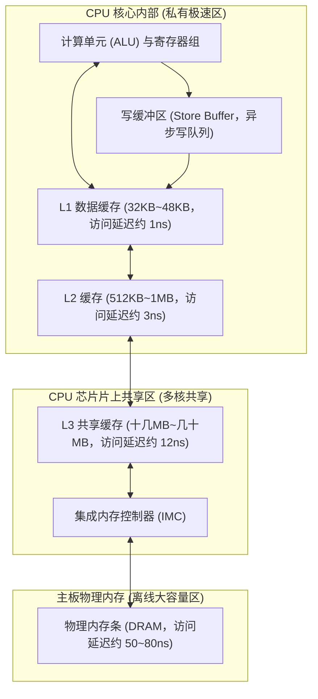
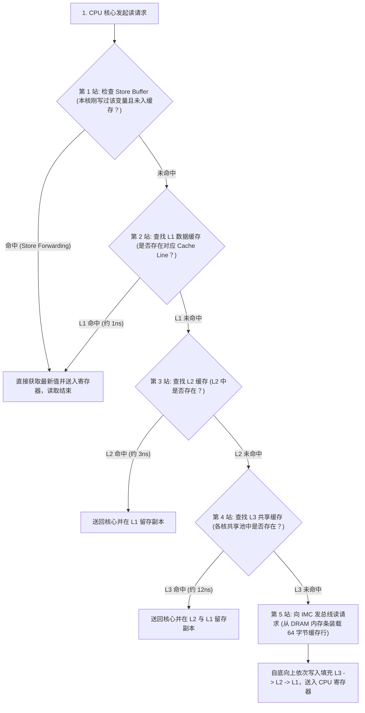
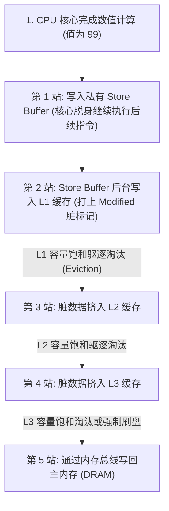
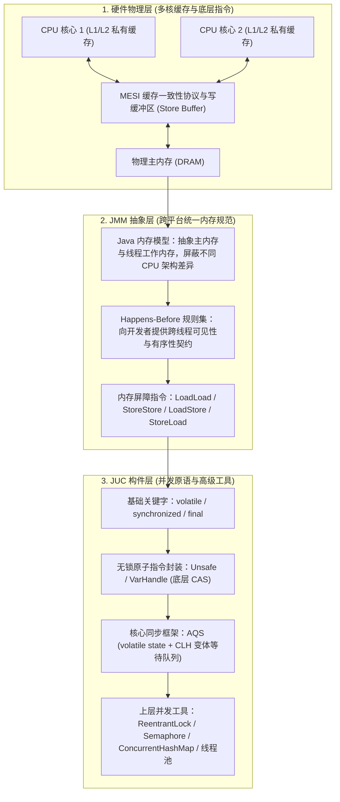
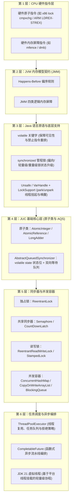
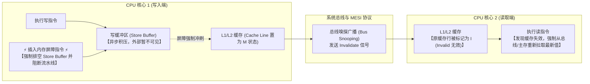
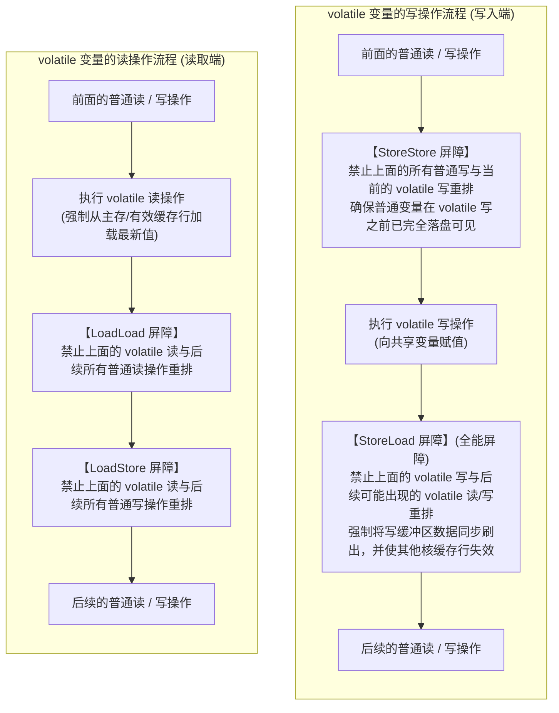
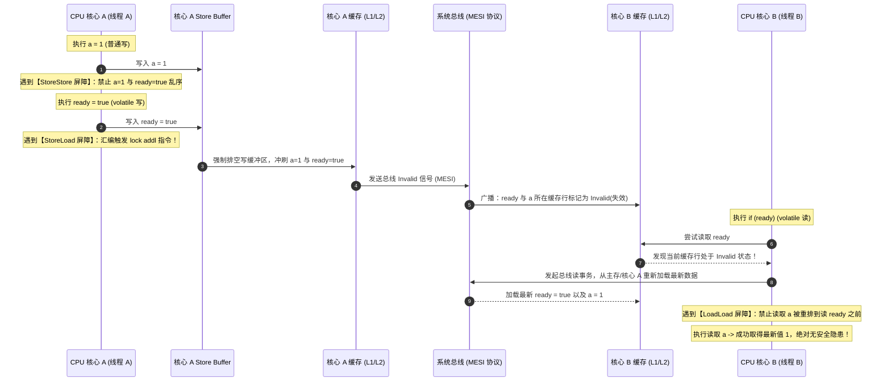

# JMM 到 JUC 并发工具的完整链路：从硬件缓存到高级并发构件

> **关联基础**：[[../03-并发编程/00-并发编程心智模型与学习路线|并发编程全景]]、[[../03-并发编程/02-Java内存模型JMM|JMM内存模型]]、[[../03-并发编程/05-AQS原理|AQS原理]]

---

## 1. 为什么需要 JMM？（硬件设计演进与并发三大问题）

### 1.1 硬件提速带来的并发挑战
在现代多核计算机体系中，CPU 寄存器的运算速度（纳秒以内）比主内存 DRAM 的读写速度（数十纳秒）快了近两个数量级。为了弥补这一速度鸿沟，硬件与编译器引入了多级高速缓存（L1/L2/L3 Cache）、写缓冲区（Store Buffer）以及指令乱序执行优化。然而，这些单线程下的提速手段在多线程并发访问共享变量时，直接引发了三大核心问题：

| 底层优化机制 | 物理层面的表现 | 映射到 Java 并发编程的问题 |
| :--- | :--- | :--- |
| **多核高速缓存与写缓冲区** | 每个 CPU 核心优先读写本地缓存与 Store Buffer，修改后未立即同步到其他核心 | **可见性问题（Visibility）**：一个线程修改了共享变量，另一个线程读取到的可能仍是过期的旧值 |
| **编译器与 CPU 乱序执行** | 在不影响单线程最终结果的前提下，重排无数据依赖的指令顺序以填满流水线 | **有序性问题（Ordering）**：代码实际生效顺序与编写顺序不一致，导致多线程协作逻辑错乱 |
| **分时调度与指令交错** | 高级语言的一条语句（如 `count++`）在底层对应“读-改-写”多条机器指令，执行中途可能被切换 | **原子性问题（Atomicity）**：多线程并发交叉执行复合操作，导致更新互相覆盖 |

### 1.2 硬件微架构：从 CPU 核心到物理主内存的五级层级结构

为了缓解 CPU 寄存器与物理内存条之间成百上千倍的速度鸿沟，现代计算机体系构建了严格的自顶向下分级缓存存储架构：



各级硬件设施的定位与职责划分如下：
1. **CPU 核心与寄存器组**：负责执行机器指令。计算单元只能对内部寄存器中的数据进行算术逻辑运算。
2. **写缓冲区（Store Buffer）**：核心内部私有的微型暂存队列。当核心执行写指令时，数据暂存于此，使得核心无需等待漫长的缓存同步即可直接执行后续指令。
3. **L1 / L2 缓存（核心私有）**：每个 CPU 核心独占的硬件高速 SRAM 缓存。L1 分为指令缓存（L1I）和数据缓存（L1D），响应延迟仅几个时钟周期。
4. **L3 共享缓存（LLC，Last Level Cache）**：位于 CPU 芯片内部但为所有核心共同拥有，充当跨核通信与减少内存条访问的缓冲池。
5. **主内存（DRAM 内存条）**：通过主板总线与 CPU 集成内存控制器（IMC）相连的大容量存储器。

---

### 1.3 数据的读写物理全流程（Load 与 Store）

在 CPU 汇编与硬件微架构眼中，高级语言的读（Read）和写（Write）对应着两套截然不同的物理数据流动路径：

#### 1. 读操作全流程（Load：自顶向下探查，自底向上填充）
代码示例：`int x = a;`（从内存中装载变量 `a` 到寄存器）



- **第一站（Store Buffer / Store Forwarding）**：CPU 核心优先自查本地写缓冲区。若上一行代码刚修改了该变量，直接内部转发取用（近水楼台先得月）。
- **逐级寻址与命中**：依次检索私有 L1、私有 L2 与共享 L3。若命中，立即中断向下检索。
- **未命中跨总线搬运**：若各级缓存全部未命中，内存控制器访问 DRAM 物理颗粒。内存条以 **64 字节缓存行（Cache Line）** 为最小传输单位，沿着内存总线回传，并自底向上依次填满 L3、L2、L1，最后将目标字节送入 CPU 寄存器。

#### 2. 写操作全流程（Store：异步入缓冲，写回惰性落盘）
代码示例：`a = 99;`（将数值 99 存入变量 `a` 所在的内存位置）



- **第一站（写缓冲区异步脱身）**：CPU 核心绝不会等待漫长的内存写入。计算完毕后，数据直接塞入核心私有的 Store Buffer，核心即刻执行后续指令。这是单核性能优化的利器，却是多核可见性延迟与乱序重排的物理根源。
- **第二站（写入 L1 并打脏标记）**：Store Buffer 在后台按序将修改写入本核心 L1 缓存，并将对应 Cache Line 标记为 `Modified`（脏数据，表示本地最新、下层未同步）。
- **写回机制（Write-Back）**：CPU 绝非每执行一次写指令就操作一次物理内存条。修改后的数据长时间驻留在 L1/L2 高速缓存中；只有当某级缓存空间已满、需要淘汰旧数据腾出空间时，脏数据才会自顶向下逐层被“挤”出，最终离开 L3 真正落盘写回主板的物理 DRAM 内存条。

---

### 1.4 从物理硬件到 JUC 工具的三层映射

由于不同 CPU 架构（如 x86、ARM）的缓存一致性强弱与内存屏障指令各不相同，Java 设计了 **JMM（Java Memory Model，Java 内存模型）** 这一跨平台抽象规范，屏蔽底层硬件差异，并在此基础上构建起完整的 `java.util.concurrent`（JUC）并发工具包：



---

## 2. 从底层指令到高层并发工具的六层演进图谱

整个 Java 并发体系是一座层层递进的工程大厦：下一层为上一层提供基础原语，上一层则对下一层进行封装与组合。



---

## 3. 核心机制跨层串联解析

### 3.1 第一环：从 `volatile` 关键字到内存屏障的深度剖析

#### 1. 为什么硬件底层必须引入“内存屏障”？（第一性原理剖析）
在前面 1.2 与 1.3 节我们看到，现代 CPU 核心为了极致性能，引入了私有的**写缓冲区（Store Buffer）**与硬件乱序执行优化：
- **没有屏障时的混乱**：当 CPU 执行写指令时，数据先扔进私有的 Store Buffer，然后核心立刻转头去执行后续指令。由于各个核心的 Store Buffer 彼此隔离且刷新到缓存的时机完全异步随机，这就造成了**“明明代码先写的变量，其他 CPU 核心却很晚才看到；甚至后写的变量被先看到”**（即内存可见性延迟与乱序重排）。
- **内存屏障（Memory Barrier / Memory Fence）的物理本质**：它是一类由 CPU 硬件指令集原生支持的特殊指令。它如同一道**不可逾越的物理栅栏**，强行给硬件流水线立下两条铁律：
  1. **阻断重排序**：屏障两边的指令绝对禁止调换执行顺序；
  2. **强制刷新缓存**：强制将当前核心 Store Buffer 中积压的所有修改立刻刷入物理缓存（L1/L2），并通过总线通知其他核心的缓存行失效，确保修改对全局立即可见。



---

#### 2. JMM 规范定义的四类逻辑内存屏障
由于不同 CPU 架构（x86、ARM、MIPS）的硬件屏障指令名称各异，Java 虚拟机在 JMM 规范中抽象出了四种统一的**逻辑内存屏障**：

| 屏障类型 | 指令组合形式 | 严格拦截规则与执行动作 | 硬件开销评级 |
| :--- | :--- | :--- | :---: |
| **`LoadLoad`** | `Load1; LoadLoad; Load2` | 确保 `Load1` 对应的数据装载**先于** `Load2` 及其后续所有读指令执行，禁止读读重排序。 | 极轻量 |
| **`StoreStore`** | `Store1; StoreStore; Store2` | 确保 `Store1` 的数据完全写入缓存并对其他核心可见，**先于** `Store2` 及其后续所有写指令执行，禁止写写重排序。 | 轻量 |
| **`LoadStore`** | `Load1; LoadStore; Store2` | 确保 `Load1` 的数据装载**先于** `Store2` 及其后续所有写指令执行，禁止读写重排序。 | 极轻量 |
| **`StoreLoad`** | `Store1; StoreLoad; Load2` | **全能型重量级屏障**。确保 `Store1` 的写操作完全刷新到主内存且对所有核心可见，**先于** `Load2` 及其后续所有读指令。 | **最高**（需强制排空整个写缓冲区并使流水线停顿） |

---

#### 3. volatile 读写的标准内存屏障插入策略
为了实现 `volatile` 的 **Happens-Before 语义**（即：对 volatile 变量的写操作，必须对后续任意线程对该变量的读操作立即可见，且前后代码禁止越界重排序），JIT 编译器在编译字节码为机器码时，遵循严格保守的屏障插入策略：



- **volatile 写前后为什么这样插？**
  - **写前插 `StoreStore`**：保证在 `volatile` 写发生之前，前面所有的普通变量修改都已经老老实实写完了，绝不能把前面的普通写拖延到 `volatile` 写之后。
  - **写后插 `StoreLoad`**：防止当前的 `volatile` 写和后面可能紧跟着的 `volatile` 读操作发生冲突颠倒，同时强制清空本核的写缓冲区。
- **volatile 读后面为什么这样插？**
  - **读后插 `LoadLoad` + `LoadStore`**：保证既然我已经拿到了最新的 `volatile` 值，那么后续任何依赖这个状态的代码（无论是读还是写）都必须老老实实在我后面执行，绝不能“抢跑”偷溜到我的读指令前面。

---

#### 4. 从 JMM 逻辑屏障到 CPU 硬件物理指令的落地映射

很多工程师容易产生误解，以为 JVM 插入了 4 个屏障，CPU 就会执行 4 条硬件慢指令。事实绝非如此，**JMM 屏障会根据目标 CPU 的硬件架构进行极致优化与裁剪**：

##### （1）x86 架构（强内存模型 TSO，Total Store Order）
- x86 芯片在硬件设计上天生就是强保序的：硬件保证了**“写-写不乱序”、“读-读不乱序”、“读-写不乱序”**。
- 因此在 x86 平台上：
  - `LoadLoad`、`StoreStore`、`LoadStore` 在硬件层面根本不需要做任何事，**直接被 JIT 编译器优化为 NOP（空操作），指令开销为 0**！
  - x86 硬件唯一允许存在的乱序就是 **Store-Load 重排序**（因为 CPU 核心读自己的 L1/L2 缓存极快，写却被暂时塞在 Store Buffer 里，造成后续的读操作反而在写刷盘之前完成了）。
- **`lock addl $0x0, (%esp)` 的秘密**：
  在 x86 汇编中，虽然存在标准的硬件全屏障指令 `mfence`，但 HotSpot JVM 底层普遍选用一条带 **`lock` 前缀的空操作加法指令**（`lock addl $0x0, (%esp)`，即给栈顶指针加 0，不改变任何数据）。
  - **为什么不用 `mfence`？** 在早期 Intel/AMD 芯片微架构中，`lock` 指令的微码执行周期和指令吞吐效率明显优于 `mfence`，它利用底层 **MESI 缓存行锁定**，在完成原子操作的同时附带产生了“排空写缓冲区 + 锁总线/缓存”的副作用，完美且高效地充当了硬件级的全内存屏障！

##### （2）ARM / PowerPC 架构（弱内存模型 Weak Memory Model）
- ARM 等移动与服务器架构为了极致功耗比，硬件几乎允许任意形式的指令乱序。
- 在 ARM 上，JVM 必须老老实实地将 JMM 屏障翻译为真正的硬件屏障指令：
  - `StoreStore` $\to$ `dmb ishst`（Data Memory Barrier, Inner Shareable Store）；
  - `StoreLoad` $\to$ `dmb ish`（全内存屏障）；
  - `LoadLoad` / `LoadStore` $\to$ `dmb ishld`。

---

#### 5. 双线程端到端实战全链路推演

通过经典标志位场景，直观还原数据在两个 CPU 核心之间的物理流转过程：

```java
public class VolatileBarrierDemo {
    private int a = 0;
    private volatile boolean ready = false;

    // 线程 A 执行
    public void writer() {
        a = 1;              // 步骤 1：普通写
        // [StoreStore 屏障]：强制确保 a=1 在 ready=true 之前写入完毕，禁止两行颠倒！
        ready = true;       // 步骤 2：volatile 写
        // [StoreLoad 屏障]：强制刷新 Store Buffer，通知其他核心缓存失效！
    }

    // 线程 B 执行
    public void reader() {
        if (ready) {        // 步骤 3：volatile 读 (发现本地失效，从主存重读)
            // [LoadLoad 屏障] + [LoadStore 屏障]：禁止下面的读写重排到 ready 之前！
            int result = a; // 步骤 4：普通读 (此时必定能读到 a = 1，绝不会读到 0)
        }
    }
}
```



#### 6. 能力边界再澄清：volatile 为什么不能代替锁？
- `volatile` 的内存屏障只能确保**单次读操作**与**单次写操作**的可见性与有序性。
- 对于 `count++` 这种操作，在字节码层面拆解为：`getfield`（读） $\to$ `iadd`（加 1） $\to$ `putfield`（写）三步。即使 `count` 加了 `volatile`，当两个线程同时执行完第 1 步并都在寄存器中暂存了旧值时，第 3 步写回时依然会发生更新覆盖。因此，**复合操作的原子性必须依赖 CAS 或锁机制**。

### 3.2 第二环：从 CAS 到无锁原子类（`AtomicLong` 与 `LongAdder`）
`volatile` 解决了“看得到最新值”的问题，而 **CAS（Compare-And-Swap，比较并交换）** 解决了“无锁原子更新”的问题。
- **CAS 执行原理**：包含三个操作数——内存位置 `V`、预期原值 `A` 和新值 `B`。CPU 通过底层硬件原子指令判断内存位置 `V` 当前的值是否等于预期值 `A`，若相等则原子地更新为 `B`，否则不做修改并返回当前实际值。
- **从 `AtomicLong` 到 `LongAdder` 的演进**：
  - `AtomicLong` 内部围绕**单个** `volatile long value` 变量进行 CAS 循环重试。在低并发下效率很高，但在高并发统计场景下，几十个线程同时争抢修改同一个内存地址，会导致大量线程 CAS 失败并不断循环重试，消耗大量 CPU 时间。
  - `LongAdder` 采用了**分段热点分散（Striping）**的设计思想：内部包含一个基础值 `base` 和一个 `Cell[]` 数组。当无竞争时直接更新 `base`；一旦发生 CAS 竞争失败，不同线程会根据自身线程哈希值路由到 `Cell[]` 数组的不同槽位上各自累加，最终调用 `sum()` 时将 `base` 与所有 `Cell` 的值汇总求和。这种“以空间换时间”的策略大幅降低了高并发计数下的冲突率（适合监控统计，而需要严格全局递增序列号的场景仍使用 `AtomicLong`）。

### 3.3 第三环：AQS（队列同步器）如何统一构建各类锁？
有了 `volatile`（状态可见）和 `CAS`（无锁原子修改），JUC 作者 Doug Lea 构建了整个并发包的基石——**`AbstractQueuedSynchronizer`（AQS）**。
无论是独占锁 `ReentrantLock`、共享信号量 `Semaphore`，还是倒计时门栓 `CountDownLatch`，它们的底层全部复用 AQS 的三大核心机制：
1. **同步状态 `volatile int state`**：
   - 在 `ReentrantLock` 中，`state = 0` 表示锁空闲，`state >= 1` 表示锁已被占用及同一线程的重入次数；
   - 在 `Semaphore` 中，`state` 表示当前剩余可用的许可证数量；
   - 在 `CountDownLatch` 中，`state` 表示还需等待倒数的任务数量。
2. **CLH 变体双向等待队列**：
   当线程尝试通过 CAS 修改 `state` 获取锁失败时，AQS 会将该线程封装为 `Node` 节点，通过 CAS 尾插法安全地加入双向等待队列中排队。
3. **`LockSupport.park()` 与 `unpark()` 精准阻塞唤醒**：
   入队后的线程不再盲目自旋消耗 CPU，而是调用 `LockSupport.park(this)` 将自身挂起（进入 `WAITING` 状态）。当持有锁的前驱线程释放锁（修改 `state`）时，会精准唤醒队列头部的后继节点线程继续争抢。

---

## 4. 面试高频追问解析

> [!question]- Q1：从 JMM 与指令重排序角度解释，单例模式的双重检查锁定（DCL）为什么必须给 `instance` 变量加上 `volatile`？
> ```java
> public class SafeLazySingleton {
>     private static volatile SafeLazySingleton instance;
> 
>     public static SafeLazySingleton getInstance() {
>         if (instance == null) {
>             synchronized (SafeLazySingleton.class) {
>                 if (instance == null) {
>                     instance = new SafeLazySingleton();
>                 }
>             }
>         }
>         return instance;
>     }
> }
> ```
> 1. **对象创建的三个步骤**：`instance = new SafeLazySingleton()` 在底层可分为三步：
>    - ① 分配对象的内存空间（`memory = allocate()`）；
>    - ② 调用构造函数初始化对象内部的字段（`ctorInstance(memory)`）；
>    - ③ 将 `instance` 引用指向刚分配的内存地址（`instance = memory`，执行完这步后 `instance != null`）。
> 2. **重排序引发的半初始化问题**：如果不加 `volatile`，编译器或处理器为了优化性能，可能将没有直接数据依赖的步骤 ② 和 ③ 重排为 **① -> ③ -> ②**。
> 3. **并发灾难现场**：假设线程 A 在 `synchronized` 块内刚执行完 ① 和 ③（此时 `instance` 已经不为 `null`，但步骤 ② 构造函数还没执行，对象内部的字段全是默认零值），恰逢线程 B 调用 `getInstance()` 执行最外层的 `if (instance == null)` 检查。线程 B 发现 `instance != null`，就会直接返回这个**尚未完成初始化的半成品对象**，导致空指针或数据错误。加上 `volatile` 后，内存屏障严格禁止步骤 ② 与 ③ 重排序，确保对象完全初始化后引用才对外非空。

> [!question]- Q2：`ReentrantReadWriteLock` 是如何仅用一个 32 位的 `int state` 变量同时管理读锁和写锁的？
> `ReentrantReadWriteLock` 采用了精妙的**高低 16 位按位拆分（Bit Slicing）**设计，将 32 位的 `int state` 一分为二：
> 1. **高 16 位（无符号右移 `state >>> 16`）**：记录**共享读锁**被获取的总次数（最大支持 $2^{16}-1 = 65535$ 次）；每个线程各自的读锁重入次数则单独记录在 `ThreadLocal<HoldCounter>` 中。
> 2. **低 16 位（按位与 `state & 0x0000FFFF`）**：记录**独占写锁**的重入次数（写锁是独占的，只有同一个线程能重入，最大同样支持 65535 次）。
> 3. **状态判断优势**：通过单次位运算即可在一次 CAS 检查中同时获知读写状态。例如当线程尝试获取写锁时，只需判断 `state != 0`：若 `state != 0` 且低 16 位写锁计数为 0，立刻就能断定当前有读锁正在被持有，从而遵循“读写互斥”原则挂起等待。

> [!question]- Q3：`Happens-Before` 规则和底层 CPU 内存屏障是什么关系？
> 1. **`Happens-Before` 是面向开发者的逻辑契约**：它是《Java 语言规范》定义的一组可见性与偏序规则（如程序顺序规则、监视器锁规则、`volatile` 变量规则、线程启动/终止规则、传递性）。它向程序员承诺：只要操作 A Happens-Before 操作 B，那么操作 A 对内存做出的修改，对操作 B 来说一定是可见的。开发者无需关心代码运行在 x86 还是 ARM 服务器上。
> 2. **内存屏障是 JVM 兑现契约的底层实现手段**：为了兑现 Happens-Before 的承诺，JVM 的 JIT 编译器在将字节码翻译为原生机器指令时，会根据目标 CPU 的架构特性，在对应的位置插入底层硬件内存屏障指令（例如在 x86 上对 `volatile` 写插入 `lock addl`，在 ARM 上插入 `dmb` 指令），禁止重排序并刷新缓存。简言之，**Happens-Before 是高层规则定义，内存屏障是底层物理实现**。

---

## 5. 核心要点复盘清单

- **并发三大根源**：多核缓存导致**可见性**问题，编译与 CPU 乱序优化导致**有序性**问题，多线程交错执行复合指令导致**原子性**问题。
- **`volatile` 核心语义**：通过内存屏障保障单次读写的跨线程可见性，并禁止指令重排序（如保护 DCL 单例不返回半初始化对象），但不保证 `i++` 等复合操作的原子性。
- **CAS 与分段思想**：`Atomic*` 利用底层硬件原子指令实现无锁更新；`LongAdder` 通过 `base + Cell[]` 分散热点写竞争，大幅提升高并发计数吞吐量。
- **AQS 三要素**：`volatile int state`（状态计数） + `CAS`（原子抢占状态与入队） + `CLH 双向等待队列 & LockSupport.park/unpark`（线程排队与精准唤醒）。
