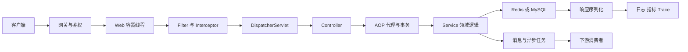

# 一次 Java 请求的全链路

> [!abstract] 一句话总结
> 一次请求不是 Controller 调 Service，而是线程、Web 容器、Spring 代理、事务、缓存、数据库、消息和可观测信号共同组成的受限执行链。

## 主链路



## 每一段连接什么知识

| 链路段 | 核心知识 | 关键约束 |
| --- | --- | --- |
| 网关到应用 | [[20-Java后端/06-中间件/06-API网关]]、[[20-Java后端/07-分布式与微服务/06-限流-熔断-降级]] | 身份、限流、超时预算和 Trace 传播 |
| Web 容器到 Controller | [[20-Java后端/04-Spring生态/06-SpringMVC请求处理流程]] | 请求线程是有限资源，不能无限阻塞 |
| Bean 与代理 | [[20-Java后端/04-Spring生态/01-IoC容器与Bean生命周期]]、[[20-Java后端/04-Spring生态/02-AOP原理与应用]] | 代理调用边界决定事务、缓存和切面是否生效 |
| 事务与持久化 | [[20-Java后端/04-Spring生态/03-Spring事务管理]]、[[20-Java后端/05-数据库与存储/02-事务与隔离级别]] | 事务范围、连接占用、锁等待和回滚语义 |
| 缓存与数据库 | [[20-Java后端/05-数据库与存储/05-Redis数据结构与应用]]、[[20-Java后端/05-数据库与存储/07-缓存穿透-击穿-雪崩]] | 一致性、热点、过期和回源容量 |
| 异步与消息 | [[20-Java后端/03-并发编程/07-线程池原理与参数]]、[[20-Java后端/06-中间件/03-消息可靠性-顺序-幂等]] | 线程池隔离、消息幂等、重试和最终一致性 |
| 可观测 | [[20-Java后端/07-分布式与微服务/08-链路追踪]] | 统一 traceId、阶段耗时、错误与关键业务标签 |

## 请求线程为什么是系统容量的一部分

假设 Web 容器只有 200 个工作线程，下游 RPC 超时设置为 30 秒。当下游变慢时，线程会被占满，即使 CPU 很空，新请求仍无法处理。因此并发能力至少受以下最小值约束：

```text
入口并发能力 <= min(Web线程、业务线程池、数据库连接、下游并发额度、队列容量)
```

扩大某一个池通常不会提高整体吞吐，只会把等待转移到下一层。

## 事务边界如何影响整条链路

1. 事务开始后占用数据库连接。
2. 在事务内执行远程调用会延长连接和锁持有时间。
3. 远程调用成功但本地事务回滚，会产生跨系统不一致。
4. 更稳妥的设计是缩短本地事务，并通过本地消息表、Outbox 或可靠事件处理跨系统动作，详见 [[04-从Spring事务到分布式一致性]]。

## 一次请求的超时预算

```text
总超时 1000 ms
├─ 网关与排队 100 ms
├─ 业务计算 100 ms
├─ 缓存与数据库 300 ms
├─ 下游调用 350 ms
└─ 序列化与余量 150 ms
```

每个下游超时之和不能机械地超过总预算；重试会消耗额外预算，还可能放大流量。超时、重试、熔断和线程池必须联合设计。

## 排障顺序

1. 用 Trace 判断慢在入口、业务、数据库还是下游。
2. 看 Web 线程池、业务线程池和数据库连接池是否有排队。
3. 看事务耗时、锁等待、慢 SQL、缓存命中率和 MQ 积压。
4. 最后再看 JVM CPU、GC 和分配速率，避免把所有慢请求都归因于 GC。

## 面试讲法

讲项目链路时不要只背技术名词。按“入口控制 → 请求线程 → Spring 代理 → 事务与数据 → 异步解耦 → 可观测与降级”叙述，并说明每层的容量、失败方式和恢复手段。

## 关联笔记

- [[20-Java后端/04-Spring生态/_index|Spring 生态索引]]
- [[20-Java后端/09-项目实战/_index|项目实战索引]]
- [[05-高并发系统的流量保护链路]]
- [[08-线上故障排查全链路]]

## 参考资料

- [Spring MVC Documentation](https://docs.spring.io/spring-framework/reference/web/webmvc.html)
- [Spring Transaction Management](https://docs.spring.io/spring-framework/reference/data-access/transaction.html)
- [Micrometer Observation](https://docs.micrometer.io/micrometer/reference/observation.html)

