# 一次 Java 请求的全链路：从客户端点击到数据库落盘的全景透视

> **关联基础**：[[../04-Spring生态/06-SpringMVC请求处理流程|SpringMVC流程]]、[[../04-Spring生态/02-AOP原理与应用|Spring AOP]]、[[../05-数据库与存储/02-事务与隔离级别|MySQL事务]]

---

## 1. 全链路宏观视角：六大阶段全景图

当用户在手机 App 上点击“提交订单”按钮，到界面弹出“下单成功”，这短短几十毫秒内，一个 HTTP 请求依次跨越了网络接入、Web 容器、Spring MVC 框架、Spring AOP 事务切面以及 MySQL InnoDB 存储引擎。理解这条完整链路，是排查线上超时、定位性能瓶颈与掌握后端架构的基石。

```mermaid
flowchart TD
    subgraph NetLayer["阶段 1：网络接入与网关路由"]
        Client["客户端 (App/浏览器)"] -->|"DNS 解析与 HTTPS/TLS 握手"| SLB["负载均衡与反向代理 (LVS / Nginx)"]
        SLB --> Gateway["微服务 API 网关 (鉴权、限流与路由转发)"]
    end

    subgraph ContainerLayer["阶段 2：Tomcat NIO 容器与线程派发"]
        Gateway -->|"TCP 连接与 HTTP 报文"| Acceptor["Acceptor 线程 (accept 接收连接)"]
        Acceptor --> Poller["Poller 线程 (基于 epoll Selector 监听可读事件)"]
        Poller --> WorkerPool["Worker 业务线程池 (解析 HTTP 报文并执行 Servlet)"]
    end

    subgraph MVCLayer["阶段 3：Servlet Filter 与 Spring MVC 分发"]
        WorkerPool --> FilterChain["Servlet Filter 责任链 (编码、安全与 TraceId 埋点)"]
        FilterChain --> Dispatcher["DispatcherServlet (前端总控制器)"]
        Dispatcher --> HandlerMapping["HandlerMapping (根据 URL 匹配目标 Controller 方法)"]
        HandlerMapping --> InterceptorPre["HandlerInterceptor.preHandle 前置拦截"]
        InterceptorPre --> Adapter["HandlerAdapter & Jackson 反序列化与 @Valid 参数校验"]
    end

    subgraph BizLayer["阶段 4：Spring AOP 代理与声明式事务"]
        Adapter --> Controller["OrderController.createOrder()"]
        Controller --> Proxy["OrderService 动态代理对象 (CGLIB / JDK Proxy)"]
        Proxy --> TxInterceptor["TransactionInterceptor (事务切面拦截)"]
        TxInterceptor --> ConnBorrow["从 HikariCP 借出 Connection，设置 autoCommit=false 并绑定 ThreadLocal"]
        ConnBorrow --> ServiceImpl["OrderServiceImpl 执行核心业务逻辑"]
    end

    subgraph DBLayer["阶段 5：MySQL InnoDB 执行与两阶段提交"]
        ServiceImpl --> MyBatis["MyBatis 参数映射并经 JDBC 发送 SQL"]
        MyBatis --> InnoDB["InnoDB 引擎：加行排他锁 -> 写 Undo Log -> 更新 Buffer Pool 数据页"]
        ServiceImpl --> TxCommit["业务方法正常返回，事务切面触发 Connection.commit()"]
        TxCommit --> TwoPhase["WAL 两阶段提交：Redo Log (Prepare) -> Binlog 落盘 -> Redo Log (Commit)"]
    end

    subgraph OutLayer["阶段 6：连接归还与响应返回"]
        TwoPhase --> ConnReturn["清理 ThreadLocal 事务上下文，将 Connection 归还 HikariCP 连接池"]
        ConnReturn --> RespConverter["HttpMessageConverter (Jackson 将返回值序列化为 JSON)"]
        RespConverter --> InterceptorAfter["执行 postHandle 与 afterCompletion 清理上下文"]
        InterceptorAfter --> ClientAck["通过操作系统 TCP 缓冲区将 HTTP 200 响应发回客户端"]
    end

    NetLayer --> ContainerLayer
    ContainerLayer --> MVCLayer
    MVCLayer --> BizLayer
    BizLayer --> DBLayer
    DBLayer --> OutLayer
```

---

## 2. 逐层拆解：每一阶段的核心运行机制

### 2.1 阶段一：网络接入与网关治理
1. **DNS 解析与连接建立**：客户端通过 DNS 获取服务端入口 IP，与边缘负载均衡（LVS / Nginx）建立 TCP 连接并完成 TLS 握手（在 Nginx 层完成 SSL 卸载，内部网络通信通常复用 HTTP 长连接以降低握手开销）。
2. **API 网关处理**：请求进入 Spring Cloud Gateway，网关过滤器依次完成 JWT 身份验签、令牌桶限流以及全链路追踪上下文（`traceparent` / `TraceId`）注入，随后根据路由规则将请求转发给后端的订单服务实例。

### 2.2 阶段二：Web 容器层（Tomcat NIO 线程模型）
请求到达订单服务所在机器的网卡后，由 Tomcat 的 NIO 连接器（`NioEndpoint`）接管，内部由三组组件协同工作：
1. **`Acceptor` 接收连接**：专门负责调用操作系统的 `accept()` 系统调用接收新建立的 TCP 连接，将其设置为非阻塞模式后封装为 `NioChannel`，注册到 `Poller` 的队列中。
2. **`Poller` 事件轮询**：底层基于 Linux `epoll` 多路复用机制，监听所有已建立连接上的 Socket 可读事件（`OP_READ`）。当某个连接上有完整的客户端请求数据到达时，`Poller` 不直接执行耗时业务，而是将该连接包装为 `SocketProcessor` 任务提交给工作线程池。
3. **`Worker` 业务线程池**：`ThreadPoolExecutor` 中的工作线程（如 `http-nio-8080-exec-1`）取出任务，读取并解析 HTTP 请求头与请求体，构造出 `HttpServletRequest` 和 `HttpServletResponse` 对象，正式进入 Servlet 容器调用链。

### 2.3 阶段三：Servlet Filter 与 Spring MVC 调度链
1. **穿越 `FilterChain`**：请求首先依次经过 Servlet 标准过滤器链（如 Spring Security 鉴权过滤器、跨域过滤器、日志 MDC 过滤器）。
2. **`DispatcherServlet` 核心分发**：
   - **查找处理器（`HandlerMapping`）**：`RequestMappingHandlerMapping` 根据请求的 URL 路径和 HTTP Method（如 `POST /api/orders`），在启动时注册的路由表中查找到对应的目标方法 `OrderController#createOrder`，并与匹配的拦截器一起封装为 `HandlerExecutionChain`。
   - **前置拦截（`HandlerInterceptor`）**：按顺序执行拦截器的 `preHandle()` 方法，若返回 `false` 则直接中断后续执行。
   - **参数解析与校验（`HandlerAdapter`）**：`RequestMappingHandlerAdapter` 发现方法参数带有 `@RequestBody` 和 `@Valid` 注解，于是调用 `MappingJackson2HttpMessageConverter` 将 JSON 字节流反序列化为 `CreateOrderDTO` 对象，随后调用 Hibernate Validator 校验字段约束。若校验不通过，直接抛出 `MethodArgumentNotValidException`，由 `@RestControllerAdvice` 全局异常处理器捕获并返回 400 错误码。

### 2.4 阶段四：Spring AOP 代理与声明式事务开启
1. **动态代理拦截**：`OrderController` 中注入的 `OrderService` 实际上并不是原始的 `OrderServiceImpl` 实例，而是 Spring 在启动阶段通过 CGLIB（或 JDK 动态代理）生成的**代理对象**。
2. **`TransactionInterceptor` 事务切面**：
   - 当调用带有 `@Transactional` 注解的 `createOrder()` 方法时，代理对象将调用转交给事务拦截器。
   - 事务管理器（`DataSourceTransactionManager`）检查当前线程的 `TransactionSynchronizationManager`（底层基于多个 `ThreadLocal`）是否已经绑定了数据库连接。
   - **借出连接与关闭自动提交**：如果是新建事务，事务管理器立即从 **HikariCP 连接池**借出一个空闲的 JDBC `Connection`，执行 `connection.setAutoCommit(false)` 开启手动事务模式，并将该 `Connection` 绑定到当前线程的 `ThreadLocal` 中，确保整个事务方法后续执行的所有 Mapper SQL 都复用同一个物理连接。

### 2.5 阶段五：MySQL InnoDB 执行与 WAL 两阶段提交
1. **SQL 执行与内存修改**：
   - MyBatis 从 Spring 的 `ThreadLocal` 中获取当前事务绑定的 `Connection`，发送 `INSERT` / `UPDATE` 语句。
   - MySQL 经过连接器、语法解析器与查询优化器生成执行计划后，调用 InnoDB 存储引擎接口。
   - InnoDB 对涉及的数据行加 **行级排他锁（X 锁）**，将修改前的旧值写入 **Undo Log**（供事务回滚和 MVCC 快照读使用），随后直接修改内存 **Buffer Pool** 中的数据页（此时内存页成为脏页，尚未刷回磁盘表空间文件）。
2. **WAL（Write-Ahead Logging）与两阶段提交**：
   当 `OrderServiceImpl#createOrder` 方法正常执行完毕返回到 `TransactionInterceptor` 时，Spring 调用 `connection.commit()` 发起事务提交。为了保证 InnoDB 的物理日志（Redo Log）与 MySQL Server 层的逻辑归档日志（Binlog）绝对一致，MySQL 内部执行**两阶段提交（2PC）**：
   - **第一阶段（Prepare）**：InnoDB 将本次事务修改产生的 Redo Log 写入磁盘（受 `innodb_flush_log_at_trx_commit=1` 控制），并将事务状态标记为 `PREPARE`。
   - **第二阶段（写 Binlog）**：MySQL Server 层将该事务的 Binlog 写入磁盘（受 `sync_binlog=1` 控制）。
   - **第三阶段（Commit）**：InnoDB 将 Redo Log 中的事务状态更新为 `COMMIT`，并释放该事务持有的全部行锁。一旦 Binlog 写入成功，即使在第三步前数据库突然掉电重启，崩溃恢复机制也会根据完整的 Binlog 自动提交该事务，保证主从数据与崩溃恢复严丝合缝。

### 2.6 阶段六：资源清理与响应写回
1. **归还数据库连接**：事务提交（或异常回滚）完成后，Spring 事务切面在 `finally` 块中解绑当前线程 `ThreadLocal` 中的 `Connection`，恢复其自动提交属性，并将其归还给 HikariCP 连接池。
2. **JSON 序列化与请求收尾**：返回结果回到 `RequestMappingHandlerAdapter`，由 Jackson 将返回对象序列化为 JSON 写入响应缓冲区；随后依次触发 `HandlerInterceptor` 的 `postHandle()` 与 `afterCompletion()`，最后穿过 `FilterChain` 的 `finally` 块清理 MDC 中的 `TraceId`，由操作系统通过网卡把 HTTP 200 响应报文发回客户端。

---

## 3. 全链路常见故障断点速查表

当线上一个请求报错或超时，可以根据返回的状态码或异常类型，迅速定位故障发生在全链路的哪一层：

| 现象 / 报错信息 | 故障所在阶段与层级 | 典型成因分析 | 快速排查手段 |
| :--- | :--- | :--- | :--- |
| **HTTP 502 Bad Gateway** | 阶段 1：Nginx / 网关层 | 后端服务进程宕机、容器正在重启，或未做优雅下线导致请求发往已关闭端口 | 检查 Nginx `error.log` 与后端 Pod 存活状态、Nacos 注册列表 |
| **HTTP 504 Gateway Timeout** | 阶段 1~5：网关等待后端超时 | 后端发生慢 SQL、外部 RPC 调用卡死、Full GC 长时间停顿或 Tomcat 线程池排队 | 通过 SkyWalking / 链路日志查看耗时最长的 Span |
| **HTTP 400 Bad Request** | 阶段 3：Spring MVC 参数绑定 | 前端传入的 JSON 语法错误、字段类型不匹配，或未通过 `@Valid` 校验规则 | 查看应用日志中的 `HttpMessageNotReadableException` 或校验异常 |
| **`SQLTransientConnectionException: Connection is not available`** | 阶段 4：HikariCP 连接池借出 | 数据库连接池耗尽。常见于 `@Transactional` 大事务内嵌套了慢 HTTP/RPC 调用 | 监控 HikariCP 的 `Active` / `Pending` 连接数，抓取 `jstack` 排查持连接线程 |
| **`Deadlock found when trying to get lock`** | 阶段 5：InnoDB 行锁争用 | 多个并发事务按不同顺序更新相同的多行记录，形成循环锁等待 | 执行 `SHOW ENGINE INNODB STATUS` 查看 `LATEST DETECTED DEADLOCK` 详情 |

---

## 4. 面试高频追问解析

> [!question]- Q1：在带有 `@Transactional` 的方法中，数据库连接（Connection）究竟是在哪一刻从连接池借出的？又是何时归还的？为什么严禁在事务中做远程 RPC 调用？
> 1. **借出时机**：在默认的 `DataSourceTransactionManager` 下，当请求刚进入 `@Transactional` 代理方法、被 `TransactionInterceptor` 拦截并开启新事务的那一刻（甚至在第一条 SQL 执行之前），就已经从 HikariCP 连接池中借出了物理连接并绑定到了当前线程的 `ThreadLocal` 上。
> 2. **归还时机**：必须等到整个 `@Transactional` 方法体内的所有代码全部执行完毕、返回到代理切面并完成 `commit()` 或 `rollback()` 之后，才会在 `finally` 块中归还给连接池。
> 3. **为什么不能在事务内调 RPC**：一个微服务的 HikariCP 连接池通常只配置 10~20 个连接。如果在 `@Transactional` 方法内部调用了一个耗时 2 秒的第三方 HTTP 接口，即使数据库 SQL 本身只需要 2 毫秒，这个宝贵的数据库连接也会被白白占用 2 秒钟。此时只要并发进来 20 个请求，数据库连接池就会瞬间被占满，导致整个服务的所有数据库操作全部阻塞超时。因此必须遵循**“短事务原则”**，将远程查询和耗时校验移到 `@Transactional` 方法外部。

> [!question]- Q2：为什么客户端明明收到了网关返回的 `HTTP 504 Gateway Timeout` 超时提示，但数据库里订单却创建成功了？
> 1. **原因剖析**：这是因为**网关层的等待超时时间小于后端的实际执行耗时，且网关超时断开并不会自动中断后端正在运行的 Java 线程**。例如网关配置了 3 秒超时，而后端由于慢查询或锁等待花了 3.5 秒。在第 3.0 秒时，网关主动向客户端返回 504；但后端的 Tomcat 工作线程依然在继续执行后续代码，并在第 3.5 秒成功执行了 MySQL 的 `COMMIT`。
> 2. **工程应对**：在分布式系统中，**“调用超时代表结果未知，绝不等于执行失败”**。因此客户端在进入下单页时应预先获取全局唯一的 `requestId`（幂等号），超时重试时携带同一个 `requestId`，服务端通过唯一索引或防重表拦截重复创单，并返回原订单状态。

> [!question]- Q3：Tomcat 的 `maxConnections`、`acceptCount` 和 `maxThreads` 这三个参数分别控制在哪个环节？如果全部满了会发生什么？
> 这三个参数对应了请求进入 Tomcat 的三道关卡：
> 1. **`maxThreads`（默认 200）**：控制 **Worker 业务线程池**的最大工作线程数，即同时最多有多少个线程在并行执行 Controller 代码。
> 2. **`maxConnections`（NIO 下默认 10000）**：控制 Tomcat 的 **`Poller` 同时接收并管理的最大 TCP 连接数**。因为基于 `epoll` 多路复用，即使只有 200 个工作线程，Tomcat 也能同时维持上万个活跃连接排队等待处理。
> 3. **`acceptCount`（默认 100）**：对应操作系统内核 TCP 协议栈的 **全连接队列（Accept Backlog）** 长度。当 Tomcat 已接收的连接数达到 `maxConnections`（10000）上限后，`Acceptor` 线程会暂停调用 `accept()`；此时新三次握手成功的连接会暂存在操作系统的 `acceptCount` 队列中。如果连这个队列（100）也满了，后续新发来的客户端连接就会直接超时或收到 `Connection Reset / Refused`（且由于请求根本没进入 JVM，Spring 的 Filter 和 Controller 完全不会留下任何日志）。

---

## 5. 核心要点复盘清单

- **Tomcat NIO 三剑客**：`Acceptor` 负责接收 TCP 新连接，`Poller` 通过 `epoll` 监听可读事件，`Worker` 线程池负责解析 HTTP 并执行业务代码。
- **Spring MVC 主干链**：`FilterChain` -> `DispatcherServlet` -> `HandlerMapping`（找方法） -> `HandlerInterceptor`（拦截器） -> `HandlerAdapter`（参数反序列化、校验与调用） -> `HttpMessageConverter`（JSON 响应写出）。
- **Spring 事务生命周期**：AOP 代理进入时借出 HikariCP 连接并绑定 `ThreadLocal`，方法退出完成 `commit/rollback` 后才归还连接；切忌在事务内嵌套远程 RPC。
- **InnoDB 两阶段提交**：修改数据前先记 Undo Log，提交时通过 `Redo Log (Prepare) -> Binlog 刷盘 -> Redo Log (Commit)` 保障崩溃恢复与主从复制的一致性。
