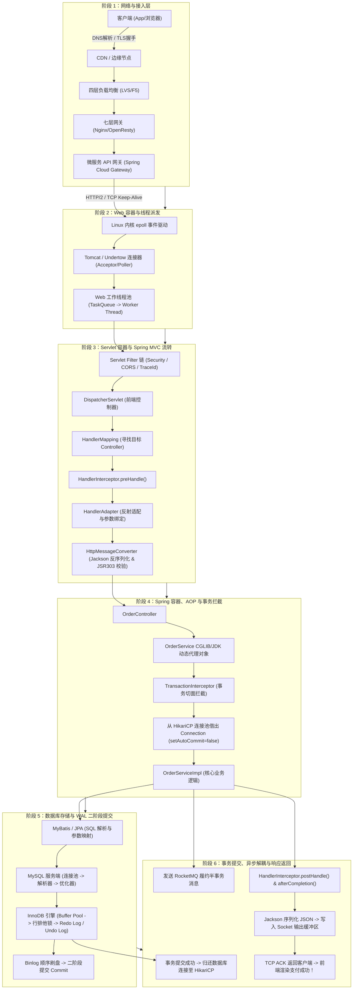

# 一次 Java 请求的全链路：从用户指尖到磁盘磁道的全景透视

> **关联基础**：[[20-Java后端/04-Spring生态/06-SpringMVC请求处理流程|SpringMVC流程]]、[[20-Java后端/04-Spring生态/04-AOP实现机制|Spring AOP]]、[[20-Java后端/05-数据库与存储/03-MySQL事务与MVCC|MySQL事务]]

---

## 1. 全链路宏观视角：六大层级跨越

当用户在手机 App 上点击一次“立即支付”按钮，这个小小的 HTTP 请求在接下来的几十毫秒内，将在物理网络、操作系统内核、JVM 虚拟机、Spring 框架与关系型数据库之间完成一场震撼的“长征”：



---

## 2. 深入每一层：微观运行机制与关键动作

### 2.1 阶段一：网络与网关层（流量调度与鉴权）
1. **DNS 与 TLS 卸载**：手机 App 解析域名获取 VIP，通过 Anycast 路由到离用户最近的数据中心。四层 LVS 负责抗击数百万高并发连接，分发到七层 Nginx。Nginx 负责卸载 SSL/TLS 加密证书，将 HTTPS 解密为明文 HTTP 请求。
2. **API 网关治理**：Spring Cloud Gateway 进行令牌桶限流校验、JWT 验签与鉴权。若校验通过，在 Header 注入 `X-User-Id` 与 `X-Trace-Id`，反向代理转发给内部后端服务。

### 2.2 阶段二：Web 容器层（Tomcat I/O 模型与线程派发）
1. **NIO 线程模型**：Tomcat 的 `Acceptor` 线程监听 TCP 握手端口，接收到新连接后注册到 `Poller` 线程的 Selector 多路复用器中。
2. **任务入队**：`Poller` 监听到读就绪事件（`OP_READ`），读取 HTTP 请求头与 Body 数据，将其封装为 `SocketProcessor` 任务，提交给 Tomcat 工作线程池（默认最大 200 线程）。
3. **线程接管**：空闲的工作线程从队列中取出任务，正式进入 Java Servlet 容器的生命周期。

### 2.3 阶段三：Spring MVC 核心分发链
1. **Filter 链过滤**：请求首先穿过 `ApplicationFilterChain`，依次执行安全过滤器、跨域过滤器，并在 MDC 中埋入分布式链路追踪的 TraceId。
2. **DispatcherServlet 调度**：
   - 核心调度器调用 `getHandler(request)`，通过 `RequestMappingHandlerMapping` 依据 URL 匹配到对应的 `OrderController.createOrder()` 方法。
   - 依次执行所有配置的 `HandlerInterceptor.preHandle()`。若某拦截器返回 false，链路立即就地中断返回。
3. **参数绑定与校验**：
   - `RequestMappingHandlerAdapter` 调度 `RequestResponseBodyMethodProcessor`，利用 Jackson 将请求 Body 中的 JSON 文本反序列化为 Java DTO 对象。
   - 触发 Hibernate Validator 执行 `@Valid` 注解规则校验。若校验失败，当场抛出 `MethodArgumentNotValidException`，跳入全局异常处理（`@ExceptionHandler`）。

### 2.4 阶段四：Spring AOP 代理与声明式事务穿透
1. **动态代理拦截**：`Controller` 调用注入的 `OrderService`。此时该引用指向的是被 Spring 容器包装的 **CGLIB 代理对象**。
2. **事务切面执行（`TransactionInterceptor`）**：
   - 检查 `@Transactional` 注解配置的传播属性（如 `PROPAGATION_REQUIRED`）。
   - 从 `ThreadLocal` 查找当前线程是否已存在事务上下文。若没有，调用 `DataSourceTransactionManager` 开始新事务。
   - **连接借出时机**：从 **HikariCP 连接池**中物理借出一个数据库连接，执行 `connection.setAutoCommit(false)`，关闭自动提交，并将该连接绑定到当前线程的 `TransactionSynchronizationManager`（底层是 `ThreadLocal`）。

### 2.5 阶段五：MySQL InnoDB 存储引擎落库与 WAL 机制
1. **SQL 发送**：MyBatis 从当前线程获取绑定的 Connection，通过 Socket 将预编译好的 SQL 发往 MySQL 服务端。
2. **Buffer Pool 与行锁**：
   - InnoDB 检查该数据所在的 Page 是否在内存的 **Buffer Pool** 中。若在则直接修改内存中的行记录；若不在则从磁盘读取加载到 Buffer Pool。
   - 对目标行记录加 **行级排他锁（X锁）**，并记录旧值到 **Undo Log**（用于 MVCC 多版本快照读和事务回滚）。
3. **WAL 与二阶段提交（Two-Phase Commit）**：
   - **Prepare 阶段**：InnoDB 生成物理修改记录，写入 **Redo Log Buffer**，并根据 `innodb_flush_log_at_trx_commit=1` 参数刷入磁盘 Redo Log 文件，状态标记为 `PREPARE`。
   - **写 Binlog**：MySQL Server 层将逻辑变更写入 Binlog Cache，根据 `sync_binlog=1` 参数刷入磁盘 Binlog 文件。
   - **Commit 阶段**：InnoDB 将 Redo Log 中的事务状态正式更新为 `COMMIT`。至此，数据具备了物理 Crash-Safe 崩溃恢复能力。

### 2.6 阶段六：响应渲染与网络写出
1. **连接释放**：Spring 事务切面调用 `connection.commit()`，并将 Connection 重置后归还给 HikariCP 连接池。
2. **后置拦截与序列化**：
   - 触发 `HandlerInterceptor.postHandle()` 与 `afterCompletion()`，清理 MDC 中的 TraceId。
   - `HttpMessageConverter` 将 Service 返回的 Java POJO 序列化为 JSON 字节流，写入 Tomcat 的 Socket 输出缓冲区。
3. **网络返回**：通过 Linux 内核 TCP 发送队列将响应报文发往客户端，App 端收到 HTTP 200 OK，界面渲染“订单创建成功”！

---

## 3. 全链路故障断点排查表（哪一层会崩？）

| 异常现象 / 状态码 | 发生阶段与层级 | 典型根因推导 | 生产排查命令与抓手 |
| :--- | :--- | :--- | :--- |
| **HTTP 502 Bad Gateway** | 接入层 (Nginx / 网关) | 上游后端微服务进程崩溃（OOM 退出）或网关根本连不上后端服务端口 | 查看 Nginx `error.log`，检查后端 Pod 存活状态 |
| **HTTP 504 Gateway Timeout** | 接入层 (网关) | 后端应用处理超时（慢 SQL、下游网络卡顿、线程池打满排队） | 查看网关超时配置，结合 SkyWalking 追踪慢调用 Span |
| **HTTP 400 Bad Request** | MVC 层 (参数解析) | 前端 JSON 格式非法，或字段类型不匹配（如字符串传给了 Long） | 查看应用错误日志中的 `HttpMessageNotReadableException` |
| **Connection Timeout** | 数据层 (HikariCP) | 数据库连接池耗尽。事务内包含了慢 HTTP 调用或大循环，导致连接被霸占 | 监控 HikariCP `ActiveConnections` 与 `ConnectionTimeout` |
| **Deadlock found** | 数据库层 (MySQL) | 并发事务以不同顺序加锁修改相同的几行记录，触发 InnoDB 死锁检测 | 执行 `SHOW ENGINE INNODB STATUS\G` 查看最新死锁日志 |

---

## 4. 大厂 30 秒面试绝杀（高频追问 3 连击）

### Q1：在整个请求过程中，数据库连接（Connection）到底是在哪一瞬间从连接池借出的？又是在何时归还的？
> **答题标杆**：
> 1. **借出时机**：当执行流穿过 Controller 进入被 `@Transactional` 修饰的 Service 方法时，Spring 的 `TransactionInterceptor` 会触发 `DataSourceTransactionManager.doBegin()`。**正是在这一刻，Spring 首次向 HikariCP 发起 `dataSource.getConnection()` 借出连接**，并立即执行 `connection.setAutoCommit(false)`，随后将该连接绑定到当前线程的 `ThreadLocal` 中。
> 2. **归还时机**：Service 方法执行结束（正常返回或抛出未捕获异常），`TransactionAspectSupport` 触发 `commitTransactionAfterReturning` 或回滚。在 `finally` 块中，Spring 调用 `DataSourceUtils.releaseConnection()`，清除 `ThreadLocal` 绑定，**将该物理连接归还（Close）回 HikariCP 连接池**。
> 3. **生产架构警示**：绝对严禁在 `@Transactional` 方法内调用外部耗时的 HTTP 接口或远程 RPC！否则数据库连接会被该线程无意义霸占数秒，瞬间导致整个系统的数据库连接池枯竭！

---

### Q2：为什么客户端明明收到了 HTTP 504 Gateway Timeout 超时报错，但后台数据库里订单却被神奇地创建成功了？
> **答题标杆**：
> 1. **分布式链路的超时脱节**：Nginx/网关层配置的超时阈值（如 3 秒）小于后端全链路实际执行时间（如 4 秒）。
> 2. **异步执行脱节**：当请求在后端执行到第 3.01 秒时，网关认为后端已死，单方面向客户端斩断连接并返回 504；但此时后端的 Tomcat 线程与 MySQL 事务并没有被强行终止，它们仍然在平稳地继续执行 `insert order` 并最终成功执行了 `commit`。
> 3. **核心启示**：在分布式系统中，**“超时不等于失败，超时只代表结果未知！”**客户端重试必须携带全局唯一的幂等键（Idempotency Key），服务端必须具备查重幂等机制，防止重复出单与重复扣款。

---

### Q3：如果 Tomcat 线程池队列满了，新来的请求会发生什么？Spring 的 Filter 和 Controller 能感知到吗？
> **答题标杆**：
> 1. **行为表现**：Tomcat 默认使用定制的 `TaskQueue`。当工作线程数达到 `maxThreads`（默认 200）且等待队列达到 `acceptCount`（连接排队上限）时，Tomcat 会直接拒绝新连接，底层的 TCP 连接要么被丢弃，要么被直接发送 RST 报文拒绝，客户端通常会当场收到 `Connection Refused` 或 `Broken Pipe`。
> 2. **感知结果**：由于请求根本**未能成功进入 Servlet 容器的派发队列**，Spring 的 `ApplicationFilterChain`、`DispatcherServlet` 和 `Controller` **完全不会被触发，根本无从感知该请求的存在**！应用业务日志里不会留下任何关于这个请求的痕迹，排查只能依赖操作系统内核 `netstat -s` 观察是否有 TCP 连接溢出丢弃（TCP socket overflow）。

---

## 5. 一分钟复盘记忆卡

```text
======================= Java全链路核心复盘口诀 =======================
指尖点击发请求，DNS解析LVS收。
Nginx卸载SSL密，网关限流MDC投；
Tomcat多路复用读，Worker线程入槽留；
Filter链过Dispatch，Mapping映射匹配优；
Jackson反序参数绑，JSR校验把错纠；
CGLIB代理切面进，事务关提Hikari借；
BufferPool改Undo记，WAL两阶段Binlog守；
事务提交连接还，异步MQ落库收；
响应序列回写出，全链路通无阻流！
======================================================================
```
