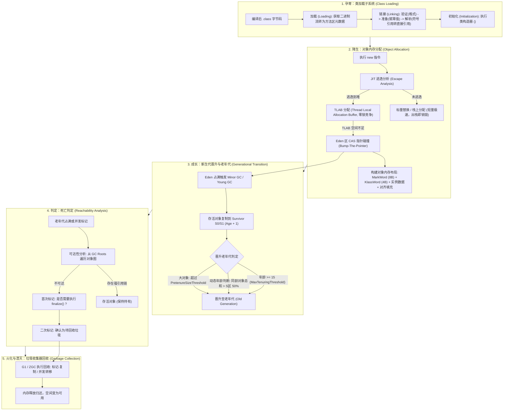

# 从类加载到对象回收与 JVM 排障：一个 Java 对象的“生老病死”全景解剖

> **关联基础**：[[../02-JVM/00-JVM全景与心智模型|JVM全景]]、[[../02-JVM/05-类加载机制与双亲委派|类加载]]、[[../02-JVM/02-对象创建与内存布局|内存结构]]、[[../02-JVM/03-垃圾回收算法|GC理论]]

---

## 1. 一个 Java 对象的“生老病死”全生命周期全景图

在 JVM 的世界里，一个 Java 对象的一生经历着严密的生命法则：



---

## 2. 核心机制穿透解析

### 2.1 降生篇：逃逸分析与 TLAB 内存分配
很多开发者以为“只要 `new` 一个对象，就一定在堆上分配”。在现代 HotSpot JVM（JDK 8+）中，这早已被打破：
1. **JIT 逃逸分析（Escape Analysis）**：
   - 如果一个对象在方法内部被创建，且**绝不会被方法外部引用**（即没有作为返回值、没有赋值给全局变量或传给其他线程），JIT 编译器会启动**标量替换（Scalar Replacement）**。
   - JVM 不会把该对象作为一个完整实体分配在堆上，而是将其内部的基础类型字段打散拆解为局部变量，**直接在线程栈帧的局部变量表中分配**！方法执行完毕栈帧弹出，内存瞬间清空，**GC 压力为 0**！
2. **TLAB（Thread Local Allocation Buffer，线程本地分配缓冲区）**：
   - 堆内存是所有线程共享的，如果几十个线程并发在堆上 `new` 对象，移动指针（指针碰撞 Bump-the-Pointer）必然引发严重的锁争用。
   - **JVM 的解法**：在 Eden 区预先为**每个线程私自切出一小块专属内存空间（TLAB，通常只占 Eden 的 1%）**。
   - 线程创建对象时，优先在自己的 TLAB 内部无锁分配，只有当 TLAB 用尽时，才需要加同步锁向 JVM 申请新的 TLAB，**并发性能提升数倍**！

### 2.2 解剖篇：64位 HotSpot 对象内存布局

在 64 位 JVM（默认开启指针压缩 `-XX:+UseCompressedOops`）下，一个普通 Java 对象的物理构成如下：

```text
+-------------------------------------------------------------------------+
|                              对象头 (12 字节)                            |
+------------------------------------+------------------------------------+
|         Mark Word (8 字节)          |        Klass Word (4 字节)         |
|  哈希码 / GC分代年龄 / 锁状态标志位  |  指向方法区 Class 元数据的压缩指针  |
+------------------------------------+------------------------------------+
|                         实例数据 (Instance Data)                        |
|        包含对象中声明的各个字段数据 (int 占 4B, long 占 8B, 引用占 4B)     |
+-------------------------------------------------------------------------+
|                         对齐填充 (Padding, 0~7 字节)                     |
|           JVM 规定对象总字节数必须是 8 字节的整数倍，不足则补齐           |
+-------------------------------------------------------------------------+
```

```java
// 举例：计算一个对象的真实内存大小（利用 JOL 工具：org.openjdk.jol:jol-core）
public class User {
    private int id;        // 4 字节
    private boolean vip;   // 1 字节
    private String name;   // 4 字节 (压缩指针)
}
// 内存计算：
// Mark Word (8B) + Klass Word (4B) = 12B
// id (4B) + vip (1B) + name (4B) = 9B
// 当前总计：12B + 9B = 21B
// 8 字节对齐：向上对齐到 24 字节（Padding 填充 3 字节）
// 结论：该 User 实例在堆中净占 24 字节！
```

### 2.3 渡劫篇：老年代晋升三原则
存活对象并不是必须熬满 15 岁（`-XX:MaxTenuringThreshold=15`）才会进入老年代：
1. **年龄阈值硬上限**：每经历一次 Minor GC 存活并在 S0/S1 转移一次，MarkWord 中的年龄加 1，达到 15 自动晋升。
2. **动态年龄判断（Dynamic Age Determination）**：如果在 Survivor 空间中，**相同年龄所有对象大小的总和大于 Survivor 空间的一半（50%）**，年龄大于或等于该年龄的对象，直接无条件提前晋升老年代！
3. **大对象直接跃迁（PretenureSizeThreshold）**：对于需要连续大内存的对象（如超大数组、视频流 byte 缓冲），如果设置了参数，直接跨过年轻代，在老年代一次性分配，防止在 Survivor 之间来回大内存复制拷贝。

### 2.4 判死篇：GC Roots 与可达性分析
JVM 坚决弃用了**引用计数法**（无法解决 A 引用 B、B 引用 A 的循环引用死结），全面采用**可达性分析算法（Reachability Analysis）**。
- **哪些对象可以作为无可撼动的 GC Roots？**
  1. **虚拟机栈（栈帧中的局部变量表）引用的对象**（当前正在执行的方法里的局部变量参数）；
  2. **方法区中类静态属性引用的对象**（`public static User currentUser`）；
  3. **方法区中常量引用的对象**（字符串常量池引用）；
  4. **本地方法栈中 JNI（Native 方法）引用的对象**；
  5. **JVM 内部核心引用**（系统类加载器、基本数据类型的 Class 对象、常驻异常等）；
  6. **所有被同步锁（`synchronized` 关键字）持有的对象**。

---

## 3. 生产级 JVM 异常诊断矩阵

| OOM 类型 | 典型报错日志 | 物理空间归属 | 核心诱因与定位手段 |
| :--- | :--- | :--- | :--- |
| **Java 堆溢出** | `java.lang.OutOfMemoryError: Java heap space` | JVM 堆内存（新生代+老年代） | 内存泄漏（静态集合、ThreadLocal 未清理）或突发大批量查询加载；用 MAT 查 Dominator Tree |
| **元空间溢出** | `java.lang.OutOfMemoryError: Metaspace` | 操作系统本地内存（Native Memory） | 动态生成类过多（CGLIB 动态代理泛滥、JSP 频繁热加载）；查看 `jcmd VM.classloader_stats` |
| **堆外直接内存溢出** | `java.lang.OutOfMemoryError: Direct buffer memory` | JVM 堆外操作系统内存 | Netty ByteBuf 漏调 `release()` 或 NIO 直接缓冲区超过 `-XX:MaxDirectMemorySize` |
| **线程栈溢出** | `java.lang.StackOverflowError` | 线程私有栈空间 | 方法递归调用无终止条件、循环依赖创建 Bean、超长调用链路；排查线程栈日志顶部重复行 |
| **无法创建本地线程** | `java.lang.OutOfMemoryError: unable to create new native thread` | 操作系统内核线程资源 | 进程无节制 `new Thread()`，打满 Linux 内核 `max user processes` 限制或系统内存耗尽 |

---

## 4. 大厂 30 秒面试绝杀（高频追问 3 连击）

### Q1：什么是 TLAB（Thread Local Allocation Buffer）？它是怎么解决多线程并发争抢堆内存分配的？
> **答题标杆**：
> 1. **痛点背景**：堆内存是全线程共享的，如果所有线程分配对象都直接在 Eden 区使用 CAS 移动指针（指针碰撞），在百级线程并发下会导致 CPU 严重的 CAS 失败与总线自旋风暴。
> 2. **TLAB 原理**：JVM 在 Eden 区内部为**每个线程划分了一块私有的内存缓存区（TLAB）**。
> 3. **无锁分配**：每个线程 `new` 对象时，先在自己的 TLAB 内分配，由于是线程私有的，**完全零锁竞争、零 CAS 开销**，效率比肩 C 语言的 `malloc`。只有当自己的 TLAB 空间耗尽，需要向 Eden 申请新的 TLAB 块时，才需要走一次 CAS 锁，从而将并发冲突概率稀释了 99%。

---

### Q2：如果两个对象互相循环引用（A 里面有 B 的引用，B 里面有 A 的引用），JVM 能回收它们吗？为什么？
> **答题标杆**：
> 1. **明确结论：能回收，绝不会引发内存泄漏**！
> 2. **原理深度剖析**：如果是早期的“引用计数法”，由于 A 和 B 的引用计数永远至少为 1，确实无法回收。
> 3. **可达性分析打破死结**：现代 JVM 采用的是以 **GC Roots** 为起点的图搜索遍历算法。只要没有任何存活的 GC Root（如当前执行线程的局部变量栈、静态变量等）能够连通到 A 或 B，即便 A 和 B 之间互相引用得再紧密，**从根节点出发它们都属于“不可达孤岛”**。在垃圾回收器的可达性遍历中，它们会被一并标记为垃圾并予以清理回收。

---

### Q3：什么是动态年龄判断？为什么在 Survivor 区的对象往往不需要熬满 15 岁就会提前晋升老年代？
> **答题标杆**：
> 1. **规则定义**：HotSpot JVM 规定，如果在某次 Minor GC 之后，Survivor 空间中**年龄从 1 到 $N$ 的所有对象大小累加和，超过了该 Survivor 空间容量的 50%（TargetSurvivorRatio）**，那么**所有年龄大于或等于 $N$ 的对象，都会直接提前晋升到老年代**，无需等待达到 `MaxTenuringThreshold`（默认 15）。
> 2. **设计哲学**：为了应对突发的大流量。如果严格等 15 次，会导致 Survivor 区瞬间被大量存活对象撑爆，直接触发频繁的跨代担保（Promotion Failure），反而更早引发破坏性的 Full GC。动态年龄判断是一种动态感知与自适应分流的自我保护机制。

---

## 5. 一分钟复盘记忆卡

```text
======================= 类加载到GC回收通关口诀 =======================
类载链接初始化，验证准备解析全。
new时逃逸栈上落，TLAB无锁并发生；
MarkWord头中存状态，压缩指针对齐整；
Eden分配满进S，年龄增长累加深；
同龄超半早晋升，大对象直接老代奔；
根节点下探孤岛，循环引用照样焚；
强软弱虚四种引，OOM看准查深堆；
全貌通达心中驻，底蕴深厚大厂尊！
======================================================================
```
