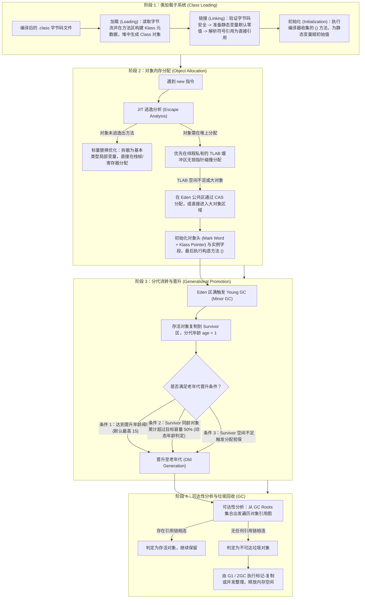

# 从类加载到对象回收与 JVM 排障：Java 对象生命周期全链路解析

> **关联基础**：[[../02-JVM/00-JVM全景与心智模型|JVM全景]]、[[../02-JVM/05-类加载机制与双亲委派|类加载]]、[[../02-JVM/02-对象创建与内存布局|内存结构]]、[[../02-JVM/03-垃圾回收算法|GC理论]]

---

## 1. Java 对象生命周期全景图

当我们在代码中写下一行 `User user = new User()`，这个对象从类的加载、内存空间的划分、在新生代与老年代之间的流转，直到最后失去引用被垃圾收集器（GC）回收，经历了一套精密的生命周期管理机制。



---

## 2. 核心生命周期阶段深度拆解

### 2.1 阶段一：类加载与对象内存分配（逃逸分析与 TLAB）
当 JVM 遇到 `new User()` 指令时，首先检查 `User` 类的符号引用是否已在元空间（Metaspace）完成加载、链接和初始化。若尚未加载，则通过双亲委派模型加载该类并执行 `<clinit>()` 静态初始化。随后进入内存分配阶段：

1. **JIT 逃逸分析与标量替换（Scalar Replacement）**：
   并非所有 `new` 出来的对象都一定会在堆上创建。HotSpot 的 JIT 编译器在编译热点代码时会进行**逃逸分析**：如果发现某个对象只在当前方法内部被使用，既没有作为返回值返回，也没有赋值给外部成员变量（即“未逃逸”），JIT 就会执行**标量替换**——干脆不在堆上创建这个完整对象，而是把它内部的字段（如 `int id`、`int age`）拆散成普通的局部变量，直接分配在 CPU 寄存器或栈帧上，方法结束随栈帧弹出立即销毁，从根源上减轻 GC 压力。
2. **TLAB（Thread Local Allocation Buffer，线程本地分配缓冲区）**：
   对于确实需要在堆上分配的对象，由于 Eden 区是所有线程共享的，如果几十个线程同时在 Eden 区移动同一个空闲内存指针，每次 `new` 对象都要加锁或执行 CAS 重试，分配效率会大打折扣。
   为此，JVM 默认开启了 **TLAB（`-XX:+UseTLAB`）**：在 Eden 区内部预先为每个线程划分一小块专属的私有缓冲区（默认占 Eden 区的 1%）。线程创建普通小对象时，优先在自己的 TLAB 内部通过简单的指针加法（Bump-the-Pointer）无锁极速分配；只有当当前 TLAB 用完需要申请新的 TLAB 块时，才需要与公共 Eden 区进行同步。

### 2.2 阶段二：64 位 HotSpot 对象内存布局

对象在堆内存中分配好空间后，其在内存中的物理结构由三部分严格组成：**对象头（Header）、实例数据（Instance Data）和对齐填充（Padding）**。

在 64 位 HotSpot 虚拟机中（默认开启指针压缩 `-XX:+UseCompressedOops` 和 `-XX:+UseCompressedClassPointers`），一个普通对象的内存布局如下：

```text
+-------------------------------------------------------------------------+
|                              对象头 (12 字节)                            |
+------------------------------------+------------------------------------+
|         Mark Word (8 字节)          |      Klass Pointer (4 字节)        |
|  记录哈希码、GC 分代年龄(4 bit)、   |  指向元空间中类元数据(InstanceKlass)|
|  锁状态标志位、偏向线程ID或锁指针   |  的压缩指针(未开启压缩时占 8 字节)  |
+------------------------------------+------------------------------------+
|                         实例数据 (Instance Data)                        |
|   对象声明的各字段：long/double(8B)、int/float(4B)、short/char(2B)、    |
|   byte/boolean(1B)、普通对象引用 oop(开启压缩占 4B，关闭压缩占 8B)      |
+-------------------------------------------------------------------------+
|                         对齐填充 (Padding, 0~7 字节)                     |
|         HotSpot 要求所有对象总字节数必须是 8 字节的整数倍，不足则补齐     |
+-------------------------------------------------------------------------+
```

> **提示**：如果对象是数组（如 `int[]`），对象头中还会额外多出一个 4 字节的**数组长度（Array Length）**字段，此时数组对象头占 16 字节。

我们可以通过一个具体的 Java 类来计算其内存占用（生产中可使用 OpenJDK 官方的 `jol-core` 工具验证）：

```java
public class OrderItem {
    private long orderId;     // 8 字节 (long)
    private int quantity;     // 4 字节 (int)
    private boolean paid;     // 1 字节 (boolean)
    private String skuName;   // 4 字节 (开启压缩后的对象引用指针)
}
// 大小计算：
// 1. 对象头：Mark Word (8B) + Klass Pointer (4B) = 12 字节
// 2. 实例数据：orderId (8B) + quantity (4B) + paid (1B) + skuName引用 (4B) = 17 字节
// 3. 当前合计：12 + 17 = 29 字节
// 4. 8 字节对齐填充：向上取 8 的倍数为 32 字节（Padding 填充 3 字节）
// 结论：一个 OrderItem 实例自身占用（Shallow Heap）精确为 32 字节。
```

### 2.3 阶段三：分代流转与老年代晋升的四个条件
对象在 Eden 区诞生后，绝大多数“朝生夕死”的临时对象会在第一次 Young GC 时被直接回收。而存活下来的对象并非一定要熬满 15 次 GC（`-XX:MaxTenuringThreshold=15`）才会进入老年代，满足以下任意一个条件即可晋升：
1. **达到年龄阈值**：对象在 Eden 经历第一次 Young GC 存活后进入 Survivor 区（年龄设为 1），此后每在 Survivor 区熬过一次 Young GC 年龄加 1（年龄保存在对象头 Mark Word 的 4 个 bit 中，因此最大值为 $2^4 - 1 = 15$）。达到设定阈值时晋升老年代。
2. **动态年龄判定（Dynamic Tenuring Threshold）**：为了适应不同业务的内存波动，HotSpot 会在 Young GC 时按年龄从 1 岁开始从小到大累加 Survivor 区中存活对象的总字节数。当累加到某个年龄 $N$ 时，若**年龄 $1 \sim N$ 的对象总大小超过了 Survivor 区目标容量（TargetSurvivorRatio，默认 50%）**，那么年龄大于或等于 $N$ 的所有对象无需等到 15 岁，直接晋升老年代。
3. **大对象直接分配**：在 Serial / ParNew 收集器中，超过 `-XX:PretenureSizeThreshold` 的大对象直接进入老年代；在 G1 收集器中，大小超过单个 Region 容量 50% 的对象被判定为 **Humongous（巨型对象）**，直接分配在专门的连续 Humongous Region 中。
4. **分配担保（Handle Promotion）**：当一次 Young GC 后存活的对象总量超过了单个 Survivor 区的容纳上限，放不下的存活对象会通过分配担保机制直接进入老年代。

### 2.4 阶段四：可达性分析与 GC Roots
JVM 是如何判断老年代或新生代里的某个对象已经“死亡”可以回收的？
现代 JVM 并不使用简单的“引用计数法”（因为引用计数法无法解决 `A.b = B; B.a = A` 的循环引用问题），而是采用 **可达性分析算法（Reachability Analysis）**：以一系列被称为 **GC Roots** 的根对象为起点向下搜索引用链；如果一个对象到任何 GC Roots 都没有引用链相连，则证明该对象不可达，可被回收。

**四大核心 GC Roots 对象类型**：
1. **虚拟机栈（栈帧局部变量表）中引用的对象**：各线程当前正在执行的方法中使用的参数、局部变量；
2. **方法区（元空间）中类静态属性引用的对象**：被 `static` 修饰的引用类型字段；
3. **方法区中常量引用的对象**：如字符串常量池（String Table）里的引用；
4. **本地方法栈中 JNI（Native 方法）引用的对象**，以及被 `synchronized` 同步锁当前持有的对象。

---

## 3. 五类常见 JVM 内存溢出（OOM）诊断对照表

线上出现内存报错时，第一时间要看清异常冒号后面的具体区域名称，对症下药：

| 异常类型与报错信息 | 溢出发生的内存区域 | 典型业务诱因 | 排查命令与解决思路 |
| :--- | :--- | :--- | :--- |
| **`OutOfMemoryError: Java heap space`** | JVM 堆内存（年轻代 + 老年代） | 1. 静态集合缓存无界增长、ThreadLocal 未清理导致内存泄漏；2. 单次 SQL 未分页查出百万行数据或导出超大 Excel | 结合 `-XX:+HeapDumpOnOutOfMemoryError` 获取 `.hprof` 文件，用 Eclipse MAT 查 `Dominator Tree` 与 `GC Roots` |
| **`OutOfMemoryError: Metaspace`** | 元空间（存储类元数据，位于本地内存） | 频繁在运行期动态生成新类（如每次请求都 `new Enhancer()` 生成 CGLIB 类、反射/脚本引擎创建大量自定义 ClassLoader） | 执行 `jcmd <PID> VM.classloader_stats` 或 Arthas `classloader -l` 排查异常类加载器，复用动态代理类 |
| **`OutOfMemoryError: Direct buffer memory`** | 堆外直接内存（DirectByteBuffer） | NIO / Netty 分配了大量直接内存但未及时调用 `release()` 释放，达到 `-XX:MaxDirectMemorySize` 上限 | 开启 `-XX:NativeMemoryTracking=detail` 与 `-Dio.netty.leakDetection.level=PARANOID` 追踪未释放的 ByteBuf |
| **`StackOverflowError`** | 线程私有虚拟机栈（`-Xss`） | 方法无限递归调用无终止条件，或对象之间互相重写 `toString()` / Jackson 双向关联序列化引发无限循环 | 直接查看异常堆栈中反复循环出现的两三行代码行号，修复递归出口或添加 `@JsonIgnore` |
| **`OutOfMemoryError: unable to create new native thread`** | 操作系统线程资源与堆外内存 | 代码中在循环里无节制 `new Thread()` 或创建未关闭的线程池，触发 Linux `ulimit -u` / 容器 `pids.max` 进程线程数上限 | 执行 `pstree -p <PID> \| wc -l` 与 `jstack` 统计线程名称前缀，收敛为全局共享的有界线程池 |

---

## 4. 面试高频追问解析

> [!question]- Q1：既然有了逃逸分析，是不是很多对象都在栈上分配了？“栈上分配”在 HotSpot 中到底是怎么实现的？
> 在 HotSpot 虚拟机中，所谓的“栈上分配”实际上是通过 **逃逸分析（Escape Analysis） + 标量替换（Scalar Replacement）** 配合实现的：
> 1. **聚合量与标量**：像 `int`、`long` 这样无法再分解的数据称为“标量”；而一个 Java 对象（如 `Point(int x, int y)`）包含了多个字段，称为“聚合量”。
> 2. **拆散消除对象**：当 JIT C2 编译器通过逃逸分析确认 `Point` 对象不会逃逸出当前方法时，它并不是真的在栈上开辟一块包含对象头（Mark Word + Klass Pointer）的完整对象空间，而是直接把 `new Point(1, 2)` 拆解替换为两个普通的 `int x = 1; int y = 2;` 局部变量，将它们保存在栈帧局部变量表甚至直接放进 CPU 寄存器中。这样不仅省去了堆内存分配和 GC 回收，连 12 字节的对象头开销也一并省掉了。

> [!question]- Q2：两个对象互相引用（`objA.instance = objB; objB.instance = objA`），然后把 `objA = null; objB = null`，它们会被 GC 回收吗？
> **一定会被回收。**
> 虽然 `objA` 和 `objB` 两个实例在堆内存内部互相指向对方，引用计数都不为 0，但在将局部变量 `objA` 和 `objB` 置为 `null`（或者方法执行结束栈帧弹出）之后，从虚拟机栈等 **GC Roots** 出发向下遍历，已经没有任何一条引用路径能够到达 `objA` 或 `objB` 这座“孤岛”。在可达性分析算法下，这组互相引用的对象会被整体判定为不可达垃圾，在下一次 GC 时被一并清理。

> [!question]- Q3：为什么 JVM 要设计 Survivor 区（且通常分为 S0 和 S1 两个区），只有 Eden 区和老年代不行吗？
> 1. **为什么需要 Survivor 区（过滤保护老年代）**：如果没有 Survivor 区，那么每当 Eden 区满触发一次 Young GC，所有刚好在这次 GC 时还存活的对象（哪怕只是刚创建 1 毫秒、马上就要用完的临时对象）都会被直接送入老年代。老年代很快就会被填满，从而频繁触发耗时极长的 Major GC / Full GC。Survivor 区就像一个“缓冲筛选池”，让对象在年轻代多经历几次复制筛选，确保只有真正长期存活的对象才进入老年代。
> 2. **为什么分成两个 Survivor 区（消除内存碎片）**：新生代对象 98% 朝生夕死，最适合采用高效的**标记-复制算法**。将 Survivor 分为大小相等的 From（S0）和 To（S1）两块，每次 Young GC 时，把 Eden 和 From 中存活的对象紧凑地连续复制到 To 区，然后直接清空整个 Eden 和 From 区并互换角色。这样既避免了标记-清除算法产生的内存碎片，又无需像把整个新生代对半切分那样浪费 50% 的内存（8:1:1 的比例每次只预留 10% 的复制空间）。

---

## 5. 核心要点复盘清单

- **对象创建五步曲**：检查类加载 -> 分配内存（未逃逸标量替换 / TLAB 无锁指针碰撞 / Eden CAS） -> 内存空间清零初始化 -> 设置对象头（Mark Word 与 Klass 指针） -> 执行 `<init>()` 构造方法。
- **对象内存三段式**：对象头（64 位开启压缩下为 8B Mark Word + 4B Klass Pointer = 12B） + 实例字段数据 + 8 字节整数倍对齐填充。
- **老年代晋升四通道**：熬满年龄阈值（最高 15） / 动态年龄判定（1~N 岁累计超 Survivor 目标容量 50%） / 大对象直接进入 / Survivor 空间不足触发分配担保。
- **四大 GC Roots**：栈帧局部变量、方法区 `static` 静态变量、常量池引用、JNI 本地方法与 `synchronized` 持锁对象。
