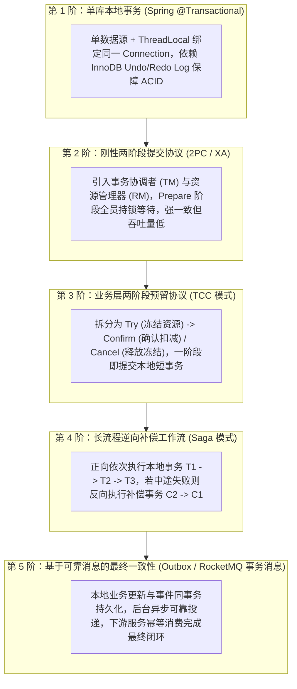
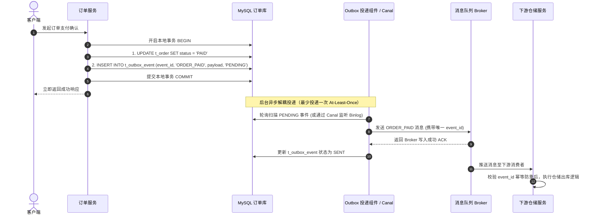
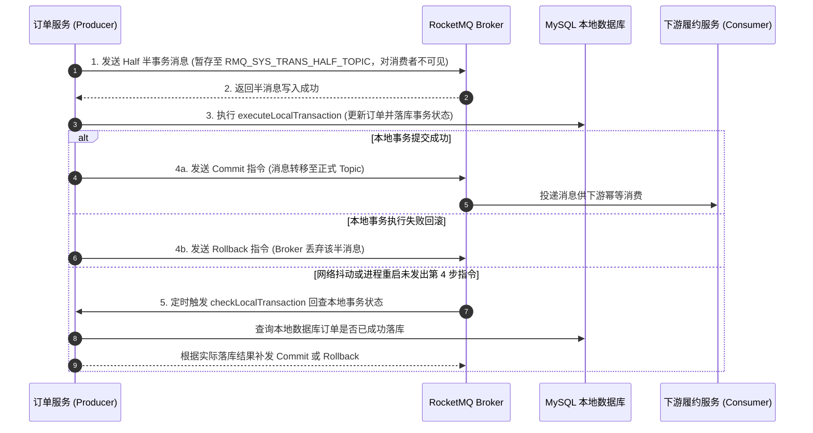

# 从 Spring 事务到分布式一致性：从单库 ACID 到跨服务最终一致性

> **关联基础**：[[../04-Spring生态/03-Spring事务管理|Spring事务]]、[[../07-分布式与微服务/01-CAP与BASE理论|CAP与BASE]]、[[../07-分布式与微服务/03-分布式事务-2PC-TCC-Saga|分布式事务2PC-TCC-Saga]]

---

## 1. 为什么单机事务跨过网络就会失效？（第一性原理）

### 1.1 单机本地事务（`@Transactional`）的运行基石
在单体单库架构下，一个下单操作（扣减库存、创建订单、增加积分）的所有 SQL 都发往同一个 MySQL 实例。Spring 的 `@Transactional` 之所以能轻松实现 ACID，核心在于：
- **共享同一个物理连接**：Spring 事务管理器从连接池借出一个 `Connection` 绑定到当前线程的 `ThreadLocal` 中，所有 DAO 操作都在这同一个连接与同一个 InnoDB 事务 ID（`trx_id`）下执行。
- **存储引擎原语兜底**：原子性与持久性由 InnoDB 的 **Undo Log** 与 **Redo Log** 保障，隔离性由 **MVCC 快照** 与 **行锁** 保障。只要方法抛异常触发 `connection.rollback()`，数据库就能利用 Undo Log 将所有修改一步撤销。

#### 附：Spring 本地事务的四大常见失效边界
在使用 `@Transactional` 时，以下四种情况会导致本地事务无法按预期回滚，必须在编码时规避：
1. **同类内部自调用（绕过 AOP 代理）**：同一个类中无事务的 `methodA()` 直接通过 `this.methodB()` 调用有 `@Transactional` 的方法，由于未经过 Spring 动态代理对象，事务切面不会触发。
2. **异常类型不匹配**：Spring 默认只对未受检异常（`RuntimeException` 和 `Error`）回滚；若方法抛出受检异常（`Exception`），需显式声明 `@Transactional(rollbackFor = Exception.class)`。
3. **异常被内部 `try-catch` 吞掉**：业务代码捕获了异常但未向上重新抛出，也未手动调用 `TransactionAspectSupport.currentTransactionStatus().setRollbackOnly()`，代理切面会认为方法正常成功而直接提交事务。
4. **开启新线程执行 SQL**：由于事务 `Connection` 保存在当前线程的 `ThreadLocal` 中，在 `@Transactional` 方法内通过线程池或 `CompletableFuture` 开启的子线程拿不到父线程的连接，子线程的 SQL 会以独立事务提交，不受父线程回滚控制。

---

### 1.2 走向微服务：跨网络调用的三大不确定性
一旦按业务领域拆分为微服务（订单服务、库存服务、支付服务），原本在同一个数据库 `Connection` 内完成的操作被拆散到了不同的数据库实例，并通过 HTTP / RPC 跨网络协同：
1. **本地回滚无法撤销远端提交**：如果订单服务通过 RPC 调用库存服务扣减库存成功，但随后订单服务本地写库报错回滚，库存服务那边的独立数据库事务早已经 `COMMIT` 落盘，无法靠本地 `Connection` 自动回滚。
2. **网络超时代表结果未知**：当调用远程接口发生 `SocketTimeoutException` 时，请求可能根本没到达对方，也可能对方已经成功执行完毕但响应包在半路丢失，调用方无法直接判断应当重试还是放弃。
3. **CAP 与 BASE 的工程权衡**：在分布式网络分区（P）风险下，跨服务强一致同步锁会严重阻塞吞吐量。因此现代互联网架构普遍遵循 **BASE 理论**——在各个微服务内部使用本地 ACID 强事务，而在跨服务之间通过资源预留或可靠事件投递达成**最终一致性（Eventual Consistency）**。

---

## 2. 事务一致性演进五重阶梯全景图

---

## 3. 五大事务模式核心机制与选型对比

| 评估维度 | 单库本地事务 | 2PC / XA 刚性事务 | TCC (Try-Confirm-Cancel) | Saga 补偿模式 | 本地发件箱 Outbox / 事务消息 |
| :--- | :--- | :--- | :--- | :--- | :--- |
| **一致性级别** | 单库强一致 | 跨库强一致（同步阻塞） | 强隔离 + 毫秒级最终一致 | 最终一致（无中间隔离） | 异步最终一致 |
| **锁持有周期** | 单次本地事务耗时 | **两阶段全程持有数据库锁** | Try/Confirm/Cancel 均为独立短事务 | 每个子步骤均为独立短事务 | 仅上游本地事务持锁 |
| **代码改造侵入度** | 极低（一行注解） | 低（框架与驱动层代理） | **高（每个接口需写 3 个方法 + 状态控制表）** | 中高（需编写正向与逆向补偿接口） | 中（需建 Outbox 表或实现事务回查接口） |
| **隔离性表现** | 数据库隔离级别保障 | 数据库隔离级别保障 | **业务层冻结字段保障隔离** | 缺乏隔离（中间态对外可见，需防脏写） | 上下游存在短暂状态同步延迟 |
| **典型适用场景** | 单服务单库内多表更新 | 低并发跨库账务调拨、传统内部系统 | **高并发核心资金扣款、秒杀/电商库存预占** | 跨机构长链路业务（如机票+酒店+租车联订） | **电商订单履约、支付通知、积分发放等主流场景** |

---

## 4. 生产主流实战：两大最终一致性落地方案

在不需要下游同步返回结果的绝大多数高并发场景（如支付成功后通知仓库发货、赠送优惠券）中，**本地事务发件箱（Transactional Outbox）** 与 **RocketMQ 半事务消息** 是最成熟可靠的工程方案。

### 4.1 方案一：本地事务发件箱模式（Transactional Outbox）
核心思想：**利用单库本地事务的 ACID 特性，将“业务数据修改”和“待发送消息记录”放在同一个数据库事务中提交**，彻底消除“业务成功但消息丢失”或“业务回滚但消息已发”的不一致窗口。

---

### 4.2 方案二：RocketMQ 半事务消息（Two-Phase Message）
如果不希望在业务库中维护 `t_outbox_event` 表及轮询任务，可以使用 RocketMQ 原生支持的事务消息机制。它通过“先发对消费者不可见的半消息（Half Message） -> 执行本地事务 -> 提交/回滚半消息 + Broker 定时反查”来实现一致性：

---

## 5. 面试高频追问解析

> [!question]- Q1：为什么微服务架构中严禁把耗时的远程 RPC 或第三方 HTTP 请求包在 `@Transactional` 本地事务方法内部？
> 1. **耗尽数据库连接池**：进入 `@Transactional` 方法时，Spring 会从 HikariCP 连接池借出一个物理数据库连接，直到方法执行结束才归还。如果事务内包含了一个耗时 2 秒的远程 RPC 调用，数据库连接就会在这 2 秒内处于空转等待状态，同时 InnoDB 行锁也一直不释放。高并发下只需几十个请求就能把连接池彻底占满，导致整个服务的所有数据库读写全部卡死。
> 2. **无法回滚外部副作用**：如果远程 RPC 调用成功修改了下游系统的数据，但随后本地方法因后续逻辑报错触发回滚，本地数据库虽然回滚了，但下游系统已经生效的操作根本不会自动撤销，反而造成数据不一致。
> 3. **正确改法**：采用**编程式事务（`TransactionTemplate`）**缩小事务范围，先在事务外执行远程查询与校验，只在最后写库的那几毫秒内开启本地事务；对于需要通知下游的写操作，采用 Outbox 本地消息表在事务提交后异步触发。

> [!question]- Q2：TCC 模式中的“幂等”、“空回滚”和“悬挂”分别指什么？在代码层面如何统一解决？
> 在分布式网络超时与重试机制下，TCC 的三个阶段（Try / Confirm / Cancel）随时可能遇到以下三大异常：
> 1. **幂等性（Idempotency）**：由于网络超时重试，Confirm 或 Cancel 可能会被协调器重复调用多次，必须保证多次执行与单次执行的扣款/释放结果完全一致。
> 2. **空回滚（Empty Rollback）**：第一阶段 `Try` 请求因网络拥堵丢包根本没到达参与者，协调器超时后直接下发了 `Cancel` 指令。如果 `Cancel` 不加判断直接给账户加回金额或释放库存，就会凭空多出资金或库存。
> 3. **业务悬挂（Hanging / Suspension）**：协调器因超时触发“空回滚”完成之后，那个在网络中滞留已久的 `Try` 请求终于到达了参与者。如果此时再执行 `Try` 冻结资源，由于事务早已结束，未来再也不会有 `Confirm` 或 `Cancel` 来解冻这笔资源，导致资源永远锁死。
> 
> **统一解决方案（引入 TCC 分支事务状态控制表）**：
> 在参与者本地数据库建一张 `t_tcc_fence_log(xid, branch_id, status)` 表，以 `(xid, branch_id)` 作为联合主键：
> - **收到 `Try` 时**：在本地事务中先尝试 `INSERT` 一条状态为 `TRIED` 的记录；若主键冲突（说明已经提前执行过空回滚 `CANCELLED`），则直接拒绝执行 `Try`，彻底防住**业务悬挂**。
> - **收到 `Cancel` 时**：先执行 `SELECT ... FOR UPDATE` 查询该记录；若查不到记录（说明 `Try` 没执行过，属于**空回滚**），则直接 `INSERT` 一条状态为 `CANCELLED` 的记录并直接返回成功，不执行业务解冻，同时利用这条记录堵死后续迟到的 `Try`。

> [!question]- Q3：Seata AT 模式相比 TCC 代码侵入很低，为什么在高并发核心交易（如秒杀、大促下单）中很少使用 Seata AT？
> Seata AT 模式的核心原理是：一阶段拦截业务 SQL，自动解析生成修改前后的镜像（`before image` / `after image`）存入 `undo_log` 表，并在提交本地事务前向 TC（事务协调器）申请**全局锁（Global Lock）**；二阶段异步删除 `undo_log` 或根据镜像反向生成 SQL 回滚。
> 它在高并发核心链路上有两个明显瓶颈：
> 1. **全局锁跨网络排队**：当大量并发请求同时修改同一行热点数据（如商品库存）时，所有分支事务都必须在 TC 处排队争抢同一把全局锁，网络通信开销加上锁等待使吞吐量大幅下降。
> 2. **额外 SQL 解析与镜像读写开销**：每次更新都要额外查询前后镜像并写入 JSON 格式的 `undo_log` 表，使单次写操作的数据库 I/O 负载成倍增加。因此高并发场景更倾向于使用 Redis/TCC 预扣或 Outbox 异步最终一致性。

---

## 6. 核心要点复盘清单

- **Spring 本地事务边界**：依赖 `ThreadLocal` 绑定单一 `Connection`；警惕自调用绕过代理、未配置 `rollbackFor = Exception.class`、内部吞异常以及跨线程丢失事务连接。
- **短事务铁律**：切忌在 `@Transactional` 内嵌套远程 RPC / HTTP 调用，用 `TransactionTemplate` 精确包裹纯数据库写操作，防止连接池耗尽。
- **TCC 三大防线**：通过独立分支事务状态表（`xid + branch_id` 唯一索引）与业务表同事务更新，一次性解决**幂等重试、空回滚与迟到 Try 悬挂**。
- **最终一致性双雄**：**Transactional Outbox（本地发件箱表）** 与 **RocketMQ 半事务消息**，将跨服务分布式事务转化为“本地原子提交 + 异步可靠投递 + 下游幂等消费”。
