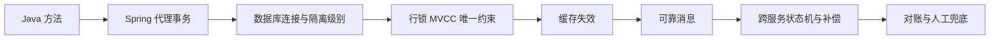
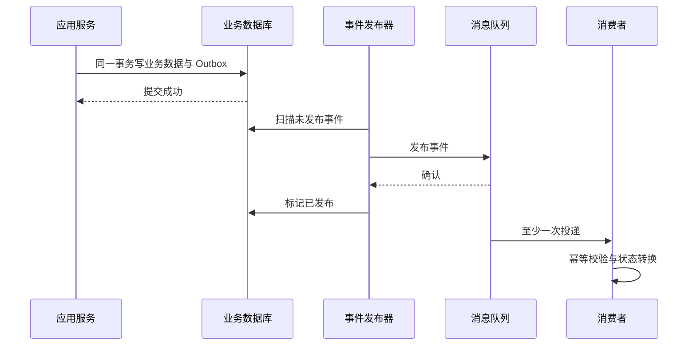

# 从 Spring 事务到分布式一致性

> [!abstract] 一句话总结
> Spring 事务管理一个本地资源的提交边界；一旦数据库、缓存、消息或多个服务共同参与，就必须显式设计幂等、事件、补偿和对账。

## 一致性边界逐层扩大

## 本地事务为什么先看代理

[[20-Java后端/04-Spring生态/03-Spring事务管理|Spring 事务]] 通常通过 AOP 代理开启和提交事务。自调用、非代理对象、异常被吞掉或回滚规则配置错误，都会让预期事务失效。事务真正落到数据库后，还受 [[20-Java后端/05-数据库与存储/02-事务与隔离级别|隔离级别]]、[[20-Java后端/05-数据库与存储/03-MySQL锁机制|锁]] 和唯一约束影响。

## 各层职责

| 层次 | 应承担的职责 | 不应承担的职责 |
| --- | --- | --- |
| Spring 事务 | 管理本地连接提交与回滚 | 自动保证远程调用、缓存和 MQ 一致 |
| MySQL | 原子写入、约束、隔离和锁 | 自动重放外部副作用 |
| Redis | 加速读取、保存短期状态 | 充当无补偿的最终事实源 |
| MQ | 解耦、重试、事件传播 | 保证消费者业务天然幂等 |
| 业务状态机 | 定义合法状态转换和补偿 | 依赖调用顺序猜测最终状态 |
| 对账 | 发现和修复长尾不一致 | 代替主流程正确性设计 |

## 推荐主线：本地事务加可靠事件

核心不是“绝不重复”，而是允许重复投递并让消费者安全重试。幂等键、唯一约束、状态版本和业务流水通常比内存锁更可靠。

## 缓存一致性如何接入

常见做法是数据库提交后删除缓存，而不是同时更新两份状态。仍需处理删除失败、并发回源和短暂旧值：

1. 数据库是事实源。
2. 提交后删除缓存；失败进入重试或补偿队列。
3. 热点 Key 用互斥重建、逻辑过期或请求合并保护数据库。
4. 对强一致要求极高的读写，不要把普通 Cache Aside 包装成强一致方案。

相关笔记：[[20-Java后端/05-数据库与存储/07-缓存穿透-击穿-雪崩]]、[[20-Java后端/06-中间件/03-消息可靠性-顺序-幂等]]。

## 什么时候考虑 TCC、Saga 或 2PC

| 方案 | 适合 | 代价 |
| --- | --- | --- |
| 2PC/XA | 参与资源支持且强一致优先 | 协调、锁持有和可用性成本高 |
| TCC | 能显式设计 Try/Confirm/Cancel | 业务侵入、空回滚、悬挂和幂等处理复杂 |
| Saga | 长事务、每步有业务补偿 | 补偿不等于物理回滚，中间状态可见 |
| 事件最终一致 | 高吞吐、可接受短暂不一致 | 需要幂等、重试、积压治理和对账 |

详见 [[20-Java后端/07-分布式与微服务/03-分布式事务-2PC-TCC-Saga]]。

## 面试讲法

先指出 `@Transactional` 只管本地事务，再画出数据库、缓存、MQ 和下游服务的边界。随后说明失败窗口、幂等键、重试、补偿、对账和可观测性，才能证明方案能处理真实异常。

## 关联笔记

- [[20-Java后端/04-Spring生态/_index|Spring 生态索引]]
- [[20-Java后端/05-数据库与存储/_index|数据库与存储索引]]
- [[20-Java后端/07-分布式与微服务/_index|分布式与微服务索引]]
- [[02-一次Java请求的全链路]]

## 参考资料

- [Spring Transaction Management](https://docs.spring.io/spring-framework/reference/data-access/transaction.html)
- [MySQL InnoDB Transaction Model](https://dev.mysql.com/doc/refman/8.4/en/innodb-transaction-model.html)
- [Apache Kafka Design](https://kafka.apache.org/documentation/#design)

